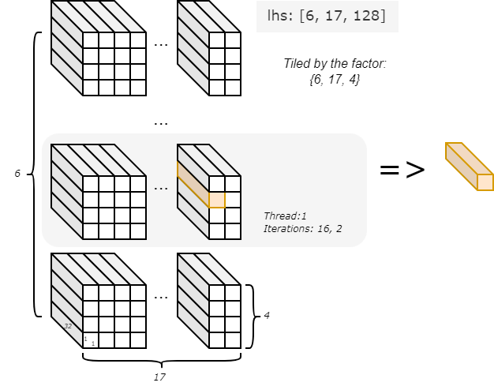
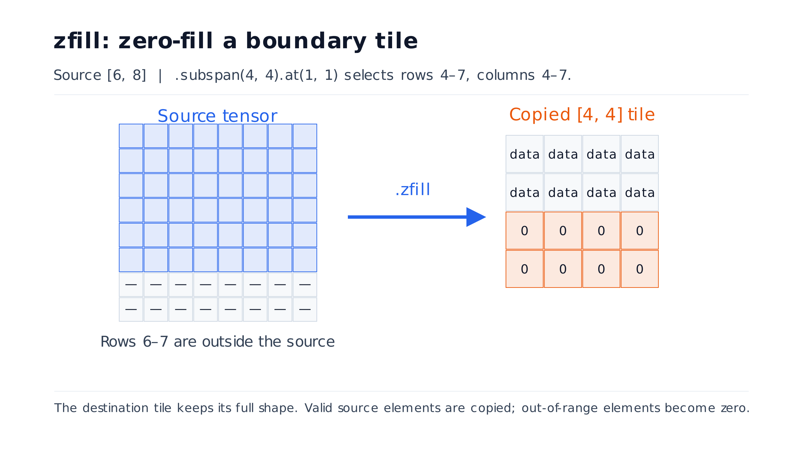
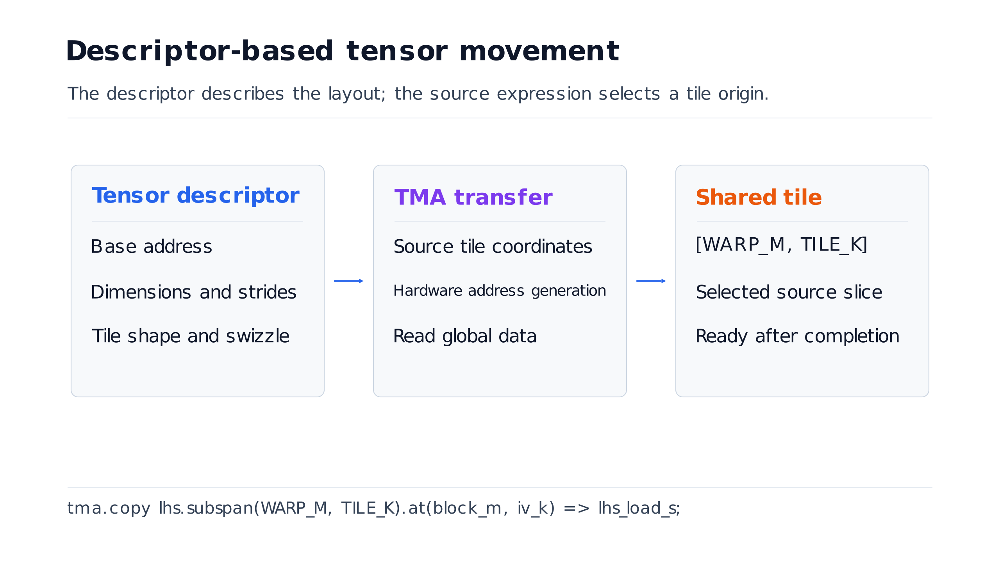
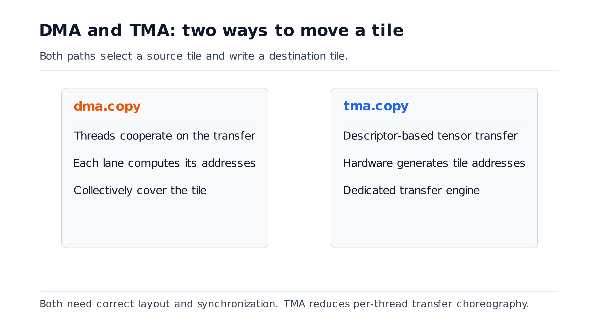
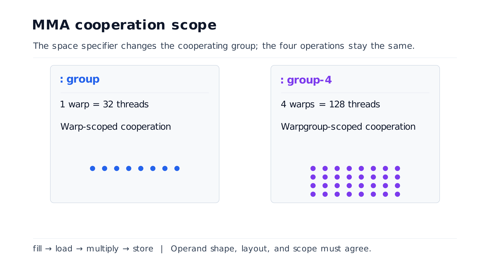

<div class="titlepage">
<div class="big">Croqtile</div>
<div class="sub">编程指南</div>
</div>

<div class="toc-heading">目录</div>
<div class="toc">
<a class="toc-l1" href="#ch1"><span class="tn">第 1 章</span><span class="tt">语言基础</span></a>
<a class="toc-l2" href="#sec-1-1"><span class="tn">1.1</span><span class="tt">Croqtile 要解决什么问题</span></a>
<a class="toc-l2" href="#sec-1-2"><span class="tn">1.2</span><span class="tt">Croqtile 程序的基本结构</span></a>
<a class="toc-l2" href="#sec-1-3"><span class="tn">1.3</span><span class="tt">逐行阅读核函数</span></a>
<a class="toc-l2" href="#sec-1-4"><span class="tn">1.4</span><span class="tt">主机侧 API：输入与输出</span></a>
<a class="toc-l2" href="#sec-1-5"><span class="tn">1.5</span><span class="tt">形状与 <code>mdspan</code></span></a>
<a class="toc-l2" href="#sec-1-6"><span class="tn">1.6</span><span class="tt">整数、整数元组与有界值</span></a>
<a class="toc-l2" href="#sec-1-7"><span class="tn">1.7</span><span class="tt">带形状数据与存储说明符</span></a>
<a class="toc-l2" href="#sec-1-8"><span class="tn">1.8</span><span class="tt">迭代：<code>parallel-by</code>、<code>with-in</code> 与 <code>foreach</code></span></a>
<a class="toc-l2" href="#sec-1-9"><span class="tn">1.9</span><span class="tt">分块选择：<code>chunkat</code>、<code>subspan</code> 与 <code>view</code>/<code>from</code></span></a>
<a class="toc-l2" href="#sec-1-10"><span class="tn">1.10</span><span class="tt">数据搬运：DMA 语句与期值</span></a>
<a class="toc-l2" href="#sec-1-11"><span class="tn">1.11</span><span class="tt">协调：<code>inthreads</code>、事件与异步块</span></a>
<a class="toc-l2" href="#sec-1-12"><span class="tn">1.12</span><span class="tt">分支与提前返回</span></a>
<a class="toc-l2" href="#sec-1-13"><span class="tn">1.13</span><span class="tt">四步 MMA 语法</span></a>
<a class="toc-l2" href="#sec-1-14"><span class="tn">1.14</span><span class="tt">C++ 嵌入、调用、宏与预处理器</span></a>
<a class="toc-l2" href="#sec-1-15"><span class="tn">1.15</span><span class="tt">打印、断言与编译时检视</span></a>
<a class="toc-l2" href="#sec-1-16"><span class="tn">1.16</span><span class="tt">语法速查</span></a>
<a class="toc-l1" href="#ch2"><span class="tn">第 2 章</span><span class="tt">编程指南</span></a>
<a class="toc-l2" href="#sec-2-1"><span class="tn">2.1</span><span class="tt">程序结构与编译模型</span></a>
<a class="toc-l2" href="#sec-2-2"><span class="tn">2.2</span><span class="tt">语法设计与类型系统</span></a>
<a class="toc-l2" href="#sec-2-3"><span class="tn">2.3</span><span class="tt">符号形状、形状求值与值编号</span></a>
<a class="toc-l2" href="#sec-2-4"><span class="tn">2.4</span><span class="tt">并行性、空间说明符与加掩码</span></a>
<a class="toc-l3" href="#sec-2-4-1"><span class="tn">2.4.1</span><span class="tt">示例剖析：分块矩阵乘法</span></a>
<a class="toc-l3" href="#sec-2-4-2"><span class="tn">2.4.2</span><span class="tt">追踪一个输出元素</span></a>
<a class="toc-l2" href="#sec-2-5"><span class="tn">2.5</span><span class="tt">分块选择与数据表达式</span></a>
<a class="toc-l3" href="#sec-2-5-1"><span class="tn">2.5.1</span><span class="tt">任意偏移窗口：<code>view</code> 与 <code>from</code></span></a>
<a class="toc-l3" href="#sec-2-5-2"><span class="tn">2.5.2</span><span class="tt">跨步分块：<code>subspan</code>、<code>step</code> 与 <code>at</code></span></a>
<a class="toc-l3" href="#sec-2-5-3"><span class="tn">2.5.3</span><span class="tt">用 <code>zfill</code> 做零填充</span></a>
<a class="toc-l3" href="#sec-2-5-4"><span class="tn">2.5.4</span><span class="tt">用 <code>span_as</code> 做布局重解释</span></a>
<a class="toc-l3" href="#sec-2-5-10"><span class="tn">2.5.10</span><span class="tt">分块选择：小结与语法</span></a>
<a class="toc-l2" href="#sec-2-6"><span class="tn">2.6</span><span class="tt">数据搬运：操作、配置与异步模式</span></a>
<a class="toc-l3" href="#sec-2-6-1"><span class="tn">2.6.1</span><span class="tt">示例剖析：DMA 矩阵乘法</span></a>
<a class="toc-l3" href="#sec-2-6-2"><span class="tn">2.6.2</span><span class="tt">多缓冲：<code>dma.any</code>、<code>swap</code> 与 <code>rotate</code></span></a>
<a class="toc-l3" href="#sec-2-6-3"><span class="tn">2.6.3</span><span class="tt">示例剖析：流水化核函数</span></a>
<a class="toc-l2" href="#sec-2-7"><span class="tn">2.7</span><span class="tt">收缩与布局约定</span></a>
<a class="toc-l3" href="#sec-2-7-1"><span class="tn">2.7.1</span><span class="tt">示例剖析：单个协作组</span></a>
<a class="toc-l3" href="#sec-2-7-2"><span class="tn">2.7.2</span><span class="tt">示例剖析：扩大协作范围</span></a>
<a class="toc-l3" href="#sec-2-7-3"><span class="tn">2.7.3</span><span class="tt">示例剖析：两个协作组</span></a>
<a class="toc-l3" href="#sec-2-7-9"><span class="tn">2.7.9</span><span class="tt">MMA 语法小结</span></a>
<a class="toc-l3" href="#sec-2-7-10"><span class="tn">2.7.10</span><span class="tt">MMA 设计小结</span></a>
<a class="toc-l2" href="#sec-2-8"><span class="tn">2.8</span><span class="tt">协调、流水线与持久调度</span></a>
<a class="toc-l3" href="#sec-2-8-1"><span class="tn">2.8.1</span><span class="tt">典型模式：一个生产者与一个消费者</span></a>
<a class="toc-l3" href="#sec-2-8-2"><span class="tn">2.8.2</span><span class="tt">示例剖析：1P1C 核函数骨架</span></a>
<a class="toc-l3" href="#sec-2-8-3"><span class="tn">2.8.3</span><span class="tt">持久调度</span></a>
<a class="toc-l3" href="#sec-2-8-4"><span class="tn">2.8.4</span><span class="tt">主机级并发与流绑定</span></a>
<a class="toc-l3" href="#sec-2-8-5"><span class="tn">2.8.5</span><span class="tt">示例剖析：完整事件流水线</span></a>
<a class="toc-l3" href="#sec-2-8-10"><span class="tn">2.8.10</span><span class="tt">协调模式小结</span></a>
<a class="toc-l2" href="#sec-2-9"><span class="tn">2.9</span><span class="tt">C++ 互操作与预处理器</span></a>
<a class="toc-l3" href="#sec-2-9-1"><span class="tn">2.9.1</span><span class="tt">示例剖析：调用设备辅助函数</span></a>
<a class="toc-l3" href="#sec-2-9-2"><span class="tn">2.9.2</span><span class="tt">原样 C++ 注入</span></a>
<a class="toc-l3" href="#sec-2-9-10"><span class="tn">2.9.10</span><span class="tt">互操作小结</span></a>
<a class="toc-l2" href="#sec-2-10"><span class="tn">2.10</span><span class="tt">Tileflow 模式与设计依据</span></a>
<a class="toc-l3" href="#sec-2-10-1"><span class="tn">2.10.1</span><span class="tt">示例剖析：分块矩阵乘法</span></a>
<a class="toc-l3" href="#sec-2-10-2"><span class="tn">2.10.2</span><span class="tt">示例剖析：rgb2gray</span></a>
<a class="toc-l2" href="#sec-2-11"><span class="tn">2.11</span><span class="tt">诊断与方法论</span></a>
</div>
<div class="page-break"></div>

## 前言

大模型的广泛应用，让算子的高效实现成为一项越来越重要的开发工作。模型架构逐渐形成了几类常见设计，内部的计算却仍在不断变化：注意力机制、稀疏模式、位置编码和量化方案的演进，都带来了新的实现需求。即使是同一个算子，面对不同的输入形状和数值格式，也可能需要不同的核函数(kernel)。模型采用相近的架构，底层仍有大量实现和优化工作需要完成。

硬件的多样化进一步增加了这项工作的规模。同一套程序可能需要运行在多种加速器上，而它们的存储组织和执行方式各不相同；即便属于同一系列，新一代硬件引入的指令和编程接口，也可能要求开发者重新审视并调优已有的核函数。算子融合又带来了更多实现组合：把多个操作合并，可以减少中间数据搬运(data movement)和启动开销，但每种组合都有自己的实现选择。要支持这些计算需求，就需要持续开发新的核函数，也需要更高效的开发方式。

写好这些核函数并不容易。分块(tile)尺寸、数据布局、数据暂存方式、流水线深度以及并行区域之间的协作，共同决定了性能；其中一项发生变化，往往还要调整其他几项。近年来陆续出现的高层核函数语言，正是希望用更少的代码表达这些工作，提高开发效率。它们面临的核心问题是：如何简化编程，同时让开发者仍能做出实现高性能所需的决策。如果抽象隐藏了这些决策，能够探索的实现方案也会随之受限。

Croqtile 是一门面向高性能异构计算的编程语言，设计的出发点是提高开发者的效率，让核函数更容易编写和修改。形状、分块选择、数据搬运与协调都有直接的语法表达，开发者可以用一段紧凑的程序描述核函数的整体工作方式。相关的尺寸和索引由带形状的数据推导，减少了修改程序结构时需要同步维护的细节；符号维度(symbolic dimension)让同一份源码适用于不同的输入尺寸，编译时检查则能在运行前发现形状和索引的不一致。这些抽象不增加运行时开销，也让影响性能的决策清楚地保留在程序中。

同样的设计也为 AI 辅助编程与调优提供了支持。源码更紧凑，智能体的上下文就能容纳更多性能分析结果和历史尝试；各项操作可以独立表达，调整流水线或并行组织时，只需修改少数几处代码；编译器的诊断则帮助它定位并修正不合法的组合。智能体由此能够反复提出修改、检查程序、测量效果，再据此继续改进。面向 AI 的设计，把提高核函数开发效率的目标延伸到了自动化工作流中。

Croqtile 嵌入在 C++ 中。在 `.co` 文件里，普通 C++ 负责准备带形状的缓冲区并调用 `__co__` 函数，后者描述并行工作的迭代、分块、数据搬运与协调。本指南通过示例介绍这些构造，并说明如何将它们组合成完整程序。

## 阅读指南

本指南面向希望读懂并编写 Croqtile 核函数的开发者。阅读前，只需掌握 C++ 中的函数、指针与数组，并了解张量的形状。书中的示例从基本构造讲起，逐步说明如何组织并行计算、选择与搬运分块，以及协调各部分的执行。你可以跟随示例读懂 `.co` 程序，再把这些构造组合起来，编写自己的核函数。

如果你第一次接触 Croqtile，建议从第 1 章“语言基础”开始顺序阅读。它通过简短的程序，从函数声明和形状描述开始，逐步加入迭代、分块、数据搬运与协调。阅读时，可以先看程序的整体结构，再对照说明理解每条语句的作用，重点把握数据怎样划分、搬运和参与计算。

熟悉基本写法后，可以按需要查阅第 2 章“编程指南”。它按功能组织内容，进一步解释各类构造的语义、使用约束与设计理由。完整核函数与相关特性放在一起，既便于深入理解某个主题，也方便在编写程序时随时查阅。附录 A 集中列出语法，适合快速确认写法；需要理解某个构造的含义和适用条件时，再回到相应章节。

# 第 1 章 语言基础 <a id="ch1"></a>

本章通过简短的示例，帮助你读懂并编写 Croqtile 程序。先从完整程序的结构和各类函数的分工看起，再逐步加入形状、迭代、分块选择、数据搬运与协调。每个示例都说明新构造在程序中的作用，让你在具体的计算过程中理解它的写法。

## 1.1 Croqtile 要解决什么问题 <a id="sec-1-1"></a>

高性能核函数开发的难点，往往在于怎样组织计算。除了实现数学运算，还要安排数据存放、并行工作的划分和执行顺序，并让这些安排彼此配合。一次调整可能牵动多处代码；输入规模或目标机器变化时，又需要重新验证和优化。这些反复实现、维护和调优的工作，构成了主要的开发成本。

Croqtile 是一门面向高性能核函数编程的 C++ 嵌入式领域专用语言(embedded DSL)，设计目标是在保留性能控制能力的同时，提高开发效率。它用直观的语法表达计算的组织方式、数据搬运与协调，让开发者能够在一段紧凑的程序中把这些安排写清楚。开发者决定核函数怎样工作，编译器负责推导相关信息、检查一致性并生成底层代码，从而减少表达和维护这些安排所需的重复劳动。

这样的程序更容易整体理解，也更便于随着需求变化进行修改。同一份程序可以适应不同的输入规模，语言抽象不增加额外的运行时开销。紧凑的源码和有用的编译器反馈，也让 AI 辅助开发与调优更容易开展。

## 1.2 Croqtile 程序的基本结构 <a id="sec-1-2"></a>

先看一个最小的加法核函数。它接收两个形状相同的矩阵，为每个位置计算相加结果，再把输出返回给调用方。这个例子只使用函数声明、形状和并行索引，便于先建立对 Croqtile 程序的整体印象。

```co
__co__ s32 [4, 8] ele_add(s32 [4, 8] lhs, s32 [4, 8] rhs) {
  s32 [lhs.span] output;
  parallel {i, j} by [4, 8]
    output.at(i, j) = lhs.at(i, j) + rhs.at(i, j);
  return output;
}
```

<div class="listing-cap">清单 1：一个简单的 Croqtile 逐元素加法函数</div>

读这段程序时，可以先沿着“输入 → 分配输出 → 逐元素计算 → 返回结果”的顺序看。`parallel {i, j} by [4, 8]` 描述 32 份独立工作，每份工作只写一个输出位置；`lhs.span` 则让输出沿用输入形状。下一节会逐行解释这些写法，这里先看它们如何组成一个完整函数。 例如两个输入在位置 (1, 3) 的值分别为 2 和 5，输出同一位置就得到 7。函数对所有位置重复这条规则，不进行矩阵乘法，也不改变矩阵形状。

一个 `.co` 文件同时包含普通 C++ 代码和 Croqtile 代码。主机程序准备数据、调用核函数并使用结果；带 `__co__` 前缀的函数描述计算与数据搬运，由 Croqtile 编译器翻译成目标代码。

#### 主机、Tileflow 与设备代码

普通 C++ 代码还可以包含设备辅助函数。因此，完整示例中常见三个区域：设备辅助函数、调用它的 `__co__` 函数，以及主机侧的 `main()`。下面按这个顺序列出它们。

```co
__device__ void device_function(...) {
  // High-performance device kernel implementation
}
// Tileflow program: orchestrating data movement
__co__ void croqtile_function(...) {
  // ... croqtile code ...
  device_function(...);
  // ...
}
// Host program: typically runs on CPU
void main() {
  // ... prepare data ...
  croqtile_function(...);
  // ...
}
```

<div class="listing-cap">清单 2：单份源文件中的三个区域</div>

程序从主机侧开始执行。主机代码使用普通 C++，负责准备输入、调用 Croqtile 函数并处理结果。

`__co__` 函数构成 Tileflow 程序，负责组织并行工作和数据搬运。它将数据放到合适的缓冲区，安排设备端计算，并把结果交回调用方。

`__device__` 辅助函数执行设备端计算。Croqtile 编译器主要翻译 `__co__` 区域，普通 C++ 的主机代码和设备代码交给后续工具链处理。<br><br>**提示：** `__device__` 主要用于在必要时复用特定硬件的函数，简化开发。对于 Croqtile 已提供较完善支持的硬件，通常直接使用语言提供的计算与数据搬运能力即可，无需通过设备辅助函数自行补充底层实现。

## 1.3 逐行阅读核函数 <a id="sec-1-3"></a>

上一节已经看到完整的加法函数。现在把它拆开阅读：函数签名约定输入与输出，缓冲区声明准备结果空间，`parallel` 划分工作，最后由 `return` 交回结果。每一步都保留了形状信息，后面的索引和计算因此有了明确的依据。

#### Croqtile 函数

先看函数签名。普通 C++ 函数的声明主要约定类型，Croqtile 还把数据形状写在参数和返回值中。这样，读者可以在进入函数体之前，先看清输入是什么、结果应该有多大。

把签名从左向右读一遍：先用 `__co__` 标明语言区域，再用 `s32 [4, 8]` 约定输出，最后看函数名及两个输入。这里两份输入和输出都是 4 × 8 的整数矩阵，因此进入函数体后，只需说明每个输出元素怎样得到。

```co
__co__ s32 [4, 8] ele_add(s32 [4, 8] lhs, s32 [4, 8] rhs) {
```

<div class="listing-cap">清单 3：核函数签名</div>

`__co__` 表明这是 Croqtile 函数。`s32 [4, 8]` 表示一个 4 × 8 的二维张量，元素是 32 位有符号整数。参数和返回值采用 `type [shape] name` 的形式；形状信息用于检查后续操作是否匹配。

常见元素类型包括 `s32`、`f16`、`bf16`、`f32`，以及 `f8_e4m3` 和 `f8_e5m2`。本例使用 `s32`，便于观察逐元素加法的结果。

```co
s32 [lhs.span] output;
```

<div class="listing-cap">清单 4：分配输出</div>

这一行声明输出张量。`lhs.span` 取出输入的完整形状，因此 `output` 也具有 `[4, 8]` 的形状。修改输入形状时，这条声明的输出形状会随之改变；本例中固定的函数签名和 `parallel` 范围仍需同步调整。

```co
parallel {i, j} by [4, 8]
  output.at(i, j) = lhs.at(i, j) + rhs.at(i, j);
```

<div class="listing-cap">清单 5：并行函数体</div>

`parallel {i, j} by [4, 8]` 声明 32 个彼此独立的工作实例，每个实例都有自己的 `(i, j)`。`.at(i, j)` 访问这个位置的元素，因此每份工作读取两个输入元素，只写对应的一个输出元素。没有附加空间说明符时，具体映射由编译器确定；这里先关注工作怎样划分。

可以追踪其中一个实例：当 `(i, j) = (1, 3)` 时，它只读取 `lhs.at(1, 3)` 和 `rhs.at(1, 3)`，把和写入 `output.at(1, 3)`。其他实例使用同一条语句处理各自的位置；正因为输出位置不重叠，这些工作可以独立展开。

```co
return output;
```

<div class="listing-cap">清单 6：返回结果</div>

返回结果的形状与元素类型必须符合函数签名。主机侧收到的 `croqtile::spanned_data` 拥有结果缓冲区，并携带形状信息，可通过 `[i][j]` 访问元素。

#### `__co__ auto` 返回类型

返回类型写成 `__co__ auto` 时，编译器从 `return` 的结果推断类型。这种写法适用于带形状的输出，也适用于 2.7 节中的矩阵乘法示例。

## 1.4 主机侧 API：输入与输出 <a id="sec-1-4"></a>

核函数的参数带有形状，而主机侧常常只有数组或指针。调用前要先把数据地址与各维大小组合起来；调用结束后，则从带形状的结果对象中读取输出。下面沿着这次调用的输入和返回过程，说明这些包装对象的作用。

#### 主机程序

主机侧先从原始存储构造带形状的数据，再将它的视图传入核函数。

```co
auto lhs = croq::make_spandata<croq::s32>(4, 8);
auto rhs = croq::make_spandata<croq::s32>(4, 8);
lhs.fill_random(-10, 10);
rhs.fill_random(-10, 10);
```

<div class="listing-cap">清单 7：创建带形状的输入</div>

```co
auto res = ele_add(lhs.view(), rhs.view());
```

<div class="listing-cap">清单 8：调用核函数</div>

主机侧的调用形式与普通 C++ 函数调用相同。`.view()` 从 `spanned_data` 创建不拥有缓冲区的 `spanned_view`，供核函数访问输入；返回的 `res` 则拥有结果缓冲区。

`main` 最后逐个检查结果元素，验证核函数的计算是否正确。这个检查沿用相同的 `(i, j)` 位置，把两个原始输入的和与返回结果比较，从主机侧完成一次完整的“准备输入、调用、验证”过程。

从一次调用来看，`lhs.view()` 与 `rhs.view()` 提供输入地址和形状，`ele_add` 使用这些视图完成计算，`res` 接收输出。视图只是访问原有存储的入口，因此准备输入的对象要在调用期间保持有效。

#### 主机代码

下面的主机代码使用相同的 `make_spandata` 和 `.view()` 调用方式。

```co
int main() {
  auto lhs = croq::make_spandata<croq::s32>(128, 256);
  auto rhs = croq::make_spandata<croq::s32>(256, 256);
  lhs.fill_random(-10, 10);
  rhs.fill_random(-10, 10);
  auto res = matmul(lhs.view(), rhs.view());
  for (size_t i = 0; i < res.shape()[0]; ++i)
    for (size_t j = 0; j < res.shape()[1]; ++j) {
      int ref = 0;
      for (size_t k = 0; k < lhs.shape()[1]; ++k)
        ref += lhs[i][k] * rhs[k][j];
      croq::croq_assert(ref == res[i][j], "values are not equal.");
    }
  std::cout << "Test Passed\n" << std::endl;
}
```

<div class="listing-cap">清单 9：主机代码</div>

调用后，程序将每个结果元素与 C++ 参考计算比较；结果不一致时，断言会报错。

#### Croqtile 与 C++ 函数之间的参数传递

C++ 指针需要与维度信息一起包装成带形状的数据，再传入 Croqtile 函数。相关工具由 `croqtile.h` 提供。

```co
#include "croqtile.h"
void bar(const float* data, unsigned size) {}
__co__ void foo(f32 mdspan<2> d) {
  parallel p by 6 {
    call bar(d, |d|);     // Call the C++ function
  }
}
void foobar(float* a) {
  foo(croqtile::make_spanview<2>(a, {1, 2}));
}
```

<div class="listing-cap">清单 10：Croqtile 与 C 函数之间的参数传递</div>

`make_spanview` 创建输入视图，不复制底层数据。示例中，`foo` 的参数 `d` 使用 `f32 mdspan<2>` 描述形状；调用 `bar` 时，可以通过隐式转换传递底层数据，`|d|` 则给出总元素数。

标量值也可以在 C++ 与 Croqtile 之间传递；`ituple` 仅用于 Croqtile 函数内部。

#### 输入参数

Croqtile 函数的输入参数包括带形状数据和整数。

参数可以具名，也可以省略名字：

```co
__co__ void foo(f32 [7] a, int) {...}
```

<div class="listing-cap">清单 11：输入参数</div>

本例的第二个参数没有名字，因此函数体无法引用它，但声明仍然合法。

#### C++ 主机：带形状的数据实参

普通指针或数组只描述存储，Croqtile 的带形状数据还记录各维度大小。调用前，需要把数据地址与形状组合起来。

可以使用 `croqtile.h` 中的包装工具。Croqtile 编译环境会自动包含这个头文件。

```co
__co__ void foo(f32 [7, 16] input, f32 [7, 16] output) {...}
void entry(float * input, float* output) {
  // foo(input, output); <-- result in error since missing shape
  foo(croqtile::make_spanned<2>(input, {7, 16}),
      croqtile::make_spanned<2>(output, {7, 16}));
}
```

<div class="listing-cap">清单 12：传入带形状的缓冲区</div>

`croqtile::make_spanned` 以秩(rank)作为模板实参，接收数据指针和维度列表，生成 `croqtile::spanned_view`。它保存指针与形状，不拥有底层缓冲区。简化定义如下。

```text
template <typename T, size_t Rank>
class spanned_view {
  T* ptr;                 // typed pointer to the data
  size_t dims[Rank];      // ranked dimensions
};
```

<div class="listing-cap">清单 13：主机侧缓冲区包装器</div>

维度也可以由运行时值提供：

```co
__co__ void foo(f32 [7, 16] input) {...}
void entry(float * input, float* output, int M, int N) {
  foo(croqtile::make_spanned<2>(input, {M, N})),
}
```

<div class="listing-cap">清单 14：由运行时维度构造的调用</div>

本例的 `input` 使用运行时形状。进入 Tileflow 程序时，系统检查它是否满足 `M == 7` 和 `N == 16`；不满足时会终止执行，以免继续使用不成立的形状假设。

输入的带形状数据引用原有缓冲区。把这个包装对象传入函数，不会复制整块输入数据。

#### 返回类型与类型推导

带形状数据和整数都可以作为返回值；不返回结果时，使用 `void`。

除了显式声明返回类型，也可以让编译器推断：

```co
__co__ auto foo() {
  f32 [7, 16] result;
  // ...
  return result;
}
```

<div class="listing-cap">清单 15：返回类型与类型推导</div>

这里的 `auto` 从返回表达式推断出 `f32 [7, 16]`。输出形状随输入变化时，类型推断可以减少重复声明。

#### C++ 主机：形状返回

主机侧收到的结果拥有自己的缓冲区，具有值语义，便于在调用结束后继续使用。

```co
__co__ auto foo() {
  f32 [7, 16] output;
  // ...
  return output;  // semantically copy
}
void entry() {
  auto result = foo(); // move the 'spanned_data' to caller
  // ...
}
```

<div class="listing-cap">清单 16：返回带形状的缓冲区</div>

示例中，`output` 作为结果返回，主机侧类型为 `croqtile::spanned_data`。实现通过返回值优化避免复制整块缓冲区。简化定义如下。

```text
template <typename T, size_t Rank>
class spanned_data {
  std::unique_ptr<T[]> ptr; // move only pointers
  size_t dims[Rank];        // ranked dimensions
};
```

<div class="listing-cap">清单 17：主机侧结果包装器</div>

`spanned_view` 只引用数据，`spanned_data` 则管理缓冲区的所有权。返回值优化允许在交付结果时省去数据复制。

主机侧可以用 `.rank()`、`.shape()` 查询结果形状，而不必依赖核函数内部的声明。

## 1.5 形状与 `mdspan` <a id="sec-1-5"></a>

加法示例用固定的 `[4, 8]` 描述矩阵，但实际程序的输出、临时缓冲区和分块形状往往来自输入。把形状当作可命名、可计算的信息，就能在修改输入时保留这些关系。下面从读取形状开始，再逐步介绍 `mdspan` 的声明、计算与未知维度。

#### `span` 与 `span(i)`

```co
s32 [lhs.span(0), rhs.span(1)] output;
```

<div class="listing-cap">清单 18：span 与 span(i)</div>

输出和临时缓冲区的形状，常常可以从输入推导。`span` 返回完整形状，`span(i)` 返回第 `i` 个维度的大小。

<div class="cap">图 1：用 span 表示整体形状，用 span(i) 表示单个轴</div>


图中以 `[4, 8]` 的输入为例：`.span` 返回 `[4, 8]`，`.span(0)` 返回 `4`，`.span(1)` 返回 `8`。上面的输出声明则分别从两个输入取出所需的维度，再组合成输出形状。

形状本身也可以命名并参与计算。下面先声明一个形状，再说明怎样从它推导出新的形状。

#### 用 `mdspan` 定义形状

`mdspan` 描述多维形状，可以单独声明，再用于数据类型或形状计算。例如，同一形状可以用于输入和临时缓冲区，而新的形状又可以从它逐维推导出来。这里先看声明写法，再看它怎样参与计算。

显式声明的写法如下：

```co
mdspan s0 : [7, 8]; // Defines a 2D shape with dimensions [7, 8]
mdspan<1> s1 : [3]; // Defines a 1D shape with dimensions [3]
```

<div class="listing-cap">清单 19：声明形状</div>

`:` 引出初始化表达式，`[]` 中依次列出各维度大小。`s0` 的形状是 `[7, 8]`，`s1` 的形状是 `[3]`。

这里先只描述形状，不分配矩阵数据。`mdspan<2>` 中的 2 是维度数量，`[7, 8]` 才是各维大小：前者回答“有几维”，后者回答“每维有多大”。命名为 `s0` 后，就可以在后续声明中复用这组尺寸。

`mdspan` 后的尖括号可以指定秩，也就是维度数量。它必须与初始化表达式一致，否则编译器会报错。

```co
mdspan<3> s2 : [64, 32]; // error: the rank of mdspan is inconsistent
```

<div class="listing-cap">清单 20：秩不匹配</div>

编译器也可以从初始化表达式推断类型，此时省略 `mdspan`：

```co
s3 : [7, 8, 9]
```

<div class="listing-cap">清单 21：省略 mdspan 关键字</div>

`s3` 的秩为 3，形状为 `[7, 8, 9]`。`mdspan` 必须在声明时初始化；省略类型只简化写法，不改变这项要求。

#### 导出 `mdspan`

分块、填充和重塑都需要从已有形状推导新形状。例如，把每维大小除以分块因子，可以得到每块形状；给某维增加长度，则能描述填充后的区域。把这些关系写成形状表达式，修改原始尺寸时就不必逐处更新数字。

可以对维度做算术运算，再组合成新的形状：

```co
shape : [128, 64]; // initial shape
new-shape0 : shape [(0) / 2, (1) / 4, 1];  // tile and reshape: [1, 64, 16]
new-shape1 : shape [(1) + 2, (0) / 16];    // pad and reshape: [66, 8]
```

<div class="listing-cap">清单 22：原始形状</div>

`new-shape0` 将原形状的两个维度分别除以 `2` 和 `4`，并增加一个长度为 `1` 的维度。

同一计算也可以展开写成：

```co
new-shape0: [shape(0) / 2, shape(1) / 4, 1];
```

<div class="listing-cap">清单 23：导出的形状</div>

展开后，`shape(0)` 和 `shape(1)` 分别取出原形状的两个维度。两种写法表达的是同一组计算。

`new-shape1` 将原形状的第二个维度加 `2`，把它放到新形状的第一维；新形状的第二维由原形状的第一维除以 `16` 得到。

也可以直接对整个形状做运算或拼接：

```co
shape : [32, 72]
new-shape0 : shape;  // [32, 72]
new-shape1 : shape + 1;  // [33, 73]
new-shape2 : shape / 4;  // [8, 18]
new-shape3 : [shape, 6]; // [32, 72, 6]
```

<div class="listing-cap">清单 24：重新绑定形状</div>

对形状施加算术运算时，各维度分别参与计算。例如：

`new-shape1 : shape + 1;`

可展开为：

`new-shape1 : shape [(0) + 1, (1) + 1];`

在初始化表达式中放入一个 `mdspan`，则会拼接它的各个维度。例如：

`new-shape3 : [shape, 6];`

可展开为：

`new-shape3 : shape [(0), (1), 6];`

这些简写能保留形状之间的关系，减少重复列出维度的代码。

#### 带匿名维度的 `mdspan`

前面的形状使用固定数字。如果某个维度要由调用方在运行时提供，可以把对应位置写成 `?`，保留其他已知维度：

```co
__co__ auto foo(s32 [?, 1, 2] input) { ... }
```

<div class="listing-cap">清单 25：含未知维度的核函数</div>

`?` 表示一个运行时提供的正整数维度：

```text
void bar(int * data, int dim0) {
  foo(croqtile::make_spanview<3>(data, {dim0, 1, 2}));
}
```

<div class="listing-cap">清单 26：由调用方提供该维度</div>

本例第一维的大小来自调用方，可以由配置或上层框架确定。

当多个参数需要共享同一维度或表达维度之间的关系时，可以进一步使用具名的符号维度。

#### 更进一步：符号维度

当多个参数需要引用同一个未知维度时，只写 `?` 还不能直观表达它们的关系。符号维度给这些大小命名，让共享维度和形状约束出现在函数签名中：

```co
__co__ auto Matmul(s32 [M, K] lhs, s32 [K, N] rhs) {
  int tile_m = 32, tile_m = 8, tile_k = 16;
  s32 [M / tile_m, K / tile_k] tiled_lhs;
  s32 [K / tile_k, N / tile_n] tiled_rhs;
  // ...
}
```

<div class="listing-cap">清单 27：更进一步：符号维度</div>

本例用 `M`、`K`、`N` 表达两个输入的形状。相同的名字明确了共享维度，便于阅读、维护和检查参数之间的关系。

例如 M=4、K=8、N=16 时，两个输入分别是 4 × 8 与 8 × 16，输出是 4 × 16。两个输入共用 K，表达的正是相乘维度必须一致这一关系；用同一个名字，可以避免把这项约束分散写在多处。

## 1.6 整数、整数元组(ituple)与有界值 <a id="sec-1-6"></a>

形状回答“数据有多大”，索引回答“当前处理哪里”。单个索引用整数表示，多维位置则可以用整数元组集中表达。进一步把索引和范围绑定后，后续的循环与分块选择就能同时使用当前位置和范围信息。

#### 标量类型

用于程序控制的标量包括整数和布尔值。`int` 是 32 位有符号整数，范围为 -2³¹ 到 2³¹-1，可用于声明变量和函数参数。

```co
int a;
__co__ int foo(int b);
```

<div class="listing-cap">清单 28：标量类型</div>

整数支持 C++ 风格的算术、移位和逻辑运算。程序控制使用 `int`，不提供其他位宽或无符号的控制整数类型。

`bool` 的运算以及它与整数之间的转换，采用 C++ 的对应规则。

#### 整数元组类型

整数元组按顺序保存多个整数，常用于多维索引。把行、列等坐标放在同一个元组中，可以整体传递或参与逐维计算；需要某个分量时，再按位置取出。元素顺序因此也是索引含义的一部分。

用花括号列出各个元素即可定义 `ituple`：

```co
ituple index = {5, 4, 3, 2, 1};  // It defines a tuple of 5 elements
index = {a, b};  // 'a' and 'b' are existing integers
```

<div class="listing-cap">清单 29：整数元组类型</div>

#### `mdspan` 与 `i-tuple` 上的运算

`mdspan` 可以与整数元组按维度运算。下面用一组分块因子计算新的形状。

```co
sp : [6, 8];
tiling_factor = {3, 2};
spn : sp / tiling_factor;   // spn is defined as [2, 4];
```

<div class="listing-cap">清单 30：mdspan 与 i-tuple 上的运算</div>

支持的运算包括：

- `mdspan` / `i-tuple`
- `mdspan` + `i-tuple`
- `mdspan` % `i-tuple`
- `mdspan` * `i-tuple`
- `mdspan` - `i-tuple`

元组写法将逐维计算集中在一个表达式中，更容易看出形状之间的关系。

整数描述单个索引或循环参数，整数元组描述多维索引。它们在声明时初始化，并可与形状一起用于后续检查。

#### 用于程序控制的整数

Tileflow 程序使用整数来控制循环和索引。为此提供的控制类型是 32 位有符号整数 `int`。

可以像 C++ 一样声明并初始化整数：

```co
int a = 1;
```

<div class="listing-cap">清单 31：已初始化的整数</div>

也可以省略类型，由初始化表达式推断：

```co
a = 1;
```

<div class="listing-cap">清单 32：对整数赋值</div>

一行中可以声明多个整数：

```co
int a = 1, b = 2, c = 3;
d = 4, e = 5;
```

<div class="listing-cap">清单 33：一次定义多个整数</div>

`mdspan` 不能直接作为函数参数；整数则可以在主机、Tileflow 程序和设备函数之间传递。

```co
__co__ void foo(int a) {
  // ...
  call kernel(a, 3);
}
```

<div class="listing-cap">清单 34：整数参数</div>

整数必须在声明时初始化，之后不能重新赋值：

```co
int a;  // error: declaration without initialization
int b = 1;
b = 3;  // error: re-assignment
```

<div class="listing-cap">清单 35：未初始化的声明</div>

这里的整数是不可变值。因此，声明中的 `=` 用于初始化，而不是修改已有变量。

#### 声明整数元组

`ituple` 将多个整数组合成一个元组，也称 `i-tuple`。显式声明如下：

```co
ituple a = {1, 2, 3};
b = {4, 5, 6};  // utilize the type inference
```

<div class="listing-cap">清单 36：i-tuple 字面量</div>

把二维位置写成 `idx = {1, 2}` 后，`idx(0)` 取第一维的 1，`idx(1)` 取第二维的 2。花括号用于组成元组，圆括号用于选择其中的分量；元组本身只保存整数，后续用 `with-in` 才为它绑定范围。

类型可以由初始化表达式推断。区分省略类型的 `ituple` 和 `mdspan` 时，注意以下两点：

- `ituple` 的初始化表达式跟在赋值号 `=` 之后（和整数一样），`mdspan` 则在 `:` 之后初始化；
- `ituple` 的初始化表达式用花括号括起，而不是 `mdspan` 使用的 `[]`。

也可以显式指定秩，让编译器检查元素个数：

```co
ituple<3> a = {1, 2};  // error: inconsistent rank
```

<div class="listing-cap">清单 37：秩不一致</div>

#### 元组运算与形状计算

圆括号 `()` 取出元组中的一个元素，下标从 `0` 开始。也可以让整个元组参与计算，把几个坐标分量的变化写在同一表达式里：

```co
a = {3, 4};
b = {a(0), 1, a(1)};  // '()' to retrieve the element value
c = a {(0), (1), 2};  // syntax sugar
d = {a, 5, 6};        // concatenate
e = a + 1;            // addition is applied elementwise
```

<div class="listing-cap">清单 38：赋一个新元组</div>

`ituple` 与整数、`mdspan` 一样，必须初始化且不能重新赋值。

元组常用于逐维修改形状：

```co
shape : [7, 18, 28];
tiling_factors = {1, 2, 4};
tiled_shape : shape / tiling_factors;
padded_shape : shape + {2, 0, 2};
```

<div class="listing-cap">清单 39：用 i-tuple 索引 mdspan</div>

`shape / tiling_factors` 按各维的分块因子计算 `tiled_shape`，`shape + {2, 0, 2}` 则得到 `padded_shape`。按维度相加时，两者的秩必须一致。

```co
shape : [7, 8, 9] + {1, 2}; // error: inconsistent rank
```

<div class="listing-cap">清单 40：非法的形状表达式</div>

#### 整数与元组的使用规则

整数和整数元组用于表达单维或多维索引，也可以参与形状计算。整数使用 C++ 风格的声明，元组使用花括号列出元素。

两者都在声明时初始化，之后保持不变。读取代码时，应把这些声明中的 `=` 理解为初始化。

## 1.7 带形状数据与存储说明符(storage specifier) <a id="sec-1-7"></a>

有了形状，还需要确定数据元素的类型，以及缓冲区放在哪里。下面把这几项合在一条声明中，并说明如何初始化数据。之后再按需选择 `global`、`shared` 或 `local`，让存储位置与使用它的并行工作相配合。

#### 完整类型

参与计算的数据需要同时声明元素类型和形状。仅有 `mdspan` 只描述形状，还没有确定数据元素的类型。

```co
ndims : [20, 15];
f32 [10, 10] d0;
f16 [ndims] d1;
```

<div class="listing-cap">清单 41：完整类型</div>

常见元素类型包括：

- 无符号整数：`u8` / `u16` / `u32`
- 有符号整数：`s8` / `s16` / `s32`
- 浮点数：`f16` / `bf16` / `f32`

`s32` 是带形状数据的元素类型；用于程序控制的 `int` 是独立的标量类型，两者用途不同。

#### 存储说明符

带形状数据的声明还可以指定存储位置。

常见存储说明符包括：

- `global`
- `shared`
- `local`

存储说明符写在元素类型之前：

```co
ndims : [20, 15];
local f32 [10, 10] d0;
shared f16 [ndims] d1;
```

<div class="listing-cap">清单 42：存储说明符</div>

省略说明符时，采用当前编译环境约定的默认存储位置。

声明缓冲区时，需要给出元素类型与形状；需要指定存储位置时，再加上存储说明符。

#### 定义带形状数据

下面声明一个带形状的缓冲区：

```co
f32 [32, 16] data;
```

<div class="listing-cap">清单 43：带形状数据的声明</div>

它的形状为 `[32, 16]`，元素类型为 `f32`。形状也可以先单独命名：

```co
shape : [72, 14];
s32 [shape] data0;              // using the named mdspan `shape`
u32 [shape(0), shape(1)] data1; // same shape as the above
u16 [shape + 6] data2;          // shaped as [78, 20]
s16 [shape, 8] data3;           // shaped as [72, 14, 8]
```

<div class="listing-cap">清单 44：独立的形状</div>

`data0` 使用名为 `shape` 的形状，并以 32 位整数为元素。`[]` 内还可以使用形状运算的结果。

元素类型也称基础类型，常见类型如下：

- 无符号整数：`u8`、`u16`、`u32`
- 有符号整数：`s8`、`s16`、`s32`
- 浮点数：`f16`、`bf16`、`f32`

`u` 和 `s` 分别表示无符号与有符号整数，数字表示位宽。`f16` 是半精度浮点，`bf16` 是脑浮点，常用于机器学习计算。

`s32` 用于声明数据元素，`int` 用于程序控制。虽然位宽相同，它们的声明方式不同：

```co
s32 a;  // error: the fundamental type can not be used for variable definition alone
```

<div class="listing-cap">清单 45：被拒绝的基础类型</div>

单独用 `s32` 声明控制变量会导致编译失败；它不能替代 `int`，两者也不能按控制整数的方式转换。

要明确缓冲区的存储位置，可以加上说明符：

```co
global f32 [32, 7, 2] a;
shared u8 [512, 144] b;
local u8 [72, 1024] c;
```

<div class="listing-cap">清单 46：存储说明符</div>

存储位置由编译模式和目标平台约定决定。在这里的主机与设备协同场景中，未标注的缓冲区使用主机存储；设备侧存储位置则显式指定。

- `global`：指设备的全局存储。
- `shared`：指设备块的共享存储。
- `local`：指线程私有存储。

不同平台的含义和声明约束可能不同，应结合当前编译环境使用。

#### 初始化

缓冲区可以在声明时初始化：

```co
local s32 [17, 6] b1 {0};       // elements are initialized to 0
shared f32 [128, 16] b2 {3.14f}; // elements are initialized to 3.14f
```

<div class="listing-cap">清单 47：初始化</div>

变量名后的括号给出初始值。本例的初始化方式把所有元素设为同一个值，适合准备清零的输出或临时缓冲区。读取声明时，可以依次看存储说明符、元素类型、形状，再看名称后的初始化表达式。

这条声明先选择共享存储，再约定 f32 元素和 32 × 16 的形状，最后把各元素初始化为 0。读取相近声明时，可以先保留类型与形状，观察 `shared` 换成 `local` 后，哪些执行实例能够使用这份数据。

#### 声明参数与返回值

带形状数据可以作为函数参数或返回值：

```co
__co__ f16 [7, 8] foo(f32 [16, 17, 5] input) {...}
```

<div class="listing-cap">清单 48：显式的返回形状</div>

参数与返回值的声明类似数据声明，但这里不能附带存储说明符或初始化表达式，也不能对已有 `mdspan` 直接做运算。

参数的 `.span` 返回它的形状，可以用来声明同形状的缓冲区：

```co
__co__ auto foo(f32 [16, 17, 5] input) {
  f32 [input.span / {4, 1, 5} ] buffer;  // declare a buffer with tiled shape
  // ...
}
```

<div class="listing-cap">清单 49：推导出的返回形状</div>

#### 数据声明小结

声明确定元素类型、形状与存储位置，初始化表达式给出初始内容。掌握这些写法后，就可以为并行工作准备相应的缓冲区。

#### `global`：全局存储

- 在下面的设备侧示例中，`global` 表示全局存储。未标注的声明采用该示例的默认位置。

```co
global f32 [100, 200] matrix;
```

<div class="listing-cap">清单 50：全局存储声明</div>

#### `shared`：共享存储

`shared` 表示供协作线程使用的共享存储，声明形式如下：

```co
shared f32 [10, 10] tile_data;
```

<div class="listing-cap">清单 51：共享存储声明</div>

#### `local`：私有存储

`local` 表示线程私有存储，适合不需要在线程间共享的小数组或临时数据：

```co
local f16 [5] thread_local_data;
```

<div class="listing-cap">清单 52：私有存储声明</div>

#### 默认行为与用法

下面先使用默认位置声明缓冲区。默认位置的含义由编译环境决定，需要明确选择时应显式标注。

```co
f32 [100, 100] d0;
```

<div class="listing-cap">清单 53：不带说明符的声明</div>

选择 `shared` 或 `local` 时，将说明符写在元素类型之前：

```co
local f32 [10, 10] d0;     // Small data, local to the thread
shared f16 [ndims] d1;     // Intermediate data, shared between threads in a block
```

<div class="listing-cap">清单 54：显式选择 local 存储</div>

#### 存储位置示例

下面把三种存储位置放在同一个示例中：

```co
ndims : [20, 15];
local f32 [10, 10] d0;
shared f16 [ndims] d1;
global f32 [100, 200] matrix;
// Perform computations on these arrays, utilizing the appropriate storage space
dma.copy d0 => d1;
dma.copy d1 => matrix;
```

<div class="listing-cap">清单 55：示例代码：使用存储说明符</div>

各缓冲区沿用相同的类型与形状语法，存储说明符决定它们所在的位置和共享范围。

## 1.8 迭代：`parallel-by`、`with-in` 与 `foreach` <a id="sec-1-8"></a>

加法中的各个输出位置互不依赖，因此可以交给 `parallel`；有前后依赖的累加或逐块处理，则需要按顺序迭代。`with-in` 负责定义有界索引，`foreach` 负责遍历它。阅读下面的例子时，先判断工作能否独立执行，再选择对应的构造。

#### Croqtile 的两层并行模型

阅读并行代码时，先区分两个问题：哪些工作彼此独立，以及这些工作映射到哪里。

- `parallel`：声明彼此独立、可以并行执行的工作。
- 空间说明符，如 `: block`、`: thread`、`: group`、`: group-4`：指定并行轴的执行位置。

`foreach` 表示顺序迭代，适合累加、归约或有前后依赖的处理；`parallel` 表示独立的工作实例。

```co
parallel {px, py} by [8, 16] : block
  foreach {tile_k} in [16]               // sequential -- K-dimension loop
    parallel {qx, qy} by [16, 16] : thread  // concurrent -- mapped to threads
      foreach k in [16]                      // sequential -- inner accumulation
        output += lhs * rhs;
```

<div class="listing-cap">清单 56：Croqtile 的两层并行模型</div>

<div class="cap">图 2：逻辑与物理的对应关系</div>


图中展示逻辑上的工作划分与执行资源的对应关系。未写空间说明符时，由编译器选择默认映射；需要明确控制时，再标注 `: block`、`: thread` 等说明符。多维索引、`#` 组合和范围运算同样适用于这些构造。

#### `: block`——并行块

```co
parallel {px, py} by [8, 16] : block
```

<div class="listing-cap">清单 57：: block——并行块</div>

这里的块网格为 8 × 16，共 128 个独立块。这个模型要求各块能独立完成自己的工作。

本例输出形状为 `[128, 256]`，每块处理 `[16, 16]`，因此网格大小为 128/16 × 256/16 = 8 × 16。

#### `: thread`——块内线程

```co
parallel {qx, qy} by [16, 16] : thread
```

<div class="listing-cap">清单 58：: thread——块内线程</div>

这一层在每个外层块内组织 16 × 16，共 256 个线程。

分块内的逐元素工作可以在这一层展开。

#### 嵌套说明符

块级和线程级工作可以嵌套声明：

```co
parallel {px, py} by [8, 16] : block {
  parallel {qx, qy} by [16, 16] : thread {
    // 128 blocks x 256 threads = 32,768 threads total
  }
}
```

<div class="listing-cap">清单 59：嵌套说明符</div>

外层划分块网格，内层划分块内线程。`px, py` 表示同一并行层次中的两个坐标轴。

#### `with tile_k in 16`

`with` 创建一个作用域，将 `tile_k` 绑定到范围为 16 的分块轴。它本身不执行循环，而是先定义索引及其范围，供后续的 `foreach` 使用。作用域内，`tile_k` 可作为 K 维分块索引，`#tile_k` 返回范围 16。

#### `foreach tile_k(1:)`：切片迭代

`(1:)` 表示从索引 1 开始迭代到范围末尾。它适合已经在循环前处理索引 0、循环中继续处理剩余分块的写法。

#### 并行区域：`parallel-by` 块

`parallel-by` 用同一段代码描述多个独立工作实例。每个实例通过不同的索引处理自己的数据。

基本形式是在 `parallel ... by ...` 后写出代码块：

```co
parallel p by 6 {
  // SPMD code
}
```

<div class="listing-cap">清单 60：并行区域：parallel-by 块</div>

本例包含 6 个实例，`p` 分别取 `0` 到 `5`。可以把它理解为 6 次彼此独立的迭代，执行先后顺序不固定。

`p` 的取值范围为 `[0, 6)`，因此称为有界整数。分块选择等操作会同时使用它的当前值和范围。

在这个六实例例子中，`p=1` 是当前工作的编号，而 `#p=6` 是整个轴的范围。当前编号会随实例变化，范围保持不变；分块操作正是利用这两项信息，同时决定取哪一块以及每块有多大。

#### `with-in` 块与 `where` 子句

`with-in` 将一个索引元组与形状范围绑定：

```co
with index in [10, 10] {
  // index is ituple with 2 elements
}
```

<div class="listing-cap">清单 61：索引 with-in 块</div>

`index` 包含两个元素，也可以分别给元素命名：

```co
with {x, y} in [10, 10] {...}
```

<div class="listing-cap">清单 62：索引元组</div>

元组本身和各个元素可以同时命名：

```co
with index = {x, y} in [10, 10] {...}
```

<div class="listing-cap">清单 63：由元组导出的索引</div>

这里的 `index` 是有界整数元组。

`with-in` 只声明有界索引，不启动并行工作。需要遍历这些索引时，再使用 `foreach`。

可以把 `with index in [2, 3]` 看成先准备一个两维索引：第一维可取 0、1，第二维可取 0、1、2。声明本身没有遍历这六个位置，进入其中的 `foreach index` 后，循环体才会依次执行。

`where` 可以声明索引之间的对应关系：

```co
with {m, n} in [M, N], {n_p, k} in [N_P, K] where n_p <-> n {
  // matmul implements with m,n,K. n_p is no long useful.
}
```

<div class="listing-cap">清单 64：嵌套的有界组</div>

`n <-> n_p` 约定两个索引在迭代中对应同一取值，因此可以在需要该索引的位置使用相应名字。

#### `foreach` 块

有界整数或元组定义后，可以用 `foreach` 遍历其范围。这里把范围声明与循环体分开：`with-in` 说明可用的位置，`foreach` 再按顺序逐个访问。循环体中的索引代表当前正在处理的位置：

```co
with x in [10] {
  foreach x {
    // do something with each x
  }
}
```

<div class="listing-cap">清单 65：foreach 块</div>

沿着 `[2, 3]` 的范围展开时，先处理第一行的三个位置，再处理第二行的三个位置。每一次循环完成后才进入下一次，因此循环体可以引用前一次留下的状态；这也是它与独立并行工作的重要区别。

#### 具名与不具名的并行索引

下面用具名索引声明并行工作：

```co
parallel p by 6 {
  // SPMD (Single Program, Multiple Data) code
}
```

<div class="listing-cap">清单 66：具名的并行索引</div>

花括号中的代码由多个实例执行。本例的组成部分如下：

- `parallel`：声明独立的工作实例。
- `p`：标识当前实例的有界索引。
- `by 6`：声明 6 个实例，索引范围为 `0` 到 `5`。

如果代码不需要引用实例索引，可以省略变量名：

```co
parallel by 2 { ... }
```

<div class="listing-cap">清单 67：不具名的并行索引</div>

这里仍有两个工作实例，但代码不能用省略的索引来区分数据位置。

#### 多层并行

可以嵌套声明不同的并行层次：

```co
parallel p by 2 {
  // parallel-level-0
  parallel q by 12 {
    // parallel-level-1
  }
}
```

<div class="listing-cap">清单 68：嵌套的两级并行</div>

本例的两层范围分别为 `2` 和 `12`，共有 24 种索引组合。`p` 属于外层，`q` 属于内层，每个组合标识一份工作。

层次划分也决定代码在哪个范围内执行，以及哪些工作需要协调。组织代码时，应让协作关系与并行层次相匹配。

两层之间没有其他语句时，也可以合写为一条声明：

```co
parallel p by 2, q by 12 { ... }
```

<div class="listing-cap">清单 69：合写的两级并行</div>

逗号分隔的写法与前面的嵌套声明表达相同的两级并行。

#### 同一并行层次的多维坐标

同一并行层次可以用多个坐标轴描述；支持的轴数由目标平台决定：

```co
parallel {px, py, pz} by [1, 1, 2] {
  // higher synchronization cost
  // ...
  parallel t_index = {qx, qy} by [3, 4] {
    // lower synchronization cost
    // ...
  }
  // ...
}
```

<div class="listing-cap">清单 70：子级并行性</div>

本例外层使用 `px, py, pz` 三个轴，内层使用 `qx, qy` 两个轴。内层索引还可以整体命名为 `t_index`，各轴的范围由对应的形状给出。

元组中第一个元素对应最低有效的并行轴。使用多维索引时，需要保持这一顺序与数据坐标的对应关系。

`with-in` 定义索引范围，`foreach` 按该范围依次迭代。两者一起描述循环的边界和循环体。

#### 用有界索引描述循环

C++ 的循环由初值、条件和步进控制。Croqtile 的循环则围绕有界索引组织。

`foreach` 的基本形式如下：

```co
foreach index {
  // loop body
}
```

<div class="listing-cap">清单 71：一个 foreach 循环</div>

如果 `index` 的上界为 `6`，它对应下面的 C++ 循环：

```text
for (int index = 0; index < 6; ++index) {
  // loop body
}
```

<div class="listing-cap">清单 72：等价的 C++ 循环</div>

有界索引把循环范围明确写在程序中，便于分块选择与数据搬运使用。

`parallel-by` 中的索引标识并行实例，不能再用 `foreach` 遍历。要声明循环索引，应使用 `with-in`。

#### 定义有界变量

`with-in` 可以定义有界整数或有界整数元组，不创建额外的执行实例：

```co
with x in 128 {
  // 'x' is a bounded integer
}
with y in [512] {
  // 'y' is a bounded ituple
}
with index in [10, 10] {
  // 'index' is a bounded ituple
}
```

<div class="listing-cap">清单 73：一个有界变量</div>

本例中，`x` 的范围是 128；`y` 是一维元组，范围为 `[512]`；`index` 是二维元组，范围为 `[10, 10]`。元组的元素也可以分别命名。

```co
with {x, y} in [10, 10] {
  // x and y are explicitly named elements of the ituple
}
with index = {x, y} in [10, 10] {
  // 'x', 'y', and 'index' can be used within the block
}
```

<div class="listing-cap">清单 74：一组有界变量</div>

多条声明可以用逗号合写：

```co
with index = {x, y} in [10, 10], idx in [100, 10] { }
```

<div class="listing-cap">清单 75：由元组导出的变量</div>

`index` 与 `idx` 只在随后的 `with-in` 作用域内有效。

用 `foreach` 遍历已经定义的有界变量：

```co
with index in [6] {
  foreach index {
    // Perform operations with each index
  }
}
```

<div class="listing-cap">清单 76：索引一个形状</div>

本例迭代 6 次，索引从 `0` 递增到 `5`。

也可以遍历多维元组：

```co
with index = {x, y} in [6, 17] {
  foreach index { }
}
```

<div class="listing-cap">清单 77：索引元组</div>

对 `index` 的遍历对应下面的嵌套循环：

```text
for (int x = 0; x < 6; ++x)
  for (int y = 0; y < 17; ++y) { }
```

<div class="listing-cap">清单 78：生成的 C++ 循环</div>

元组中的索引从左到右，对应循环从外到内的顺序。

`foreach` 后列出多个有界变量时，采用相同的嵌套规则：

```co
with index = {x, y} in [6, 17], iv in [128] {
  foreach iv, index { }
}
```

<div class="listing-cap">清单 79：若干有界组</div>

下面的等价代码把 `iv` 放在最外层，再依次遍历 `index` 的两个维度。

```text
for (int iv = 0; iv < 128; ++iv)
  for (int x = 0; x < 6; ++x)
    for (int y = 0; y < 17; ++y) { }
```

<div class="listing-cap">清单 80：生成的内层循环</div>

#### 直接声明循环范围

```co
foreach x in 128 { }
foreach idx in [10, 20] { }
foreach {y, z} in [8, 16] { }
```

<div class="listing-cap">清单 81：一个 foreach 循环</div>

如果一个索引只用于紧接着的循环，可以直接在 `foreach` 后给出范围，省去单独的 `with-in` 声明。两种写法的区别在于声明位置，循环范围与遍历顺序不变：

```co
with x in 128 {
  foreach x { }
}
with idx in [10, 20] {
  foreach idx { }
}
with {y, z} in [8, 16] {
  foreach y, z { }
}
```

<div class="listing-cap">清单 82：它展开成的 with-in 形式</div>

#### 由有界整数导出循环

需要跳过起始元素、提前结束或按步长迭代时，可以在有界整数后附加范围表达式：

```co
with {x, y} in [6, 17] {
  foreach x, y(1::) { }
}
```

<div class="listing-cap">清单 83：一组有界变量</div>

`y(1::)` 对应下面的循环：

```text
for (int x = 0; x < 6; ++x)
  for (int y = 1; y < 17; ++y) { }
```

<div class="listing-cap">清单 84：导出的 C++ 循环</div>

循环从 `1` 开始。范围表达式的三个字段分别表示下偏移、上偏移和步长：

```co
  bounded-variable(lower-offset:upper-offset:stride)
```

<div class="listing-cap">清单 85：有界变量的语法</div>

它保留原有的索引范围，并调整实际遍历方式：

- 初值为索引下界加下偏移；有界整数的下界为 `0`。
- 结束位置为索引上界加上偏移，不包含该位置。
- 每次迭代按给定步长递增。

例如 `y(1:-1:2)` 对应 `for (y = 0 + 1; y < 17 - 1; y += 2)`。省略字段时，下偏移和上偏移默认为 `0`，步长默认为 `1`。

若原范围为 17，先去掉开头的索引 0 和末尾的索引 16，再按步长 2 遍历，就得到 1、3、5、7、9、11、13、15。中间的 `-1` 是相对于范围上界的偏移，读切片时应先确定原范围，再计算实际端点。

范围表达式适用于有界整数，不能直接用于有界整数元组。

#### 循环与范围小结

有界索引给出循环范围，范围表达式调整实际遍历的起点、终点与步长。

跳过已预先处理的分块等写法，会在 2.6.2 节的多缓冲模式中使用。

## 1.9 分块选择：`chunkat`、`subspan` 与 `view`/`from` <a id="sec-1-9"></a>

并行或循环索引确定了当前的工作位置，下一步是选出它要处理的数据区域。规则等分时，可以让有界索引同时提供分块数量和分块坐标；需要固定窗口或显式偏移时，则直接写出区域大小与位置。这一节比较这些写法，并说明怎样把块内坐标还原成全局坐标。

#### `chunkat(...)`：等分

```co
lhs.chunkat(tr, tc)
```

<div class="listing-cap">清单 86：chunkat(...)：等分</div>

已有并行或循环索引明确了分块方式时，可以用 `chunkat` 选取当前分块。本例中，`lhs` 的形状为 `[64, 128]`，`tr`、`tc` 的范围分别为 `4`、`8`，所以每块为 `[16, 16]`。索引当前值再决定选中哪一块。

<div class="cap">图 3：chunkat(1, 3) 从规则分块网格中选出一个等分块</div>


图中选中分块坐标 `(1, 3)`，对应原张量的行 `[16, 32)`、列 `[48, 64)`。这里的坐标以块为单位，而不是元素偏移。

#### `subspan(...).at(...)`：指定分块形状与坐标

```co
lhs.subspan(64, 64).at(block_m, iv_k)
```

<div class="listing-cap">清单 87：subspan(...).at(...)：分块网格上显式指定分块范围</div>

与 `chunkat` 不同，这里先用 `subspan` 明确写出每块的形状，再用 `at` 给出分块网格中的坐标。坐标表示“第几块”，因此对应的元素偏移要乘以各维的分块大小。

#### `view(...).from(...)`：指定区域形状与元素偏移

```co
lhs.view(TILE_M, TILE_K).from(offset_m, offset_k)
```

<div class="listing-cap">清单 88：view(...).from(...)：显式分块范围与显式元素偏移</div>

起始位置以元素偏移给出，或访问区域不适合规则等分时，可以使用 `view(...).from(...)`。`view` 确定窗口大小，`from` 确定它从哪个元素开始；窗口位置因此不必落在分块网格的整数坐标上。

三种写法分别适用于：

- `chunkat(...)`：由有界索引确定等分方式和分块坐标。
- `subspan(...).at(...)`：显式给出分块形状与分块坐标。
- `view(...).from(...)`：显式给出区域形状与起始元素偏移。

#### 组合：`outer # inner`

```co
output.at(tr # i, tc # j)
```

<div class="listing-cap">清单 89：组合：outer # inner</div>

中缀 `#` 将外层分块坐标和块内坐标组合成原张量中的坐标。

`tr # i` 表示分块 `tr` 中第 `i` 行对应的原张量行索引。

<div class="cap">图 4：把分块索引与块内偏移组合以还原全局坐标</div>


图中用一维例子说明同一规则：128 个元素等分为 8 块，每块有 16 个元素。`tile == 2`、`i == 3` 时，`tile # i` 为 `2 × 16 + 3 = 35`。二维代码分别对行和列做这样的组合。

#### 范围：`#name`

```co
foreach i in [128 / #tile]
```

<div class="listing-cap">清单 90：范围：#name</div>

前缀 `#tile` 返回 `tile` 的范围。声明为 `parallel tile by 8` 时，`#tile` 就是 `8`。

<div class="cap">图 5：前缀 # 求范围，中缀 # 组合坐标</div>


前缀 `#` 取范围，中缀 `#` 组合坐标，两者用途不同。

#### 用有界索引选择分块

`chunkat` 从带形状的数据中选择一个子区域。参数是有界整数或元组：上界决定怎样等分，当前值决定选哪一块。

```co
global f32 [6, 10, 100] data;
parallel p by 6 {
  with index = {x, y} in [10, 10] {
    // for every data move, the stride into 'data' is
    //    stride = p*1000 + x * 100 + y * 10
    //
    // for each chunk, the dimensioned size for the movement is {1, 1, 10}
    f = dma.copy data.chunkat(p, index) => local;
  }
}
```

<div class="listing-cap">清单 91：有界整数元组／整数与 chunkat 运算</div>

本例输入形状为 `[6, 10, 100]`，索引范围把它划为 6 × 10 × 10 个分块。每块在最后一维包含 10 个连续元素，并由搬运语句送入局部存储。

在 DMA 语句中，`chunkat` 直接描述要搬运的分块，减少手工计算地址偏移的工作。

#### 上界运算

有界变量同时包含当前索引和范围。循环使用索引，分块与缓冲区声明则常常需要它的上界。

在有界变量前加 `#` 可以取出上界：

```co
with size in [32] {
  local u8 [#size, 16] a; // buffer shape: [32, 16]
  local u8 [size, 16] b; // error in shape: [0, 16]
}
```

<div class="listing-cap">清单 92：上界运算</div>

`#size` 给出范围 `[32, 16]`，可以用于声明缓冲区 `a`。`size` 本身是当前索引，不能在这里替代范围。

#### 用 `chunkat` 表达式对数据分块

DMA 的源和目的区域都可以使用分块表达式：

```co
__co__ void foo(f32 [36] input) {
  parallel p by 6 {
    dma.copy input.chunkat(p) => shared;
  }
}
```

<div class="listing-cap">清单 93：用 chunkat 表达式对数据分块</div>

`.chunkat(...)` 根据有界索引选取当前分块，可以理解为先按范围分块，再按当前索引选取。

<div class="cap">图 6：chunkat 表达式各部分的语义</div>


`input.chunkat(p)` 对应 `input.chunk(#p).at(p)`，各部分的作用如下：

- `input`：要分块的数据。
- `#p`：分块因子。本例为 `6`，将输入分成 6 块。
- `.chunk(#p)`：确定每块形状，本例为 `[6]`。
- `.at(p)`：选择当前块。例如 `p == 1` 时选择元素 `[6, 12)`，`p == 5` 时选择 `[30, 36)`。

`chunkat` 把分块因子与分块索引放在同一表达式中，避免分别维护两组信息。

#### 使用多个有界变量

多个有界变量可以一起指定分块：

```co
__co__ void foo(f32 [36, 14, 8] input) {
  parallel p by 6 {
    with index in [7, 4] {
      foreach index {
        dma.copy input.chunkat(p, index) => shared;
      }
    }
  }
}
```

<div class="listing-cap">清单 94：使用多个有界变量</div>

本例将 `p` 与二维元组 `index` 组合起来。各维范围为 `6`、`7`、`4`，所以 `[36, 14, 8]` 的输入被划为 `[6, 2, 2]` 的小块。

外层 6 个并行实例各处理一个 `[6, 14, 8]` 区域，内部再迭代 7 × 4 次，每次把一个 `[6, 2, 2]` 分块搬入 `shared`。

每次搬运的区域由当前索引确定。编译器利用形状和范围生成对应的地址与搬运配置，减少手工维护这些细节的工作。

#### 分块选择小结

`chunkat` 用有界索引选取分块，既可用于 DMA 的源，也可用于目的区域。

2.6.1 节将分块、迭代与搬运组合成完整示例。

## 1.10 数据搬运：DMA 语句与期值(future) <a id="sec-1-10"></a>

选出分块后，程序常常需要把它送到计算所用的存储位置。DMA 语句描述这段数据从哪里来、到哪里去；期值让后续代码引用搬运结果。先看同步搬运怎样接上计算，再加入异步形式，明确数据何时可以使用。

#### DMA 语句族

分块搬运使用统一的基本形式：

```co
future = engine.operation.modifiers source => destination;
```

<div class="listing-cap">清单 95：DMA 的一般形式</div>

各部分含义如下：

| 组成部分 | 含义 |
| --- | --- |
| `future` | 可选的传输结果句柄。用 `future.data` 访问已搬运分块，用 `future.span` 查询其形状。 |
| `operation` | `copy`、`transp<...>` 或 `pad<...>`。 |
| `modifiers` | 可选标志，如 `.async`、`.zfill` 或 `.swiz<N>`。 |
| `source => destination` | 源区域与目的存储位置或区域。 |

最简单的拷贝示例如下：

```co
f = dma.copy input.chunkat(block) => shared;
g = dma.transp<1, 0> matrix => local;
h = dma.pad<{2, 1}, {3, 2}, {0, 0}, 0> tile => shared;
```

<div class="listing-cap">清单 96：一个具体的拷贝</div>

沿着箭头阅读，`input` 是要搬运的区域，`shared` 指定目的存储，`f` 为传输结果命名。同步语句完成后，可以通过 `f.data` 访问目的数据；因此后续计算使用的是搬运后的缓冲区。

搬运对象是带形状的数据区域，可以一次描述整个分块的传输。`=>` 左侧写源区域，右侧写目的区域或存储位置；目的只写 `shared` 时，编译器根据源形状准备缓冲区，后续代码可以通过期值引用它。

#### 示例：先搬运分块，再计算加法

```co
__co__ s32 [64, 128] tiled_add_2d(s32 [64, 128] lhs, s32 [64, 128] rhs) {
  s32 [lhs.span] output;
  parallel {tr, tc} by [4, 8] {
    lhs_load = dma.copy lhs.chunkat(tr, tc) => shared;
    rhs_load = dma.copy rhs.chunkat(tr, tc) => shared;
    foreach {i, j} in lhs_load.span
      output.at(tr # i, tc # j) =
          lhs_load.data.at(i, j) + rhs_load.data.at(i, j);
  }
  return output;
}
```

<div class="listing-cap">清单 97：第一个示例：经由共享存储的分块加法</div>

下面仍计算逐元素加法，先把输入分块搬入共享存储：

- `chunkat(tr, tc)` 选择输入分块。
- `dma.copy ... => shared` 将分块搬入共享缓冲区。
- `tr # i` 与 `tc # j` 将块内坐标组合成输出坐标。

程序依次选择分块、搬入缓冲区，再对其中的元素计算。两个输入的同一分块分别由 `lhs_load` 和 `rhs_load` 引用；内部循环使用搬运后的形状遍历元素，最后把块内索引组合成原输出中的位置。

<div class="cap">图 7：装入分块、在暂存数据上计算，再用全局坐标写回结果</div>


图中展示了输入分块、暂存计算与结果写回的过程。

#### 期值、`.data` 与 `.span`

DMA 或 TMA 传输可以返回一个期值句柄：

```co
f = dma.copy input => shared;
```

<div class="listing-cap">清单 98：由一次拷贝得到的期值</div>

它提供两个成员：

- `f.data`：传输的目的缓冲区。
- `f.span`：目的缓冲区的形状。

使用方式如下：

```co
f = dma.copy input => shared;
foreach idx in [f.span]
  output.at(idx) = f.data.at(idx);
```

<div class="listing-cap">清单 99：读取 data 与 span</div>

即使拷贝是同步的，给结果命名也有用途：后续代码既能通过 `.data` 访问目的缓冲区，又能通过 `.span` 确定遍历范围。这样不必再单独维护一份缓冲区名称和形状。

<div class="cap">图 8：传输结果是句柄，通过 .data 读拷贝、通过 .span 读形状</div>


传输返回句柄，`.data` 引用目的数据，`.span` 返回目的形状。

#### 同步拷贝与异步拷贝

不加 `.async` 时，拷贝完成后才执行后续语句：

```co
f = dma.copy input => shared;
dma.copy f.data => output;
```

<div class="listing-cap">清单 100：同步拷贝</div>

加上 `.async` 后，可以在传输期间继续执行其他工作：

```co
f = dma.copy.async input => shared;
wait f;
dma.copy f.data => output;
```

<div class="listing-cap">清单 101：异步拷贝</div>

TMA 使用相同的异步形式：

```co
f = tma.copy.async input => shared;
wait f;
tma.copy f.data => output;
```

<div class="listing-cap">清单 102：异步 TMA 拷贝</div>

访问异步传输的 `f.data` 之前，需要先执行 `wait`。发起传输后，可以把与这批数据无关的工作放在等待之前；真正使用目的数据时，再确认传输已经完成。

`.async` 发起传输，`wait` 确认完成；两者共同确定数据何时可以使用。

把同一条拷贝改为异步后，发起传输与读取结果之间就出现了一个可以安排其他工作的区间。`wait f` 结束这个区间，确保传输完成；它应放在第一次使用 `f.data` 之前，而不是简单地放在函数末尾。

#### `dma.transp<...>`

```co
fa = dma.transp<1, 0, 2> a => local;
dma.copy fa.data => o;
```

<div class="listing-cap">清单 103：dma.transp<...></div>

`dma.transp` 在搬运时置换维度，目的缓冲区使用变换后的布局。它把维度变换与数据搬运写在同一条语句里；读取代码时，既要看源和目的，也要看尖括号中约定的维度顺序。

#### `dma.pad<...>`

```co
f = dma.pad<{2, 1}, {3, 2}, {0, 0}, V>.async input => shared;
wait f;
dma.copy f.data => output;
```

<div class="listing-cap">清单 104：dma.pad<...></div>

`dma.pad` 在搬运时填充目的区域。模板实参指定各维填充、内部间隔和填充值，适合需要显式边界值的情况。与普通拷贝相比，目的区域可能更大，后续计算应使用填充后得到的形状。

先确认普通拷贝的源与目的，再看操作名是否附加了变换。转置改变维度顺序，填充扩展目标区域；后续声明或计算需要使用变换后的形状，不能直接沿用原始输入的尺寸。

#### Tileflow 程序：编排数据搬运

下面把迭代、分块选择和 DMA 放在同一个 Tileflow 程序中，观察数据从输入到输出的过程。

完整代码如下：

```co
__co__ s32 [6, 17, 128] ele_add(s32 [6, 17, 128] lhs, s32 [6, 17, 128] rhs) {
  s32 [lhs.span] output; // Use same shape as lhs
  parallel p by 6 {
    with index in [17, 4] { // Tiling factors
      foreach index {
        lhs_load = dma.copy lhs.chunkat(p, index) => local;
        rhs_load = dma.copy rhs.chunkat(p, index) => local;
        local s32 [lhs_load.span] l1_out;
        // Call kernel with loaded data
        call kernel(lhs_load.data, rhs_load.data, l1_out, |lhs_load.span|);
        // Store result back to output
        dma.copy l1_out => output.chunkat(p, index);
      }
    }
  }
  return output;
}
```

<div class="listing-cap">清单 105：tileflow 程序</div>

`__co__` 函数接收形状为 `[6, 17, 128]` 的两个 `s32` 输入，并声明同形状的输出。

`parallel p by 6` 声明 6 个独立实例，每个实例处理输入的一个外层区域。

`with-in` 将 `index` 绑定到范围 `[17, 4]`。它是二维有界整数元组，供内部循环使用。

`foreach index` 对应下面的嵌套循环：

```text
for (int x = 0; x < 17; x++)  // assume 'x' represents the 1st element of 'index'
  for (int y = 0; y < 4; y++) { ... }  // and 'y' represents the 2nd element of 'index'
```

<div class="listing-cap">清单 106：等价的 C++ 循环</div>

循环中的 `dma.copy` 负责搬运当前分块：

- `lhs_load`：传输结果句柄，用于引用目的缓冲区。
- `dma.copy`：拷贝数据，`=>` 左边是源，右边是目的。
- `local`：让编译器分配线程私有的目的缓冲区。
- `lhs.chunkat(p, index)`：根据范围 `6`、`17`、`4` 选取 `[1, 1, 32]` 分块，具体位置由索引当前值决定。例如索引 `(1, 16, 2)` 选中对应的分块。

分块方式如下图所示。

<div class="cap">图 9：由 [6, 17, 128] 形状导出的 chunkat 分块</div>


`lhs` 和 `rhs` 的对应分块分别搬入设备的 `local` 存储，供当前实例计算。

`local s32 [lhs_load.span] l1_out;` 声明同分块形状的输出缓冲区。`call kernel` 在其中完成计算，随后 DMA 将结果搬回主机侧输出区域。

每个实例迭代 17 × 4 次，每次处理一个 `[1, 1, 32]` 分块。全部实例完成后，函数把输出交给主机调用方。

DMA 语句同时描述要搬运的数据区域和传输结果，结果可以用期值命名。

异步 DMA 允许程序在传输期间继续执行后续代码；使用传输结果前，需要等待完成。

基本写法如下：

```co
future = dma-op src-expr => dst-expr;
```

<div class="listing-cap">清单 107：基本语法</div>

`=` 左边的期值命名传输结果。同步传输也可以命名，以便引用目的数据；不需要引用时可以省略。

`=` 右边依次写搬运操作、源表达式和目的表达式。`=>` 表示从源到目的的数据流向。

#### 同步与异步

下面同时使用异步和同步拷贝：

```co
f0 = dma.copy.async data0 => shared; // non-blocking
f1 = dma.copy data1 => shared;       // blocking
...
wait f0;                             // synchronization
```

<div class="listing-cap">清单 108：同步与异步</div>

`f0` 的拷贝在后台进行，程序继续执行；`f1` 的拷贝是同步的，需要等它完成才能继续。等待 `f1` 时，`f0` 的传输可能仍在进行。

`wait f0;` 等待对应传输完成。应在读取结果之前完成等待，并安排好所有异步传输的使用顺序。

#### 数据表达式

数据表达式可以引用已有缓冲区。目的也可以直接写存储位置，由编译器分配相应缓冲区：

```co
global f32 [32, 16] input;
shared f32 [32, 16] output;
dma.copy input => output;  // Copy to a user-declared buffer
dma.copy input => shared;  // Same, but to a compiler-allocated buffer
```

<div class="listing-cap">清单 109：数据表达式</div>

第二条语句以 `shared` 为目的，编译器按源形状分配缓冲区，效果与第一条显式声明的写法相同。

结合 1.9 节的 `chunkat`，还可以把源或目的限制为缓冲区中的一个分块。

#### 期值与等待

期值命名传输结果。异步传输的期值还可以传给 `wait`，用来等待完成。

`wait` 可以同时等待多个异步期值；同步传输已经完成，不能再用其期值等待。

```co
f0 = dma.copy.async input0 => shared;
f1 = dma.copy.async input1 => shared;
f2 = dma.copy input2 => shared;
...
wait f0, f1;  // Multiple wait
wait f2;      // Error: cannot wait on a sync-dma
```

<div class="listing-cap">清单 110：同步与异步期值的等待</div>

同步传输返回期值，是为了让后续代码取得目的缓冲区。主要成员如下：

- `.span` 取出 DMA 目的缓冲区的 `mdspan`。
- `.data` 取出 DMA 目的缓冲区的引用（带形状数据）。

下面通过期值访问目的缓冲区：

```co
f0 = dma.copy.async input0 => shared;
f1 = dma.copy input2 => shared;
...
local f32 [f0.span] buffer;
call device_kernel(f1.data, |f1.span|);
```

<div class="listing-cap">清单 111：通过期值访问数据与形状</div>

`.span` 返回目的形状，`.data` 返回目的数据。示例中的元素计数运算还可以取得目的区域的总元素数。

#### 数据搬运小结

搬运操作确定传输方式，期值命名结果，`wait` 明确异步数据何时就绪。读代码时，可以沿着这三个环节追踪数据流。

需要回顾分块区域的选择方式时，可查阅 1.9 节。

## 1.11 协调：`inthreads`、事件与异步块 <a id="sec-1-11"></a>

当不同执行实例分别负责搬运和计算时，仅仅启动这些工作还不够：消费者要等数据就绪，生产者也要知道缓冲区何时可以复用。下面先用 `inthreads` 选择执行实例，再用事件把异步区域的执行顺序连接起来，最后扩展到多个缓冲槽。

#### 选择执行实例

`inthreads` 从当前并行作用域中选择执行实例。

下面只让索引不大于 2 的实例执行选定区域：

```co
__co__  void foo() {
  // sequential code
  // start of the SPMD code region
  parallel p by 6 {
    // some uniform code for all threads
    // ...
    inthreads (p <= 2) {
      // divergent code for thread 0, 1, 2 (thread-mask: 000111)
    }
    // threads are forced to be synchronized
    // some uniform code for all threads
    // ...
  }
  // end of the SPMD code region
  // sequential code
}
```

<div class="listing-cap">清单 112：tileflow 程序的并行视角</div>

可以把程序中的执行范围分成以下几类：

- 主机侧的顺序代码。
- `parallel-by` 内由多个实例执行的代码。
- 并行实例共同执行的代码。
- `inthreads` 中仅由选定实例执行的代码。

本例的 `p <= 2` 选择索引为 `0`、`1`、`2` 的实例；其余实例跳过该区域。普通 `inthreads` 用于按顺序执行的过滤区域，异步形式则使用 `.async`。

`inthreads` 从已有并行区域中选择实例，使用位置和条件需要满足以下约束：

- 只能放在 `parallel-by` 创建的并行作用域中。
- 条件需要与并行索引有关。

编译器会检查条件表达式及其所在的并行作用域。

假设外层已有六个实例，筛选条件 `p <= 2` 只保留 0、1、2 三个执行者。它改变的是这一段代码由谁执行，外层的六实例结构仍然存在；需要其他实例使用它们准备的数据时，再用同步构造连接两段工作。

#### 嵌套层次之间的执行范围

嵌套并行层次之间的语句，不一定由内层的所有实例重复执行：

```co
__co__  void foo() {
  parallel p by 6 {
    // implicit masking: 'inthreads (q == 0) { ... } '
    parallel q by 2 {
      // code here is for all threads
    }
    // implicit masking: 'inthreads (q == 0) { ... } '
  }
}
```

<div class="listing-cap">清单 113：隐式掩码</div>

本例中，位于外层 `parallel p by 6`、内层 `parallel q by 2` 之外的代码，每个外层实例只执行一份。可以理解为内层索引 `q == 0` 的实例执行它；进入内层块后，才由该层的全部实例执行。

异步区域可以分别执行不同的工作。它们共享数据时，需要通过事件约定数据就绪和使用完成的时机。

#### 事件基础

事件用于协调异步代码区域的执行顺序。例如，一个区域准备数据，另一个区域要在准备完成后才能读取。生产者触发事件，消费者等待事件，就把这项先后关系直接写进了程序。

事件有 *SET*（已触发）和 *UNSET*（未触发）两种状态，声明时为 *UNSET*：

```co
shared event e;
```

<div class="listing-cap">清单 114：声明一个共享事件</div>

`shared` 事件在并行作用域中供协作实例使用。也可以声明 `global` 或 `local` 事件，具体可见范围与约束由目标平台决定。

事件也可以声明为数组：

```co
shared event e[4], e1;
```

<div class="listing-cap">清单 115：声明事件数组</div>

逗号分隔的声明可以同时定义数组 `e` 和单个事件 `e1`。

`trigger` 将事件置为 *SET*：

```co
shared event e[4], e1;
trigger e, e1;
```

<div class="listing-cap">清单 116：触发事件数组</div>

`trigger e, e1` 触发数组 `e` 的各个事件和单个事件 `e1`。

`wait` 等待事件触发。事件为 *UNSET* 时，当前实例阻塞；变为 *SET* 后，等待结束。

下面用事件让一个异步区域等待另一个区域：

```co
parallel p by 2 {
  shared event e;                          // init 'e' to 'UNSET'
  inthreads.async (p == 1) { wait e; }     // wait-thread
                                           // once unblocked, change 'e' to 'UNSET'
  inthreads.async (p == 0) { trigger e; }  // trigger-thread
                                           // convert 'e' to 'SET'
  sync.shared;                             // sync point
}
```

<div class="listing-cap">清单 117：等待事件</div>

索引 `1` 的区域先等待 `e`，索引 `0` 的区域触发它后，等待才能结束。两个区域随后到达 `sync.shared` 同步点。事件明确了触发操作必须先于等待结束的顺序。

等待完成后，事件自动恢复为 *UNSET*，可以用于下一次触发与等待。

可以按一次交接来读：消费者先遇到 `wait e`，数据尚未就绪就停在这里；生产者准备完成后执行 `trigger e`，消费者才继续。等待完成会让事件恢复未触发状态，下一次交接需要再次触发。

#### 多级流水线的事件数组

多个缓冲阶段可以用事件数组分别记录状态：

```co
shared event full[STAGES], empty[STAGES];
```

<div class="listing-cap">清单 118：多级流水线的事件数组</div>

每个缓冲槽对应一组 `full` 和 `empty` 事件。`stage = iv_k % STAGES` 将循环索引映射到固定数量的槽位：生产者等待空槽，写完后触发 `full`；消费者等待数据就绪，读完后再触发 `empty`。这样，同一个缓冲区可以在后续迭代中复用。

#### 初始化空槽事件

循环开始前，需要先触发空槽对应的 `empty` 事件：

```co
foreach {s} in [STAGES] {
  trigger empty[s];
}
```

<div class="listing-cap">清单 119：引导协议</div>

事件初始为未触发状态。如果没有这一步，生产者第一次等待空槽时就无法继续。初始化表示这些槽位已经可以使用。

完整的双缓冲和多阶段流水线示例见 2.8.5 节。先理解事件的触发与等待关系，再阅读这些组合用法。

以两个槽位为例，迭代 0、1、2、3 依次使用槽位 0、1、0、1。复用槽位 0 之前，生产者先等待 `empty[0]`，确认上一次读取已完成；写入后触发 `full[0]`，把可读取的消息交给消费者。

#### 事件的配对与复用

使用事件时，应把每个 `wait` 与相应的 `trigger` 配对，并考虑等待完成后的自动复位。

每次等待都需要有可到达的触发操作；缓冲区循环复用时，还要安排好初始状态。

## 1.12 分支与提前返回 <a id="sec-1-12"></a>

并非每个并行实例都需要执行相同的后续工作。运行时条件可以决定是否进入分支，`yield` 则让当前实例提前结束。下面分别说明这两种写法；存在同步操作时，还需要考虑退出的实例是否承担了其他工作正在等待的责任。

#### 运行时条件：`if`

`if` 根据运行时条件决定是否执行代码。它适合检查当前索引或运行值，再决定是否处理这份工作；没有进入分支的实例会继续执行分支后的语句：

```co
if (tile_id < total_tiles) {
  // body executes only when the condition is true
}
```

<div class="listing-cap">清单 120：用 if 做谓词执行</div>

条件为真的实例执行分支，条件为假的实例跳过。在按线程组执行的平台上，组内条件不一致可能让不同路径依次执行，增加执行成本。

条件尽量在同一执行组内保持一致。本例所面向的线程束包含 32 个线程。

一次条件判断只影响当前实例：条件为真就执行花括号中的代码，为假则跳到分支之后。阅读含多个分支的并行程序时，可以选定一个实例的索引，沿着它实际满足的条件追踪执行路径。

#### 从 `parallel` 提前返回

`yield` 让当前并行实例提前结束，生成对应的 `return;`。与跳过一个 `if` 分支不同，它会省去该实例的所有后续工作，适合已经完成任务或无需继续处理的实例：

```co
parallel p by BLK_CNT: block {
  parallel q by THR_CNT : thread {
    if (cond) yield;
    ...
  }
}
```

<div class="listing-cap">清单 121：从 parallel 提前返回</div>

> `yield` 不会自动检查提前退出是否影响同步。使用前应确认其他实例仍能完成相应的等待与同步操作。

若当前实例已经完成任务，`yield` 会让它停止后续工作，其他实例仍各自继续。检查这样的提前退出时，可以沿着该实例后面的语句看一遍，确认它没有跳过其他实例正在等待的事件触发或同步责任。

## 1.13 四步 MMA 语法 <a id="sec-1-13"></a>

逐元素加法可以直接写算术表达式，矩阵乘法则通常围绕一个输出分块反复累加。MMA 语法把这个过程拆成四步：准备累加器、装入输入、执行乘加、写回结果。先掌握各步之间的数据关系，再到第 2 章阅读完整核函数。

矩阵乘法中，一个输出分块的结果通常来自多个 K 维切片。程序先准备累加器，再逐次装入对应的 A、B 分块，把每次乘加结果留在同一个累加器中，最后写回输出。MMA 把这个过程分为四步：初始化累加器、装入操作数、计算并累加、写回结果。

- `mma.fill 0.0`：初始化累加器。
- `mma.load`：装入当前分块的操作数。
- `mma.row.row mc, ma, mb`：执行 C += A × B，将结果累加到 `mc`。
- `mma.store mc, dst`：写回结果。

装入与计算步骤沿 K 维重复，每次把一个切片的结果累加到 `mc`；完成后再写回输出。底层的线程数据分配由编译器结合布局约定处理。

假设 K 维被分为两个切片，先把 `mc` 清零，第一次装入并累加第一个切片，第二次装入并累加第二个切片，最后才写回。两次乘加必须围绕同一个 `mc`，否则前一次的部分结果就无法保留下来。

`row.row` 表示两个操作数采用行优先布局。其他组合包括 `row.col`、`col.row` 和 `col.col`。布局必须与输入数据一致，否则计算结果可能错误。

## 1.14 C++ 嵌入、调用、宏与预处理器 <a id="sec-1-14"></a>

Croqtile 嵌入在 C++ 中，因此可以与现有代码和配置配合使用。需要复用设备函数时使用 `call`，需要原样保留一段 C++ 时使用 `__cpp__`；宏和条件编译则用于共享常量、选择代码路径。下面分别说明这些接口作用在哪个阶段，以及使用时要注意的边界。

#### `__cpp__`：原样注入 C++

`__cpp__` 将字符串中的 C++ 代码插入生成程序，适合需要保留目标工具链接口或现有 C++ 语句的场合。它的内容由后续工具链处理，因此必须在插入位置合法；Croqtile 不会解析或改写其中的语句。

- `__cpp__("...")`：适合简短代码。
- `__cpp__(R"(...)")`：原始字符串写法，适合包含引号或多行内容的代码。

阅读注入代码时，先找到 `__cpp__` 所在的作用域，再把字符串内容放回这个位置理解。字符串保留原有 C++ 写法，里面的名字必须对后续工具链可见；这也解释了为什么外部宏不会自动替换字符串中的文字。

#### `__cpp__` 字符串中的宏

宏不会在字符串字面量内部展开：

```co
#define PRODUCER_MAXNREG 40
inthreads.async (p1 == 0) {
  __cpp__(R"(asm volatile("setmaxnreg.dec.sync.aligned.u32 PRODUCER_MAXNREG;");)");
}
```

<div class="listing-cap">清单 122：字符串中的宏</div>

因此，注入代码中的宏名不会变成数值。可以在字符串中写出数值，并在外部用 `#if` 与 `#error` 检查配置：

```co
#define PRODUCER_MAXNREG 40
#if PRODUCER_MAXNREG > 50
#error "Producer maxnreg too high for this tile config"
#endif
inthreads.async (p1 == 0) {
  __cpp__(R"(asm volatile("setmaxnreg.dec.sync.aligned.u32 40;");)");
}
```

<div class="listing-cap">清单 123：展开后的形式</div>

预处理在 Croqtile 解析之前进行。普通 C++ 和 `__co__` 区域可以共用宏定义，便于统一维度与配置。

| 指令 | 作用 |
| --- | --- |
| `#define NAME value` | 对象式宏：文本替换 |
| `#if` / `#elif` / `#else` / `#endif` | 条件包含 |
| `#ifdef` / `#ifndef` | 判断宏是否已定义的简写 |
| `#error message` | 带消息强制编译时失败 |

预处理器不支持函数式宏。需要带参数的计算时，可以在普通 C++ 中使用辅助函数。

#### 集中定义分块参数

分块尺寸与阶段数可以集中定义为宏：

```co
#define MATMUL_WARP_M 64
#define MATMUL_WARP_N 128
#define MATMUL_TILE_K 64
#define MATMUL_WARP_K 16
#define MATMUL_STAGES 4
```

<div class="listing-cap">清单 124：用宏表示分块参数</div>

这些名字可以在 `parallel`、缓冲区声明、循环范围和主机侧检查中共同使用。

#### 用 `#error` 做编译时断言

```co
#if MATMUL_SWIZ != (2 * MATMUL_TILE_K)
#error "MATMUL_SWIZ must equal 2 * MATMUL_TILE_K for f16 kernel"
#endif
#if MATMUL_WARP_M != 64
#endif
```

<div class="listing-cap">清单 125：用 #error 做编译时断言</div>

#### 条件编译的代码路径

```co
#define PATH0
__co__ foo() {
  #ifdef PATH0
    // path 0 code
  #else
    // path 1 code
  #endif
}
```

<div class="listing-cap">清单 126：条件代码路径</div>

预处理器根据条件保留相应的代码分支。宏也可以从命令行定义，例如 `croqtile kernel.co -DMATMUL_TILE_K=128`。

#### 调用 C++ 辅助函数

Croqtile 函数可以调用设备辅助函数，但不能直接调用另一个 Croqtile 函数。

```co
void bar() {...}    // C++ kernel function
__co__ void foo() {
  parallel p by 6 {
    call bar();     // Call the C++ function
  }
}
```

<div class="listing-cap">清单 127：用 call 调用 C++ 辅助函数</div>

本例用 `call bar()` 调用 C++ 辅助函数 `bar`。设备调用的作用域和参数约束见本节后面的说明。

宏定义在预处理阶段展开，使主机代码与 Tileflow 代码使用同一组常量。

#### 对象式宏

对象式宏执行文本替换，不接受参数：

```co
#define M 256
#define N 32
#define K 64
__co__ auto matmul(f32 [M, N] lhs, f32 [N, K] rhs) { /*...*/ }
void foo() {
  croqtile::f32 a[M][K];
  croqtile::f32 b[N][K];
  // ...
  auto res = matmul(croqtile::make_spanview<2>(a, {M, K}),
                    croqtile::make_spanview<2>(b, {N, K}));
}
```

<div class="listing-cap">清单 128：对象式宏</div>

本例的 `M`、`N`、`K` 在解析前被替换为 `256`、`32`、`64`，因此对应的形状是静态确定的。主机代码也使用相同的宏值。

带参数的函数式宏不受支持：

```text
#define MAX(a, b) (((a) > (b)) ? (a) : (b))
```

<div class="listing-cap">清单 129：带参数的宏</div>

这个 `MAX` 定义不能按函数式宏使用。

例如先定义 `M` 为 256，后面声明中的 `[M, N]` 就会在解析前使用替换后的尺寸。主机侧准备输入时也使用同一个 M，可以让数据准备与核函数形状保持一致；修改常量后仍需检查其他维度关系。

#### 注释

注释可以使用 `/*...*/` 或 `//...`。

#### 条件编译

条件编译支持 `#if`、`#ifdef`、`#ifndef`、`#else` 和 `#endif` 等指令：

```co
#define PATH0
// some host code
__co__ foo() {
#ifdef PATH0
// some code related to PATH0
#else
// other code
#endif
}
// host control
#ifdef PATH0
// ...
#else
// ...
#endif
```

<div class="listing-cap">清单 130：条件编译</div>

同一个条件可以同时控制主机代码与 Croqtile 代码。

这里使用 Croqtile 预处理器支持的指令即可；其支持范围不等同于完整的 C 预处理器。

可以把条件编译看成先从多条候选源码路径中选出一条，再交给编译器解析。运行时 `if` 则是在程序执行时根据当前值选择路径；判断配置常量和判断实际数据时，应分别使用对应的构造。

设备辅助函数用于完成具体计算，Tileflow 程序负责在合适的执行位置调用它。

#### 调用设备函数

设备函数使用 `call` 调用。调用需要放在可以执行设备代码的并行区域中：Tileflow 程序先准备数据并选择执行位置，再把相应参数交给设备函数。它主要用于按需复用已有硬件函数；硬件支持完善时，通常直接使用 Croqtile 提供的能力。

#### 调用语句的基本语法

`call` 的基本形式如下：

```co
call func-name <optional-template-args> (arguments);
```

<div class="listing-cap">清单 131：调用语句的一般语法</div>

函数名后可以附带尖括号中的模板实参，普通参数写在圆括号中，并用逗号分隔。

先对照设备函数的声明确认参数顺序，再看调用位于哪个并行区域。带形状数据作为元素指针传入后，设备函数无法仅从指针恢复各维大小，因此需要的尺寸应通过整数参数一并传递。

`foo` 中的调用位于并行区域内；`mou` 中的调用处于主机执行区域，不能直接调用设备函数。

```co
__co__ void foo() {
  parallel p by 1 {
    call bar();  // ok
  }
}
__co__ void mou() {
  call bar();  // error: not able to call device function from host
}
```

<div class="listing-cap">清单 132：非法的调用点</div>

#### 设备调用的参数类型

设备调用可传递以下参数：

- 带形状数据。
- 标量整数。
- 目标平台支持的标量浮点值。

控制整数使用 `int`。可传递的浮点类型取决于目标平台，例如 `float`、`double`、`half`、`bfp16` 或 `half8`。

Tileflow 侧不进行这些浮点值的算术运算，而是把它们传给设备函数用于计算。

下面将几类参数传给设备辅助函数：

```co
__device__ void bar(float *p, int m, int n) {}
__device__ void foo(float *, int, unsigned, double, float) {}
__co__ void foobar(f32 [M, 24] input, int N, float padding) {
  parallel p by 1 {
    shared f32 [14, 7] buffer;
    call bar(input.data, M, buffer.span(0));
    call foo(buffer.data, N, 3, 3.14, padding);
  }
}
```

<div class="listing-cap">清单 133：向设备函数传递参数</div>

带形状数据传到设备函数时，参数是指向元素的指针，不再携带完整形状。例如 `bar` 的 `float *p` 对应 `input.data`；需要的维度另以整数参数传递。设备函数的声明应与这些参数类型匹配。

目标平台没有对应的原生类型时，可以使用 `croqtile::f16`、`croqtile::bf16` 等类型。

#### 设备调用的检查阶段

设备调用的接口由后续目标编译阶段检查。出现参数或类型错误时，需要结合生成的调用和设备函数声明定位问题。

## 1.15 打印、断言与编译时检视 <a id="sec-1-15"></a>

读懂语法后，还需要确认形状推导和运行结果符合预期。编译时打印适合观察形状、范围与类型；运行时打印和断言则帮助检查实际执行。先根据要观察的信息选择时机，再限制输出范围，便于定位问题。

#### `print!` 与 `println!`：编译时检视

`print!` 和 `println!` 在编译时输出信息，可用于查看形状、范围和类型。例如，修改分块因子后，可以先打印推导出的形状，确认尺寸关系成立，再运行程序检查数值结果：

```co
__co__ void check_shapes(f32 [3, 2] b) {
  print!("shape of b: ");
  println!("b.span = ", b.span);
}
```

<div class="listing-cap">清单 134：编译时打印形状</div>

编译时得到如下输出：

```co
shape of b: b.span = [3, 2]
```

<div class="listing-cap">清单 135：打印出的形状</div>

相邻字符串字面量会拼接，例如 `"wor" "ld!"` 等价于 `"world!"`。

修改分块尺寸后，可以先查看 `input.span` 或分块的 `.span`，确认编译器推导出的区域大小。这个检查回答的是“程序理解了怎样的形状”，实际元素是否算对，还要在运行时验证。

#### `print` 与 `println`：运行时设备输出

```co
__co__ void inspect(s32 [4, 8] data) {
  foreach i in [data.span] {
    println("element ", i, " = ", data.at(i));
  }
}
```

<div class="listing-cap">清单 136：一个运行时检视核函数</div>

运行时打印接受字符串和表达式，参数用逗号分隔。它适合观察实际执行中的索引或数据，与编译时检视互相补充。多个并行实例的输出顺序不固定，因此读取日志时需要结合实例索引辨认来源。

```co
parallel {px, py} by [8, 16] : block
  parallel {qx, qy} by [16, 16] : thread {
    // ... compute ...
    if (px == 0 && py == 0 && qx == 3 && qy == 5) {
      println("partial sum = ", accum);
    }
  }
```

<div class="listing-cap">清单 137：并行块内的打印</div>

调试时可以用条件限制打印的实例，避免大量重复输出。

#### `assert`：运行时不变式检查

`assert` 在运行时检查条件，不满足时输出消息并中止。适合把程序必须满足的假设写在使用位置附近，让失败信息直接指向相应索引、数据或执行阶段：

```co
assert(stage < MATMUL_STAGES, "stage index out of bounds");
```

<div class="listing-cap">清单 138：assert：运行时不变式检查</div>

可以用断言检查索引范围、指针有效性或其他必须成立的条件，以便尽早发现错误。

调试时先选一个实例输出索引和值，再在可疑操作附近写断言，检查当前数据是否满足预期。将输出限制到少量实例，可以把一次执行中的具体位置与源码对应起来，避免从大量并行日志中猜测来源。

## 1.16 语法速查 <a id="sec-1-16"></a>

下面把本章的常用写法集中列出，便于在编写程序时快速回看。表格中的构造已经在前面的示例中出现；如果记得作用但忘了写法，可以从这里查起，需要理解使用条件时再回到对应小节。

#### 数据搬运与分块选择

下面汇总数据搬运和分块选择的常用写法。

| 语法 | 含义 |
| --- | --- |
| `dma.copy.async ...` | 启动非阻塞 DMA 传输。 |
| `wait f` | 等待 `f` 对应的传输完成。 |
| `future.data` | 访问已搬运分块。 |
| `future.span` | 访问已搬运分块的形状。 |
| `dma.transp<...>` | 搬运过程中置换维度。 |
| `dma.pad<...>` | 搬运过程中填充，并显式给出填充值。 |
| `.zfill` | 把不完整分块中的越界位置补零。 |
| `.swiz<N>` | 选择共享内存重排布局。 |
| `chunkat(...)` | 从规则分块中选出一个等分块。 |
| `subspan(...).at(...)` | 按显式分块范围与分块坐标选取分块。 |
| `view(...).from(...)` | 按显式范围与显式元素偏移选取分块。 |
| `tile # i` | 把分块坐标与块内坐标合成为全局坐标。 |
| `#tile` | 求 `tile` 轴的范围。 |

掌握分块选择、搬运和等待后，可以阅读 2.6 节中的多缓冲模式，进一步了解如何让搬运与计算重叠。

#### 并行与迭代

| **语法** | **含义** |
| --- | --- |
| `parallel p by N` | N 个独立实例，索引为 0 至 N-1 |
| `parallel px, py by [M, N]` | 同一并行层次中的两个坐标轴 |
| `parallel p by A, q by B` | 逗号分隔的多个并行层次 <br>（`p` 与 `q` 对应不同并行层次） |
| `parallel q by N : thread` | 映射到线程块内的线程 |
| `foreach index = m, n, k in [a, b, c]` | 在 `foreach` 中对具名元组解构 |
| `lhs.span(0)` | 取出张量形状的一个维度 |
| `p # m` | 把外部分块索引 `p` 与内部偏移 `m` 合成为全局坐标 |

1.13 节概述 MMA 的计算步骤，2.7 节给出完整示例。

#### 分支与协调

| **语法** | **含义** |
| --- | --- |
| `if (expr) ...` | 按运行时条件选择执行 |
| `inthreads.async (condition)` | 结构化并发区域：编译时划分线程 |
| `shared event name[N]` | 声明 N 个同步令牌 |
| `trigger name` | 发出条件已满足的信号 |
| `wait name` | 阻塞直到相应的 `trigger` 触发 |
| `tile_id = tile_iter # block_id` | 组合分块索引 |
| `int total_tiles = expr` | 初始化一个控制整数 |
| `yield` | 从 `parallel` 块提前返回 |

#### 期值与循环简写

| **语法** | **含义** |
| --- | --- |
| `dma.copy.async src => dst` | 非阻塞拷贝，立即返回 |
| `dma.any` | 占位期值，尚无传输在途 |
| `swap(f0, f1)` | 交换两个期值句柄，不拷贝数据 |
| `rotate(f0, f1, f2)` | 轮转三个期值句柄 |
| `with tile_k in N ...` | 绑定到范围为 N 的分块轴，作用域受限 |
| `foreach tile_k(1:)` | 从索引 1 开始迭代 |
| `__co__ auto fn(...)` | 由 `return` 语句推导返回类型 |

读完本章，你已了解 Croqtile 程序的基本结构，以及形状、迭代、分块、搬运和协调的常用写法。第 2 章进一步解释这些构造的语义、约束与设计理由；附录 A 可用于快速查阅语法。

# 第 2 章 编程指南 <a id="ch2"></a>

本章按功能重新组织同一门语言，说明 Croqtile 程序的结构、类型系统、符号形状、并行性、分块选择、数据搬运、收缩与协调，以及背后的设计依据。完整核函数就放在它所演示的特性旁边，因此每一节也可独立阅读。

## 2.1 程序结构与编译模型 <a id="sec-2-1"></a>

这份参考覆盖 Croqtile 编程的方方面面：

- **程序结构**：Croqtile 程序如何组织——`__co__` 函数、主机侧 API 与 C++ 互操作。

- **带形状数据**：Croqtile 面向多维张量的类型系统——形状、`MDSpan`、`spanned data`、符号维度与动态形状。

- **循环与并行性**：单程序多数据并行、循环控制、分块与迭代构造。

- **数据搬运**：DMA 语句、用 `chunkat` 分块、TMA、重排与高级数据搬运模式。

- **C++ 嵌入**：输入／输出约定、`__cpp__` 内联块、宏与预处理器集成。

- **优化模式**：tileflow 优化、异步 DMA 模式、多缓冲与性能调优技术。

`.co` 程序的结构是固定的：主机代码、设备代码和一个 tileflow 函数，编译器对三者区别对待。

#### 构造一个 Croqtile 程序

一个典型的 *Croqtile* 程序由几部分组成，具体取决于目标平台。

- 设备程序
- 主机程序
- tileflow 程序

#### 转译与编译

Croqtile 的编译过程通常包含三个主要步骤：**预处理**、**转译**和**目标编译**。

<div class="cap">图 10：Croqtile 的完整编译流程</div>


如图所示，*预处理*之后，Croqtile 立刻把 *tileflow 程序* *转译*（也就是*源到源*编译）为目标代码，而用户提供的*主机程序*和*设备程序*原封不动。*tileflow 程序*被*转译*成主机源代码和设备源代码，这些统称 *croqtile 生成代码*。随后，编译器把用户代码和 *croqtile 生成*代码合并，执行*目标编译*。这个过程可以产出多种结果，比如转译后的源代码、工作流脚本、目标模块、目标汇编和可执行文件。

Croqtile 编译器是一台端到端编译器，关键步骤就是把 *tileflow 程序*转译成 *croqtile 生成代码*。

Croqtile 编译有一个显著特点：同时支持两种模型：

- **单源编译模型**：类似目标编译器允许设备程序和主机程序待在同一个源文件里一起做目标编译的情形。
- **分离源编译模型**：类似主机代码和设备代码必须分开编译的情形。

上面的代码天然支持*单源编译模型*。但要支持*分离源编译模型*，Croqtile 要求用 `__cok__` 块把设备程序包起来，如下所示：

```co
__cok__ {
  void device_function(...) { ... }
} // end of __cok__
__co__ void croqtile_function(...) { ... }
void foo() { ... }
```

<div class="listing-cap">清单 139：转译与编译</div>

这就是一个程序的代码结构。`__cok__` 包装让 Croqtile 编译器能正确处理用户提供的设备代码，把设备代码和主机代码从同一个 Croqtile 源文件里分开，交给不同的编译过程。所以在某些 Croqtile 代码里看到 `__cok__` 不必奇怪——这是支持*分离源编译模型*所必需的。

#### 设备程序：并行计算

核函数负责处理输入数据：并行完成计算，再产生输出。

下面这样的代码可以反复使用：

```co
__device__ void kernel(int * a, int * b, int * c, int n) {
  for (int i = 0; i < n; ++i) c[i] = a[i] + b[i];
}
```

<div class="listing-cap">清单 140：从 tileflow 调用的设备辅助函数</div>

对于只支持*分离源编程模型*的目标平台，代码可能需要包在 `__cok__` 块里。等价的写法如下：

```co
__cok__ {
  extern "C" void kernel(int * a, int * b, int * c, int n) {
    for (int i = 0; i < n; ++i) c[i] = a[i] + b[i];
  }
} // end of __cok__
```

<div class="listing-cap">清单 141：分离源所需的 cok 包装</div>

这里 `extern "C"` 标注取代了目标平台使用的 `__device__` 关键字，因为设备函数要求 C 链接。

写设备程序的人要记住：它遵循*单程序多数据*范式。但和传统程序不同，设备程序不管数据搬运——主机与设备之间不管，设备内部各存储层次之间也不管。这些任务由 *tileflow 程序*以更简单、更安全的方式编排。

#### 小结

到这里可以看清：Croqtile 程序由三部分组成，其中 *tileflow 程序*是核心，它在编译时被转译成目标源代码。调用链通常从主机到 tileflow 程序，再从 tileflow 程序到设备代码。

Croqtile 不仅把 DMA 操作抽象成更高层的语义，还把迭代和分块结合起来，因此代码既简洁又有表现力。

#### 异构性：从转译到程序启动

在某些目标平台上，`parallel-by` 块不仅指定并行线程的数量，还划出了主机代码与设备代码的边界，这正是 Croqtile 管理异构性的方式。具体来说：

- `parallel-by` 块**之外**的代码被转译为**主机代码**。
- 块**之内**的代码被转译为**设备代码**，如下图所示：

```co
__co__ void foo(...) {
  // Generate host code
  // ...
  parallel p by 6 {
    // Generate device code
    // ...
  }
  // Generate host code
  // ...
}
```

<div class="listing-cap">清单 142：异构性：从转译到程序启动</div>

熟悉相关目标平台的读者会看出，这里正对应着 `parallel-by` 语句处发生的程序启动。Croqtile 用统一的单程序多数据并行模型把这些细节抽象掉，让开发者专心写算法，不必操心底层异构性。

## 2.2 语法设计与类型系统 <a id="sec-2-2"></a>

#### 类型系统补记：`mdspan` 与 `ituple`

前面的示例其实已经悄悄用过 `mdspan` 和 `ituple`，现在是时候给它们正式命名了。

`span(i)` 语法取出一个维度：`lhs.span(0)` 是 128，`rhs.span(1)` 是 256。简写 `lhs.span` 则复制整个形状。

完整细节见 1.5 节和 1.6 节。下面的示例里，关键的一点是：Croqtile 在编译时就能抓住形状不匹配，而不是等到运行时。

它的目标是给日常编写高性能核函数的工程师减负。借助 Croqtile，编程过程更容易上手，工程师也能更轻松、更高效地优化这些关键环节。

#### 把 Croqtile 嵌入 C++

Croqtile 是嵌入在 C++ 里的领域专用语言代码。Croqtile 编译器对 Croqtile 函数做源到源翻译，生成 C++ 代码，并隐式包含 `croqtile.h`，让翻译后的代码能与其他 C++ 代码正常协作。下面的代码片段是一个例子。

```co
// some C++ code
__co__ void croqtile_function() {
  // croqtile code
}
// another C++ code
void foo() {
  croqtile_function();
}
```

<div class="listing-cap">清单 143：在 C++ 中嵌入 Croqtile</div>

注意，Croqtile 函数以 `__co__` 关键字开头。函数作用域内的全部代码都由 Croqtile 编译器翻译；其他 C++ 代码则按声明的名字调用这个 Croqtile 函数。

此外，Croqtile 引入了一些专用类型，用来保证 Croqtile 函数的实参与调用方之间的一致性。由于还有几个重要的编程要素没讲，这些细节留到介绍数据类型时再说。

#### 变量与类型

Croqtile 引入四类基本类型：标量类型、带跨度类型、整数元组类型（`ituple` 类型）和有界类型。它们各有各的用途。

- **标量类型**：为满足程序控制的需要而设计，由*整数类型*和*布尔类型*组成。
- **带跨度类型**：表示参与计算的数据类型（通常是张量）。除了引用原始数据，*带跨度类型*还把数据与一个用多维范围表示的形状关联起来，这种「多维范围」就叫 `mdspan`。它对分块等操作很有用。
- **整数元组类型**：表示一组整数值，常见用法是给出多维数据的界。
- **有界（整数／ITuple）类型**：这是一类特殊类型，用于简化对数据子区域的引用，并与循环构造配合，迭代地处理数据。

四类之中，*标量*和 *ituple* 比较容易接受，因为它们对应现有通用编程语言里就有的要素；*带跨度类型*和*有界类型*则是这个领域特有的。

#### 带跨度类型

带跨度类型是一种**复合类型**，由**基本类型**和**多维跨度（`mdspan`）类型**组成。*基本类型*和 *mdspan* 都不是*完整类型*，也就是说，单靠它们谁也无法为带存储的数据定型。在 Croqtile 里，称它们为*部分类型*。

把类型拆成两部分，是为了能单独操作 *mdspan*。这在机器学习场景里至关重要：数据总是按多维方式组织，程序员经常要把它切成更小的分块，让分块跨存储层次移动。因此，操作多维数据的_形状_（由 _mdspan_ 表示）就成了一件关键的事。

部分类型必须组合成完整类型，才能声明带存储的多维数据。

#### 部分类型：**mdspan**

与多数类型系统不同，*mdspan* 作为一种类型手段并不完整。称它为*部分*，是因为 Croqtile 程序不能把数据定义成 *mdspan* 类型，但 *mdspan* 本身可以单独定义。这样设计基于一个观察：循环分块只关心多维数据的形状。因此，Croqtile 允许程序员不管基本类型，单独操作 *mdspan*，把与形状有关的编程简化下来。

与此同时，Croqtile 编译器可以对 *mdspan* 做类型检查，尽可能早地（在适用时早于执行）暴露代码错误。

在 Croqtile 里，mdspan 用 `[` 和 `]` 括起来，其中的维度上界用 `,` 分隔：

```co
mdspan sp : [7, 8];           // defined a mdspan of 2-dimensions
mdspan<4> mds : [a, 3, 4, 1]; // 'a' is an existing integer
d : [c, 4, 28];               // 'd' is not explicit annotated. Type is deduced.
```

<div class="listing-cap">清单 144：一个 mdspan 声明</div>

如图所示，可以用带标注的 *mdspan* 部分类型关键字显式定义 mdspan，也可以选用 `<` `>` 括起的秩。还可以不加类型标注定义 mdspan，比如上面 `d` 的定义。（注意：`mds` 和 `d` 属于**依赖类型**，因为它们的类型取决于 `a` 和 `b` 的求值。程序员可以给 `a`、`b` 提供运行时值，但这样一来就要付出一些运行时检查的代价。）

对 C++ 程序员来说，可以把 mdspan 看成多维数组的特征描述，它描述的是多层范围。例如上例中的 `sp` 定义了两层范围，分别是 0 到 6 和 0 到 7。

定义好 mdspan 之后，可以用作用在它上面的 `()` 运算符取出整数维度值。

```co
sp : [7, 8];
int b = sp(0) + sp(1);   // 'b' equals to 15 (7 + 8)
```

<div class="listing-cap">清单 145：一个形状字面量</div>

上例中，表达式 `sp(0)` 求出 mdspan `sp` 第一维的取值。维度值本质上是整数，可以直接参与整数算术。

于是就可以像下面这样，从已有的 mdspan 派生出新的 mdspan：

```co
sp : [6, 8];
spn : [1, sp(0)/2, sp(1)/4]; // define a new mdspan from the existing one.
```

<div class="listing-cap">清单 146：改变一个维度后的形状</div>

有了这个机制，在 Croqtile 代码里对多维跨度做分块就方便多了。构造高性能核函数总免不了分块，所以 Croqtile 又提供了语法糖，让这件事更简单：

```co
sp : [6, 8];
spn : sp [1, (0)/2, (1)/4];  // spn is defined as [1, 3, 2]
```

<div class="listing-cap">清单 147：同样的形状，另一种写法</div>

这段代码和前面那段作用相同，语法却明显更简洁。这体现了 Croqtile 的一条设计理念：能用最少的代码实现，就用最少的代码。

除了这种*逐维度*定义 mdspan 的方式，Croqtile 还支持其他定义方法；这些方法留到介绍 *i-tuple* 时再说。

#### 有界类型

有界类型包括**有界标量**和**有界 ITuple**。有界标量的取值范围是 `[0, ub)`，其中 `ub` 表示上界。所以，把一个整数 `p` 设为有界时，必须同时给它一个具体的上界；这种关联要在 `parallel-by` 和 `with-in` 这些*控制结构*里显式写出来。

类似地，*ITuple* 是一组*整数*，也可以关联一组界。在 Croqtile 里，*有界 ITuple* 与一个 *mdspan* 值相关联，一组上界就设在这个 *mdspan* 里。后面几节会给出详细语法。

#### 小结

Croqtile 为单程序多数据编程带来了一种新思路。它偏好 C++ 风格的代码，也嵌入在 C++ 中；但它主要想减轻底层编程细节的负担，尤其是通过 DMA 操作跨多个内存层次搬运数据的那些细节。它有时也被称为数据流编程领域专用语言。做这个工具，是为了支撑日常构造高性能核函数的工作，让程序员少纠缠语言构造的细枝末节，多做高层的概念性思考。

希望你用起来得心应手。也欢迎任何反馈，帮助我们持续改进。

#### 范围的组与整数的组

在 Croqtile 里，*mdspan* 可以表示各维度的形状。*mdspan* 就是**多维跨度**，其中的元素是*维度跨度*，隐含着一个取值范围。

例如，*mdspan* `[7, 14]` 表示两个范围组成的一组：`[0, 7)` 和 `[0, 14)`。所以 *mdspan* 并不表示一组整数值。不过在某些场景里，把整数值组成一组确实有用：

- 计算两个 mdspan 之差时需要多个整数；在高层的语义上，这个差可能反映调整形状维度时的填充差异。
- 对形状做分块时，各个分块因子是整数，而不是范围。

这些情形促使 Croqtile 提供一种把整数值组成一组的类型。

#### 前瞻：有界 I-Tuple

#### *Spanned*：数据与缓冲区

tileflow 程序的主要任务，就是搬动大规模数据集来处理它们。在某些术语体系里，Croqtile 函数的输入和输出分别称为「输入数据」和「输出数据」，其余存储则称为「缓冲区」。从函数的视角看，这就在概念上分出了「外部」内存和「内部」内存。不过「数据」和「缓冲区」指的都是存储位置；在 Croqtile 里，两者都定型为**带跨度类型**，表明它们是与形状关联的数据或缓冲区。

#### 缓冲区生存期管理

在 *croqtile 函数*内部分配的存储，生存期由 Croqtile 编译器管理，以便高效利用：只要生存期不重叠，编译器就尽量复用缓冲区。因此，用 Croqtile 的人不必自己操心缓冲区管理。

#### 有界变量

在 `parallel-by` 块中，紧跟 `parallel` 关键字定义的变量称为**有界变量**。具体来说：

- 若变量是*整数*，称为**有界整数**。
- 若变量是 *ituple*，称为**有界 ituple**。

这个术语表明，变量不只有值，还有确定的界。例如在语句 `parallel p by 6` 中，`p` 是*有界整数*，界为 `[0, 6)`，其中 `6` 是不含在内的上界。

有界变量的当前值由 `foreach` 迭代决定，上界由 `parallel-by` 或 `with-in` 语句给出。

#### 有界变量的取值

理解有界变量关联的取值很关键。有界变量有两个重要的值：

- **当前值**：在 `foreach` 语句中，有界变量充当迭代变量，当前值由循环迭代决定；在 `foreach` 语句之外，其当前值恒为零。

- **上界值**：由 `with-in` 或 `parallel-by` 语句指定。

在 `foreach` 语句之外——尤其是循环结束之后——使用有界变量的当前值，很容易出问题。按定义，除了在 `foreach` 循环内部，有界变量的当前值是不可变的。下面的代码说明了这一点：

```co
with x in 6 {
  // x's current value is 0
  foreach x {
    // x's current value is either 0, 1, 2, ..., 5
  }
  // x's current value is 0, NOT 6
}
```

<div class="listing-cap">清单 148：有界变量的取值</div>

#### Croqtile 中的内存

Croqtile 的内存系统是为高效处理大规模数据集而设计的，这对高性能计算、尤其是机器学习和科学计算至关重要。

#### Croqtile 中的带跨度类型

**带跨度类型**是一种复合类型，同时包含基本数据类型（如 `f32`、`s32`、`f16`）和描述数据形状与组织的**多维跨度（`mdspan`）**。有了它，Croqtile 能用高效的布局定义大型数组或矩阵，程序员也可以抛开数据类型单独操作形状（也就是各个维度）。并行计算和机器学习负载里常见的多维数据集，正需要这种灵活性。

带跨度类型本身并不为数据分配存储。它更像一张蓝图，规定数据在内存中如何组织，从而为运行时留出灵活性与优化空间。

#### Croqtile 中的存储限定词

在 Croqtile 里，**存储限定词**标注内存的分配方式，说明数据驻留在哪块内存区域。Croqtile 定义了三种主要存储限定词：

## 2.3 符号形状、形状求值与值编号(value numbering) <a id="sec-2-3"></a>

#### 一等公民：形状

Croqtile 的首要职能是管理数据搬运，这对高效组织、处理大规模数据集至关重要，机器学习和高性能计算场景尤其如此。然而多数 C++ 编程环境处理数据的方式很随意——要么是扁平的（指针），要么是层次结构（数组），没有一种原生方式来表示与之关联的形状。

Croqtile 反过来，要求**任何声明或使用的数据都必须关联一个形状**，以此强化代码安全，也让带形状数据的编程变简单。这就是 Croqtile 把形状当作一等公民的原因。

#### *mdspan* 的求值

在很多场景里，取常量值的 mdspan 就够用了，因为高性能设备核函数往往要针对固定的输入形状做精细调优。这时 `mdspan` 在编译时求值，不会带来额外的执行时间或存储开销。

有些场景则要用运行时形状来构造核函数，也就是部分维度到执行时才能确定。Croqtile 通过 `mdspan` 的**符号维度**支持这种做法。这类场景中，维度值可能必须在运行时求值。Croqtile 把求值安排在刚进入 croqtile 函数时、由生成的主机代码完成，启动代价可以忽略。**所以通常情况下，程序员可以忽略与 _mdspan_ 有关的开销**。

#### 整数与 I-Tuple 的求值

和 mdspan 一样，*整数*和 *i-tuple* 的运行时开销都很小。只要可能，它们的值就在编译时求出来，所以程序员通常不必在意这部分代价。

有些系统需要动态形状，Croqtile 用*匿名维度*和*符号维度*来支撑。

#### 固定形状与动态形状

固定形状的数据在高性能计算核函数里很常见，因为维度已知，可以做激进的优化。但有些场景必须处理带运行时维度的形状，也就是动态形状；这就要求核函数足够通用，能应对形状各异的输入。许多机器学习框架都强调这一点。

#### 代码安全的提升

使用*符号维度*能提升代码安全，是因为 Croqtile 编译器可以施加更全面的检查。例如，先看 `Matmul` 函数的*匿名维度*版本：

```co
__co__ auto Matmul(s32 [?, ?] lhs, s32 [?, ?] rhs) {
  int tile_m = 32, tile_m = 8, tile_k = 16;
  s32 [lhs.span / {tile_m, tile_k}] tiled_lhs;  // 'mdspan' and 'ituple': rank must be same
  s32 [rhs.span / {tile_k, tile_n}] tiled_rhs;  // 'tiled_rhs' can not have a zero dimension
  // ...
}
```

<div class="listing-cap">清单 149：使用匿名维度的核函数</div>

Croqtile 同时做编译时检查和运行时检查来保证安全：

- **编译时检查**：Croqtile 校验秩是否一致。本例中 `lhs.span` 的秩为 `2`，与 `tile_m`、`tile_k` 的秩一致，所以没有问题。
- **运行时检查**：Croqtile 生成的代码在运行时校验维度。例如 `tiled_lhs` 的声明里，形状不能出现 `0` 维，否则会得到非法的零大小缓冲区。Croqtile 的*转译*过程会生成如下*目标主机代码*：

```text
void __croqtile_transpiled_Matmul(croqtile::span_view<2, croqtile::s32> lhs,
                                croqtile::span_view<2, croqtile::s32> rhs) {
  croqtile_assert(lhs.shape()[0] / 32 > 0,
                "the 0 dimension of 'lhs' may result in spanned data "
                "with a dimension value of 0.");
  // ...
}
```

<div class="listing-cap">清单 150：转译后的函数签名</div>

条件不满足时，`croqtile_abort` 函数会中止程序。这项前置检查帮助 Croqtile 及时发现问题。

对于*符号维度*版本，Croqtile 编译器会在*目标主机代码*里生成额外的检查：

```text
void __croqtile_transpiled_Matmul(croqtile::span_view<2, croqtile::s32> lhs,
                                croqtile::span_view<2, croqtile::s32> rhs) {
  // additional check happens only when using symbolic dimensions
  croqtile_assert(lhs.shape()[1] == rhs.shape()[0],
                "dimension 'K' is not consistent.");
  croqtile_assert(lhs.shape()[0] / 32 > 0,
                "the 0 dimension of 'lhs' may result in spanned data "
                "with a dimension value of 0.");
  // ...
}
```

<div class="listing-cap">清单 151：生成的形状检查</div>

除了*匿名维度*版本已有的检查，*符号维度*版本还会校验 `lhs` 与 `rhs` 之间维度是否一致，所以代码更安全。

因此建议使用符号维度：不只是为了好用，也是为了代码更安全。

#### 代价与限制

为了支持动态形状，Croqtile 在编译时必须保守。这一限制让某些编译时检查做不了，只能挪到运行时。实现上已经尽量把这些检查放进主机代码来压低开销，但它们**仍然比固定形状的代码更保守**。程序员要留意这一点，必要时补上用户级断言，加强代码安全。

*匿名维度*和*符号维度*都有一个重要限制：它们**只能用在参数列表里的 *spanned data* 上**。在 Croqtile 函数内部声明的缓冲区，维度不能设成动态。例如，下面的代码会产生编译时错误：

```co
__co__ void foo() { f32 [M] d;} // compile-time error: can not applied to the spanned buffer
```

<div class="listing-cap">清单 152：代价与限制</div>

#### 小结

匿名维度和符号维度，是 Croqtile 表示「写程序时还没完全知道的形状」的两种方式。与*匿名维度*相比，*符号维度*能通过额外的编译时检查提升代码安全，所以无论从易用性还是安全性看，都更值得推荐。

#### **a. 可读性与清晰度**

在形状定义里显式写出 `M`、`N` 这样的符号维度，程序会**更好读**、也更好懂。读者不用看到 `?` 或 `-1` 再猜这个维度代表什么，而能立刻明白 `M` 和 `N` 是依赖运行时值的变量。这提升了**可维护性**，也减轻了读代码、改代码的人的认知负担。

比如，程序用 `?` 表示动态维度时，你无法判断它代表未初始化的值、通配维度，还是别的什么，推理程序行为时很容易糊涂。相比之下，符号维度是显式的，准确说明了形状是怎么确定的：

```co
// Using symbolic dimensions
mdspan sp : [M, N];
mdspan spn : sp [1, M / 2, N / 4];
// Clear how the new shape is derived
// Using `?` or `-1`
mdspan sp : [? , ?];
```

<div class="listing-cap">清单 153：a. 可读性与清晰度</div>

后一种写法含义含糊，缺少符号维度带来的那份清晰。

#### **b. 类型安全与编译时检查**

符号维度在 Croqtile 里的一大优势，是**类型安全**、**在编译时受检**。Croqtile 允许声明符号维度，甚至对它们做代数运算（如 `M / 2`、`N / 4`），并保证结果符合预期的类型和约束。这样就不需要运行时检查，而运行时检查往往带来错误或性能损失。

例如，其他系统用 `?` 或 `-1` 表示动态维度时，常常要在运行时做一致性检查，比如使用前确认维度是否已正确初始化。这些检查带来开销，也让程序更难优化。符号维度则让 Croqtile 能**在编译时检查约束**，保证形状表达式在执行前就是合法的：

```co
mdspan sp : [M, N];
// M and N are symbolic dimensions
mdspan spn : sp [1, M / 2, N / 4];
// Compiler ensures validity of shape expressions`
```

<div class="listing-cap">清单 154：b. 类型安全与编译时检查</div>

这保证了类型一致性，也减少了运行时出错的可能。

#### **c. 表达力与灵活性**

符号维度描述数据形状的方式**更丰富**。`?` 或 `-1` 这类任意占位符只能表达基本的维度信息，符号维度却能用复杂的算术和关系来**约束**。比如，某个维度如何依赖另一个维度、如何缩放或分块，都可以直接写出来，自然得多。

相比之下，用 `?` 或 `-1` 写出来的代码往往很脆弱：开发者不得不在运行时手工计算或推断实际尺寸，既容易出错，也让代码更难推理。

例如，用符号变量可以轻松表达维度之间的关系：

```co
mdspan sp : [M, N]; // Symbolic dimensions
mdspan spn : sp [1, M / 2, N / 4]; // Derived shape based on symbolic expressions
```

<div class="listing-cap">清单 155：c. 表达力与灵活性</div>

如果改用 `?` 或 `-1`，表达同样的关系就得借助曲折的变通写法或额外的运行时逻辑。

#### **d. 编译时优化**

符号维度还有一个重要好处：有助于**编译时优化**。既然符号维度可以在编译时求值，Croqtile 就有可能依据它们优化内存布局和核函数执行计划。相比之下，`?` 或 `-1` 可能要求运行时求值和动态内存分配，白白放掉优化机会；符号维度则能带来更高效的代码生成和更好的性能。

#### Croqtile 值编号简介

在 Croqtile 里，值编号过程用来支撑形状推导：要么直接推导出编译时已知的形状，要么生成形状计算表达式。

许多值编号方法着眼于消除冗余计算，也就是那些始终产生相同值的表达式；Croqtile 的值编号则想建立一种渐进的方法，化简自己的领域专用构造 `mdspan`。在这种语境下，常量传播、代数化简等技术反而更关键。

实现上，Croqtile 采用一种简单的**基于作用域**的值编号方法：它是局部值编号的扩展，配上一张词法作用域的值编号表[1]。与其他方法不同，Croqtile 不需要构造基本块、剪枝 SSA，也不需要编译器后端，因为它直接把值编号施加在抽象语法树上。但为了配合这种做法，必须给 Croqtile 的语法规则加上若干限制，尤其是防止值被改写。

#### 快速示例

值编号过程会给所有含有一组取值的实体分配值编号，mdspan 和 ituple 都在其中。例如：

```co
mdspan a : {1, b, c + 3}
```

<div class="listing-cap">清单 156：一个形状表达式</div>

值编号过程会产生下面这些取值：

```co
   VN #0:  const_1
   VN #1:  b
   VN #2:  c
   VN #3:  const_3
   VN #4:  +:#2:#3
   VN #5:  #0,#1,#4
```

<div class="listing-cap">清单 157：对应的值编号图</div>

图中「VN #」后面的数字，是某个表达式的值编号。它可能表示编译时已知的常量整数，也可能表示符号值（如变量 `a`、`b`），还可能表示其他值编号的组合。这里值编号 #0 和 #3 引用常量值，#1 和 #2 分别引用整型变量 `b` 和 `c`。#4 表示一个加法表达式的值，也就是 #2 与 #3 之和；把所有值编号解引用之后，它就是表达式 `c + 3`。最后，值编号 #5 表示由 mdspan `a` 以符号方式定义的一组取值。有了这样的定义，就可以翻译索引操作了：例如 `a(0)` 得到值编号 #0，也就是常量 1。

#### 从表达式到值编号

在当前实现中，值编号以语法制导的方式进行：遍历抽象语法树的节点，遇到含表达式的节点就生成值编号。

生成值编号的方法很简单：把表达式作为输入，返回它对应的值编号。

更具体地说，它：

- 先由表达式生成一个签名。
- 如果这个签名已经存在，就查值编号表，返回与它关联的值编号。
- 否则，在值编号表里把这个签名和一个新值编号关联起来，再返回这个新编号。

为了简单，目前签名就是表达式的字符串；以后可以像多数值编号过程那样改用哈希来改进。

此外，为了处理符号的定义和引用，它遵循以下规则：

- 表达式用于初始化某个符号（变量或部分类型）时，该符号获得与表达式相同的值编号。更具体地说，它把*带作用域*的符号名签名和值编号关联到表中。
- 表达式引用某个符号时，就在值编号表里查找对应的签名并返回。

注意，生成签名时，符号必须使用*带作用域的名字*，因为不同作用域里允许定义同名符号。

#### 化简

值编号过程每生成一个签名，都会顺便尝试化简表达式。例如：

```co
   int a = 0 + 1;
```

<div class="listing-cap">清单 158：一个常量表达式</div>

对这个简单的整数表达式，值编号过程可能生成下面的签名和关联值编号：

```co
   VN #0:  const_3
   VN #1:  const_8
   VN #2:  +:#0:#1
   Alias a -> #2
```

<div class="listing-cap">清单 159：未化简的图</div>

如果不做优化，这里会生成两个常量值 #0 和 #1，以及一个表示两者相加的新值编号 #2，它的签名是 `+:#0:#1`。但常量相加可以在编译时求值，所以可以化简。下面的输出展示了优化后的值编号过程：

```co
   VN #0:  const_3
   VN #1:  const_8
   VN #2:  const_11
   Alias a -> #2
```

<div class="listing-cap">清单 160：折叠后的图</div>

#2 的签名现在表示一个常量，说明代数化简已经生效。

#### 从值编号回到表达式

经过值编号和化简，每个表达式都关联到一个化简后的值编号。在 Croqtile 里，这是 `mdspan` 类型形状推导的重要一步。

*mdspan* 类型是一种部分类型，定义基本类型元素的个数。编程时，它和某个基本类型一起，决定一个 *spanned* 对象占多少内存。

*mdspan* 的形状细节可以在运行时确定。但很多场景下，形状能在编译时完全求成固定数值。这时还可以在编译时触发静态内存分配，充分利用系统内存；否则就得生成计算形状的代码。

所以，除了常量值，还需要从值编号反向生成表达式。

#### 词法作用域与限制

在 Croqtile 里，值编号是**全局地**施加在抽象语法树上的。这是语法制导的方法，没有基本块，也就没有数据流分析，因此无法推导维度会变化的形状。

#### 限制

更具体地说，有两条限制：

- 任何 mdspan 都不能含有有界整数类型的元素，也不能由有界 ituple 生成。
- 简单整数类型和 ituple 类型不能被重新定义。

#### 参考文献

[1] Briggs P, Cooper K D, Simpson L T. Value numbering[J]. Software: Practice and Experience, 1997, 27(6): 701-724.

## 2.4 并行性、空间说明符与加掩码(masking) <a id="sec-2-4"></a>

#### 并行性：Croqtile 如何表示并行工作

前两章把问题简化了：`parallel i, j\` by [4, 8] 创建 32 个实例，每个实例处理一个元素，却从没追问过这些实例到底在哪里运行。对逐元素加法和理解数据搬运来说，这样处理没问题——编译器会挑出合理的默认配置。

#### 如何看待并行任务

在接触 Croqtile 语法之前，先把「并行」到底是什么意思说清楚。

假设有八个彼此独立的任务——八个要相加的分块、八行要处理的数据，诸如此类。你可以一次把八个任务都描述出来，称之为「并行」。但这句话完全没说明有多少任务真的在同时运行：在单核 CPU 上，它们一个接一个执行；在 4 核 CPU 上，也许同时跑四个。

<div class="cap">图 11：八个任务完全相同</div>


关键在于，并行性是一个**虚拟**的概念。想改分块方式，就得同时改启动配置，逻辑和物理搅在一起。Croqtile 把这两者解开了。

#### `: group-4` —— 协作组

```co
parallel g by 2 : group-4
```

<div class="listing-cap">清单 161：`: group-4` —— 协作组</div>

2.7 节会把它用在张量核心运算上。

#### 矩阵乘法：组合起来

有了 `parallel`、`foreach`、`dma.copy`、`chunkat`、`#` 和空间说明符，分块矩阵乘法就快成形了。

思路是：用 `[128, 256]` 的矩阵乘以 `[256, 256]` 的矩阵，得到 `[128, 256]` 的结果。

#### 控制结构

Croqtile 表达并行和循环的方式与 C++ 不同，但程序内部的分支处理仍然沿用 C++ 的 `if`-`else` 块。

#### 顺序性与并行性

重复性任务在编程中很常见。

目前用得最广的并行范式是**单程序多数据**：代码只写一次，却以多个实例同时执行。除非显式同步，各实例彼此独立运行。Croqtile 采用这一范式，并用 **parallel-by** 块来抽象并行性。

相比之下，循环是更直白的概念，也是写顺序代码最常用的手段。在 Croqtile 里，程序员用 **with-in + foreach** 块构造循环。这种结构支持 *do-while* 风格的迭代，在涉及多个缓冲区的场景里尤其有用——毕竟 Croqtile 的主要着眼点就是编排数据搬运。

循环处理必须按顺序发生的工作，`parallel-by` 处理彼此独立的实例。

`parallel-by` 块声明一组彼此独立的实例；空间说明符则规定这些实例如何分组。

#### 并行执行块

在 Croqtile 里，并行运行的代码放进*并行执行块*，表示同一段代码有多个实例同时执行。

#### 小结

`parallel-by` 块声明独立的实例，空间说明符把它们分组；加掩码再决定其中哪些实例真正执行某条语句。

必须按顺序发生的工作仍然需要循环；1.8 节会介绍它们在 Croqtile 里的写法。

#### 并行化与加掩码

编写单程序多数据代码时，常常要屏蔽掉一部分*并行线程*。程序员可能启动了固定数量的线程，任务却除不尽，这时就需要加掩码来补上差距：只让一部分线程干活，其余线程等着。

在 Croqtile 代码里，掩码可以是隐式的，也可以是显式的。

#### 显式掩码／条件

线程掩码这个概念，只有站在全局视角看到 SPMD 代码的所有实例时才成立。但在 SPMD 编程实践中，程序只有单线程视角，于是线程掩码表现为一个布尔表达式，通常是与线程标识符有关的比较结果。

后面的示例里，Croqtile 以实验性质支持对整个 `foreach` 块加显式掩码，也就是把循环代码整段屏蔽。例如：

```co
__co__  void foo() {
  parallel p by 6 {
    with q in [2] {
      foreach q if (p == 0) {
        // this iteration only work for parallel thread 0
      }
    }
  }
}
```

<div class="listing-cap">清单 162：显式掩码／条件</div>

#### 隐式掩码

Croqtile 里有些代码结构自带隐式掩码，多层 `parallel-by` 块就是典型。下面是一个例子：

```co
__co__  void foo() {
  parallel p by 6 {
    // parallel-level-0:
    //   code here is as if implicitly masked 'if (q == 0)'
    parallel q by 2 {
      // parallel-level-1:
      //   code here is for all 'q' threads
    }
    // parallel-level-0:
    //   code here is as if implicitly masked 'if (q == 0)'
  }
}
```

<div class="listing-cap">清单 163：隐式掩码</div>

本例有两层并行。位于 `parallel p by 6` 块内、却在 `parallel q by 2` 块之外的代码，只属于*并行层次 0*。然而在某些目标平台上，实际会启动 2 个并行线程，分别执行*并行层次 0* 或*并行层次 1* 里的代码。于是，只属于*并行层次 0* 的那部分，就好像被一个 C++ 的 `if (q == 0)` 块保护着。

带条件的 `foreach` 块：既然可以用条件守护 `foreach` 循环，一种直接的写法就是……

#### 实验特性：`within` 的可选 *Where-Binding*

还可以追加 *where 子句*，在 `with-in` 语句定义的多个有界变量之间施加 **Where-Binding** 约束，让不同的有界变量互为别名。例如：

```co
with {m, n} in [M, N], {n_p, k} in [N_P, K]
where n_p <-> n {
  // matmul implements with m, n, K. 'n_p' always refers to the same value as 'n'.
}
```

<div class="listing-cap">清单 164：实验特性：within 的可选 Where-Binding</div>

语法上，`->` 运算在两个有界变量之间建立 *where-binding*。在 `with-in` 块里，任何对 `n_p` 的引用都指向 `n`，反过来也一样。

Croqtile 主要面向单程序多数据编程，但也通过线程掩码支持多程序多数据(MPMD)执行；发散代码就写在 `inthreads` 块里。

#### SPMD 中的加掩码

在 SPMD 编程中，常常需要屏蔽掉一部分*并行线程*。比如，程序员把数据切成分块，交给多个线程并行或迭代处理，但可能除不尽，留下余量。

<div class="cap">图 12：13 个数据分块在 4 个并行线程上的分派</div>


上图把 13 个数据分块分派给 4 个并行线程。要处理完全部分块需要 4 次迭代，但最后一次只有*线程 0* 有活干。前三次迭代的**线程掩码**都是 `1111`，只有最后一次是 `1000`。线程掩码由若干布尔位组成，`1` 表示**活跃**，`0` 表示**非活跃**。所以本例中只把*线程 0* 设为*活跃*，免得最后一次迭代白做分块处理。

#### 一致与发散

加掩码是实现层面的概念。从 SPMD 编程的视角看，处理数据分块的代码通常被称为**发散**的，因为并非所有线程实例都执行同一段代码。程序员应当意识到，自己的 SPMD 代码由两部分组成：

- **一致代码**：*所有线程*执行同一条代码路径。
- **发散代码**：只有*被掩码选中的线程*执行*发散*代码路径。

现实中的不同需求，需要 SPMD 代码里有*发散*代码来应付。换一种范式看，在 SPMD 程序里使用*发散*代码，甚至能模拟多程序多数据的行为：MPMD 里不同线程执行不同代码，所以*发散*在概念上把 SPMD 扩展到了 MPMD 的范围。

在 Croqtile 里，可以用 `inthreads` 块来写发散代码。

#### 多层次的加掩码

线程掩码可以施加在不同的并行层次上。下面这个例子演示了这一点：

```co
__co__  void foo() {
  parallel p by 3, q by 4 {
    inthreads (p < 2 && q == 0) {
      // divergent code for thread (0, 0), (1, 0)
      // thread-mask: 011-0001
    }
    inthreads (q == 1) {
      // divergent code for thread (0, 1), (1, 1), (2, 1)
      // thread-mask: 111-0010
    }
  }
}
```

<div class="listing-cap">清单 165：多层次的加掩码</div>

这段代码用了两层并行：

- 外层（`p`）：并行数为 3
- 内层（`q`）：并行数为 4

第一个 `inthreads` 谓词（`p < 2 && q == 0`）把执行限制为：

- 外层并行 ID：`0, 1`（不含 2）
- 内层并行 ID：仅 `0`

线程掩码 `011-0001` 反映了这些约束，两个层次之间用连字符 `-` 分隔。

第二个谓词（`q == 1`）不限制外层（`p`），允许所有外层 ID（`0, 1, 2`），只把内层限制为 `q == 1`。

#### 小结

加掩码让原本一致的并行区域内部也能出现发散执行。开发者既可以用 `inthreads` 块做显式线程掩码，也可以借 `parallel-by` 构造隐式控制，把执行限制在特定线程上。

线程掩码带来灵活性，也引入了线程异步性，使协同变复杂。下一节会讨论管理这些同步难题的高级技术。

### 2.4.1 示例剖析：分块矩阵乘法 <a id="sec-2-4-1"></a>

#### 标量矩阵乘法（不使用 DMA）

第一个版本只用 `parallel` 和 `.at()`，还没有加入任何分块或数据搬运。

```co
__co__ s32 [128, 256] matmul(s32 [128, 256] lhs, s32 [256, 256] rhs) {
  s32 [lhs.span(0), rhs.span(1)] output;
  parallel {p, q} by [16, 64] {
    foreach index = {m, n, k} in [128 / #p, 256 / #q, 256]
      output.at(p#m, q#n) += lhs.at(p#m, k) * rhs.at(k, q#n);
  }
  return output;
}
```

<div class="listing-cap">清单 166：标量矩阵乘法（不使用 DMA）</div>

<div class="cap">图 13：`[128, 256]` 输出被划分为 16 × 64 的分块网格</div>


每个 `(p, q)` 对拥有一个分块。**由操作数维度得出输出形状。** `s32 [lhs.span(0), rhs.span(1)] output` 从输入构造输出形状：`lhs.span(0)` 是 128（左矩阵的行数），`rhs.span(1)` 是 256（右矩阵的列数）。**多轴并行。** `parallel p, q\` by [16, 64]` 用逗号声明同一并行层次的两个并行索引，形成 16 × 64 = 1024 路并行网格，每个 `(p, q)` 对拥有输出的一个分块。**具名元组解构。** `foreach index = m, n, k\` in [128 / #p, 256 / #q, 256]` 引入三个嵌套循环索引 `m`、`n`、`k`，绑定到名为 `index` 的元组。各循环的行程数为：`128 / #p = 128 / 16 = 8` 行每分块，`256 / #q = 256 / 64 = 4` 列每分块，收缩维度取完整的 `256`。**合成全局索引。** `p#m` 把分块索引与块内偏移合成：`p` 选择 16 个行分块之一，`m` 在该分块内取 0..7，于是 `p#m` 覆盖所有分块上的 0..127。**算术。** `output.at(p#m, q#n) += lhs.at(p#m, k) * rhs.at(k, q#n)` 就是教科书式的点积：对每个输出元素，沿 K 维累加乘积之和。

### 2.4.2 追踪一个输出元素 <a id="sec-2-4-2"></a>

取输出中的全局位置 `(row=37, col=50)`。弄清哪个块、哪个线程拥有它，核函数其余部分的索引算术就都定下来了。

各块把 128 行划分为 8 个大小为 16 的分块：`px = 37 / 16 = 2`，偏移 `qx = 37 % 16 = 5`。列方向把 256 划分为 16 个大小为 16 的分块：`py = 50 / 16 = 3`，偏移 `qy = 50 % 16 = 2`。于是块为 `(2, 3)`，线程为 `(5, 2)`。

对该线程，K 循环执行 16 次迭代。在 `tile_k = 0` 这次迭代中，`dma.copy` 把 `lhs` 的第 32..47 行、K 的第 0..15 列装入共享的 `lhs_load`，把 `rhs` 的 K 第 0..15 行、第 48..63 列装入共享的 `rhs_load`。内层 `foreach k in [16]` 把 `lhs_load.data.at(5, k) * rhs_load.data.at(k, 2)`（k = 0..15）累加到 `output.at(37, 50)`。随后 `tile_k = 1` 装入下一条 K 条带，依此类推。16 次迭代之后，`output.at(37, 50)` 中就是完整的点积——与标量参考版本的答案相同。

## 2.5 分块选择与数据表达式 <a id="sec-2-5"></a>

#### `chunkat`、`subspan` 与 `view().from()`：三种选取分块的方式

Croqtile 提供三种常用方式来描述想要搬运的分块。

#### `#`：合成与范围

Croqtile 以两种相互关联的方式使用 `#`。

#### 处理不规则访问

到目前为止介绍的分块原语——`chunkat`、`subspan(...).at(...)`——都假定张量能被整齐地切成分块。教科书式的 GEMM 确实如此，因为 M、N、K 都是分块尺寸的整数倍；可生产环境里的核函数很少这么整齐：专家批次从动态偏移开始，卷积窗口彼此重叠，最后一个 K 分块几乎总不是 TILE_K 的整数倍，还有些输入以扁平的缓冲区到来，得先改变形状才能交给 MMA 使用。

Croqtile 为这些情形准备了四种工具。它们只改变编译器解释张量寻址的方式，不碰流水线结构——DMA、TMA、MMA、事件和重排都照常工作。

#### 分块与流动

`chunkat` 表达式既可以作 *DMA 语句*的源，也可以作目的地。只把它用在源上，通常是把输入或缓冲区切成更小的块，搬到离处理器更近的存储；只用在目的地上，则通常是搬运缓冲区，拼出输出的一部分。下面的代码是一个例子：

```co
__co__ auto foo(f32 [36] input) {
  f32 [36] output;
  parallel p by 6 {
    f0 = dma.copy input.chunkat(p) => shared;  // tile the source
    dma.copy f0.data => output.chunkat(p);     // un-tile the destination
  }
  return output;
}
```

<div class="listing-cap">清单 167：分块与流动</div>

本例把 `chunkat` 用在目的地，把 `shared` 里的数据块搬出来，「反分块」地写进输出。注意，如果目的地的*数据表达式*用的不是 *storage*，Croqtile 编译器就**要求源数据和目的数据的形状、元素类型完全一致**。

同时在源和目的地两端使用 `chunkat` 表达式，目前几乎没有任何目标平台支持。

#### 用 `#` 合成两个有界变量以分块

上面的例子需要让分块同时涉及**两个有界变量**。这时就轮到 **`#` 运算符**出场：它计算两个有界变量的**笛卡儿积**（**不满足交换律**）。

- 代码用四个有界变量 `q`、`n`、`h`、`w` 定义分块参数，其上界分别为 `6`、`N/6`、`H/16`、`W/512`。
- 假设 `N` 为 18，`q` 表示物理线程索引；如果希望每个线程处理第一维上连续的数据，也就是第一个线程处理 `input[02][xxx]`、第二个线程处理 `input[35][xxx]`，依此类推。
- `q # n` 会隐式产生一个新的有界变量，其上界为 `N`：`q` 的上界乘以 `n` 的上界。
- 每次数据搬运在各维的步长为 1、3、16、512；最后一维的索引是 `w`，第一维的索引是 `q * (bound of n) + n`。

- `q` 与 `n` 的组合保证物理并行与虚拟并行能高效协同。
- 这有助于优化**内存访问模式**，处理大矩阵时尤其关键，因为内存使用效率至关重要。
- 与 TVM 中把实际数据搬运抽象掉的高层循环调度不同，Croqtile 把**虚拟循环**显式关联到**物理 DMA 操作**，从而带来更高效的数据搬运与计算。

### 2.5.1 任意偏移窗口：`view` 与 `from` <a id="sec-2-5-1"></a>

```co
patch = matrix.view(16, 16).from(37, 50);
```

<div class="listing-cap">清单 168：常量偏移处的窗口</div>

该表达式选取从第 37 行、第 50 列开始的 `[16, 16]` 切片。原点可以是任意运行时值。

<div class="cap">图 14：用 `view().from()` 在常量偏移处开窗口</div>


`view` / `from` 的威力在于可组合：窗口一旦划出来，后面的所有操作——`subspan`、`chunkat`、`dma.copy`、`tma.copy`——都作用在这个窗口上，就像它是一个独立的张量。流水线原样不动，只是原点挪了位置：

```co
expert_lhs = lhs.view(expert_M, K).from(expert_offset, 0);
dma.copy expert_lhs.subspan(WARP_M, TILE_K).at(block_m, iv_k) => shared;
```

<div class="listing-cap">清单 169：运行时偏移处的窗口</div>

在 MoE 栈里，每个专家的 token 批次都从动态行 `expert_offset` 开始。`view` / `from` 只改接流水线顶端的操作数；下面的 DMA、暂存和 MMA 循环，对每个专家都跑同一段代码。

### 2.5.2 跨步分块：`subspan`、`step` 与 `at` <a id="sec-2-5-2"></a>

加上 `.step(sM, sK)` 会改写步长：分块之间相隔 `sM` 行、`sK` 列，不再紧挨着排：

```co
matrix.subspan(16, 16).step(32, 32).at(i, j);
```

<div class="listing-cap">清单 170：带步长的分块：.subspan、.step 与 .at</div>

<div class="cap">图 15：用 `.step` 得到带步长的分块</div>


分块 `(0,0)` 从 `(0,0)` 开始，而分块 `(1,0)` 从第 32 行开始（不是第 16 行），留出 16 行的间隔。省略 `.step` 时，步长等于分块尺寸，也就是紧凑排列的情形。

### 2.5.3 用 `zfill` 做零填充 <a id="sec-2-5-3"></a>

#### 零填充：`.zfill`

每个分块核函数都要面对同一个边界问题：M 或 K 不是分块尺寸的整数倍时，该怎么办？那条轴上最后一个分块是不完整的，其中一些元素落在了张量边界之外。

粗暴的办法是给边界分块加一条专用代码路径，但这会破坏 MMA 循环的一致性，还引入编译器优化不掉的分支。`.zfill` 把这个问题解决得很漂亮：

```co
tma.copy.swiz<3> lhs.subspan(WARP_M, TILE_K).at(block_m, iv_k).zfill
  => lhs_load_s;
```

<div class="listing-cap">清单 171：零填充：.zfill</div>

<div class="cap">图 16：`.zfill` 把越界元素补零</div>


### 2.5.4 用 `span_as` 做布局重解释 <a id="sec-2-5-4"></a>

#### 布局重新解释：`span_as`

有些核函数把数据当作扁平的一维条带载入，却要把它作为二维矩阵交给 MMA。朴素的做法是把数据拷进一个改过形状的缓冲区；`span_as` 则不拷贝，直接就地重新解释现有缓冲区的形状：

```co
flat_buffer.span_as([rows, cols])
```

<div class="listing-cap">清单 172：扁平条带被重新解释为矩阵</div>

元素个数保持不变，只有逻辑秩改变，不搬运任何数据。

```co
strip_load = dma.copy data.chunkat(tile) => shared;
tile_2d = strip_load.data.span_as([tile_m, tile_k]);
ma = mma.load tile_2d.chunkat(_, iv_warp);
```

<div class="listing-cap">清单 173：使用重新解释结果的搬运语句</div>

<div class="cap">图 17：`span_as` 就地改变逻辑形状</div>


### 2.5.10 分块选择：小结与语法 <a id="sec-2-5-10"></a>

#### 小结

| **概念** | **语法** | **作用** |
| --- | --- | --- |
| 软件 DMA | `dma.copy` / `dma.copy.swiz<N>` | 线程协作的分块传输 |
| 重排 | 拷贝上的 `.swiz<N>` 与 `mma.load.swiz<N>` | 无布局冲突的共享内存布局；对 DMA 与 TMA 效果相同 |
| 任意窗口 | `view(M,N).from(r,c)` | 不规整或运行时定位的切片 |
| 带步长的分块 | `.subspan().step().at()` | 非紧凑布局、相互重叠的模板 |
| 不完整分块 | `.zfill` | 把越界元素补零 |
| 形状重新解释 | `span_as([dims])` | 暂存缓冲区的零拷贝变形 |

#### 语法速览

| **语法** | **含义** |
| --- | --- |
| `tma.copy.swiz<N>` src => dst | 采用重排模式 `N`（0--3）的 TMA 拷贝 |
| `dma.copy.swiz<N>` src => dst | 采用重排模式 `N`（0--3）的 DMA 拷贝；布局与 TMA 相同 |
| `mma.load.swiz<N>` src | 与重排 `N` 一致的 MMA 操作数加载 |
| `.view(M, N).from(r, c)` | 任意偏移处的 `M x N` 窗口 |
| `.subspan(M, K).step(sM, sK).at(i, j)` | 带步长的分块选择 |
| `.zfill` | 把拷贝源中的越界元素补零 |
| `span_as(dims)` | 把线性存储重新解释为带形状的张量 |

2.6 节把上面的分块表达式用作搬运语句的源与目的。对于程序中确实需要纯 C++ 的部分，1.14 节汇集了 `__device__` 函数、预处理守卫与注入的源代码文本。

## 2.6 数据搬运：操作、配置与异步模式 <a id="sec-2-6"></a>

#### 到目前为止已具备的内容

已介绍的构造可以拼成一副骨架：一个参数和返回值都带类型、带形状的 `__co__` 函数；用 `parallel` 和 `.at()` 做逐元素计算；用 `lhs.span` 从输入推导输出形状；以及主机侧用 `make_spandata` / `.view()` API 创建、传递张量。

1.10 节会引入 `dma.copy` 和 `chunkat`，用来表达分块级的数据搬运。

#### 数据搬运：分块搬运引擎

逐元素写法使用标量索引：选一个位置、读输入、计算、写输出。

Croqtile 把这件事摆到明面上。它不把数据搬运当成索引的隐含副作用，而是提供了一小组分块搬运语句：

- `dma.copy` 原样搬运一个分块。
- `dma.transp<...>` 在搬运的同时置换维度。
- `dma.pad<...>` 扩大分块并填充边缘。

这一模型的核心语法和规则，决定了 DMA、TMA 代码能否正确、高效地降低到目标代码。

<div class="cap">图 18：逐元素思维与按分块搬入快速存储</div>


左图是逐元素的思路，右图是按分块搬入快速存储。

#### 其他操作：`transp` 与 `pad`

#### DMA 与 TMA

两种引擎都搬运带形状的分块，区别在于搬运方式与所需约束。

|  | **`dma`** | **`tma`** |
| --- | --- | --- |
| 常见目的地 | `shared` | `shared` |
| 异步支持 | 是 | 是 |

TMA 用法示例：

```co
f = tma.copy.async lhs.subspan(64, 64).at(block_m, iv_k) => shared;
wait f;
```

<div class="listing-cap">清单 174：DMA 与 TMA</div>

实用规则很简单：

- 当分块尺寸动态、不规整，或希望走可移植路径时，使用 `dma`。

#### TMA 的主要约束

TMA 的分块形状必须能由主机计算出来。运行时的分块索引没问题：

```co
tma.copy lhs.subspan(64, 64).at(block_m, iv_k) => shared;
```

<div class="listing-cap">清单 175：可由主机计算的分块形状</div>

但核函数运行时产生的值，不能用来定义分块形状本身：

```co
// Not valid for TMA if TILE_M is only known inside the kernel
tma.copy lhs.subspan(TILE_M, 64).at(block_m, iv_k) => shared;
```

<div class="listing-cap">清单 176：被拒绝的运行时分块索引</div>

如果分块尺寸确实依赖核函数运行时的状态，就改用 `dma.copy`。

#### `tma.copy`：目标张量搬运

表层语法和 `dma.copy` 一样：

```co
tma.copy lhs.subspan(WARP_M, TILE_K).at(block_m, iv_k) => lhs_load_s;
```

<div class="listing-cap">清单 177：tma.copy：目标张量搬运</div>

源表达式一样，`=` 后面目的地的写法也一样。区别在于**活是谁干的**：

<div class="cap">图 19：TMA 描述符描述张量切片</div>


- **DMA 路径**：各线程协作覆盖整个分块，每条通道都参与地址计算、发起加载。
- **TMA 路径**：由一条基于描述符的操作来描述张量切片；

<div class="cap">图 20：TMA 与 DMA 的执行方式对比</div>


#### 异步操作：DMA 语句

除了并行执行，Croqtile 只允许一种固定形式的异步操作：DMA 语句。

概念上，DMA 语句与 SPMD 代码异步执行，行为很像 CPU 的异步线程，只是受 DMA 配置的约束（CPU 上的异步线程可以随便写）。

一条基本的 DMA 语句把源分块搬到目的存储，并返回一个异步句柄。

```co
global f32 [10] g_data;
local f32 [10] l_data;
f = dma.copy.async g_data => l_data;
// ... async operations
wait f;         // explicit wait
```

<div class="listing-cap">清单 178：一个异步 DMA 声明</div>

注意对 `f` 的赋值。它是异步 DMA 实体的句柄，在 Croqtile 里称为该 DMA 操作的「期值」。程序员可以显式写出同步语句 `wait`，暂停当前线程直到期值到达；不写的话，线程就和 DMA 操作并行地继续执行。

有时显式定义临时数据确实麻烦。Croqtile 提供了更简单的语法：

```co
global f32 [10] data;
f = dma.copy data => local;
... f.data;  // retrieve the 'local' data from the future
```

<div class="listing-cap">清单 179：带存储的同一种声明</div>

这里不必指定 DMA 把数据搬到哪个确切位置，只要说明目的内存类型。要取用搬好的数据，调用期值的 `data` 成员即可。另外，这个 dma 操作没有标 `.async`，所以对 `f` 的 `wait` 既不需要，也不能执行。

DMA 操作的细节应查阅 DMA 手册；Croqtile 编译器提供了大量静态检查和运行时检查，帮你避开这方面的潜在错误。

#### 数据搬运语句

Croqtile 要处理多个层次的数据搬运。它沿用了这个术语，并把数据搬运抽象为 **DMA 操作**。

#### 操作类型

Croqtile 在软件层把这些功能映射成不同的 **DMA 操作类型**。支持的操作包括：

- `dma.copy`：直接拷贝扁平内存。
- `dma.pad`：搬运带形状数据的同时做填充。
- `dma.transp`：搬运带形状数据的同时做转置。

填充、转置这些细节，作为 DMA 操作的参数来配置。例如：

```co
global f32 [32, 16, 9] input;
dma.transp<0, 2, 1> input => shared;  // Result shape [32, 9, 16]
dma.pad<{1, 0, 3}, {0, 1, 2}, {0, 0, 0}, 0.1f> input => shared; // Result shape [33, 17, 14]
```

<div class="listing-cap">清单 180：操作类型</div>

这里的 **DMA 配置**用 `<...>` 括起，内容随操作不同而变化。以某个目标平台为例，具体的配置语法和限制如下：

要注意，`dma.copy` 之外的 DMA 类型，支持程度因平台而异。比如在某些平台上，它可能是 TMA 的一种映射，也可能是对多个线程加载指令的编排。

数据搬运对 *tileflow 程序*至关重要。*DMA 语句*为各个层次各提供一种形式，从单次拷贝一直到链式非阻塞传输。

#### 完全非阻塞 DMA 模式（Croqtile 中的链模式）

在 Croqtile 里，可以把多个异步 DMA 操作串成链，再用带 `after` 的事件通知实现完全非阻塞的 DMA：一次 DMA 操作只在前一次完成之后才被触发：

```co
out_store = dma.copy.async l2_out => output.chunkat(m_tile, n_tile) after out_store_s;
```

<div class="listing-cap">清单 181：完全非阻塞 DMA 模式（Croqtile 中的链模式）</div>

这个例子里：

- `out_store` 是把数据从 `l2_out` 搬到 `output.chunkat(m_tile, n_tile)` 的异步 DMA 操作。
- `out_store_s` 是另一项 DMA 操作或事件，必须在 `out_store` 开始前完成。
- `after out_store_s` 语法规定，`out_store` 只能在 `out_store_s` 完成后启动，从而保证主线程不被阻塞。

这时 `out_store` 和 `out_store_s` 都不会阻塞主程序流程；DMA 操作在后台处理，程序继续往前走。关键区别在于：`out_store_s` 完成会触发 `out_store` 启动，两项 DMA 操作之间因此建立了事件驱动的依赖。这个模型能实现高效、非阻塞的内存传输。

### 2.6.1 示例剖析：DMA 矩阵乘法 <a id="sec-2-6-1"></a>

#### DMA 矩阵乘法：共享存储中的分块

```co
__co__ s32 [128, 256] matmul(s32 [128, 256] lhs, s32 [256, 256] rhs) {
  s32 [lhs.span(0), rhs.span(1)] output;
  parallel {px, py} by [8, 16] : block {
    foreach {tile_k} in [16] {
      lhs_load = dma.copy lhs.chunkat(px, tile_k) => shared;
      rhs_load = dma.copy rhs.chunkat(tile_k, py) => shared;
      parallel {qx, qy} by [16, 16] : thread {
        foreach k in [256 / #tile_k]
          output.at(px#qx, py#qy) += lhs_load.data.at(qx, k) * rhs_load.data.at(k, qy);
      }
    }
  }
  return output;
}
```

<div class="listing-cap">清单 182：DMA 矩阵乘法：共享存储中的分块</div>

<div class="cap">图 21：把分块装入共享存储的 DMA 矩阵乘法</div>


标量版本一次索引一个元素；分块版本先把一个分块拷进共享存储，再在这块数据上计算：

- 外层 `parallel` 现在用 `: block` 和花括号形式的索引 `px, py`。8 × 16 的块网格覆盖整个输出。

- 对 `tile_k` 的 `foreach` 分 16 步走完 K 维。每一步用 `dma.copy ... => shared` 把 `lhs` 和 `rhs` 的一条条带拷进 `shared` 存储。

- 内层 `parallel qx, qy` by [16, 16] : thread 在每个块里创建 256 个线程，每个线程负责块内分块的一个输出元素。

- 算术从 `lhs_load.data` 和 `rhs_load.data` 读取，也就是共享内存里的副本，而不是全局的 `lhs` 和 `rhs`。

合成索引分两层：`px#qx` 把块索引 `px` 和线程索引 `qx` 合成为全局行，`py#qy` 对列做同样的事。

### 2.6.2 多缓冲(multi-buffering)：`dma.any`、`swap` 与 `rotate` <a id="sec-2-6-2"></a>

#### 用 `swap` 做双缓冲

给 K 循环准备**两个**逻辑缓冲区：数学计算消耗缓冲区 0 时，DMA 把下一个分块填进缓冲区 1。数学步骤做完后**交换**句柄，原来的「下一个」变成「当前」，腾出来的槽位就能装下一块了。

在 Croqtile 里，这一过程由 `dma.copy.async`（非阻塞拷贝）、`dma.any`（占位期值）、`swap`（交换期值句柄）和一个三阶段循环来表达：

```co
__co__ auto matmul(s32 [M, K] lhs, s32 [K, N] rhs) {
  s32 [lhs.span(0), rhs.span(1)] output;
  parallel {px, py} by [8, 16] : block
    parallel {qx, qy} by [16, 16] : thread {
    with tile_k in 16 {
      // Prologue: start loading tile 0
      lf0 = dma.copy.async lhs.chunkat(px, tile_k) => shared;
      rf0 = dma.copy.async rhs.chunkat(tile_k, py) => shared;
      // Placeholder futures for buffer 1
      lf1 = dma.any;
      rf1 = dma.any;
      // Steady state: load next tile while computing on current
      foreach tile_k(1:) {
        lf1 = dma.copy.async lhs.chunkat(px, tile_k) => shared;
        rf1 = dma.copy.async rhs.chunkat(tile_k, py) => shared;
        wait lf0, rf0;
        foreach k in [256 / #tile_k]
          output.at(px#qx, py#qy) += lf0.data.at(qx, k) * rf0.data.at(k, qy);
        swap(lf0, lf1);
        swap(rf0, rf1);
      }
      // Epilogue: compute on the last loaded tile
      foreach k in [256 / #tile_k]
        output.at(px#qx, py#qy) += lf0.data.at(qx, k) * rf0.data.at(k, qy);
    }
  }
  return output;
}
```

<div class="listing-cap">清单 183：用 swap 做双缓冲</div>

#### 三个阶段

#### `swap`：交换的是名字，不是字节

#### `dma.any`：占位期值

#### 用 Croqtile 做多缓冲优化

要激进地优化高性能计算核函数，一个有效的办法是让计算与 DMA（直接内存访问）数据搬运重叠。这种做法叫**多缓冲优化**，通常要求程序员管理多个缓冲区。

在 Croqtile 里，这种做法需要两个关键原语：哑期值 **dma.any**，以及 **swap/rotate** 函数：

```co
__co__ s32 [6, 17, 128] ele_add(s32 [6, 17, 128] lhs,
                                s32 [6, 17, 128] rhs) {
  s32[lhs.span] output;
  parallel p by 6 {
    with index = {x, y} in [17, 4] {
      local s32 [rhs.span / {#p, #x, #y}] l_out;
      foreach x { // first bunch
        lfA = dma.copy.async lhs.chunkat(p, x, y) => local;
        rfA = dma.copy.async rhs.chunkat(p, x, y) => local;
        lfB = dma.any;  // dummy DMA used for multi-buffering
        rfB = dma.any;
        foreach y(1:) {
          lfB = dma.copy.async lhs.chunkat(p, x, y) => local;
          rfB = dma.copy.async rhs.chunkat(p, x, y) => local;
          wait lfA, rfA;  // wait another bunch
          call kernel(lfA.data, rfA.data, l_out, |lfB.span|);
          dma.copy l_out => output.chunkat(p, x, y - 1);
          swap(lfA, lfB); // exchange futures
          swap(rfA, rfB);
        }
        lf = select(#y % 2, lfB, lfA);
        rf = select(#y % 2, rfB, rfA);
        wait lf, rf;  // handle the last bunch
        call kernel(lf.data, rf.data, l_out, |lfB.span|);
        dma.copy l_out => output.chunkat(p, x, y(-1));
      }
    }
  }
  return output;
}
```

<div class="listing-cap">清单 184：用 Croqtile 做多缓冲优化</div>

croqtile 函数 `ele_add` 有两个输入参数 `lhs` 和 `rhs`，两者都在本地存储里做双缓冲，这里把两个缓冲区叫作 `A` 和 `B`。用缓冲区 A 计算时，缓冲区 B 由 DMA 操作填充数据。核函数在 A 上算完，A 和 B 就互换角色：A 去装下一块数据，B 来供计算使用。如此反复，直到所有数据块都被消耗完。

实现把数据搬运和计算分成三个阶段：

- **前奏**（第 8--11 行）：先（预）装入第一块数据。本例中缓冲区 A 被预先装好。
- **主体**（第 12--20 行）：处理上一轮迭代或前奏预装的数据，同时预装下一轮要用的数据。
- **尾声**（第 21--25 行）：只处理最后一块数据。

代码里的期值 `lfB` 和 `rfB` 先声明为哑值，占个位置，到第 13--14 行再被 DMA 语句替换。之所以要提前声明，是因为主体阶段（第 12--20 行）发起的 DMA，其期值 `lfB`、`rfB` 要到尾声阶段（第 21--22 行）才被使用；而从词法作用域看，把期值定义在 foreach 块内部，它的生存期撑不到最后一次使用。所以必须先把 `lfB` 和 `rfB` 声明出来。

第 18--19 行的 **swap** 语句交换期值，让第 15 行的 **wait** 语句能正常工作。注意，只有对应相同 DMA 操作的期值才能交换。另外，第 12 行 *foreach* 的迭代范围也调过：`foreach y(1:)` 表示对*有界变量* `y` 的循环从第二个取值开始，一直到上界。第 17 行的 *chunkat* 表达式同样调过：`y - 1` 取 `y` 的当前值减 1，让主体阶段和前奏阶段正确衔接。这个调整是必要的：迭代次数要减 1，而预装载操作应该在计算「当前」数据块时去抓「下一」块。也可以改用 `foreach y(:-1)`，再相应调整第 13--14 行预装载语句的 chunkat 表达式，效果一样。

第 25 行的 `y(-1)` 取出 `y` 在界内的「最后一个取值」。

第 21--22 行的 **select** 表达式处理*有界变量* `y` 上界为奇数和偶数两种情况，无论哪种都能拿到最后一块数据对应的期值。

如果想用两个以上的缓冲区，就要用 **rotate** 语句代替 **swap**。

### 2.6.3 示例剖析：流水化核函数 <a id="sec-2-6-3"></a>

#### 示例：流水化矩阵乘法中的 TMA

2.8.5 节的流水线骨架没有变：各级围成的环、事件上的 `wait` / `trigger`、MMA 提交，消费者取走分块的同时生产者填下一个槽位。这里生产者把 `dma.copy` 换成 `tma.copy.swiz<3>`，消费者把 `mma.load` 换成 `mma.load.swiz<3>`：

```co
__co__ void matmul(global f16 [M, K] lhs, global f16 [N, K] rhs, global f16 [M, N] output) {
  parallel {block_m, block_n} by [cdiv(M, WARP_M), cdiv(N, WARP_N)] : block {
    shared event full[STAGES], empty[STAGES];
    shared f16 [WARP_M, TILE_K] lhs_load_s[STAGES];
    shared f16 [WARP_N, TILE_K] rhs_load_s[STAGES];
    shared f16 [WARP_M, WARP_N] output_s;
    parallel p1 by 2 : group-4 {
      inthreads.async (p1 == 0) {
        foreach {iv_k} in [cdiv(K, TILE_K)] {
          stage = iv_k % STAGES;
          wait empty[stage];
          tma.copy.swiz<3> lhs.subspan(WARP_M, TILE_K).at(block_m, iv_k)
            => lhs_load_s[stage];
          tma.copy.swiz<3> rhs.subspan(WARP_N, TILE_K).at(block_n, iv_k)
            => rhs_load_s[stage];
          trigger full[stage];
        }
      }
      inthreads.async (p1 == 1) {
        mc = mma.fill.f16 0.0f;
        foreach {s} in [STAGES] { trigger empty[s]; }
        foreach {iv_k} in [cdiv(K, TILE_K)] {
          stage = iv_k % STAGES;
          wait full[stage];
          foreach {iv_warp} in [cdiv(TILE_K, WARP_K)] {
            ma = mma.load.swiz<3> lhs_load_s[stage].chunkat(_, iv_warp);
            mb = mma.load.swiz<3> rhs_load_s[stage].chunkat(_, iv_warp);
            mma.row.row mc, ma, mb;
          }
          mma.commit;
          trigger empty[stage];
        }
        mma.store mc, output_s;
        dma.copy output_s => output.subspan(WARP_M, WARP_N).at(block_m, block_n);
      }
    }
  }
}
```

<div class="listing-cap">清单 185：示例：流水化矩阵乘法中的 TMA</div>

与 2.8.5 节的 `dma.copy` 版本相比，只有入口行和操作数加载行变了；事件、暂存索引和提交都原样不动。存储到底用 TMA 还是 DMA，看目标平台。

## 2.7 收缩与布局约定 <a id="sec-2-7"></a>

#### 不完整分块、守卫与 `.zfill`

真实核函数常常以不完整的分块收尾。关键区别在于**源分块形状**和**目的分块形状**是否相同。

例如：

```co
dma.copy.swiz<32>.zfill
  lhs.view(ROWS_M, TILE_K).from(base_m, base_k)
    => lhs_load_s;
```

<div class="listing-cap">清单 186：不完整分块、守卫与 .zfill</div>

这里 `lhs_load_s` 的形状可能是 `[group_M, TILE_K]`，源视图的形状却是 `[ROWS_M, TILE_K]`；在最后一个分块上，`ROWS_M` 可能小于 `group_M`。这是实打实的形状不匹配，此时 `.zfill` 的意思是：拷贝有效的源行，把目的分块剩下的行写零。

这正是 `.zfill` 的正确用法。

形状相同时，情况是这样：

- 源视图和目的分块形状相同时，编译器已经自动给运行时尾部加了守卫。
- 这时它会生成掩码，让越界元素既不被读，也不被写。
- 对把 `[100]` 张量切成 `[64]` 分块这类情况，这已经够了：最后一个分块只有 36 个有效元素。

`.zfill` **不是**处理「任意不完整分块」的通用机制。它专门针对目的分块大于有效源区域、且目的端多出的部分必须填零的情形。

`.zfill` 为什么重要：

- 消费者只读有效区域时，编译器的自动掩码通常就够了。
- 消费者要读整个目的分块时，尤其是 MMA 片元，无效区域里必须是已知值。
- `.zfill` 把多出来的那块区域置零。

当有效源区域小于目的分块，且消费者会把目的端当作完整的稠密分块时，就用 `.zfill`。这是带动态行数或带填充边缘分块的 GEMM 式流水线里的常见情形。

源和目的形状本来就相同时再加 `.zfill`，编译器可能警告说这个 `.zfill` 是多余的；反过来，形状不同时，编译器也可能警告需要 `.zfill`，免得未覆盖区域里出现未定义值。

#### `.swiz<N>`：面向消费者的共享内存布局

典型的 GEMM 暂存代码如下：

```co
dma.copy.swiz<128> lhs.subspan(WARP_M, TILE_K).at(block_m, iv_k) => lhs_load_s;
ma = mma.load.swiz<128> lhs_load_s.chunkat(_, iv_warp);
```

<div class="listing-cap">清单 187：.swiz N：面向消费者的共享内存布局</div>

装载侧和计算侧的重排必须一致。用 `.swiz<128>` 暂存的分块，消费者通常也要用匹配的重排来加载。

`.swiz<N>` 的取值决定共享内存中分块元素的排列，必须与 `mma.load.swiz<N>` 一致。

#### 张量收缩：`mma` 语法

2.4 节的分块矩阵乘法是按 CPU 的方式计算内部收缩的：一个 `foreach k` 循环，每次迭代把两个标量相乘，累加到同一个输出元素上。这样当然能跑。

真正的任务是**二维张量收缩**——C += A × B，其中 A、B、C 都是形状固定的小矩阵分块。它是每个 GEMM、每个以 im2col 矩阵乘表达的卷积、每个注意力头 QKT 的内层核函数。

同样是这个数学运算——在分块状的操作数上做 C += A × B。真正让程序员为难的不是数学，而是布局：布局弄错，比如把列主序的分块装进行主序的片元，结果会错得悄无声息。Croqtile 的设计干脆绕开了这层复杂性。四步 MMA 语法就是一个抽象接口。

#### 扩大协作范围

无论多少线程协作完成一次收缩，四步语法都不变。变的是**协作范围**——这一节就沿着这条线往下走。

#### 稠密 FP16 之外：四步还能表达什么

上面的例子对稠密 FP16 分块使用 `mma.row.row`。同样的四步模式可以扩展到基本形式覆盖不到的工作负载。

不过它还需要一个**元数据操作数** `me`，用来标明哪些元素非零：

```co
mma.row.row.sp mc, ma, mb, me;
```

<div class="listing-cap">清单 188：一次稀疏收缩</div>

`.sp` 后缀加上元数据操作数，其余仍是填充、加载、相乘、存储的老节奏。任何布局组合都能用，比如 `mma.row.col.sp`。`me` 和 A、B 一起，从单独的元数据张量里载入。

```co
mma.row.row.scale mc, ma, mb, sc_a, sc_b;
```

<div class="listing-cap">清单 189：一次带缩放的收缩</div>

收缩之后，每个结果元素由 `sc_a` 和 `sc_b` 缩放——不再需要单独的反量化核函数。如果缩放来源和标准的融合路径不同，缩放也可以写成**独立语句**：

```co
mma.row.row mc, ma, mb;
mma.scale mc, sc_a, sc_b;
```

<div class="listing-cap">清单 190：另一种收缩布局</div>

独立的 `mma.scale` 出现在某些 MoE 与混合精度核函数中。

`tma.copy.swiz<N>` 和 `mma.load.swiz<N>` 里的 `N` 必须一致，不一致就会读出垃圾数据。输出方面，`mma.store.transp mc, dst` 会把累加器的行和列互换后写出，适合下一阶段需要列主序数据的情形。

所有变体都汇在下面的表里，方便查阅。

#### 重排与布局冲突

```co
dma.copy.swiz<3> src => dst;       // software DMA with swizzle
tma.copy.swiz<3> src => dst;
```

<div class="listing-cap">清单 191：一次带重排的拷贝</div>

MMA 的读取路径必须使用相同的 `swiz<N>`，让地址与暂存的布局对得上：

```co
ma = mma.load.swiz<3> lhs_load_s.chunkat(_, iv_warp);
```

<div class="listing-cap">清单 192：一次带重排的 mma 加载</div>

重排不是 TMA 独有的特性。在 Croqtile 里，`dma.copy.swiz<N>` 和 `tma.copy.swiz<N>` 产生的共享内存布局完全相同；区别只在于数据怎么到达，到达之后的布局是一样的。

<div class="cap">图 22：共享内存重排示意图</div>


### 2.7.1 示例剖析：单个协作组(cooperative group) <a id="sec-2-7-1"></a>

#### 一组一分块：最简单的 MMA 矩阵乘法

一个协作组在 Croqtile 里写作 `: group`。

```co
#define TILE_M 16
#define TILE_N 16
#define TILE_K 16
#define WARP_M 16
#define WARP_N 16
#define WARP_K 16
__co__ void matmul_wmma(global f16 [M, K] lhs, global f16 [N, K] rhs, global f16 [M, N] output) {
  parallel {block_m, block_n} by [cdiv(M, TILE_M), cdiv(N, TILE_N)] : block {
    shared f16 [TILE_M, TILE_N] output_s;
    parallel {warp_m, warp_n} by [cdiv(TILE_M, MMA_M), cdiv(TILE_N, MMA_N)] : group {
      mc = mma.fill 0.0;
      foreach {iv_k} in [cdiv(K, TILE_K)] {
        lhs_load_s = dma.copy lhs.subspan(TILE_M, TILE_K).at(block_m, iv_k) => shared;
        rhs_load_s = dma.copy rhs.subspan(TILE_N, TILE_K).at(block_n, iv_k) => shared;
        foreach iv_warp_k in [cdiv(TILE_K, MMA_K)] {
          ma = mma.load lhs_load_s.chunkat(warp_m, iv_warp_k);
          mb = mma.load rhs_load_s.chunkat(warp_n, iv_warp_k);
          mma.row.row mc, ma, mb;
        }
      }
      mma.store mc, output_s.subspan(MMA_M, MMA_N).at(warp_m, warp_n);
    }
    dma.copy output_s => output.subspan(TILE_M, TILE_N).at(block_m, block_n);
  }
}
```

<div class="listing-cap">清单 193：一组一分块：最简单的 MMA 矩阵乘法</div>

所有维度都是 16 时，各范围的乘积是 1×1。

2.6 节会深入讨论 `subspan` 和 `chunkat` 的区别。

> `subspan(h, w)` 声明固定大小的矩形视图形状，`.at(i, j)` 从父张量中选出想要的视图实例。换言之，`lhs.subspan(TILE_M, TILE_K).at(block_m, iv_k)` 的意思是「取位于 `(block_m, iv_k)` 的 `[TILE_M, TILE_K]` 分块」。需要显式分块形状时用 `subspan`；需要按已有维度的等分来切时用 `chunkat`。

四步语法读下来是线性的，分块几何关系一目了然。

### 2.7.2 示例剖析：扩大协作范围 <a id="sec-2-7-2"></a>

#### 扩大范围：协作组与 mma

四步语法不变。在 Croqtile 里唯一改变的是空间说明符：用 `: group-4` 代替 `: group`。

<div class="cap">图 23：SM86 与 SM90 上的协作组对比</div>


```co
#define TILE_M 128
#define TILE_N 128
#define TILE_K 128
#define WARP_M 64
#define WARP_N 64
#define WARP_K 16
__co__ void matmul_wgmma(global f16 [M, K] lhs, global f16 [N, K] rhs, global f16 [M, N] output) {
  parallel {block_m, block_n} by [cdiv(M, WARP_M), cdiv(N, WARP_N)] : block {
    shared f16 [WARP_M, TILE_K] lhs_load_s;
    shared f16 [WARP_N, TILE_K] rhs_load_s;
    mc = mma.fill.f16 0.0f;
    foreach {iv_k} in [cdiv(K, TILE_K)] {
      dma.copy lhs.subspan(WARP_M, TILE_K).at(block_m, iv_k) => lhs_load_s;
      dma.copy rhs.chunkat(block_n, iv_k) => rhs_load_s;
      foreach {iv_warp} in [cdiv(TILE_K, WARP_K)] {
        parallel p by 1 : group-4 {
          ma = mma.load lhs_load_s.chunkat(_, iv_warp);
          mb = mma.load rhs_load_s.chunkat(_, iv_warp);
          mma.row.row mc, ma, mb;
        }
      }
    }
    shared f16 [WARP_M, WARP_N] output_s;
    mma.store mc, output_s;
    dma.copy output_s => output.subspan(WARP_M, WARP_N).at(block_m, block_n);
  }
}
```

<div class="listing-cap">清单 194：扩大范围：协作组与 mma</div>

填充、加载、相乘、存储——节奏一模一样。差别只是机械性的：

这正是这层抽象的意义：同样的四个操作、同样的布局约定、同样的 `chunkat` / `subspan` 表达式。你只需要考虑*要做什么收缩*；协作宽度只是部署时的细节。

### 2.7.3 示例剖析：两个协作组 <a id="sec-2-7-3"></a>

#### 进一步分块：两个协作组共享操作数

2.4 节引入了 `parallel p1 by 2 : group-4` —— 有了 MMA，两个组可以共享同一个 B 分块，同时各自装载 A 的不同行。

```co
#define TILE_M 128
#define TILE_N 128
#define TILE_K 128
#define WARP_M 64
#define WARP_N 64
#define WARP_K 16
__co__ void matmul_wgmma_2group(global f16 [M, K] lhs, global f16 [N, K] rhs, global f16 [M, N] output) {
  parallel {block_m, block_n} by [cdiv(M, TILE_M), cdiv(N, WARP_N)] : block {
    shared f16 [TILE_M, TILE_K] lhs_load_s;
    shared f16 [WARP_N, TILE_K] rhs_load_s;
    shared f16 [TILE_M, WARP_N] output_s;
    mc = mma.fill.f32 0.0f;
    foreach {iv_k} in [cdiv(K, TILE_K)] {
      dma.copy lhs.subspan(TILE_M, TILE_K).at(block_m, iv_k) => lhs_load_s;
      dma.copy rhs.chunkat(block_n, iv_k) => rhs_load_s;
      parallel p1 by 2 : group-4 {
        foreach {iv_warp} in [cdiv(TILE_K, WARP_K)] {
          ma = mma.load lhs_load_s.subspan(WARP_M, TILE_K).at(p1, 0).chunkat(_, iv_warp);
          mb = mma.load rhs_load_s.chunkat(_, iv_warp);
          mma.row.row mc, ma, mb;
        }
      }
    }
    parallel p1 by 2 : group-4
      mma.store mc, output_s.subspan(WARP_M, WARP_N).at(p1, 0);
    dma.copy output_s => output.subspan(TILE_M, WARP_N).at(block_m, block_n);
  }
}
```

<div class="listing-cap">清单 195：进一步分块：两个协作组共享操作数</div>

四步语法保持不变，只有分块的并行分解方式改变。

| **方面** |  |  |  |
| --- | --- | --- | --- |
| 操作数共享 | 不适用 | 不适用 | 共享 B 分块，A 的行按 `p1` 划分 |
| 线程数 | 32 | 128 | 256 |
| 累加器 | `mma.fill 0.0` | `mma.fill.f16 0.0f` | `mma.fill.f32 0.0f` |

### 2.7.9 MMA 语法小结 <a id="sec-2-7-9"></a>

#### 语法速览

| **语法** | **含义** |
| --- | --- |
| `mc = mma.fill 0.0` | 把累加器分块初始化为零 |
| `mma.fill.f16 0.0f` / `mma.fill.f32 0.0f` | 显式指定精度的累加器 |
| `mma.load.swiz<N>` src | 按重排模式加载 |
| `mma.row.row mc, ma, mb` | C += A × B（均为行主序） |
| `mma.row.col mc, ma, mb` | C += A × B（A 行主序，B 列主序） |
| `mma.row.row.sp mc, ma, mb, me` | 带元数据操作数的稀疏 MMA |
| `mma.row.row.scale mc, ma, mb, sc_a, sc_b` | 融合的 MMA 与逐分块反量化 |
| `mma.scale mc, sc_a, sc_b` | 独立的 MMA 后置缩放 |
| `mma.store.transp mc, dst` | 转置后写出累加器 |
| `cdiv(a, b)` | 向上取整除法 |
| `__co__ void fn(...)` | 就地写出结果的核函数 |

### 2.7.10 MMA 设计小结 <a id="sec-2-7-10"></a>

#### 小结

| **主题** | **要点** |
| --- | --- |
| 二维张量收缩 | 在分块状操作数上做 C += A × B —— 通用的内层核函数 |
| 四步抽象 | **填充 → 加载 → 相乘 → 存储**；编译器为各目标平台处理片元布局 |
| 扩大协作规模 | 语法保持不变 |
| 布局约定 | `mma.row.row`、`mma.row.col` 等 |
| 稀疏与量化 | `.sp` 增加元数据操作数；`.scale` 融合逐分块反量化 |
| 重排与流水线 | `mma.load.swiz<N>` 匹配带重排的共享布局；`mma.commit` 为流水线各级设栅 |

收缩是快了，但装载和计算仍然轮流进行——2.8 节会引入**角色专门化**，让不同的线程组各司其职：一组装载数据，另一组做计算，使内存访问和数学运算在时间上重叠。

## 2.8 协调、流水线与持久调度 <a id="sec-2-8"></a>

#### 控制流：发散、并发与协同

每一种面向并行机的语言都必须回答同一个问题：**当不同线程需要做不同的事情时，会发生什么？**

在 CPU 上，答案很简单——每个核心都有自己的程序计数器，线程想跑什么就跑什么。可在并行设备上，发散的路径必须**串行化**，非活跃线程则要被屏蔽掉。

所有线程都求值该条件，条件为假的线程被屏蔽（停用）；这就是**谓词执行**——简单、通用，有时代价极高。

但只有谓词执行还不够。这里的分歧不是数据相关的分支，而是**结构上完全不同的两段程序**恰好共享同一地址空间。若用 `if` 来表达，就意味着一段程序运行时另一段必须暂停，没有重叠，也没有流水线。

Croqtile 引入两个额外的控制流原语来填补这个空白：

- **`inthreads.async`** —— **结构化并发区域**：在编译时把线程分成若干组，各组**同时运行不同的程序**，编译器为它们生成彼此独立的指令流；
- **`shared event` / `wait` / `trigger`** —— **区域间通信**：轻量级的同步令牌，让并发区域能安全地通信。

#### 用 `inthreads.async` 构造结构化并发区域

```co
parallel p1 by 2 : group-4 {
  inthreads.async (p1 == 0) {
  }
  inthreads.async (p1 == 1) {
  }
}
```

<div class="listing-cap">清单 196：用 inthreads.async 构造结构化并发区域</div>

与 `if` 的区别是结构性的，不只是性能上的：

|  | **`if`（谓词执行）** | **`inthreads.async`**（结构化并发） |
| --- | --- | --- |
| **判定时机** | 运行时——每个线程都求值条件 | 编译时——线程归属已固定 |
| **指令流** | 一段程序；发散线程被屏蔽 | 每个区域各有一段程序 |
| **编程语言类比** | 任意语言中的 `if`/`else` | 结构化并发中的 `async`/`spawn`（Trio、Go 协程、Cilk） |

下图展示了实际效果——生产者的 DMA 和消费者的 MMA 在时间上重叠：

<div class="cap">图 24：角色对比：严格串行与并发区域</div>


两者互相等待。下图则相反：`inthreads.async` 把程序分成两个并发程序——DMA 和 MMA 重叠进行，墙钟时间大约减半。

#### 用事件做区域间通信

`inthreads.async` 创建并发区域之后，这些区域需要一种通信方式。Croqtile 提供了**事件**。

```co
shared event full;
shared event empty;
```

<div class="listing-cap">清单 197：用事件做区域间通信</div>

事件有两种操作：

- **`trigger name`** —— 发出条件已满足的信号（例如「数据已就绪」）
- **`wait name`** —— 阻塞直到相应的 `trigger` 触发

生产者写完一个分块后调用 `trigger full`，发出「数据就绪」的信号；消费者读取之前调用 `wait full`，阻塞到信号到达。对称地，消费者读完（缓冲区可以复用了）就触发 `empty`，生产者在写下一个分块之前等待 `empty`。

这是一种**基于信用的有界缓冲区**协议——`full` 是「数据可用」信用，`empty` 是「缓冲区空闲」信用。

#### 同步实践：流水线、缓冲区与事件

2.8 节介绍了三个控制流原语：用于谓词执行的 **`if`**、用于结构化并发区域的 **`inthreads.async`**，以及用于区域间通信的**事件**（`shared event` / `wait` / `trigger`）。下面用两种复杂度递增的核函数模式，看这些原语如何组合起来解决真实的同步问题。

第一种模式是**用 `swap` 做双缓冲**：一个线程组在一段程序里交错进行装载和计算，不用 `inthreads.async`，也不用事件——只要两个缓冲区句柄，轮换着用。第二种是**完整的 1P1C 事件流水线**：用 `inthreads.async` 把装载和计算拆成两个独立的并发程序，再用事件数组协调。

两种模式解决的是同一个根本问题：**不能在一方写入缓冲区的同时读取它**。区别只在于解法的组织方式。

#### 为什么没有事件就无法「直接重叠」

`swap` 模式之所以行得通，是因为同一个线程组同时管着装载和计算——它清楚顺序。一旦拆成两组，就没法共享同一套 `swap` 调度了，得另找一种通信机制。

下图对比了严格的「先装载再计算」阶梯和双缓冲重叠：逻辑上的工作量一样，空闲时间却少了。

<div class="cap">图 25：流水线时间线：串行阶梯与双缓冲重叠</div>


#### 让它异步

和 `parallel-by` 语句类似，也可以让执行发散代码的线程与不执行发散代码的线程彼此异步。下面的例子展示如何在 SPMD 代码里做 MPMD 执行：

```co
__co__  void foo() {
  parallel p by 6 {
    inthreads.async (p <= 2) {
      // divergent code for thread 0, 1, 2 (thread-mask: 000111)
    }
    inthreads.async (p > 2) {
      // divergent code for thread 3, 4, 5 (thread-mask: 111000)
    }
    sync.shared; // sync point
                 // all 'inthreads' paths must get executed
  }
}
```

<div class="listing-cap">清单 198：让它异步</div>

本例把并行线程平均分成两个子组，并且不在每个 `inthreads` 块之后强制同步。这样两组的线程就能并行执行，模拟出 MPMD 的效果。不过 `sync.shared` 语句为所有线程建立了一个**同步点**，保证两条路径的代码都执行到该*同步点*之后。

只有外层 `inthreads` 能声明为异步。对任何内层 `inthreads` 块使用 `inthreads.async`，都会得到编译时错误。

#### 事件实例

在 Croqtile 里，事件与存储说明符关联，可以是 `global`、`shared` 或 `local`；这个存储说明符决定了事件的实例。

```co
__co__ void foo() {
  global event ge;     // single instance in the tileflow program
  parallel p by 2 {    // shared level
    shared event se;   // two instances, 1 for each shared instance
    parallel q by 6 {  // local level
      local event le;  // 12 instances in total, 6 for each shared instance
    }
  }
}
```

<div class="listing-cap">清单 199：事件实例</div>

上面代码里的注释说明了事件实例。机制和带跨度数据的声明相同，后者同样要求存储说明符。从实现角度看，事件可以做成指定存储层次里的布尔数据，因此也占用该层次的存储；但在概念上，事件属于某个特定层次，实例数就对应它的并行层次。

#### 死锁

默认情况下，事件是无锁的，用于不同异步块之间的高性能同步。这意味着多个线程同时更新事件时有风险，尤其是 `wait`。

例如：

```co
parallel p by 1 {
  shared event e;
  trigger e;   // one thread set e;
  parallel q by 2 {
    wait e;    // two threads can reset e;
  }
}
```

<div class="listing-cap">清单 200：单实例死锁</div>

这段代码里，两个线程等待同一个事件 `e`。但 `wait` 会复位事件 `e`，因此可能出现 `thread-0` 在 `thread-1` 发现 `e` 已触发之前就把它复位的情况，结果 `thread-1` 永远无法解除阻塞，形成死锁。

```co
qc = 2;
parallel p by 1 {
  shared event e[qc];
  trigger e;   // one thread set e[0] and e[1];
  parallel q by qc {
    wait e[q]; // no dead lock
  }
}
```

<div class="listing-cap">清单 201：信用计数死锁</div>

这段代码使用事件数组，保证每个事件只由一个线程等待和复位。

### 2.8.1 典型模式：一个生产者与一个消费者 <a id="sec-2-8-1"></a>

#### 典型模式：1 生产者 + 1 消费者

`inthreads.async` 最常见的用途，是矩阵乘法里的 **1P1C**（一生产者、一消费者）划分：

```co
parallel p1 by 2 : group-4 {
  inthreads.async (p1 == 0) {
  }
  inthreads.async (p1 == 1) {
  }
}
```

<div class="listing-cap">清单 202：典型模式：1 生产者 1 消费者</div>

共享地址空间恰恰让这件事变得危险：没有协调的话，消费者可能在生产者还没写完缓冲区时就开始读。事件就是来解决这个问题的。

### 2.8.2 示例剖析：1P1C 核函数骨架 <a id="sec-2-8-2"></a>

#### 1P1C 矩阵乘法骨架

这个骨架省略了基于事件的同步；2.8.5 节会补上完整的流水线协议。

```co
__co__ void matmul(global f16 [M, K] lhs, global f16 [N, K] rhs, global f16 [M, N] output) {
  parallel {block_m, block_n} by [cdiv(M, WARP_M), cdiv(N, WARP_N)] : block {
    shared f16 [WARP_M, TILE_K] lhs_load_s;
    shared f16 [WARP_N, TILE_K] rhs_load_s;
    shared f16 [WARP_M, WARP_N] output_s;
    parallel p1 by 2 : group-4 {
      inthreads.async (p1 == 0) {
        foreach {iv_k} in [cdiv(K, TILE_K)] {
          dma.copy lhs.subspan(WARP_M, TILE_K).at(block_m, iv_k) => lhs_load_s;
          dma.copy rhs.chunkat(block_n, iv_k) => rhs_load_s;
        }
      }
      inthreads.async (p1 == 1) {
        mc = mma.fill.f16 0.0f;
        foreach {iv_k} in [cdiv(K, TILE_K)] {
          foreach {iv_warp} in [cdiv(TILE_K, WARP_K)] {
            ma = mma.load lhs_load_s.chunkat(_, iv_warp);
            mb = mma.load rhs_load_s.chunkat(_, iv_warp);
            mma.row.row mc, ma, mb;
          }
        }
        mma.store mc, output_s;
        dma.copy output_s => output.subspan(WARP_M, WARP_N).at(block_m, block_n);
      }
    }
  }
}
```

<div class="listing-cap">清单 203：一个 1P1C 矩阵乘法骨架</div>

### 2.8.3 持久调度 <a id="sec-2-8-3"></a>

前面的核函数里，网格随问题规模增长：大致每个输出分块对应一个块。矩阵一大，启动的块数就很多，而最后一批块常常让一部分 SM 闲着——这就是**尾部利用率不足**。

**持久核函数**把启动规模固定下来（通常接近 SM 数量），让每个块迭代处理多个分块：

```co
__co__ void matmul(global f16 [M, K] lhs, global f16 [N, K] rhs, global f16 [M, N] output) {
  int total_tiles = cdiv(M, WARP_M) * cdiv(N, WARP_N);
  parallel block_id by NUM_GROUPS : block {
    shared f16 [WARP_M, TILE_K] lhs_load_s;
    shared f16 [WARP_N, TILE_K] rhs_load_s;
    shared f16 [WARP_M, WARP_N] output_s;
    foreach {tile_iter} in [cdiv(total_tiles, NUM_GROUPS)] {
      tile_id = tile_iter # block_id;
      if (tile_id < total_tiles) {
        block_m = tile_id / cdiv(N, WARP_N);
        block_n = tile_id % cdiv(N, WARP_N);
        mc = mma.fill.f16 0.0f;
        foreach {iv_k} in [cdiv(K, TILE_K)] {
          dma.copy lhs.subspan(WARP_M, TILE_K).at(block_m, iv_k) => lhs_load_s;
          dma.copy rhs.subspan(WARP_N, TILE_K).at(block_n, iv_k) => rhs_load_s;
          foreach {iv_warp} in [cdiv(TILE_K, WARP_K)] {
            parallel p by 1 : group-4 {
              ma = mma.load lhs_load_s.chunkat(_, iv_warp);
              mb = mma.load rhs_load_s.chunkat(_, iv_warp);
              mma.row.row mc, ma, mb;
            }
          }
        }
        mma.store mc, output_s;
        dma.copy output_s => output.subspan(WARP_M, WARP_N).at(block_m, block_n);
      }
    }
  }
}
```

<div class="listing-cap">清单 204：持久调度与 if 守卫</div>

<div class="cap">图 26：持久核函数的网格与分块条带化</div>


#### 数据相关网格与持久网格

| **方面** | **每分块一个块** | **持久（`NUM_GROUPS` 块）** |
| --- | --- | --- |
| 网格规模 | 随问题增长 | 固定 |
| 尾部利用率 | 最后一批可能使 SM 空闲 | 所有 SM 保持忙碌 |
| 额外构造 | 最少 | `total_tiles`、`tile_iter # block_id`、`if` |
| 复杂度 | 较低 | 较高 |

### 2.8.4 主机级并发与流绑定 <a id="sec-2-8-4"></a>

#### `parallel.async`：主机层并发

上面这些都发生在核函数内部。有时需要在**主机层**实现并发：启动一个网格而不阻塞 CPU。

```co
parallel.async {px, py} by [grid_m, grid_n] : block {
  // kernel body
}
```

<div class="listing-cap">清单 205：parallel.async：主机层并发</div>

这属于**主机编排**，与核函数内部的控制流互不相干。它既不能替代用于线程划分的 `inthreads.async`，也不能替代用于运行时谓词的 `if`——它决定的是一个网格相对于其他网格*在何时、何处*运行。

#### 异步程序启动与流绑定

默认情况下，主机会等 `parallel-by` 核函数完成后才继续。要异步启动核函数，就用 `parallel.async`。

```co
__co__ void foo(stream s, f32[M] a) {
  parallel.async<s> p by M : block {
    a.at(p) = 1.0f;
  }
  // host continues immediately (no synchronization)
}
```

<div class="listing-cap">清单 206：异步程序启动与流绑定</div>

2.8.4 节对此有详细说明。

#### 同步与异步 `parallel-by`

和 `inthreads` 类似，`parallel-by` 也可以加上 `.async` 变成异步：

```co
parallel.async p by 6 : block {
}
```

<div class="listing-cap">清单 207：一次异步启动</div>

不加 `.async` 时，主机会等核函数结束后才继续：

```co
parallel p by 6 : block {
}
// host continues only after the kernel finishes
```

<div class="listing-cap">清单 208：同步形式</div>

加上 `.async` 之后，主机代码在启动核函数后立刻继续。要让计算和数据传输重叠，或者并发启动彼此独立的核函数，这一点很关键。

在 Croqtile 里，可以用尖括号语法把 `parallel-by` 块绑定到指定的流：

```co
__co__ void foo(stream s0, stream s1, f32[M] a, f32[N] b) {
  parallel.async<s0> p by M : block {
    a.at(p) = 1.0f;
  }
  parallel.async<s1> q by N : block {
    b.at(q) = 2.0f;
  }
}
```

<div class="listing-cap">清单 209：流绑定</div>

这个例子里：

- **`stream s0, stream s1`**：由主机传入的流参数。
- **`parallel.async<s0>`**：在流 `s0` 上异步启动核函数。
- **`parallel.async<s1>`**：在流 `s1` 上启动第二个核函数。

#### 不带 `.async` 的流绑定

流绑定同样适用于同步的 `parallel-by`。此时主机在指定的流上启动核函数，然后等待该流完成：

```co
__co__ void bar(stream _s, f32[M] a) {
  parallel<_s> p by M : block {
    a.at(p) = 1.0f;
  }
  // host synchronizes on stream _s before continuing
}
```

<div class="listing-cap">清单 210：不带 .async 的流绑定</div>

#### 规则

- 流绑定只能用在**块级**并行（`: block`）上。
- `<...>` 里的标识符必须是 `stream` 类型的变量。
- 不做流绑定时，同步的 `parallel-by` 使用设备范围的同步机制。

异步的 `parallel-by` 则使用默认流。

### 2.8.5 示例剖析：完整事件流水线 <a id="sec-2-8-5"></a>

#### 完整的 1P1C 事件流水线

这个核函数把 2.8 节的 `inthreads.async` 和事件数组结合起来，搭出一条完整的多级流水线。生产者和消费者作为独立的并发程序运行，完全靠 `wait` / `trigger` 协调：

```co
#define TILE_M 128
#define TILE_N 128
#define TILE_K 128
#define WARP_M 64
#define WARP_N 64
#define WARP_K 16
#define STAGES 2
__co__ void matmul(global f16 [M, K] lhs, global f16 [N, K] rhs, global f16 [M, N] output) {
  parallel {block_m, block_n} by [cdiv(M, WARP_M), cdiv(N, WARP_N)] : block {
    shared event full[STAGES], empty[STAGES];
    shared f16 [WARP_M, TILE_K] lhs_load_s[STAGES];
    shared f16 [WARP_N, TILE_K] rhs_load_s[STAGES];
    shared f16 [WARP_M, WARP_N] output_s;
    parallel p1 by 2 : group-4 {
      inthreads.async (p1 == 0) {
        foreach {iv_k} in [cdiv(K, TILE_K)] {
          stage = iv_k % STAGES;
          wait empty[stage];
          dma.copy lhs.subspan(WARP_M, TILE_K).at(block_m, iv_k)
            => lhs_load_s[stage];
          dma.copy rhs.chunkat(block_n, iv_k)
            => rhs_load_s[stage];
          trigger full[stage];
        }
      }
      inthreads.async (p1 == 1) {
        mc = mma.fill.f16 0.0f;
        foreach {s} in [STAGES]
          trigger empty[s];
        foreach {iv_k} in [cdiv(K, TILE_K)] {
          stage = iv_k % STAGES;
          wait full[stage];
          foreach {iv_warp} in [cdiv(TILE_K, WARP_K)] {
            ma = mma.load lhs_load_s[stage].chunkat(_, iv_warp);
            mb = mma.load rhs_load_s[stage].chunkat(_, iv_warp);
            mma.row.row mc, ma, mb;
          }
          mma.commit;
          trigger empty[stage];
        }
        mma.store mc, output_s;
        dma.copy output_s => output.subspan(WARP_M, WARP_N).at(block_m, block_n);
      }
    }
  }
}
```

<div class="listing-cap">清单 211：完整的 1P1C 事件流水线</div>

#### 逐段走查核函数

#### 单级的信用流

图和代码一一对应：引导阶段先授予 `empty` 信用；生产者等待 `empty`、填入数据、发出 `full` 信号；消费者等待 `full`、做计算、发出 `empty` 信号。当 `iv_k` 按 `STAGES` 取模回绕时，同一个物理级又进入下一轮循环。

<div class="cap">图 27：事件信用在各流水线级之间流动</div>


### 2.8.10 协调模式小结 <a id="sec-2-8-10"></a>

#### 小结

| **概念** | **原语** | **何时使用** |
| --- | --- | --- |
| 谓词执行 | `if` | 数据相关的判断（边界、条件） |
| 结构化并发 | `inthreads.async` | 编译时划分线程（生产者／消费者、异构角色） |
| 区域间通信 | `shared event` / `wait` / `trigger` | 并发区域之间的协调 |
| 主机并发 | `parallel.async` / `stream s` | 多核函数重叠、非阻塞启动 |
| 持久调度 | `if` + `foreach` + `#` | 固定网格规模、带填充守卫的分块条带化 |

上面的 1P1C 骨架还不完整：没有 `wait` / `trigger`，消费者可能在生产者写完之前就读取。2.8.5 节会补上让流水线安全的缓冲与事件协议，并逐段走查最终的核函数。

#### 小结

| **模式** | **所用原语** | **何时使用** |
| --- | --- | --- |
| `swap` 双缓冲 | `dma.any`、`swap` | 单线程组交错执行装载与计算 |

两种模式的目标相同——让内存访问和计算重叠——但复杂度不一样。简单的核函数可以从 `swap` 入手；

更深的流水线则改用事件数组与 `inthreads.async`，底层数据搬运原语不变。

## 2.9 C++ 互操作与预处理器 <a id="sec-2-9"></a>

#### C++ 互操作：设备函数、内联代码与预处理器

每一种高层语言都需要一个通往下一层的逃生口。Python 有 `ctypes` 与 C 扩展，Rust 有 `unsafe` 块与 `extern "C"`，Java 有 JNI。

Croqtile 的互操作方案由三部分组成：

- **`__device__` 函数** —— 编译器原样放行。
- **`__cpp__`**
- **预处理器** —— `#define`、`#if`、`#ifdef`、`#error` 用于编译时配置，作用与 C/C++ 代码库中的 `#define` 相同。

前面几节搭起了一整套抽象：分块、并行、MMA、流水线、事件、TMA。那是你想待着的 Croqtile 世界；这一节讲的是不得不走出去的时候。

#### `__device__` 与普通 C++ 内联代码

`__device__` 函数与普通 C++ 函数都会被原样放行，但二者进入不同的编译路径——这个区别很重要。

`__device__` 函数编译成设备代码；`__co__` 函数体用 `call` 关键字调用它，生成的 `__global__` 核函数会在设备上直接调用。

普通 C++ 函数（没有 `__device__` 或 `__co__` 标注）编译成 **CPU 代码**，运行在主机上，负责建立缓冲区、启动核函数、打印结果。不能在 `__co__` 函数体里调用主机函数；

边界很严格：`__device__` 在 `c++` 划分的设备侧，主机 C++ 在主机侧。`__co__` 函数是桥——编译器把它变换成 `__global__` 核函数（设备侧），同时生成启动它的主机侧包装。

#### 与 C++ 预处理的区别

Croqtile 的预处理比 C++ 预处理早得多。croqtile 编译流程如下图所示：

```co
chore-preprocessing -> croqtile compilation -> c/c++ preprocessing -> c/c++ compilation
```

<div class="listing-cap">清单 212：与 C 预处理的区别</div>

croqtile 预处理的主要目标，是让主机和设备的宏作为一个整体生效，但这样的工作流有时会带来差异。从实现角度看，Croqtile 预处理器只对 tileflow 函数内部的代码做替换或条件编译，其余预处理留给 C++ 预处理器——这就把 Croqtile 预处理限制在了较小的范围内。

#### 预定义宏

为了模仿目标平台的原生编译，croqtile 预处理也会取用目标平台的内建宏。因此这些宏既能在 tileflow 函数里用，也能在主机代码里用。

#### 触发 C++ 模板实例化

Croqtile 代码可以调用模板函数。例如：

```co
template<int M, int N, int K>
__device__ void matmul_kernel(int *lhs, int* rhs, int* output) {}
__co__ auto matmul(s32 [96, 72] lhs, s32 [72, 24] rhs) {
  s32 [lhs.span(0), rhs.span(1)] output;
  parallel p by 6 {
    shared s32 [output.span / #p] buffer;   // shape: [16, 4]
    lhs_load = dma.copy lhs.chunkat(p, _) => shared;
    rhs_load = dma.copy rhs.chunkat(_, p) => shared;
    call matmul_kernel<buffer.span(0), buffer.span(1), 72>(lhs_load.data, rhs_load.data, buffer);
  }
  return output;
}
```

<div class="listing-cap">清单 213：一个模板化的设备辅助函数</div>

这里定义了名为 `matmul_kernel` 的设备函数模板，带三个模板参数。调用方给出模板实参后，就会触发该模板的实例化，得到供这次调用使用的 `matmul<16, 4, 72>`。

所以，在 Croqtile 里调用模板函数与 C++ 类似。但**传入的模板实参必须能被 Croqtile 编译器推导为编译时常量**；只要带运行时值，就会出错。

```co
__co__ void foo(int M) {
  parallel p by 1 {
    call bar<M>();  // error: 'M' is a runtime value
  }
}
```

<div class="listing-cap">清单 214：一次触发实例化的调用</div>

Croqtile 编译器会尽可能在编译时推导取值。若模板实参无法推导，编译将中止并报错。

#### 更多问题

和 C++ 函数一样，Croqtile 函数可以定义在源代码的任何位置。把模块和 Croqtile 函数定义链接起来时，需要确定它的**函数签名**。

答案是：Croqtile 函数遵循 C++ 调用约定，也就是带 C++ 名字改编的标准 C++ 函数。Croqtile 函数**不能**使用 `extern "C"`，因为它的参数类型（带跨度数据）是基于 C++ 模板的对象。

还有一些特性尚未支持：

- 只有声明、没有定义的 Croqtile 函数——有了它，才能从另一个模块调用 Croqtile 函数。
- 带 `inline` 的 Croqtile 函数——有了它，Croqtile 函数才能放进头文件。

#### *Factor* 目标的特定细节

在 *factor* 这类目标上，设备函数必须遵循 C 链接，也就是函数要加 `extern "C"`。模板函数不能用于带 C 链接的函数，所以 Croqtile 用了一些包装技巧。例如：

```co
__cok__ {
extern "C" void bar(int v) {};  // v is a compile-time constant
}
__co__ void foo() {
  parallel p by 1 { call bar(3); }
}
```

<div class="listing-cap">清单 215：包住设备代码的 cok 块</div>

程序员可以把 `bar` 改成函数模板，如下所示：

```co
__cok__ {
template <int v> void bar() {};
// compiler generate a explicit function template specialization:
// template<> void bar<3>() {};
}
__co__ void foo() {
  parallel p by 1 { call bar<3>(); }
}
```

<div class="listing-cap">清单 216：抽取目标特定细节之后的块</div>

正如注释所示，Croqtile 编译器可能生成函数模板 `bar<3>` 的特化版本，这样函数模板也能用。但要注意，这个函数模板不再需要普通 *factor* 设备函数所用的 `extern "C"`。

由于实现方式与其他目标不同，可以用 `-kt` 为 *croqtile-factor* 编译启用该功能。

### 2.9.1 示例剖析：调用设备辅助函数 <a id="sec-2-9-1"></a>

#### `__device__` 函数：与 Croqtile 一并面向目标平台

自定义归约、排序网络、特殊数学函数——这些都不需要 Croqtile 来管；

`__co__` 函数可以用 `call` 关键字调用 `__device__` 函数：

```co
template <int K>
__device__ void warp_topk(f32* vals, s32* idxs);
template <typename T>
__device__ __forceinline__ T SHFL_XOR(T var, int lane_mask, int width) {
  return __shfl_xor_sync(uint32_t(-1), var, lane_mask, width);
}
__co__ void moe_topk(f32 [N_TOKENS, N_EXPERTS] scores,
                     s32 [N_TOKENS, K]& topk_ids,
                     f32 [N_TOKENS, K]& topk_scores,
                     int N_BLOCK) {
  parallel n by N_BLOCK : block {
    foreach m in [ |scores.span| / N_THREAD / N_BLOCK ] {
      shared_scores = dma.copy scores.chunkat(n#m, _) => shared;
      parallel gid by [N_THREAD / 32] : group
        parallel tid by 32 : thread {
          score = shared_scores.data.span_as(|shared_scores.data.span|).at(gid # tid);
          local s32 [K] frag_idx{-1};
          local f32 [K] frag_val{-1.0f};
          frag_idx.at(0) = tid;
          frag_val.at(0) = score;
          call warp_topk<8>(frag_val, frag_idx);
          inthreads (tid == 0)
            foreach k in K {
              topk_ids.at(n#m, gid#k) = frag_idx.at(k);
              topk_scores.at(n#m, gid#k) = frag_val.at(k);
            }
        }
    }
  }
}
```

<div class="listing-cap">清单 217：device 函数：与 Croqtile 一并面向目标平台</div>

这种分工——Croqtile 管并行、分块和内存编排，设备函数管专门计算——在 MoE（专家混合）top-K、自定义归约和专用数学运算等生产核函数里很常见。

### 2.9.2 原样 C++ 注入 <a id="sec-2-9-2"></a>

#### 存储提示：`setmaxnreg`

```co
parallel p1 by 2 : group-4 {
  inthreads.async (p1 == 0) {
    __cpp__(R"(asm volatile("setmaxnreg.dec.sync.aligned.u32 40;");)");
    foreach {iv_k} in [cdiv(K, MATMUL_TILE_K)] {
      // ... TMA loads ...
    }
  }
  inthreads.async (p1 == 1) {
    __cpp__(R"(asm volatile("setmaxnreg.inc.sync.aligned.u32 216;");)");
    mc = mma.fill.f16 0.0f;
  }
}
```

<div class="listing-cap">清单 218：存储提示：setmaxnreg</div>

### 2.9.10 互操作小结 <a id="sec-2-9-10"></a>

#### 小结

| **语法** | **作用** | **运行于** |
| --- | --- | --- |
| `#define NAME value` | 对象式宏；在 `__co__` 与主机区域间共享 | 预处理器 |
| `#if` / `#ifdef` / `#error` | 条件编译与编译时断言 | 预处理器 |
| `-DNAME=value` | 从命令行定义宏，用于分块尺寸扫描 | 预处理器 |

2.11 节转向工作流程的另一面：核函数能编译、输出却不对时该怎么办——调试、详细模式，以及一步步缩小范围。2.10 节的两个完整程序，则把互操作机制放进了具体语境。

## 2.10 Tileflow 模式与设计依据 <a id="sec-2-10"></a>

#### 受限接口为何有效：表达力与性能

这种灵活性是有代价的。

Croqtile 反其道而行：只保留那些**保证落在性能甜点区**的表达模式。你没法不小心写出带步长、非合并的全局加载，也没法写出有布局冲突的共享内存布局——语法根本不允许。

<div class="cap">图 28：表达力与性能的取舍</div>


Croqtile 的 `dma.copy` 遵循同样的原则，取舍很明确：放弃随意编写数据搬运的能力，换来写下的每一次数据搬运都足够快。

#### 易于使用

你面对的是张量与分块，而不是原始缓冲区和指针。

#### 编译时安全

在开发构建里，1,319 条运行时断言守着每一次传输和内存访问，成批地消灭了原本要靠 `memcheck` 和数小时 printf 调试才能发现的错误。

#### 动态形状

一等公民的符号维度让核函数只写一次，就能在任意形状上运行，无需重新编译。打包后的 K、元数据列数、网格维度和共享内存大小，编译器都会自动推导。静态内存和运行时内存被统一起来——没有模板元编程，也没有样板代码。

#### 为 AI 调优而生

紧凑、结构化的语法，让整个核函数都装得进 AI 的上下文窗口（30--60 行）。结构化的错误信息，加上文档齐全的命令行参数，使自主智能体不用人工介入，就能编译、剖析并迭代。

#### Croqtile 中的分块优化

两个完整的程序，足以说明分块构造为什么长成现在这个样子。

### 2.10.1 示例剖析：分块矩阵乘法 <a id="sec-2-10-1"></a>

#### 示例 1：`matmul`

第一个例子是设备程序上的矩阵乘法。代码展示了 Croqtile 的分块和内存管理机制如何配合起来优化矩阵运算，也包括如何借助 DMA（直接内存访问）高效搬数据。

#### 示例代码：带分块的矩阵乘法

```co
__co__ s32 [512, 1024] matmul(s32 [512, 1024] lhs, s32 [1024, 1024] rhs) {
  // Device program
  s32[lhs.span(0), rhs.span(1)] output; // Use same shape as lhs
  parallel p by 1 {
    with index = {m_tile, k_tile, n_tile} in [1, 1, 1] {
      foreach m_tile, n_tile {
        shared s32[512, 1024] l2_out;
        foreach k_tile {
          // Initiate DMA operations
          lhs_load = dma.copy.async lhs.chunkat(m_tile, k_tile) => shared;
          rhs_load = dma.copy.async rhs.chunkat(k_tile, n_tile) => shared;
          parallel q by 1 {
            with index = {m_tile_s, k_tile_s, n_tile_s} in [4, 4, 8] {
              // Local buffers for tiling
              local s32 [128, 256] lhs_load_s_buffer_0 {0}, lhs_load_s_buffer_1 {0};
              local s32 [256, 128] rhs_load_s_buffer_0 {0}, rhs_load_s_buffer_1 {0};
              foreach index {
                // Add "after" primitive to chain up paired DMA operations
                lhs_load_s = dma.copy.async lhs_load.data.chunkat(m_tile_s, k_tile_s) => select(k_tile_s % 2, lhs_load_s_buffer_0, lhs_load_s_buffer_1) after lhs_load;
                rhs_load_s = dma.copy.async rhs_load.data.chunkat(k_tile_s, n_tile_s) => select(k_tile_s % 2, rhs_load_s_buffer_0, rhs_load_s_buffer_1) after rhs_load;
                out_load_s = dma.copy.async l2_out.chunkat(m_tile_s, n_tile_s) => local;
                wait out_load_s;
                // Perform the matrix multiplication (dot product) operation
                call dot_general_fp32(lhs_load_s.data, rhs_load_s.data, 256, 256, 256, 0, 8, out_load_s.data);
                // Store the result back to l2_out
                out_store_s = dma.copy.async out_load_s.data => l2_out.chunkat(m_tile_s, n_tile_s);
              }
            }
          }
          // Add "after" primitive to chain up DMA operations for the final output
          out_store = dma.copy.async l2_out => output.chunkat(m_tile, n_tile) after out_store_s;
        }
      }
    }
  }
  return output;
}
```

<div class="listing-cap">清单 219：示例代码：带分块的矩阵乘法</div>

#### 用 `chunkat` 做内存分块

矩阵乘法示例里，**内存分块**是用 `chunkat` 方法做的：它把输入矩阵 `lhs`（左操作数）和 `rhs`（右操作数）切成更小的块，方便并行处理。

- `lhs` 与 `rhs` 矩阵用 `chunkat` 方法分块，分块由 `m_tile`、`k_tile`、`n_tile` 定义，分别对应乘法涉及矩阵的不同维度。
- 两个矩阵的分块都用 `dma.copy.async` 异步装入（`lhs_load` 和 `rhs_load`）。这个操作把矩阵的一部分从源缓冲区搬进暂存缓冲区，是大型矩阵运算里改善数据局部性的常见优化。

- 变量 `m_tile`、`k_tile`、`n_tile` 是**有界变量**，定义在 `parallel-by` 和 `with-in` 构造的上下文中，这些构造确定了分块的迭代空间。
- 这些有界变量让分块能被并行计算，每个线程处理矩阵的不同切片，矩阵乘法因此能跨多个线程高效完成。

### 2.10.2 示例剖析：rgb2gray <a id="sec-2-10-2"></a>

#### 示例 2：rgb2gray

第二个例子是 RGB 转灰度算法：用加权平均把彩色 RGB 图像变成灰度图像。它展示了物理并行和虚拟并行如何协同工作。

#### 示例代码

```co
__co__ auto rgb2gray(f32 [N, 3, H, W] input) {
  f32 [N, H, W] out;
  parallel q by 6 {
    with index={n, h, w} in [N, H, W]/{#q, 16, 512} {
      foreach n, h, w {
        // _ means no tiling
        input_L1_A = dma.copy input.chunkat(q#n, _, h, w) => local;
        dims : input_L1_A.span[(0), (2), (3)];
        local f32 [dims] out_L1;
        call rgb2gray_kernel_fp32_fp32(input_L1_A.data, out_L1, |out_L1|, 1);
        dma.copy out_L1 => out.chunkat(q#n, h, w);
      }
    }
  }
  return out;
}
```

<div class="listing-cap">清单 220：示例代码</div>

## 2.11 诊断与方法论 <a id="sec-2-11"></a>

#### 调试与详细模式：打印、断言与 GDB

调试的通用准则到哪儿都一样：**系统地缩小搜索范围**，从代价低的检查走向代价高的检查。先做静态分析和编译时断言——免费，还能成批抓住错误；再用有针对性的运行时探针——代价低，能定位问题；只有便宜的手段把嫌疑范围收窄之后，才请出交互式调试器。

Croqtile 在每一层都有工具：**编译时形状打印**（`print!`、`println!`），不用启动核函数就能核对分块尺寸；**运行时断言**（`assert`），用来检查不变式；**带守卫的设备 `println`**，在运行时查看特定线程；给 `debugger` 用的**调试 RTTI**；以及看清编译器实际干了什么的**详细模式**（`-v`）。

附录 A 集中列出语法。关于语言背后的编译器设计，见[参考文献]。

## 语法速查

构造按阅读顺序分组：先是声明，然后是迭代、分块选择与数据搬运，再是语句、协调与诊断。第 2 章说明每个构造的含义及其设计依据；本附录的用途是查写法，无需重读示例。

## 声明与形状

| 构造 | 含义 |
| --- | --- |
| `__co__ T [shape] f(T [shape] a)` | 带形状参数的 Croqtile 函数。 |
| `__co__ void` / `__co__ auto` | 就地结果 / 推导返回类型。 |
| `T [a.span] b;` | 复制形状的缓冲区。 |
| `a.span` / `a.span(i)` | 整体形状 / 单个维度。 |
| `x : [7, 8]` | 具名 `mdspan` 声明。 |
| `a = {1, 2, 3}` | `ituple` 声明。 |
| `tensor.at(i, j)` | 位置访问。 |

## 迭代

| 构造 | 含义 |
| --- | --- |
| `parallel p by N` / `parallel p, q by [M, N]` | 相互独立的实例。 |
| `: block` / `: thread` / `: group` / `: group-4` | 并行轴上的标注。 |
| `foreach idx in [N]` / `foreach t(1:)` | 有序迭代 / 切片迭代。 |
| `with idx in [a, b]` | 有作用域的索引绑定。 |
| `p # m` / `#p` | 组合索引 / 轴范围。 |
| `cdiv(a, b)` | 向上取整除法。 |

## 分块选择与数据搬运

| 构造 | 含义 |
| --- | --- |
| `f = dma.copy src => shared` | 分块搬运语句。 |
| `f = tma.copy src => shared` | 另一引擎上的同一语句形式。 |
| `a.chunkat(t)` | 规则划分中的一个分块。 |
| `a.subspan(M, K).at(i, j)` | 显式范围与分块坐标。 |
| `a.subspan(M, K).step(sM, sK).at(i, j)` | 跨步分块选择。 |
| `a.view(M, N).from(r, c)` | 带显式元素偏移的窗口。 |
| `a.span_as([dims])` | 不搬运数据的形状重解释。 |
| `f.data` / `f.span` / `dma.any` | 已搬运分块 / 其形状 / 占位句柄。 |
| `.async` / `wait f` / `swap` / `rotate` | 异步传输与句柄轮转。 |
| `global` / `shared` / `local` | 存储说明符。 |

## 语句修饰符与收缩

| 构造 | 含义 |
| --- | --- |
| `dma.transp<...>` / `dma.pad<...>` | 搬运时变换。 |
| `.zfill` / `.swiz<N>` | 填充与布局修饰符。 |
| `mc = mma.fill 0.0` | 累加器清零。 |
| `ma = mma.load src.chunkat(...)` | 装入操作数。 |
| `mma.row.row mc, ma, mb` | 带布局约定的收缩。 |
| `mma.store mc, dst` | 写回累加器。 |
| `.sp` / `.scale` / `mma.commit` / `mma.scale` | 收缩变体与阶段栅栏。 |

## 协调、互操作与诊断

| 构造 | 含义 |
| --- | --- |
| `if (expr) ... ` | 运行时谓词。 |
| `inthreads.async (cond)` / `inthreads (cond)` | 并发区域 / 顺序过滤。 |
| `shared event e[N]` / `trigger e` / `wait e` | 同步令牌。 |
| `parallel.async ...` / `stream s` / `yield` | 主机调度与提前返回。 |
| `__device__ fn()` / `call fn(args)` | 互操作的 C++ 函数及其调用。 |
| `__cpp__("...")` / `__cpp__(R"(...)")` | 注入的源文本。 |
| `#define` / `#if` / `#ifdef` / `#error` / `-D` | 预处理器。 |
| `print!` / `println!` / `print` / `println` | 编译时输出与运行时输出。 |
| `assert` / `croq_assert` | 设备侧与主机侧断言。 |

若要了解构造背后的含义，请回到引入它的小节：初次阅读见第 1 章，设计依据见第 2 章。若要在完整程序中观察某个构造，可从 2.4.1、2.6.1 与 2.8.5 节的示例核函数开始。


## 术语表

英文术语与中文译名对照。

| English | 中文 |
| --- | --- |
| kernel | 核函数 |
| tile / tiling | 分块 |
| data movement | 数据搬运 |
| zero-cost abstraction | 零开销抽象 |
| cooperative group | 协作组 |
| source-to-source compiler | 源到源编译器 |

