<div class="titlepage">
<div class="big">Croqtile</div>
<div class="sub">编程指南</div>
<div class="tag">面向高性能核函数的 Croqtile 语言导读</div>
<div class="rule"></div>
<div class="meta">版本 1.0 — 2026 年 11 月</div>
<div class="foot">LancerLab</div>
</div>

<div class="toc-heading">目录</div>
<div class="toc">
<a class="toc-l1" href="#ch1"><span class="tn">第 1 章</span><span class="tt">入门</span></a>
<a class="toc-l2" href="#sec-1-1"><span class="tn">1.1</span><span class="tt">什么是 Croqtile</span></a>
<a class="toc-l2" href="#sec-1-2"><span class="tn">1.2</span><span class="tt">环境准备：依赖要求、构建与验证</span></a>
<a class="toc-l2" href="#sec-1-3"><span class="tn">1.3</span><span class="tt">工具链：命令行与构建工具</span></a>
<a class="toc-l2" href="#sec-1-5"><span class="tn">1.4</span><span class="tt">检查与调试构建过程</span></a>
<a class="toc-l1" href="#ch2"><span class="tn">第 2 章</span><span class="tt">语言基础</span></a>
<a class="toc-l2" href="#sec-2-1"><span class="tn">2.1</span><span class="tt">Croqtile 程序的两个部分</span></a>
<a class="toc-l2" href="#sec-2-2"><span class="tn">2.2</span><span class="tt">逐行阅读核函数</span></a>
<a class="toc-l2" href="#sec-2-3"><span class="tn">2.3</span><span class="tt">主机侧 API：输入与输出</span></a>
<a class="toc-l2" href="#sec-2-4"><span class="tn">2.4</span><span class="tt">形状与 <code>mdspan</code></span></a>
<a class="toc-l2" href="#sec-2-5"><span class="tn">2.5</span><span class="tt">整数、整数元组与有界值</span></a>
<a class="toc-l2" href="#sec-2-6"><span class="tn">2.6</span><span class="tt">带形状数据与存储说明符</span></a>
<a class="toc-l2" href="#sec-2-7"><span class="tn">2.7</span><span class="tt">迭代：<code>parallel-by</code>、<code>with-in</code> 与 <code>foreach</code></span></a>
<a class="toc-l2" href="#sec-2-8"><span class="tn">2.8</span><span class="tt">分块选择：<code>chunkat</code>、<code>subspan</code> 与 <code>view</code>/<code>from</code></span></a>
<a class="toc-l2" href="#sec-2-9"><span class="tn">2.9</span><span class="tt">数据搬运：DMA 语句与期值</span></a>
<a class="toc-l2" href="#sec-2-10"><span class="tn">2.10</span><span class="tt">协调：<code>inthreads</code>、事件与异步块</span></a>
<a class="toc-l2" href="#sec-2-11"><span class="tn">2.11</span><span class="tt">分支与提前返回</span></a>
<a class="toc-l2" href="#sec-2-12"><span class="tn">2.12</span><span class="tt">四步 MMA 语法</span></a>
<a class="toc-l2" href="#sec-2-13"><span class="tn">2.13</span><span class="tt">C++ 嵌入、调用、宏与预处理器</span></a>
<a class="toc-l2" href="#sec-2-14"><span class="tn">2.14</span><span class="tt">打印、断言与编译时检视</span></a>
<a class="toc-l2" href="#sec-2-15"><span class="tn">2.15</span><span class="tt">语法速查</span></a>
<a class="toc-l1" href="#ch3"><span class="tn">第 3 章</span><span class="tt">编程指南</span></a>
<a class="toc-l2" href="#sec-3-1"><span class="tn">3.1</span><span class="tt">程序结构与编译模型</span></a>
<a class="toc-l2" href="#sec-3-2"><span class="tn">3.2</span><span class="tt">语法设计与类型系统</span></a>
<a class="toc-l2" href="#sec-3-3"><span class="tn">3.3</span><span class="tt">符号形状、形状求值与值编号</span></a>
<a class="toc-l2" href="#sec-3-4"><span class="tn">3.4</span><span class="tt">并行性、空间说明符与加掩码</span></a>
<a class="toc-l3" href="#sec-3-4-1"><span class="tn">3.4.1</span><span class="tt">示例剖析：分块矩阵乘法</span></a>
<a class="toc-l3" href="#sec-3-4-2"><span class="tn">3.4.2</span><span class="tt">追踪一个输出元素</span></a>
<a class="toc-l2" href="#sec-3-5"><span class="tn">3.5</span><span class="tt">分块选择与数据表达式</span></a>
<a class="toc-l3" href="#sec-3-5-1"><span class="tn">3.5.1</span><span class="tt">任意偏移窗口：<code>view</code> 与 <code>from</code></span></a>
<a class="toc-l3" href="#sec-3-5-2"><span class="tn">3.5.2</span><span class="tt">跨步分块：<code>subspan</code>、<code>step</code> 与 <code>at</code></span></a>
<a class="toc-l3" href="#sec-3-5-4"><span class="tn">3.5.3</span><span class="tt">用 <code>span_as</code> 做布局重解释</span></a>
<a class="toc-l3" href="#sec-3-5-10"><span class="tn">3.5.4</span><span class="tt">分块选择：小结与语法</span></a>
<a class="toc-l2" href="#sec-3-6"><span class="tn">3.6</span><span class="tt">数据搬运：操作、配置与异步模式</span></a>
<a class="toc-l3" href="#sec-3-6-1"><span class="tn">3.6.1</span><span class="tt">示例剖析：DMA 矩阵乘法</span></a>
<a class="toc-l3" href="#sec-3-6-2"><span class="tn">3.6.2</span><span class="tt">多缓冲：<code>dma.any</code>、<code>swap</code> 与 <code>rotate</code></span></a>
<a class="toc-l2" href="#sec-3-7"><span class="tn">3.7</span><span class="tt">收缩与布局约定</span></a>
<a class="toc-l3" href="#sec-3-7-1"><span class="tn">3.7.1</span><span class="tt">示例剖析：单个协作组</span></a>
<a class="toc-l3" href="#sec-3-7-9"><span class="tn">3.7.2</span><span class="tt">MMA 语法小结</span></a>
<a class="toc-l3" href="#sec-3-7-10"><span class="tn">3.7.3</span><span class="tt">MMA 设计小结</span></a>
<a class="toc-l2" href="#sec-3-8"><span class="tn">3.8</span><span class="tt">协调、流水线与持久调度</span></a>
<a class="toc-l3" href="#sec-3-8-1"><span class="tn">3.8.1</span><span class="tt">典型模式：一个生产者与一个消费者</span></a>
<a class="toc-l3" href="#sec-3-8-2"><span class="tn">3.8.2</span><span class="tt">示例剖析：1P1C 核函数骨架</span></a>
<a class="toc-l3" href="#sec-3-8-3"><span class="tn">3.8.3</span><span class="tt">持久调度</span></a>
<a class="toc-l3" href="#sec-3-8-4"><span class="tn">3.8.4</span><span class="tt">主机级并发与流绑定</span></a>
<a class="toc-l3" href="#sec-3-8-5"><span class="tn">3.8.5</span><span class="tt">示例剖析：完整事件流水线</span></a>
<a class="toc-l3" href="#sec-3-8-10"><span class="tn">3.8.6</span><span class="tt">协调模式小结</span></a>
<a class="toc-l2" href="#sec-3-9"><span class="tn">3.9</span><span class="tt">C++ 互操作与预处理器</span></a>
<a class="toc-l3" href="#sec-3-9-1"><span class="tn">3.9.1</span><span class="tt">示例剖析：调用设备辅助函数</span></a>
<a class="toc-l3" href="#sec-3-9-10"><span class="tn">3.9.2</span><span class="tt">互操作小结</span></a>
<a class="toc-l2" href="#sec-3-10"><span class="tn">3.10</span><span class="tt">Tileflow 模式与设计依据</span></a>
<a class="toc-l3" href="#sec-3-10-1"><span class="tn">3.10.1</span><span class="tt">示例剖析：分块矩阵乘法</span></a>
<a class="toc-l3" href="#sec-3-10-2"><span class="tn">3.10.2</span><span class="tt">示例剖析：rgb2gray</span></a>
<a class="toc-l2" href="#sec-3-11"><span class="tn">3.11</span><span class="tt">诊断与方法论</span></a>
</div>
<div class="page-break"></div>

## 前言

大模型的广泛应用，让算子的高效实现成为一项越来越重要的开发工作。模型架构逐渐形成了几类常见设计，内部的计算却仍在不断变化：注意力机制、稀疏模式、位置编码和量化方案的演进，都带来了新的实现需求。即使是同一个算子，面对不同的输入形状和数值格式，也可能需要不同的核函数(kernel)。模型采用相近的架构，底层仍有大量实现和优化工作需要完成。

硬件的多样化进一步增加了这项工作的规模。同一套程序可能需要运行在多种加速器上，而它们的存储组织和执行方式各不相同；即便属于同一系列，新一代硬件引入的指令和编程接口，也可能要求开发者重新审视并调优已有的核函数。算子融合又带来了更多实现组合：把多个操作合并，可以减少中间数据搬运(data movement)和启动开销，但每种组合都有自己的实现选择。要支持这些计算需求，就需要持续开发新的核函数，也需要更高效的开发方式。

写好这些核函数并不容易。分块(tile)尺寸、数据布局、数据暂存方式、流水线深度以及并行区域之间的协作，共同决定了性能；其中一项发生变化，往往还要调整其他几项。近年来陆续出现的高层核函数语言，正是希望用更少的代码表达这些工作，提高开发效率。它们面临的核心问题是：如何简化编程，同时让开发者仍能做出实现高性能所需的决策。如果抽象隐藏了这些决策，能够探索的实现方案也会随之受限。

Croqtile 是一门面向高性能异构计算的编程语言，设计的出发点是提高开发者的效率，让核函数更容易编写和修改。形状、分块选择、数据搬运与协调都有直接的语法表达，开发者可以用一段紧凑的程序描述核函数的整体工作方式。相关的尺寸和索引由带形状的数据推导，减少了修改程序结构时需要同步维护的细节；符号维度(symbolic dimension)让同一份源码适用于不同的输入尺寸，编译时检查则能在运行前发现形状和索引的不一致。这些抽象不增加运行时开销，也让影响性能的决策清楚地保留在程序中。

同样的设计也为 AI 辅助编程与调优提供了支持。源码更紧凑，智能体的上下文就能容纳更多性能分析结果和历史尝试；各项操作可以独立表达，调整流水线或并行组织时，只需修改少数几处代码；编译器的诊断则帮助它定位并修正不合法的组合。智能体由此能够反复提出修改、检查程序、测量效果，再据此继续改进。面向 AI 的设计，把提高核函数开发效率的目标延伸到了自动化工作流中。

Croqtile 嵌入在 C++ 中。在 `.co` 文件里，普通 C++ 负责准备带形状的缓冲区并调用 `__co__` 函数，后者描述并行工作的迭代、分块、数据搬运与协调。本指南通过示例介绍这些构造，并说明如何将它们组合成完整程序。

## 阅读指南

本指南面向希望读懂并编写 Croqtile 核函数的开发者。阅读前，只需掌握 C++ 中的函数、指针与数组，并了解张量的形状。书中的示例从基本构造讲起，逐步说明如何组织并行计算、选择与搬运分块，以及协调各部分的执行。你可以跟随示例读懂 `.co` 程序，再把这些构造组合起来，编写自己的核函数。

如果你第一次接触 Croqtile，建议先阅读第 1 章“入门”，完成环境准备、编译和运行，确认示例结果正确，再进入第 2 章“语言基础”。它通过简短的程序，从函数声明和形状描述开始，逐步加入迭代、分块、数据搬运与协调。阅读时，可以先看程序的整体结构，再对照说明理解每条语句的作用，重点把握数据怎样划分、搬运和参与计算。

熟悉基本写法后，可以按需要查阅第 3 章“编程指南”。它按功能组织内容，进一步解释各类构造的语义、使用约束与设计理由。完整核函数与相关特性放在一起，既便于深入理解某个主题，也方便在编写程序时随时查阅。附录 A 集中列出语法，适合快速确认写法；需要理解某个构造的含义和适用条件时，再回到相应章节。

# 第 1 章 入门 <a id="ch1"></a>

本章带你从安装 Croqtile 开始，完成程序的构建与运行。先了解语言的设计动机，再准备并验证编译器，运行一个完整的逐元素加法示例，并用命令行选项检查编译过程。最后介绍如何查看实际编译命令、检查运行时数据，以及定位错误结果。

## 1.1 什么是 Croqtile <a id="sec-1-1"></a>

高性能核函数开发的难点，往往在于怎样组织计算。除了实现数学运算，还要安排数据存放、并行工作的划分和执行顺序，并让这些安排彼此配合。一次调整可能牵动多处代码；输入规模或目标机器变化时，又需要重新验证和优化。这些反复实现、维护和调优的工作，构成了主要的开发成本。

Croqtile 是一门面向高性能核函数编程的 C++ 嵌入式领域专用语言(embedded DSL)，设计目标是在保留性能控制能力的同时，提高开发效率。它用直观的语法表达计算的组织方式、数据搬运与协调，让开发者能够在一段紧凑的程序中把这些安排写清楚。开发者决定核函数怎样工作，编译器负责推导相关信息、检查一致性并生成底层代码，从而减少表达和维护这些安排所需的重复劳动。

这样的程序更容易整体理解，也更便于随着需求变化进行修改。同一份程序可以适应不同的输入规模，语言抽象不增加额外的运行时开销。紧凑的源码和有用的编译器反馈，也让 AI 辅助开发与调优更容易开展。

## 1.2 环境准备：依赖要求、构建与验证 <a id="sec-1-2"></a>

Croqtile 需要从源码构建，而不是安装预编译软件包。编译器本身是一个 C++ 程序，其解析器由语法规则生成，因此首先需要检查用于构建它的工具链。下表列出了已知可用的最低版本：一个支持 C++17 的编译器，以及两个解析器生成工具。

| **依赖** | **最低版本** |
| --- | --- |
| GCC | 8.1+，或 Clang 6+ |
| Bison | 3.8+ |
| Flex | 2.6.4+ |

部分 Linux 发行版自带的 Bison 版本较旧。如果版本低于 3.8，可以让下面的环境准备命令下载所需版本，无须手动替换系统安装的 Bison。

这些最低版本要求有其原因。GCC 8.1 和 Clang 6 是最早完整支持 C++17 的版本，Bison 3.8 和 Flex 2.6.4 生成的代码则支持 Croqtile 编译器所使用的 C++ 特性。常见的障碍是 Bison 版本过旧，环境准备步骤会替你解决这个问题。

克隆仓库并运行自动环境准备步骤：

```text
git clone https://github.com/LancerLab/croqtile.git
cd croqtile
make setup-core
```

<div class="listing-cap">清单 1：克隆仓库并准备依赖</div>

`make setup-core` 会拉取 Git 子模块，并在需要时下载指定版本的 Flex、Bison、FileCheck 和 GoogleTest。环境准备完成后，构建编译器：

```text
make
```

<div class="listing-cap">清单 2：构建编译器</div>

接着运行测试套件，检查刚构建的编译器是否正常：

```text
make test
```

<div class="listing-cap">清单 3：运行测试套件</div>

所有测试通过后，就可以使用构建目录中的 `croq` 可执行文件。将其所在目录加入 `PATH`，或者通过完整路径调用它。接下来，编译一个最小程序，验证整个安装流程。

下面的核函数把四个整数复制到输出缓冲区，主机程序逐个比较输入与输出。将完整代码保存为 `verify.co`：

```co
__co__ s32 [4] identity(s32 [4] input) {
  s32 [input.span] output;
  parallel i by 4
    output.at(i) = input.at(i);
  return output;
}
int main() {
  auto input = croq::make_spandata<croq::s32>(4);
  input[0] = 1; input[1] = 2; input[2] = 3; input[3] = 4;
  auto result = identity(input.view());
  for (int i = 0; i < 4; ++i)
    if (input[i] != result[i]) { std::cerr << "FAIL\n"; return 1; }
  std::cout << "OK\n";
}
```

<div class="listing-cap">清单 4：验证安装的最小程序</div>

在文件所在目录中编译并运行：

```text
croq verify.co -o verify
./verify
```

<div class="listing-cap">清单 5：编译并运行验证程序</div>

如果终端输出 `OK`，说明这次验证已完成编译、链接和运行，结果也符合预期。1.3 节介绍如何选择输出文件、目标平台和其他编译选项。

## 1.3 工具链：命令行与构建工具 <a id="sec-1-3"></a>

完成环境准备后，先运行一个完整的逐元素加法程序。它对两个小矩阵求和，由两部分组成：`__co__` 函数描述并行计算，普通 C++ 的 `main()` 准备输入、调用核函数并检查结果。这个示例暂不涉及分块、显式数据搬运和区域间协调，便于先掌握从源码到运行结果的完整流程。

#### 完整示例：逐元素加法

下面的程序对两个形状为 `[4, 8]` 的 32 位整数矩阵逐元素求和：

```co
__co__ s32 [4, 8] ele_add(s32 [4, 8] lhs, s32 [4, 8] rhs) {
  s32 [lhs.span] output;
  parallel {i, j} by [4, 8]
    output.at(i, j) = lhs.at(i, j) + rhs.at(i, j);
  return output;
}
int main() {
  auto lhs = croq::make_spandata<croq::s32>(4, 8);
  auto rhs = croq::make_spandata<croq::s32>(4, 8);
  lhs.fill_random(-10, 10);
  rhs.fill_random(-10, 10);
  auto res = ele_add(lhs.view(), rhs.view());
  for (int i = 0; i < 4; ++i)
    for (int j = 0; j < 8; ++j)
      croq_assert(lhs[i][j] + rhs[i][j] == res[i][j],
                          "values are not equal.");
  std::cout << "Test Passed\n" << std::endl;
}
```

<div class="listing-cap">清单 6：完整的逐元素加法程序</div>

将代码保存为 `ele_add.co`，然后编译并运行：

```text
croq ele_add.co -o ele_add
./ele_add
```

<div class="listing-cap">清单 7：编译并运行加法示例</div>

如果输出 `Test Passed`，说明程序计算出的结果通过了检查。第 2 章会进一步拆解这个示例，说明函数声明、形状和并行语句各自的作用。

<div class="guide-figure wide">
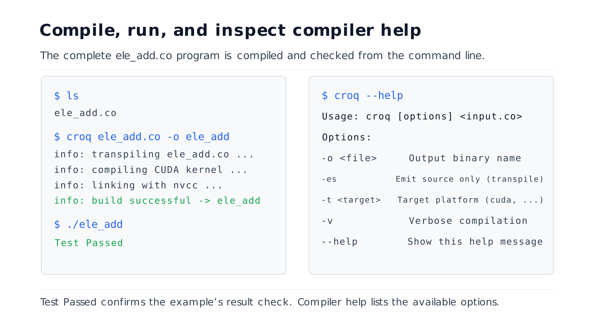
<div class="cap">图 1：编译并运行 ele_add，再查看编译器帮助</div>
</div>

#### 常用编译选项

成功运行 `ele_add` 后，就可以用同样的命令形式编译其他 `.co` 文件。Croqtile 先生成目标源码，再调用目标工具链完成编译和链接。默认输出名为 `a.out`，使用 `-o` 可以指定名称。

下表列出了选择输出形式和检查编译过程时常用的选项：

| **选项** | **作用** |
| --- | --- |
| `-o <file>` | 指定输出文件名。 |
| `-t <platform>` | 选择目标平台；用 `--help-target` 查看支持的目标。 |
| `-es` | 只生成目标源码，不进行后续编译。 |
| `-E` | 只输出预处理后的 Croqtile 源码。 |
| `-c` | 编译为目标文件，不链接。 |
| `-S` | 生成汇编代码，需要目标工具链支持。 |
| `-gs` | 生成用于后续编译和执行的脚本。 |
| `-v` / `--verbose` | 显示编译器调用的外部命令。 |
| `--help` / `--help-hidden` | 查看常规或高级编译选项。 |

例如，需要检查生成的目标源码或预处理结果时，可以让流程在相应阶段停止：

```text
croq -t target -es ele_add.co -o ele_add.target.cpp
croq -E ele_add.co
croq --help
```

<div class="listing-cap">清单 8：查看中间输出与编译器帮助</div>

将 `target` 替换为 `croq --help-target` 列出的目标名称。可用的输出形式取决于所选工具链；需要查看实际编译命令时，使用 `-v`。更多诊断方法见 1.4 节。

#### 开发与测试工具

上面的命令用于编译自己的 `.co` 程序。测试示例算子或修改编译器时，还可以使用仓库提供的 Makefile 命令：

```text
make help
make sample-test
make sample-test-operator OPERATOR=add
```

<div class="listing-cap">清单 9：测试示例算子</div>

`make help` 列出可用目标，`make sample-test` 运行全部示例算子，`OPERATOR=add` 则只测试加法。其他可选算子包括 `mul`、`relu`、`sigmoid`、`softmax` 和 `tanh`。程序构建完成后，可以继续阅读 1.4 节，检查实际编译命令和程序的执行情况。

## 1.4 检查与调试构建过程 <a id="sec-1-5"></a>

#### 详细模式：`-v`

给编译命令加上 `-v` 或 `--verbose`，可以查看编译器调用的外部命令，包括所用的预处理器、代码生成器，以及具体的 `c++` 调用：

```text
croq kernel.co -v -o kernel
```

<div class="listing-cap">清单 10：开启详细编译日志</div>

如果怀疑编译器传给 `c++` 的选项有误，或者需要查找生成文件的完整路径以便手动检查，这个选项会很有用。

#### 运行时检查：`-rtc`

编译器通过 `-rtc` 或 `--runtime-check` 提供逐级增强的运行时检查：

```text
croq kernel.co -rtc=high -o kernel
```

<div class="listing-cap">清单 11：设置运行时检查级别</div>

检查级别包括 `none`、`entry`（默认）、`low`、`medium`、`high` 和 `all`。每一级都包含前一级的检查。开发时使用 `high` 或 `all`，正式运行时使用 `none`。

#### 调试 RTTI 与 `debugger`

当 `print` 和 `println` 不足以定位问题时，可以使用 Croqtile 提供的调试运行时类型信息，让 `debugger` 能够查看 Croqtile 类型。

编译时使用 `-g` 启用调试符号：

```text
croq kernel.co -g -o kernel_debug
```

<div class="listing-cap">清单 12：生成带调试符号的程序</div>

生成代码中包含用于描述 Croqtile 类型的 RTTI 结构体：

| **Croqtile 类型** | **调试器中的类型** | **字段** |
| --- | --- | --- |
| 带形状张量（`s32 [M, N]`） | `croq::rtti::spanned<int, 2>` | `.span.data[]`：各维大小；`.stride.data[]`：步长；`.data`：数据指针 |
| 带范围的索引元组 | `croq::rtti::bounded_ituple<N>` | `.data[]`：索引值；`.ub[]`：上界 |
| 整数元组 | `croq::rtti::ituple<N>` | `.data[]`：整数值 |
| 多维形状 | `croq::rtti::mdspan<N>` | `.data[]`：各维大小 |

```text
debugger -q ./kernel_debug
(gdb) break my_kernel
(gdb) run
(gdb) ptype __dbg_lhs
type = struct croq::rtti::spanned<int, 2>
(gdb) print __dbg_lhs.span.data[0]
$1 = 32
(gdb) print __dbg_lhs.span.data[1]
$2 = 64
(gdb) print __dbg_lhs.data != 0
$3 = true
```

<div class="listing-cap">清单 13：在调试器中查看变量</div>

变量名中的 `__dbg_` 前缀由编译器生成，使 Croqtile 变量能够与生成的 C++ 中间变量一起出现在调试器中。

#### 组合使用调试工具

先根据现象选择检查方式。分块尺寸不对时，用 `println!` 在运行前查看形状；形状正确而数值不对时，只打印一个分块，或在可疑操作附近添加断言。流水线停住时，检查事件和迭代次数；矩阵结果呈规律性错位时，检查布局。若问题已缩小到地址或生命周期，再使用调试器。把临时输出放在预处理条件中，便于在正常构建时去掉：

```co
#ifdef DEBUG_PRINT
  println("tile_k=", iv_k, " accum=", mc);
#endif
```

<div class="listing-cap">清单 14：用条件编译控制调试输出</div>

```text
croq kernel.co -DDEBUG_PRINT -o kernel    # debug build
croq kernel.co -o kernel                   # production build
```

<div class="listing-cap">清单 15：调试构建与正式构建</div>

#### 调试大量使用 MMA 的核函数

MMA 路径出现错误结果时，先核对数据布局：操作数是行优先还是列优先，右侧矩阵在内存中是 `[N, K]` 还是 `[K, N]`。再检查分块索引，确认 `.at` 或 `chunkat` 选择了正确的 `block_m`、`block_n` 和 K 维切片。

常见问题包括实际数据布局与 `mma.row.row` 的声明不一致，或分块尺寸与 MMA 所需形状不匹配。使用带 swizzle 的装入方式时，布局不一致还可能产生规律性的错误，例如每隔十六个元素只有一个正确。记录错误位置的规律，有助于缩小排查范围。

#### 调试提示

修改流水线后，如果结果或执行行为异常，先检查事件的触发与等待顺序，以及生产者和消费者的循环次数。例如，两者应使用一致的 `cdiv(K, TILE_K)` 上界。如果缓冲阶段过少，消费者还可能频繁停在 `wait full`；确认这些安排后，再检查 MMA 的布局和索引。相关协调构造见后续章节。

#### 小结

| **工具** | **作用阶段** | **开销或行为** |
| --- | --- | --- |
| `print!` / `println!` | 编译时 | 不增加运行时开销 |
| `assert(expr, "msg")` | 运行时 | 开销较低，条件不满足时终止执行 |
| `print` / `println` | 运行时 | 打印可能串行执行，应限制输出范围 |
| `-rtc=high` | 运行时 | 增加边界等检查 |
| `-v` / `--verbose` | 编译过程 | 显示外部命令，不增加程序运行时开销 |
| `-g`、调试器与 RTTI | 调试过程 | 提供符号和类型信息，性能取决于构建配置 |

这些工具观察的是同一程序的不同阶段。编译器输出说明 Croqtile 推导出了哪些形状和类型，运行时检查则暴露某次调用中的实际取值。构建失败时，详细模式能显示失败的外部命令，便于单独复现。构建成功与结果正确，需要分别确认。

小例子验证通过后，再把同样的方法用于需要修改的核函数。保留参考结果，每次调整程序的一处内容，先比较输出，再测量性能。这样出现回退时，才能把问题对应到具体修改。

程序运行成功后，继续阅读第 2 章“语言基础”，理解程序中各项构造的含义。如果已经熟悉语法，可以直接按需要查阅第 3 章“编程指南”。

# 第 2 章 语言基础 <a id="ch2"></a>

本章通过简短的示例，帮助你读懂并编写 Croqtile 程序。先从完整程序的结构和各类函数的分工看起，再逐步加入形状、迭代、分块选择、数据搬运与协调。每个示例都说明新构造在程序中的作用，让你在具体的计算过程中理解它的写法。

## 2.1 Croqtile 程序的两个部分 <a id="sec-2-1"></a>

先看一个最小的加法核函数。它接收两个形状相同的矩阵，为每个位置计算相加结果，再把输出返回给调用方。这个例子只使用函数声明、形状和并行索引，便于先建立对 Croqtile 程序的整体印象。

```co
__co__ s32 [4, 8] ele_add(s32 [4, 8] lhs, s32 [4, 8] rhs) {
  s32 [lhs.span] output;
  parallel {i, j} by [4, 8]
    output.at(i, j) = lhs.at(i, j) + rhs.at(i, j);
  return output;
}
```

<div class="listing-cap">清单 16：一个简单的 Croqtile 逐元素加法函数</div>

读这段程序时，可以先沿着“输入 → 分配输出 → 逐元素计算 → 返回结果”的顺序看。`parallel {i, j} by [4, 8]` 描述 32 份独立工作，每份工作只写一个输出位置；`lhs.span` 则让输出沿用输入形状。下一节会逐行解释这些写法，这里先看它们如何组成一个完整函数。 例如两个输入在位置 (1, 3) 的值分别为 2 和 5，输出同一位置就得到 7。函数对所有位置重复这条规则，不进行矩阵乘法，也不改变矩阵形状。

一个 `.co` 文件同时包含普通 C++ 代码和 Croqtile 代码。主机程序准备数据、调用核函数并使用结果；带 `__co__` 前缀的函数描述计算与数据搬运，由 Croqtile 编译器翻译成目标代码。

#### 主机、Tileflow 与设备代码

普通 C++ 代码还可以包含设备辅助函数。因此，完整示例中常见三个区域：设备辅助函数、调用它的 `__co__` 函数，以及主机侧的 `main()`。下面按这个顺序列出它们。

```co
__device__ void device_function(...) {
  // High-performance device kernel implementation
}
// Tileflow program: orchestrating data movement
__co__ void croqtile_function(...) {
  // ... croqtile code ...
  device_function(...);
  // ...
}
// Host program: typically runs on CPU
void main() {
  // ... prepare data ...
  croqtile_function(...);
  // ...
}
```

<div class="listing-cap">清单 17：单份源文件中的三个区域</div>

程序从主机侧开始执行。主机代码使用普通 C++，负责准备输入、调用 Croqtile 函数并处理结果。

`__co__` 函数构成 Tileflow 程序，负责组织并行工作和数据搬运。它将数据放到合适的缓冲区，安排设备端计算，并把结果交回调用方。

`__device__` 辅助函数执行设备端计算。Croqtile 编译器主要翻译 `__co__` 区域，普通 C++ 的主机代码和设备代码交给后续工具链处理。<br><br>**提示：** `__device__` 主要用于在必要时复用特定硬件的函数，简化开发。对于 Croqtile 已提供较完善支持的硬件，通常直接使用语言提供的计算与数据搬运能力即可，无需通过设备辅助函数自行补充底层实现。

## 2.2 逐行阅读核函数 <a id="sec-2-2"></a>

上一节已经看到完整的加法函数。现在把它拆开阅读：函数签名约定输入与输出，缓冲区声明准备结果空间，`parallel` 划分工作，最后由 `return` 交回结果。每一步都保留了形状信息，后面的索引和计算因此有了明确的依据。

#### Croqtile 函数

先看函数签名。普通 C++ 函数的声明主要约定类型，Croqtile 还把数据形状写在参数和返回值中。这样，读者可以在进入函数体之前，先了解输入内容与预期的结果形状。

把签名从左向右读一遍：先用 `__co__` 标明语言区域，再用 `s32 [4, 8]` 约定输出，最后看函数名及两个输入。这里两份输入和输出都是 4 × 8 的整数矩阵，因此进入函数体后，只需说明每个输出元素怎样得到。

```co
__co__ s32 [4, 8] ele_add(s32 [4, 8] lhs, s32 [4, 8] rhs) {
```

<div class="listing-cap">清单 18：核函数签名</div>

前缀 `__co__` 标记 Croqtile 函数。`s32 [4, 8]` 把 32 位有符号整数元素与二维形状组合起来，表示四行八列。输入与返回值都采用 `type [shape] name` 的形式。编译器据此检查秩并推导索引范围；依赖调用方实际尺寸的约束，还可能需要运行时检查。

常见元素类型包括 `s32`、`f16`、`bf16`、`f32`，以及 `f8_e4m3` 和 `f8_e5m2`。本例使用 `s32`，便于观察逐元素加法的结果。

```co
s32 [lhs.span] output;
```

<div class="listing-cap">清单 19：分配输出</div>

这一行声明输出张量。`lhs.span` 取出输入的完整形状，因此 `output` 也具有 `[4, 8]` 的形状。修改输入形状时，这条声明的输出形状会随之改变；本例中固定的函数签名和 `parallel` 范围仍需同步调整。

```co
parallel {i, j} by [4, 8]
  output.at(i, j) = lhs.at(i, j) + rhs.at(i, j);
```

<div class="listing-cap">清单 20：并行函数体</div>

语句 `parallel {i, j} by [4, 8]` 声明 32 个独立实例，每个实例负责一个元素位置。例如 `(i, j) = (1, 3)` 的实例读取两份输入的这一位置，再把和写入 `output` 的相同位置。不同实例的写入位置不重叠，也不依赖其他实例产生的结果，因此这些工作可以并行执行。

没有空间说明符时，由编译器选择实例到执行资源的映射。语句确定工作彼此独立，并不要求每个元素都对应一个物理线程，也不要求所有实例同时运行。

```co
return output;
```

<div class="listing-cap">清单 21：返回结果</div>

返回结果的形状与元素类型必须符合函数签名。主机侧收到的 `croq::spanned_data` 拥有结果缓冲区，并携带形状信息，可通过 `[i][j]` 访问元素。

#### `__co__ auto` 返回类型

若结果形状更适合在函数体中描述，可以使用 `auto`。对于 `__co__ auto matmul(...)`，编译器从 `return output` 所返回的缓冲区推导类型。返回值仍然有元素类型和形状，`auto` 只是省去了签名中重复的声明。若希望直接在接口中约定输出形状，则可以写出完整返回类型。

逐元素算术、标量矩阵乘法以及返回缓冲区的 MMA 核函数，都遵循相同的返回约定。函数内部怎样计算元素，并不影响这一规则。

## 2.3 主机侧 API：输入与输出 <a id="sec-2-3"></a>

核函数的参数带有形状，而主机侧常常只有数组或指针。调用前要先把数据地址与各维大小组合起来；调用结束后，则从带形状的结果对象中读取输出。下面沿着这次调用的输入和返回过程，说明这些包装对象的作用。

#### 主机程序

主机侧提供数据存储和形状信息。加法示例先创建两份拥有存储的缓冲区，填入数据，再将视图传给核函数。主机保留输入的所有权，调用结束后还可以用原始数据检查结果。

```co
auto lhs = croq::make_spandata<croq::s32>(4, 8);
auto rhs = croq::make_spandata<croq::s32>(4, 8);
lhs.fill_random(-10, 10);
rhs.fill_random(-10, 10);
```

<div class="listing-cap">清单 22：创建带形状的输入</div>

调用 `croq::make_spandata<T>(dims...)` 分配由对象拥有的主机缓冲区。模板参数选择元素类型，实参给出各维大小。随后调用 `fill_random`，在指定范围内初始化元素。

```co
auto res = ele_add(lhs.view(), rhs.view());
```

<div class="listing-cap">清单 23：调用核函数</div>

主机侧的调用形式与普通 C++ 函数调用相同。`.view()` 从 `spanned_data` 创建不拥有缓冲区的 `spanned_view`，供核函数访问输入；返回的 `res` 则拥有结果缓冲区。

`main` 最后逐个检查结果元素，验证核函数的计算是否正确。这个检查沿用相同的 `(i, j)` 位置，把两个原始输入的和与返回结果比较，从主机侧完成一次完整的准备输入、调用与验证的过程。

从一次调用来看，`lhs.view()` 与 `rhs.view()` 提供输入地址和形状，`ele_add` 使用这些视图完成计算，`res` 接收输出。视图只是访问原有存储的入口，因此准备输入的对象要在调用期间保持有效。

#### 主机代码

下面的主机代码使用相同的 `make_spandata` 和 `.view()` 调用方式。

```co
int main() {
  auto lhs = croq::make_spandata<croq::s32>(128, 256);
  auto rhs = croq::make_spandata<croq::s32>(256, 256);
  lhs.fill_random(-10, 10);
  rhs.fill_random(-10, 10);
  auto res = matmul(lhs.view(), rhs.view());
  for (size_t i = 0; i < res.shape()[0]; ++i)
    for (size_t j = 0; j < res.shape()[1]; ++j) {
      int ref = 0;
      for (size_t k = 0; k < lhs.shape()[1]; ++k)
        ref += lhs[i][k] * rhs[k][j];
      croq_assert(ref == res[i][j], "values are not equal.");
    }
  std::cout << "Test Passed\n" << std::endl;
}
```

<div class="listing-cap">清单 24：主机代码</div>

调用后，程序将每个结果元素与 C++ 参考计算比较；结果不一致时，断言会报错。

#### Croqtile 与 C++ 函数之间的参数传递

C++ 指针需要与维度信息一起包装成带形状的数据，再传入 Croqtile 函数。相关工具由 `choreo.h` 提供。

```co
#include "choreo.h"
void bar(const float* data, unsigned size) {}
__co__ void foo(f32 mdspan<2> d) {
  parallel p by 6 {
    call bar(d, |d|);     // Call the C++ function
  }
}
void foobar(float* a) {
  foo(croq::make_spanview<2>(a, {1, 2}));
}
```

<div class="listing-cap">清单 25：Croqtile 与 C 函数之间的参数传递</div>

`make_spanview` 创建输入视图，不复制底层数据。示例中，`foo` 的参数 `d` 使用 `f32 mdspan<2>` 描述形状；调用 `bar` 时，可以通过隐式转换传递底层数据，`|d|` 则给出元素总数。

标量值也可以在 C++ 与 Croqtile 之间传递；`ituple` 仅用于 Croqtile 函数内部。

#### 输入参数

Croqtile 函数的输入参数包括带形状数据，以及标量：整数、布尔值或浮点元素类型。

参数可以具名，也可以省略名字：

```co
__co__ void foo(f32 [7] a, int) {...}
```

<div class="listing-cap">清单 26：输入参数</div>

本例的第二个参数没有名字，因此函数体无法引用它，但声明仍然合法。

#### C++ 主机：带形状的数据实参

普通指针或数组只描述存储，Croqtile 的带形状数据还记录各维度大小。调用前，需要把数据地址与形状组合起来。

可以使用 `choreo.h` 中的包装工具。Croqtile 编译环境会自动包含这个头文件。

```co
__co__ void foo(f32 [7, 16] input, f32 [7, 16] output) {...}
void entry(float * input, float* output) {
  // foo(input, output); <-- result in error since missing shape
  foo(croq::make_spanview<2>(input, {7, 16}),
      croq::make_spanview<2>(output, {7, 16}));
}
```

<div class="listing-cap">清单 27：传入带形状的缓冲区</div>

`croq::make_spanview` 以秩(rank)作为模板实参，接收数据指针和维度列表，生成 `croq::spanned_view`。它保存指针与形状，不拥有底层缓冲区。简化定义如下。

```text
template <typename T, size_t Rank>
class spanned_view {
  T* ptr;                 // typed pointer to the data
  size_t dims[Rank];      // ranked dimensions
};
```

<div class="listing-cap">清单 28：主机侧缓冲区包装器</div>

维度也可以由运行时值提供：

```co
__co__ void foo(f32 [7, 16] input) {...}
void entry(float * input, float* output, int M, int N) {
  foo(croq::make_spanview<2>(input, {M, N}));
}
```

<div class="listing-cap">清单 29：由运行时维度构造的调用</div>

本例的 `input` 使用运行时形状。进入 Tileflow 程序时，系统检查它是否满足 `M == 7` 和 `N == 16`；不满足时会终止执行，以免继续使用不成立的形状假设。

输入的带形状数据引用原有缓冲区。把这个包装对象传入函数，不会复制整块输入数据。

#### 返回类型与类型推导

返回值和输入一样，可以是带形状数据、标量，或者不返回结果（`void`）。

除了显式声明返回类型，也可以让编译器推断：

```co
__co__ auto foo() {
  f32 [7, 16] result;
  // ...
  return result;
}
```

<div class="listing-cap">清单 30：返回类型与类型推导</div>

这里，编译器根据 `result` 将 `auto` 推导为 `f32 [7, 16]`。当输出形状在函数体内推导时，这种写法可以避免修改推导式后还要同步修改返回声明。若固定返回形状是接口的一项要求，则适合显式声明类型。

#### C++ 主机：形状返回

主机侧收到的结果拥有自己的缓冲区，具有值语义，便于在调用结束后继续使用。

```co
__co__ auto foo() {
  f32 [7, 16] output;
  // ...
  return output;  // semantically copy
}
void entry() {
  auto result = foo(); // move the 'spanned_data' to caller
  // ...
}
```

<div class="listing-cap">清单 31：返回带形状的缓冲区</div>

示例中，`output` 作为结果返回，主机侧类型为 `croq::spanned_data`。实现通过返回值优化避免复制整块缓冲区。简化定义如下。

```text
template <typename T, size_t Rank>
class spanned_data {
  std::unique_ptr<T[]> ptr; // move only pointers
  size_t dims[Rank];        // ranked dimensions
};
```

<div class="listing-cap">清单 32：主机侧结果包装器</div>

`spanned_view` 只引用数据，`spanned_data` 则管理缓冲区的所有权。返回值优化允许在交付结果时省去数据复制。

主机侧可以用 `.rank()`、`.shape()` 查询结果形状，而不必依赖核函数内部的声明。

## 2.4 形状与 `mdspan` <a id="sec-2-4"></a>

加法示例用固定的 `[4, 8]` 描述矩阵，但实际程序的输出、临时缓冲区和分块形状往往来自输入。把形状当作可命名、可计算的信息，就能在修改输入时保留这些关系。下面从读取形状开始，再逐步介绍 `mdspan` 的声明、计算与未知维度。

#### `span` 与 `span(i)`

成员 `tensor.span` 返回完整形状，`tensor.span(i)` 返回第 i 维的大小。矩阵乘法的输出行数来自左输入，列数来自右输入：

```co
s32 [lhs.span(0), rhs.span(1)] output;
```

<div class="listing-cap">清单 33：span 与 span(i)</div>

这个例子从两个不同操作数取得结果尺寸，使输出声明与输入保持关联。需要匹配已搬运分块形状的暂存缓冲区，也可以用同样的方法声明。

<div class="guide-figure">
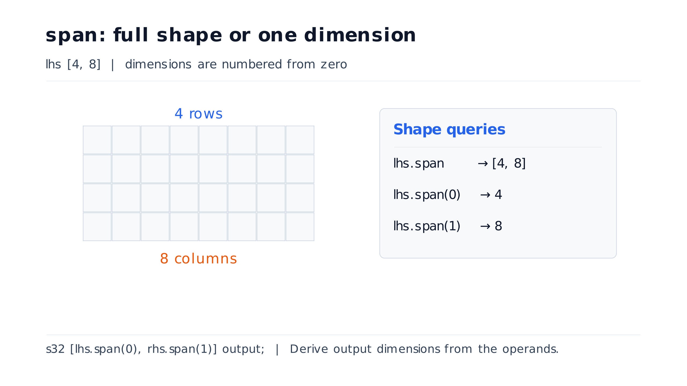
<div class="cap">图 2：对 [4, 8] 张量，.span 返回完整形状 [4, 8]；.span(0) 和 .span(1) 分别返回 4 和 8。</div>
</div>

形状本身也可以命名并参与计算。下面先声明一个形状，再说明怎样从它推导出新的形状。

#### 用 `mdspan` 定义形状

关键字 `mdspan` 表示多维范围，用来描述形状各维的大小，本身不分配元素存储。例如 `[7, 8]` 的秩为 2，描述 56 个位置；这些位置采用 `f32` 还是 `s32` 元素，则是另一项选择。

显式声明的写法如下：

```co
mdspan s0 : [7, 8]; // Defines a 2D shape with dimensions [7, 8]
mdspan<1> s1 : [3]; // Defines a 1D shape with dimensions [3]
```

<div class="listing-cap">清单 34：声明形状</div>

`:` 引出初始化表达式，`[]` 中依次列出各维度大小。`s0` 的形状是 `[7, 8]`，`s1` 的形状是 `[3]`。

`mdspan` 后的尖括号可以指定秩，也就是维度数量。它必须与初始化表达式一致，否则编译器会报错。

```co
mdspan<3> s2 : [64, 32]; // error: the rank of mdspan is inconsistent
```

<div class="listing-cap">清单 35：秩不匹配</div>

编译器也可以从初始化表达式推断类型，此时省略 `mdspan`：

```co
s3 : [7, 8, 9]
```

<div class="listing-cap">清单 36：省略 mdspan 关键字</div>

`s3` 的秩为 3，形状为 `[7, 8, 9]`。`mdspan` 必须在声明时初始化；省略类型只简化写法，不改变这项要求。

#### 导出 `mdspan`

分块、填充和重塑都需要从已有形状推导新形状。例如，把每维大小除以分块因子，可以得到每块形状；给某维增加长度，则能描述填充后的区域。把这些关系写成形状表达式，修改原始尺寸时就不必逐处更新数字。

可以对维度做算术运算，再组合成新的形状：

```co
shape : [128, 64]; // initial shape
new-shape0 : shape [(0) / 2, (1) / 4, 1];  // tile and reshape: [1, 64, 16]
new-shape1 : shape [(1) + 2, (0) / 16];    // pad and reshape: [66, 8]
```

<div class="listing-cap">清单 37：原始形状</div>

`new-shape0` 将原形状的两个维度分别除以 `2` 和 `4`，并增加一个长度为 `1` 的维度。

同一计算也可以展开写成：

```co
new-shape0: [shape(0) / 2, shape(1) / 4, 1];
```

<div class="listing-cap">清单 38：导出的形状</div>

展开后，`shape(0)` 和 `shape(1)` 分别取出原形状的两个维度。两种写法表达的是同一组计算。

`new-shape1` 将原形状的第二个维度加 `2`，把它放到新形状的第一维；新形状的第二维由原形状的第一维除以 `16` 得到。

也可以直接对整个形状做运算或拼接：

```co
shape : [32, 72]
new-shape0 : shape;  // [32, 72]
new-shape1 : shape + 1;  // [33, 73]
new-shape2 : shape / 4;  // [8, 18]
new-shape3 : [shape, 6]; // [32, 72, 6]
```

<div class="listing-cap">清单 39：重新绑定形状</div>

对整个形状进行算术运算时，运算逐维应用。例如 `[128, 64]` 加 1 得到 `[129, 65]`，并不会增加一个维度。下面两种表达式写的是同一项计算：

`new-shape1 : shape + 1;`

可展开为：

`new-shape1 : shape [(0) + 1, (1) + 1];`

在初始化表达式中放入一个 `mdspan`，则会拼接它的各个维度。例如：

`new-shape3 : [shape, 6];`

可展开为：

`new-shape3 : shape [(0), (1), 6];`

这些简写能保留形状之间的关系，减少重复列出维度的代码。

#### 带匿名维度的 `mdspan`

前面的形状使用固定数字。如果某个维度要由调用方在运行时提供，可以把对应位置写成 `?`，保留其他已知维度：

```co
__co__ auto foo(s32 [?, 1, 2] input) { ... }
```

<div class="listing-cap">清单 40：含未知维度的核函数</div>

`?` 表示一个运行时提供的正整数维度：

```text
void bar(int * data, int dim0) {
  foo(croq::make_spanview<3>(data, {dim0, 1, 2}));
}
```

<div class="listing-cap">清单 41：由调用方提供该维度</div>

本例第一维的大小来自调用方，可以由配置或上层框架确定。

如果只需使用某份输入的一维大小，匿名维度已经足够。但当两份输入的某个维度必须相等时，它没有为这项关系提供共同的名字。矩阵乘法恰好需要这样的约束：左操作数的列数必须等于右操作数的行数。

#### 更进一步：符号维度

当多个参数需要引用同一个未知维度时，只写 `?` 还不能直观表达它们的关系。符号维度给这些大小命名，让共享维度和形状约束出现在函数签名中：

```co
__co__ auto Matmul(s32 [M, K] lhs, s32 [K, N] rhs) {
  int tile_m = 32, tile_n = 8, tile_k = 16;
  s32 [M / tile_m, K / tile_k] tiled_lhs;
  s32 [K / tile_k, N / tile_n] tiled_rhs;
  // ...
}
```

<div class="listing-cap">清单 42：更进一步：符号维度</div>

本例用 `M`、`K`、`N` 表达两个输入的形状。相同的名字明确了共享维度，便于阅读、维护和检查参数之间的关系。

例如 M=4、K=8、N=16 时，两个输入分别是 4 × 8 与 8 × 16，输出是 4 × 16。两个输入共用 K，表达的正是相乘维度必须一致这一关系；用同一个名字，可以避免把这项约束分散写在多处。

## 2.5 整数、整数元组(ituple)与有界值 <a id="sec-2-5"></a>

形状回答“数据有多大”，索引回答“当前处理哪里”。单个索引用整数表示，多维位置则可以用整数元组集中表达。进一步把索引和范围绑定后，后续的循环与分块选择就能同时使用当前位置和范围信息。

#### 标量类型

用于程序控制的标量包括整数和布尔值。`int` 是 32 位有符号整数，范围为 -2³¹ 到 2³¹-1，可用于声明变量和函数参数。

```co
int a;
__co__ int foo(int b) { return b; }
```

<div class="listing-cap">清单 43：标量类型</div>

整数支持 C++ 风格的算术、移位和逻辑运算。程序控制使用 `int`，不提供其他位宽或无符号的控制整数类型。

`bool` 的运算以及它与整数之间的转换，采用 C++ 的对应规则。

#### 整数元组类型

整数元组按顺序保存多个整数，常用于多维索引。把行、列等坐标放在同一个元组中，可以整体传递或参与逐维计算；需要某个分量时，再按位置取出。元素顺序因此也是索引含义的一部分。

用花括号列出各个元素即可定义 `ituple`：

```co
ituple index = {5, 4, 3, 2, 1};  // It defines a tuple of 5 elements
index = {a, b};  // 'a' and 'b' are existing integers
```

<div class="listing-cap">清单 44：整数元组类型</div>

#### `mdspan` 与 `i-tuple` 上的运算

`mdspan` 可以与整数元组按维度运算。下面用一组分块因子计算新的形状。

```co
sp : [6, 8];
tiling_factor = {3, 2};
spn : sp / tiling_factor;   // spn is defined as [2, 4];
```

<div class="listing-cap">清单 45：mdspan 与 i-tuple 上的运算</div>

支持的运算包括：

- `mdspan` / `i-tuple`
- `mdspan` + `i-tuple`
- `mdspan` % `i-tuple`
- `mdspan` * `i-tuple`
- `mdspan` - `i-tuple`

元组写法将逐维计算集中在一个表达式中，更容易看出形状之间的关系。

整数描述单个索引或循环参数，整数元组描述多维索引。它们在声明时初始化，并可与形状一起用于后续检查。

#### 用于程序控制的整数

Tileflow 程序使用整数来控制循环和索引。为此提供的控制类型是 32 位有符号整数 `int`。

可以像 C++ 一样声明并初始化整数：

```co
int a = 1;
```

<div class="listing-cap">清单 46：已初始化的整数</div>

也可以省略类型，由初始化表达式推断：

```co
a = 1;
```

<div class="listing-cap">清单 47：对整数赋值</div>

一行中可以声明多个整数：

```co
int a = 1, b = 2, c = 3;
d = 4, e = 5;
```

<div class="listing-cap">清单 48：一次定义多个整数</div>

`mdspan` 不能直接作为函数参数；整数则可以在主机、Tileflow 程序和设备函数之间传递。

```co
__co__ void foo(int a) {
  parallel p by 1 {
    call kernel(a, 3);
  }
}
```

<div class="listing-cap">清单 49：整数参数</div>

整数必须在声明时初始化，之后不能重新赋值：

```co
int a;  // error: declaration without initialization
int b = 1;
b = 3;  // error: re-assignment
```

<div class="listing-cap">清单 50：未初始化的声明</div>

这里的整数是不可变值。因此，声明中的 `=` 用于初始化，而不是修改已有变量。

#### 声明整数元组

`ituple` 将多个整数组合成一个元组，也称 `i-tuple`。显式声明如下：

```co
ituple a = {1, 2, 3};
b = {4, 5, 6};  // utilize the type inference
```

<div class="listing-cap">清单 51：i-tuple 字面量</div>

把二维位置写成 `idx = {1, 2}` 后，`idx(0)` 取第一维的 1，`idx(1)` 取第二维的 2。花括号用于组成元组，圆括号用于选择其中的分量；元组本身只保存整数，后续用 `with-in` 才为它绑定范围。

类型可以由初始化表达式推断。区分省略类型的 `ituple` 和 `mdspan` 时，注意以下两点：

- `ituple` 的初始化表达式跟在赋值号 `=` 之后（和整数一样），`mdspan` 则在 `:` 之后初始化；
- `ituple` 的初始化表达式用花括号括起，而不是 `mdspan` 使用的 `[]`。

也可以显式指定秩，让编译器检查元素个数：

```co
ituple<3> a = {1, 2};  // error: inconsistent rank
```

<div class="listing-cap">清单 52：秩不一致</div>

#### 元组运算与形状计算

圆括号 `()` 取出元组中的一个元素，下标从 `0` 开始。也可以让整个元组参与计算，把几个坐标分量的变化写在同一表达式里：

```co
a = {3, 4};
b = {a(0), 1, a(1)};  // '()' to retrieve the element value
c = a {(0), (1), 2};  // syntax sugar
d = {a, 5, 6};        // concatenate
e = a + 1;            // addition is applied elementwise
```

<div class="listing-cap">清单 53：赋一个新元组</div>

`ituple` 与整数、`mdspan` 一样，必须初始化且不能重新赋值。

元组常用于逐维修改形状：

```co
shape : [7, 18, 28];
tiling_factors = {1, 2, 4};
tiled_shape : shape / tiling_factors;
padded_shape : shape + {2, 0, 2};
```

<div class="listing-cap">清单 54：用 i-tuple 索引 mdspan</div>

`shape / tiling_factors` 按各维的分块因子计算 `tiled_shape`，`shape + {2, 0, 2}` 则得到 `padded_shape`。按维度相加时，两者的秩必须一致。

```co
shape : [7, 8, 9] + {1, 2}; // error: inconsistent rank
```

<div class="listing-cap">清单 55：非法的形状表达式</div>

#### 整数与元组的使用规则

一个控制值用整数表示，一组有顺序的值用 `ituple` 表示。形状 `[7, 14]` 描述范围，元组 `{1, 2}` 则可以表示位置或分块因子。两者的秩一致时，形状运算会把每个因子应用到对应维度。

整数和普通元组都必须初始化，之后不能重新赋值。这项限制针对用于控制和形状计算的名字。缓冲区元素则不同：加法示例会写入 `output.at(i, j)`，矩阵乘法也会更新累加器。区分这两种角色，就不会把不可变索引误当成可变累加器。

## 2.6 带形状数据与存储说明符(storage specifier) <a id="sec-2-6"></a>

有了形状，还需要确定数据元素的类型，以及缓冲区放在哪里。下面把这几项合在一条声明中，并说明如何初始化数据。之后再按需选择 `global`、`shared` 或 `local`，让存储位置与使用它的并行工作相配合。

#### 完整类型

缓冲区声明需要同时给出元素类型和形状。形状确定缓冲区包含多少个位置，基础类型确定每个位置存储什么。下面的例子为半精度数据复用命名形状，为单精度数据直接写出形状。

```co
ndims : [20, 15];
f32 [10, 10] d0;
f16 [ndims] d1;
```

<div class="listing-cap">清单 56：完整类型</div>

基本元素类型包括：

- 无符号整数：`u8` / `u16` / `u32`
- 有符号整数：`s8` / `s16` / `s32`
- 浮点数：`f16` / `bf16` / `f32`

`s32` 是带形状数据的元素类型；用于程序控制的 `int` 是独立的标量类型，两者用途不同。

#### 存储说明符

分块可以由协作线程共同使用，也可以由单个线程独占。元素类型和形状无法表达这种区别，需要由存储说明符补充。

这些示例使用以下三种存储说明符：

- `global`
- `shared`
- `local`

存储说明符写在元素类型之前：

```co
ndims : [20, 15];
local f32 [10, 10] d0;
shared f16 [ndims] d1;
```

<div class="listing-cap">清单 57：存储说明符</div>

应根据使用缓冲区的代码选择存储说明符。默认位置取决于执行上下文和目标平台；若搬运操作或协作组需要特定的存储位置，应显式声明。

声明缓冲区时，需要给出元素类型与形状；需要指定存储位置时，再加上存储说明符。

#### 定义带形状数据

下面声明一个带形状的缓冲区：

```co
f32 [32, 16] data;
```

<div class="listing-cap">清单 58：带形状数据的声明</div>

它的形状为 `[32, 16]`，元素类型为 `f32`。形状也可以先单独命名：

```co
shape : [72, 14];
s32 [shape] data0;              // using the named mdspan `shape`
u32 [shape(0), shape(1)] data1; // same shape as the above
u16 [shape + 6] data2;          // shaped as [78, 20]
s16 [shape, 8] data3;           // shaped as [72, 14, 8]
```

<div class="listing-cap">清单 59：独立的形状</div>

`data0` 使用名为 `shape` 的形状，并以 32 位整数为元素。`[]` 内还可以使用形状运算的结果。

元素类型也称基础类型，常见类型如下：

- 无符号整数：`u8`、`u16`、`u32`
- 有符号整数：`s8`、`s16`、`s32`
- 浮点数：`f16`、`bf16`、`f32`

`u` 和 `s` 分别表示无符号与有符号整数，数字表示位宽。`f16` 是半精度浮点，`bf16` 是脑浮点，常用于机器学习计算。

`s32` 用于声明数据元素，`int` 用于程序控制。虽然位宽相同，它们的声明方式不同：

```co
s32 a;    // a control integer, the same as 'int a'
s32 [4] b; // a buffer of four elements
```

<div class="listing-cap">清单 60：被拒绝的基础类型</div>

两种写法都能通过编译：带形状的声明得到缓冲区，不带形状的声明得到普通控制整数；区别在形状，不在类型名。

要明确缓冲区的存储位置，可以加上说明符：

```co
global f32 [32, 7, 2] a;
shared u8 [512, 144] b;
local u8 [72, 1024] c;
```

<div class="listing-cap">清单 61：存储说明符</div>

存储位置由编译模式和目标平台约定决定。在这里的主机与设备协同场景中，未标注的缓冲区使用主机存储；设备侧存储位置则显式指定。

- `global`：指设备的全局存储。
- `shared`：指设备块的共享存储。
- `local`：指线程私有存储。

不同平台的含义和声明约束可能不同，应结合当前编译环境使用。

#### 初始化

缓冲区可以在声明时初始化：

```co
local s32 [17, 6] b1 {0};       // elements are initialized to 0
shared f32 [128, 16] b2 {3.14f}; // elements are initialized to 3.14f
```

<div class="listing-cap">清单 62：初始化</div>

变量名后的括号给出初始值。本例的初始化方式把所有元素设为同一个值，适合准备清零的输出或临时缓冲区。读取声明时，可以依次看存储说明符、元素类型、形状，再看名称后的初始化表达式。

第一条声明把线程私有的 s32 缓冲区初始化为 0；第二条把共享的 f32 缓冲区初始化为 3.14。花括号中的单个值会应用到所有元素。改变存储说明符不会改变初始化规则，但会改变哪些执行实例共享这份数据。

#### 声明参数与返回值

带形状数据可以作为函数参数或返回值：

```co
__co__ f16 [7, 8] foo(f32 [16, 17, 5] input) {...}
```

<div class="listing-cap">清单 63：显式的返回形状</div>

参数与返回值的声明类似数据声明，但这里不能附带存储说明符或初始化表达式，也不能对已有 `mdspan` 直接做运算。

参数的 `.span` 返回它的形状，可以用来声明同形状的缓冲区：

```co
__co__ auto foo(f32 [16, 17, 5] input) {
  f32 [input.span / {4, 1, 5} ] buffer;  // declare a buffer with tiled shape
  // ...
}
```

<div class="listing-cap">清单 64：推导出的返回形状</div>

#### 数据声明小结

声明确定元素类型、形状与存储位置，初始化表达式给出初始内容。掌握这些写法后，就可以为并行工作准备相应的缓冲区。

#### `global`：全局存储

声明中的 `global` 把缓冲区放入目标平台的全局存储，适合需要超出单个线程或协作块访问范围的数据。选择存储位置并不等于初始化内容，也不会自动把已有数据搬入其中：

```co
global f32 [100, 200] matrix;
```

<div class="listing-cap">清单 65：全局存储声明</div>

#### `shared`：共享存储

`shared` 缓冲区为块内线程提供共同的暂存区域。在分块矩阵乘法中，一个块可以装入一次操作数分块，再让多个线程读取。读取必须在装入完成后开始，下次装入也必须等到这些读取结束。

```co
shared f32 [10, 10] tile_data;
```

<div class="listing-cap">清单 66：共享存储声明</div>

#### `local`：私有存储

`local` 表示线程私有存储，适合不需要在线程间共享的小数组或临时数据：

```co
local f16 [5] thread_local_data;
```

<div class="listing-cap">清单 67：私有存储声明</div>

#### 默认行为与用法

省略说明符时，存储位置由目标平台和所在执行上下文决定。入门代码这样写很方便，但仅凭一个没有说明符的名字，无法判断哪些线程能共享其内容。追踪数据流时，应把声明与包围它的并行区域一起阅读。

```co
f32 [100, 100] d0;
```

<div class="listing-cap">清单 68：不带说明符的声明</div>

选择 `shared` 或 `local` 时，将说明符写在元素类型之前：

```co
local f32 [10, 10] d0;     // Small data, local to the thread
shared f16 [ndims] d1;     // Intermediate data, shared between threads in a block
```

<div class="listing-cap">清单 69：显式选择 local 存储</div>

#### 存储位置示例

下面把三种存储位置放在同一个示例中：

```co
ndims : [20, 15];
local f32 [10, 10] d0;
shared f16 [ndims] d1;
global f32 [100, 200] matrix;
// Perform computations on these arrays, utilizing the appropriate storage space
dma.copy d0 => d1;
dma.copy d1 => matrix;
```

<div class="listing-cap">清单 70：示例代码：使用存储说明符</div>

这些声明展示三种存储位置，复制语句示意它们之间的数据流向。要把这段示意写成实际搬运，需要选择形状兼容的源视图和目标视图，因为这里声明的完整数组大小不同。存储说明符只选择位置，并不会使不同形状的缓冲区可以相互替代。

## 2.7 迭代：`parallel-by`、`with-in` 与 `foreach` <a id="sec-2-7"></a>

加法中的各个输出位置互不依赖，因此可以交给 `parallel`；有前后依赖的累加或逐块处理，则需要按顺序迭代。`with-in` 负责定义有界索引，`foreach` 负责遍历它。阅读下面的例子时，先判断工作能否独立执行，再选择对应的构造。

#### Croqtile 的两层并行模型

阅读并行代码时，先区分两个问题：哪些工作彼此独立，以及这些工作映射到哪里。

- `parallel`：声明彼此独立、可以并行执行的工作。
- 空间说明符，如 `: block`、`: thread`、`: group`：指定并行轴的执行位置。

`foreach` 表示顺序迭代，适合累加、归约或有前后依赖的处理；`parallel` 表示独立的工作实例。

```co
parallel {px, py} by [8, 16] : block
  foreach {tile_k} in [16]               // sequential -- K-dimension loop
    parallel {qx, qy} by [16, 16] : thread  // concurrent -- mapped to threads
      foreach k in [16]                      // sequential -- inner accumulation
        output += lhs * rhs;
```

<div class="listing-cap">清单 71：Croqtile 的两层并行模型</div>

<div class="guide-figure">
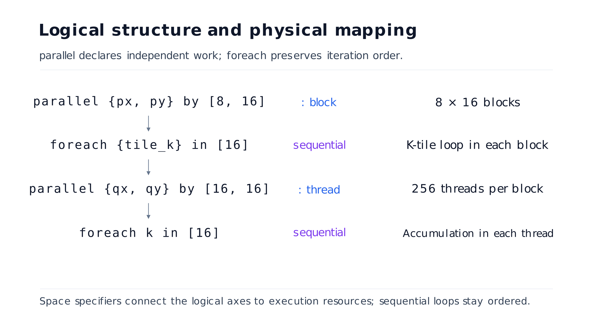
<div class="cap">图 3：空间说明符将 parallel 轴映射到 block 和 thread；其中的 foreach 循环仍按顺序执行。</div>
</div>

未写空间说明符时，由编译器选择默认映射；需要明确控制时，再标注 `: block`、`: thread` 等说明符。

`parallel` 和 `foreach` 都可以使用多维索引。确定外层与内层范围后，组合运算符 `#` 将它们的坐标连接成完整张量中的位置。范围参与这项计算，因此修改迭代划分时，分块选择也会随之改变。

#### `: block`——并行块

```co
parallel {px, py} by [8, 16] : block
```

<div class="listing-cap">清单 72：: block——并行块</div>

这里声明 8 × 16 的网格，共 128 个块。每个块都应能独立完成分配给自己的输出分块；这个示例没有提供块间通信或同步协议。

本例输出形状为 `[128, 256]`，每块处理 `[16, 16]`，因此网格大小为 128/16 × 256/16 = 8 × 16。

#### `: thread`——块内线程

```co
parallel {qx, qy} by [16, 16] : thread
```

<div class="listing-cap">清单 73：: thread——块内线程</div>

这一层在每个外层块内组织 16 × 16，共 256 个线程。

分块内的逐元素工作可以在这一层展开。

#### 嵌套说明符

块级和线程级工作可以嵌套声明：

```co
parallel {px, py} by [8, 16] : block {
  parallel {qx, qy} by [16, 16] : thread {
    // 128 blocks x 256 threads = 32,768 threads total
  }
}
```

<div class="listing-cap">清单 74：嵌套说明符</div>

外层划分块网格，内层划分块内线程。`px, py` 表示同一并行层次中的两个坐标轴。

#### `with tile_k in 16`

语句 `with tile_k in 16` 为 `tile_k` 绑定 0 到 15 的范围，上界为 `#tile_k = 16`，但它本身不会把语句体执行 16 次。遍历由后续的 `foreach tile_k` 完成。将绑定与循环分开后，流水线就可以先在循环外选择第 0 块，再遍历其余分块。

#### `foreach tile_k(1:)`：切片迭代

范围表达式 `(1:)` 从索引 1 开始，保留原有的排他上界。共有 16 块时，它遍历 1 到 15。若前序阶段已装入第 0 块，循环就只需发起其余分块的装入，同时计算上一块；最后装入的一块留到循环结束后处理。

#### 并行区域：`parallel-by` 块

`parallel-by` 用同一段代码描述多个独立工作实例。每个实例通过不同的索引处理自己的数据。

基本形式是在 `parallel ... by ...` 后写出代码块：

```co
parallel p by 6 {
  // SPMD code
}
```

<div class="listing-cap">清单 75：并行区域：parallel-by 块</div>

本例包含 6 个实例，`p` 分别取 `0` 到 `5`。可以把它理解为 6 次彼此独立的迭代，执行先后顺序不固定。

`p` 的取值范围为 `[0, 6)`，因此称为有界整数。分块选择等操作会同时使用它的当前值和范围。

在这个六实例例子中，`p=1` 是当前工作的编号，而 `#p=6` 是整个轴的范围。当前编号会随实例变化，范围保持不变；分块操作正是利用这两项信息，同时决定取哪一块以及每块有多大。

#### `with-in` 块与 `where` 子句

`with-in` 将一个索引元组与形状范围绑定：

```co
with index in [10, 10] {
  // index is ituple with 2 elements
}
```

<div class="listing-cap">清单 76：索引 with-in 块</div>

`index` 包含两个元素，也可以分别给元素命名：

```co
with {x, y} in [10, 10] {...}
```

<div class="listing-cap">清单 77：索引元组</div>

元组本身和各个元素可以同时命名：

```co
with index = {x, y} in [10, 10] {...}
```

<div class="listing-cap">清单 78：由元组导出的索引</div>

这里的 `index` 是有界整数元组。

`with-in` 只声明有界索引，不启动并行工作。需要遍历这些索引时，再使用 `foreach`。

可以把 `with index in [2, 3]` 看成先准备一个两维索引：第一维可取 0、1，第二维可取 0、1、2。声明本身没有遍历这六个位置，进入其中的 `foreach index` 后，循环体才会依次执行。

`where` 可以声明索引之间的对应关系：

```co
with {m, n} in [M, N], {n_p, k} in [N_P, K] where n_p <-> n {
  // matmul implements with m,n,K. n_p is no long useful.
}
```

<div class="listing-cap">清单 79：嵌套的有界组</div>

`n <-> n_p` 约定两个索引在迭代中对应同一取值，因此可以在需要该索引的位置使用相应名字。

#### `foreach` 块

有界整数或元组定义后，可以用 `foreach` 遍历其范围。这里把范围声明与循环体分开：`with-in` 说明可用的位置，`foreach` 再按顺序逐个访问。循环体中的索引代表当前正在处理的位置：

```co
with x in [10] {
  foreach x {
    // do something with each x
  }
}
```

<div class="listing-cap">清单 80：foreach 块</div>

每次迭代在循环体内为有界变量提供当前值，上界则保持不变。选择数据时使用当前值，推导分块数量时使用上界。若改为声明并行索引，则是给每个独立实例分配一个值，而不是按顺序遍历这些值。

沿着 `[2, 3]` 的范围展开时，先处理第一行的三个位置，再处理第二行的三个位置。每一次循环完成后才进入下一次，因此循环体可以引用前一次留下的状态；这也是它与独立并行工作的重要区别。

#### 具名与不具名的并行索引

下面用具名索引声明并行工作：

```co
parallel p by 6 {
  // SPMD (Single Program, Multiple Data) code
}
```

<div class="listing-cap">清单 81：具名的并行索引</div>

花括号中的代码由多个实例执行。本例的组成部分如下：

- `parallel`：声明独立的工作实例。
- `p`：标识当前实例的有界索引。
- `by 6`：声明 6 个实例，索引范围为 `0` 到 `5`。

如果代码不需要引用实例索引，可以省略变量名：

```co
parallel by 2 { ... }
```

<div class="listing-cap">清单 82：不具名的并行索引</div>

这里仍有两个工作实例，但代码不能用省略的索引来区分数据位置。

#### 多层并行

可以嵌套声明不同的并行层次：

```co
parallel p by 2 {
  // parallel-level-0
  parallel q by 12 {
    // parallel-level-1
  }
}
```

<div class="listing-cap">清单 83：嵌套的两级并行</div>

本例的两层范围分别为 `2` 和 `12`，共有 24 种索引组合。`p` 属于外层，`q` 属于内层，每个组合标识一份工作。

层次划分也决定代码在哪个范围内执行，以及哪些工作需要协调。组织代码时，应让协作关系与并行层次相匹配。

两层之间没有其他语句时，也可以合写为一条声明：

```co
parallel p by 2, q by 12 { ... }
```

<div class="listing-cap">清单 84：合写的两级并行</div>

逗号分隔的写法与前面的嵌套声明表达相同的两级并行。

#### 同一并行层次的多维坐标

同一并行层次可以用多个坐标轴描述；支持的轴数由目标平台决定：

```co
parallel {px, py, pz} by [1, 1, 2] {
  // higher synchronization cost
  // ...
  parallel t_index = {qx, qy} by [3, 4] {
    // lower synchronization cost
    // ...
  }
  // ...
}
```

<div class="listing-cap">清单 85：子级并行性</div>

本例外层使用 `px, py, pz` 三个轴，内层使用 `qx, qy` 两个轴。内层索引还可以整体命名为 `t_index`，各轴的范围由对应的形状给出。

元组中第一个元素对应最低有效的并行轴。使用多维索引时，需要保持这一顺序与数据坐标的对应关系。

`with-in` 定义索引范围，`foreach` 按该范围依次迭代。两者一起描述循环的边界和循环体。

#### 用有界索引描述循环

C++ 的循环由初值、条件和步进控制。Croqtile 的循环则围绕有界索引组织。

`foreach` 的基本形式如下：

```co
foreach index {
  // loop body
}
```

<div class="listing-cap">清单 86：一个 foreach 循环</div>

如果 `index` 的上界为 `6`，它对应下面的 C++ 循环：

```text
for (int index = 0; index < 6; ++index) {
  // loop body
}
```

<div class="listing-cap">清单 87：等价的 C++ 循环</div>

有界索引把循环范围明确写在程序中，便于分块选择与数据搬运使用。

`parallel-by` 中的索引标识并行实例，不可修改；它可以作为 `foreach` 的上界，但不能作为被遍历的变量。要声明循环索引，应使用 `with-in`。

#### 定义有界变量

`with-in` 可以定义有界整数或有界整数元组，不创建额外的执行实例：

```co
with x in 128 {
  // 'x' is a bounded integer
}
with y in [512] {
  // 'y' is a bounded ituple
}
with index in [10, 10] {
  // 'index' is a bounded ituple
}
```

<div class="listing-cap">清单 88：一个有界变量</div>

本例中，`x` 的范围是 128；`y` 是一维元组，范围为 `[512]`；`index` 是二维元组，范围为 `[10, 10]`。元组的元素也可以分别命名。

```co
with {x, y} in [10, 10] {
  // x and y are explicitly named elements of the ituple
}
with index = {x, y} in [10, 10] {
  // 'x', 'y', and 'index' can be used within the block
}
```

<div class="listing-cap">清单 89：一组有界变量</div>

多条声明可以用逗号合写：

```co
with index = {x, y} in [10, 10], idx in [100, 10] { }
```

<div class="listing-cap">清单 90：由元组导出的变量</div>

`index` 与 `idx` 只在随后的 `with-in` 作用域内有效。

用 `foreach` 遍历已经定义的有界变量：

```co
with index in [6] {
  foreach index {
    // Perform operations with each index
  }
}
```

<div class="listing-cap">清单 91：索引一个形状</div>

本例迭代 6 次，索引从 `0` 递增到 `5`。

也可以遍历多维元组：

```co
with index = {x, y} in [6, 17] {
  foreach index { }
}
```

<div class="listing-cap">清单 92：索引元组</div>

对 `index` 的遍历对应下面的嵌套循环：

```text
for (int x = 0; x < 6; ++x)
  for (int y = 0; y < 17; ++y) { }
```

<div class="listing-cap">清单 93：生成的 C++ 循环</div>

元组中的索引从左到右，对应循环从外到内的顺序。

`foreach` 后列出多个有界变量时，采用相同的嵌套规则：

```co
with index = {x, y} in [6, 17], iv in [128] {
  foreach iv, index { }
}
```

<div class="listing-cap">清单 94：若干有界组</div>

下面的等价代码把 `iv` 放在最外层，再依次遍历 `index` 的两个维度。

```text
for (int iv = 0; iv < 128; ++iv)
  for (int x = 0; x < 6; ++x)
    for (int y = 0; y < 17; ++y) { }
```

<div class="listing-cap">清单 95：生成的内层循环</div>

#### 直接声明循环范围

```co
foreach x in 128 { }
foreach idx in [10, 20] { }
foreach {y, z} in [8, 16] { }
```

<div class="listing-cap">清单 96：一个 foreach 循环</div>

如果一个索引只用于紧接着的循环，可以直接在 `foreach` 后给出范围，省去单独的 `with-in` 声明。两种写法的区别在于声明位置，循环范围与遍历顺序不变：

```co
with x in 128 {
  foreach x { }
}
with idx in [10, 20] {
  foreach idx { }
}
with {y, z} in [8, 16] {
  foreach y, z { }
}
```

<div class="listing-cap">清单 97：它展开成的 with-in 形式</div>

#### 由有界整数导出循环

需要跳过起始元素、提前结束或按步长迭代时，可以在有界整数后附加范围表达式：

```co
with {x, y} in [6, 17] {
  foreach x, y(1::) { }
}
```

<div class="listing-cap">清单 98：一组有界变量</div>

`y(1::)` 对应下面的循环：

```text
for (int x = 0; x < 6; ++x)
  for (int y = 1; y < 17; ++y) { }
```

<div class="listing-cap">清单 99：导出的 C++ 循环</div>

循环从 `1` 开始。范围表达式的三个字段分别表示下偏移、上偏移和步长：

```co
  bounded-variable(lower-offset:upper-offset:stride)
```

<div class="listing-cap">清单 100：有界变量的语法</div>

它保留原有的索引范围，并调整实际遍历方式：

- 初值为索引下界加下偏移；有界整数的下界为 `0`。
- 结束位置为索引上界加上偏移，不包含该位置。
- 每次迭代按给定步长递增。

例如 `y(1:-1:2)` 对应 `for (y = 0 + 1; y < 17 - 1; y += 2)`。省略字段时，下偏移和上偏移默认为 `0`，步长默认为 `1`。

若原范围为 17，先去掉开头的索引 0 和末尾的索引 16，再按步长 2 遍历，就得到 1、3、5、7、9、11、13、15。中间的 `-1` 是相对于范围上界的偏移，读切片时应先确定原范围，再计算实际端点。

范围表达式适用于有界整数，不能直接用于有界整数元组。

#### 循环与范围小结

有界索引给出循环范围，范围表达式调整实际遍历的起点、终点与步长。

跳过已预先处理的分块等写法，会在 3.6.2 节的多缓冲模式中使用。

## 2.8 分块选择：`chunkat`、`subspan` 与 `view`/`from` <a id="sec-2-8"></a>

并行或循环索引确定了当前的工作位置，下一步是选出它要处理的数据区域。规则等分时，可以让有界索引同时提供分块数量和分块坐标；需要固定窗口或显式偏移时，则直接写出区域大小与位置。这一节比较这些写法，并说明怎样把块内坐标还原成全局坐标。

#### `chunkat(...)`：等分

```co
lhs.chunkat(tr, tc)
```

<div class="listing-cap">清单 101：chunkat(...)：等分</div>

表达式 `chunkat` 根据对应索引的上界划分各维。输入为 `[64, 128]`、并行声明为 `parallel {tr, tc} by [4, 8]` 时，选中的分块大小是 `[16, 16]`。`tr` 和 `tc` 的当前值决定选哪块，上界决定块有多大。

已有并行或循环索引明确了分块方式时，可以用 `chunkat` 选取当前分块。本例中，`lhs` 的形状为 `[64, 128]`，`tr`、`tc` 的范围分别为 `4`、`8`，所以每块为 `[16, 16]`。索引当前值再决定选中哪一块。

<div class="guide-figure">
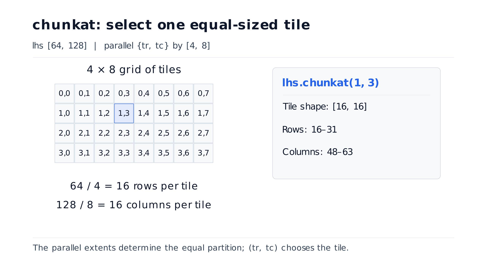
<div class="cap">图 4：对按 [4, 8] 网格划分的 [64, 128] 张量，chunkat(1, 3) 选中第 16–31 行、第 48–63 列。</div>
</div>

#### `subspan(...).at(...)`：指定分块形状与坐标

```co
lhs.subspan(64, 64).at(block_m, iv_k)
```

<div class="listing-cap">清单 102：subspan(...).at(...)：分块网格上显式指定分块范围</div>

表达式 `subspan` 显式给出分块尺寸，`.at(...)` 给出分块坐标。对于 `[16, 16]` 分块，坐标 `(2, 3)` 的元素起点是 `(32, 48)`。分块大小由算法固定选择，而不是从并行实例数推导时，适合使用这种形式。

与 `chunkat` 不同，这里先用 `subspan` 明确写出每块的形状，再用 `at` 给出分块网格中的坐标。坐标表示“第几块”，因此对应的元素偏移要乘以各维的分块大小。

#### `view(...).from(...)`：指定区域形状与元素偏移

```co
lhs.view(TILE_M, TILE_K).from(offset_m, offset_k)
```

<div class="listing-cap">清单 103：view(...).from(...)：显式分块范围与显式元素偏移</div>

形式 `view(...).from(...)` 为窗口给出显式形状和按元素计量的起点。从 `(37, 50)` 开始的 `[16, 16]` 窗口保留这个起点，不会将其取整到最近的分块边界。

起始位置以元素偏移给出，或访问区域不适合规则等分时，可以使用 `view(...).from(...)`。`view` 确定窗口大小，`from` 确定它从哪个元素开始；窗口位置因此不必落在分块网格的整数坐标上。

三种写法分别适用于：

- `chunkat(...)`：由有界索引确定等分方式和分块坐标。
- `subspan(...).at(...)`：显式给出分块形状与分块坐标。
- `view(...).from(...)`：显式给出区域形状与起始元素偏移。

#### 组合：`outer # inner`

```co
output.at(tr # i, tc # j)
```

<div class="listing-cap">清单 104：组合：outer # inner</div>

中缀 `#` 将外层分块坐标和块内坐标组合成原张量中的坐标。

对于外层分块索引 `tr` 和块内索引 `i`，`tr # i` 的值为 `tr * #i + i`。每块有 16 行时，第 2 块的块内第 5 行对应全局第 37 行。组合后的上界是两个上界的乘积。内层上界决定步幅，因此操作数顺序不能交换。

<div class="guide-figure">
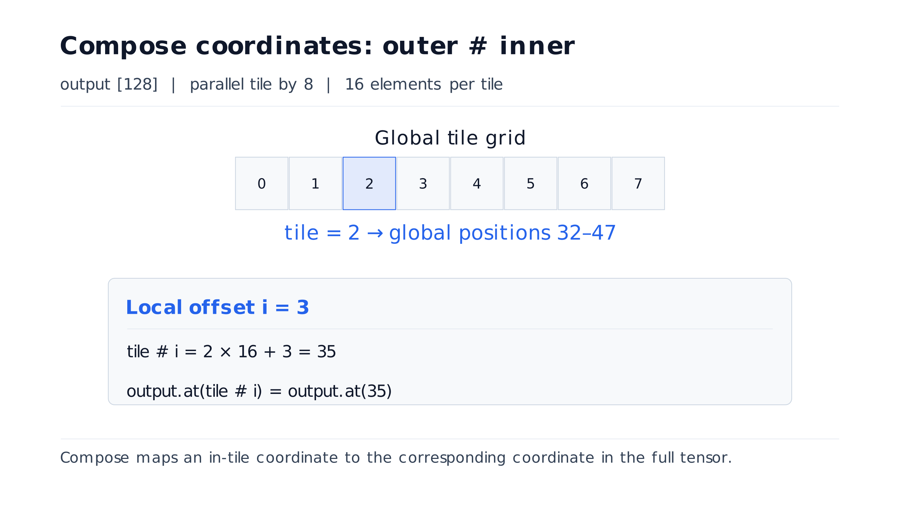
<div class="cap">图 5：每块含 16 个元素时，tile = 2 与块内偏移 i = 3 组合得到全局位置 2 × 16 + 3 = 35。</div>
</div>

#### 范围：`#name`

```co
foreach i in [128 / #tile]
```

<div class="listing-cap">清单 105：范围：#name</div>

前缀 `#tile` 返回 `tile` 的范围。声明为 `parallel tile by 8` 时，`#tile` 就是 `8`。

<div class="guide-figure">
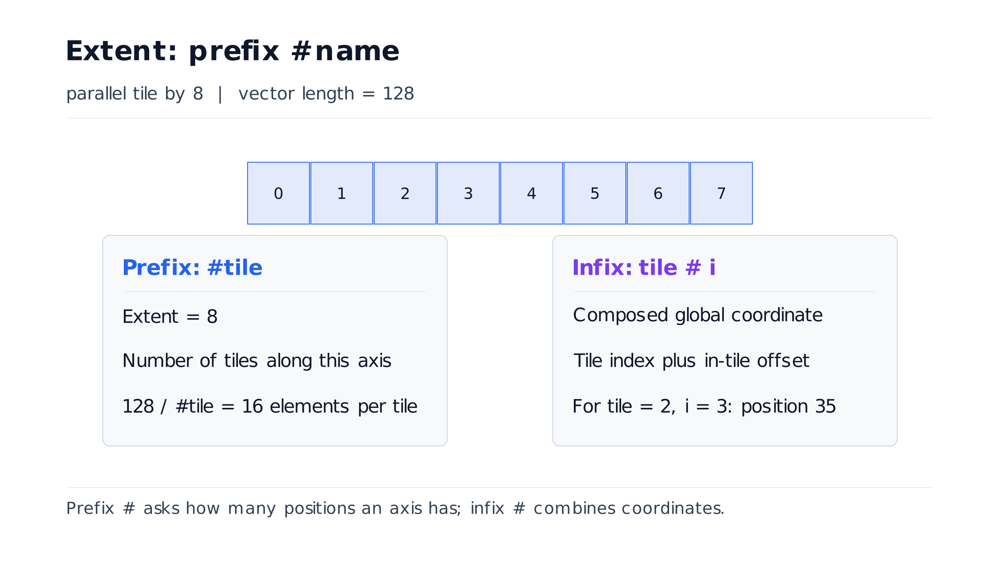
<div class="cap">图 6：前缀 #tile 返回轴的范围大小，此处为 8；中缀 tile # i 将分块坐标与块内偏移组合。</div>
</div>

#### 用有界索引选择分块

`chunkat` 表达式从已有带形状数据中选择视图。每个有界参数提供两项信息：上界决定分块数量，当前值选择其中一块。选择视图本身不搬运元素，实际搬运由外层 DMA 语句执行。

```co
global f32 [6, 10, 100] data;
parallel p by 6 {
  with index = {x, y} in [10, 10] {
    // for every data move, the stride into 'data' is
    //    stride = p*1000 + x * 100 + y * 10
    //
    // for each chunk, the dimensioned size for the movement is {1, 1, 10}
    f = dma.copy data.chunkat(p, index) => local;
  }
}
```

<div class="listing-cap">清单 106：有界整数元组／整数与 chunkat 运算</div>

本例输入形状为 `[6, 10, 100]`，索引范围把它划为 6 × 10 × 10 个分块。每块在最后一维包含 10 个连续元素，并由搬运语句送入局部存储。

在 DMA 语句中，`chunkat` 直接描述要搬运的分块，减少手工计算地址偏移的工作。

#### 上界运算

有界变量同时包含当前索引和范围。循环使用索引，分块与缓冲区声明则常常需要它的上界。

在有界变量前加 `#` 可以取出上界：

```co
with size in [32] {
  local u8 [#size, 16] a; // buffer shape: [32, 16]
  local u8 [size, 16] b; // error in shape: [0, 16]
}
```

<div class="listing-cap">清单 107：上界运算</div>

`#size` 给出范围 `[32, 16]`，可以用于声明缓冲区 `a`。`size` 本身是当前索引，不能在这里替代范围。

#### 用 `chunkat` 表达式对数据分块

搬运可以使用整个缓冲区，但分块算法通常只需要当前实例负责的区域。把 `chunkat` 放在源表达式中，就能直接描述这片区域：

```co
__co__ void foo(f32 [36] input) {
  parallel p by 6 : block {
    dma.copy input.chunkat(p) => shared;
  }
}
```

<div class="listing-cap">清单 108：用 chunkat 表达式对数据分块</div>

`.chunkat(...)` 根据有界索引选取当前分块，可以理解为先按范围分块，再按当前索引选取。

<div class="guide-figure">
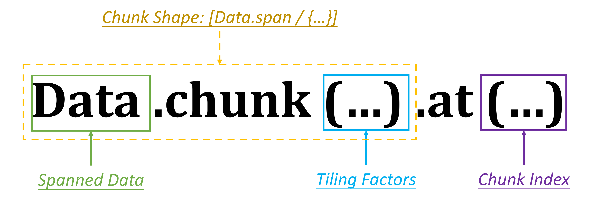
<div class="cap">图 7：chunkat 表达式各部分的语义</div>
</div>

`input.chunkat(p)` 对应 `input.chunk(#p).at(p)`，各部分的作用如下：

- `input`：要分块的数据。
- `#p`：分块因子。本例为 `6`，将输入分成 6 块。
- `.chunk(#p)`：确定每块形状，本例为 `[6]`。
- `.at(p)`：选择当前块。例如 `p == 1` 时选择元素 `[6, 12)`，`p == 5` 时选择 `[30, 36)`。

`chunkat` 把分块因子与分块索引放在同一表达式中，避免分别维护两组信息。

#### 使用多个有界变量

多个有界变量可以一起指定分块：

```co
__co__ void foo(f32 [36, 14, 8] input) {
  parallel p by 6 : block {
    with index in [7, 4] {
      foreach index {
        dma.copy input.chunkat(p, index) => shared;
      }
    }
  }
}
```

<div class="listing-cap">清单 109：使用多个有界变量</div>

本例将 `p` 与二维元组 `index` 组合起来。各维范围为 `6`、`7`、`4`，所以 `[36, 14, 8]` 的输入被划为 `[6, 2, 2]` 的小块。

外层 6 个并行实例各处理一个 `[6, 14, 8]` 区域，内部再迭代 7 × 4 次，每次把一个 `[6, 2, 2]` 分块搬入 `shared`。

同一组范围现在同时描述迭代空间与所选数据。划分改变时，编译器从这些范围推导新的分块尺寸。检查搬运时，可以先将输入形状除以上界，得到分块大小，再把分块坐标乘以相应尺寸，还原元素起点。

#### 分块选择小结

`chunkat` 用有界索引选取分块，既可用于 DMA 的源，也可用于目的区域。

3.6.1 节将分块、迭代与搬运组合成完整示例。

## 2.9 数据搬运：DMA 语句与期值(future) <a id="sec-2-9"></a>

选出分块后，程序常常需要把它送到计算所用的存储位置。DMA 语句描述这段数据从哪里来、到哪里去；期值让后续代码引用搬运结果。先看同步搬运怎样接上计算，再加入异步形式，明确数据何时可以使用。

#### DMA 语句族

分块搬运使用统一的基本形式：

```co
future = engine.operation.modifiers source => destination;
```

<div class="listing-cap">清单 110：DMA 的一般形式</div>

各部分含义如下：

| 组成部分 | 含义 |
| --- | --- |
| `future` | 可选的传输结果句柄。用 `future.data` 访问已搬运分块，用 `future.span` 查询其形状。 |
| `operation` | `copy`、`transp<...>` 或 `pad<...>`。 |
| `modifiers` | 可选标志，如 `.async`、`.zfill` 或 `.swiz<N>`。 |
| `source => destination` | 源区域与目的存储位置或区域。 |

最简单的拷贝示例如下：

```co
f = dma.copy input.chunkat(blk) => shared;
g = dma.transp<1, 0> matrix => local;
h = dma.pad<{2, 1}, {3, 2}, {0, 0}, 0> tile => shared;
```

<div class="listing-cap">清单 111：一个具体的拷贝</div>

沿着箭头阅读，`input` 是要搬运的区域，`shared` 指定目的存储，`f` 为传输结果命名。同步语句完成后，可以通过 `f.data` 访问目的数据；因此后续计算使用的是搬运后的缓冲区。

搬运对象是带形状的数据区域，可以一次描述整个分块的传输。`=>` 左侧写源区域，右侧写目的区域或存储位置；目的只写 `shared` 时，编译器根据源形状准备缓冲区，后续代码可以通过期值引用它。

#### 示例：先搬运分块，再计算加法

```co
__co__ s32 [64, 128] tiled_add_2d(s32 [64, 128] lhs, s32 [64, 128] rhs) {
  s32 [lhs.span] output;
  parallel {tr, tc} by [4, 8] : block {
    lhs_load = dma.copy lhs.chunkat(tr, tc) => shared;
    rhs_load = dma.copy rhs.chunkat(tr, tc) => shared;
    foreach {i, j} in lhs_load.span
      output.at(tr # i, tc # j) =
          lhs_load.data.at(i, j) + rhs_load.data.at(i, j);
  }
  return output;
}
```

<div class="listing-cap">清单 112：第一个示例：经由共享存储的分块加法</div>

下面仍计算逐元素加法，先把输入分块搬入共享存储：

- `chunkat(tr, tc)` 选择输入分块。
- `dma.copy ... => shared` 将分块搬入共享缓冲区。
- `tr # i` 与 `tc # j` 将块内坐标组合成输出坐标。

程序依次选择分块、搬入缓冲区，再对其中的元素计算。两个输入的同一分块分别由 `lhs_load` 和 `rhs_load` 引用；内部循环使用搬运后的形状遍历元素，最后把块内索引组合成原输出中的位置。

<div class="guide-figure">
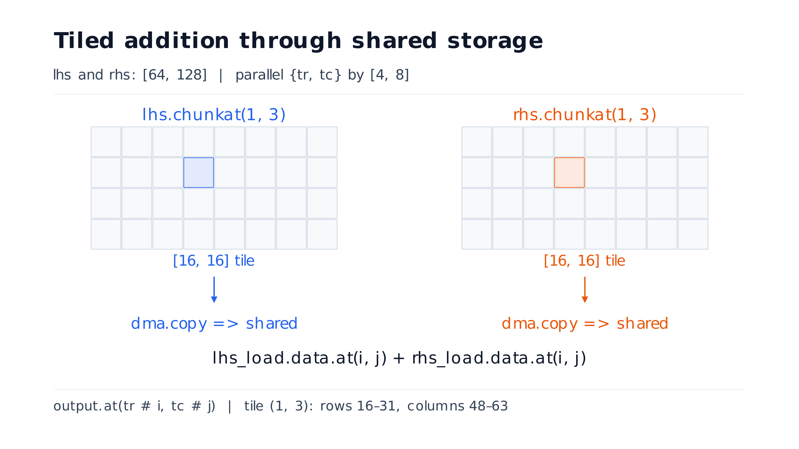
<div class="cap">图 8：输入形状为 [64, 128]，分块网格为 [4, 8]。分块 (1, 3) 先装入两个 [16, 16] 操作数，再逐元素相加。</div>
</div>

#### 期值、`.data` 与 `.span`

DMA 传输可以返回一个期值句柄：

```co
f = dma.copy input => shared;
```

<div class="listing-cap">清单 113：由一次拷贝得到的期值</div>

它提供两个成员：

- `f.data`：传输的目的缓冲区。
- `f.span`：目的缓冲区的形状。

使用方式如下：

```co
f = dma.copy input => shared;
foreach idx in [f.span]
  output.at(idx) = f.data.at(idx);
```

<div class="listing-cap">清单 114：读取 data 与 span</div>

即使拷贝是同步的，给结果命名也有用途：后续代码既能通过 `.data` 访问目的缓冲区，又能通过 `.span` 确定遍历范围。这样不必再单独维护一份缓冲区名称和形状。

<div class="guide-figure">
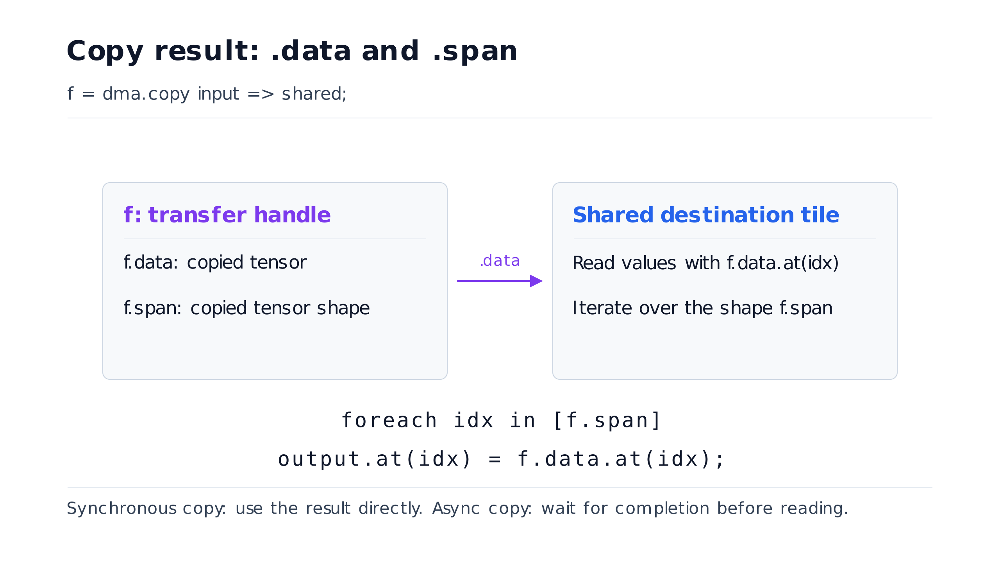
<div class="cap">图 9：复制结果通过 .data 提供目标张量，通过 .span 提供其形状；异步复制必须完成后才能读取。</div>
</div>

#### 同步拷贝与异步拷贝

不加 `.async` 时，拷贝完成后才执行后续语句：

```co
f = dma.copy input => shared;
dma.copy f.data => output;
```

<div class="listing-cap">清单 115：同步拷贝</div>

加上 `.async` 后，可以在传输期间继续执行其他工作：

```co
f = dma.copy.async input => shared;
wait f;
dma.copy f.data => output;
```

<div class="listing-cap">清单 116：异步拷贝</div>

异步拷贝使用相同的形式：

```co
f = dma.copy.async input => shared;
wait f;
dma.copy f.data => output;
```

<div class="listing-cap">清单 117：异步拷贝</div>

期值可以在异步搬运尚未结束时就标识目标缓冲区。能够引用 `f.data`，并不意味着元素已经就绪。应在首次读取这些元素的操作之前执行 `wait f`，并在搬运过程中保持源和目标有效。

`.async` 发起传输，`wait` 确认完成；两者共同确定数据何时可以使用。

把同一条拷贝改为异步后，发起传输与读取结果之间就出现了一个可以安排其他工作的区间。`wait f` 结束这个区间，确保传输完成；它应放在第一次使用 `f.data` 之前，而不是简单地放在函数末尾。

#### `dma.transp<...>`

```co
fa = dma.transp<1, 0, 2> a => local;
dma.copy fa.data => o;
```

<div class="listing-cap">清单 118：dma.transp<...></div>

`dma.transp` 在搬运时置换维度，目的缓冲区使用变换后的布局。它把维度变换与数据搬运写在同一条语句里；读取代码时，既要看源和目的，也要看尖括号中约定的维度顺序。

#### `dma.pad<...>`

```co
f = dma.pad<{2, 1}, {3, 2}, {0, 0}, V>.async input => shared;
wait f;
dma.copy f.data => output;
```

<div class="listing-cap">清单 119：dma.pad<...></div>

`dma.pad` 在搬运时填充目的区域。模板实参指定各维填充、内部间隔和填充值，适合需要显式边界值的情况。与普通拷贝相比，目的区域可能更大，后续计算应使用填充后得到的形状。

先确认普通拷贝的源与目的，再看操作名是否附加了变换。转置改变维度顺序，填充扩展目标区域；后续声明或计算需要使用变换后的形状，不能直接沿用原始输入的尺寸。

#### Tileflow 程序：编排数据搬运

下面把迭代、分块选择和 DMA 放在同一个 Tileflow 程序中，观察数据从输入到输出的过程。

完整代码如下：

```co
__co__ s32 [6, 17, 128] ele_add(s32 [6, 17, 128] lhs, s32 [6, 17, 128] rhs) {
  s32 [lhs.span] output; // Use same shape as lhs
  parallel p by 6 {
    with index in [17, 4] { // Tiling factors
      foreach index {
        lhs_load = dma.copy lhs.chunkat(p, index) => local;
        rhs_load = dma.copy rhs.chunkat(p, index) => local;
        local s32 [lhs_load.span] l1_out;
        // Call kernel with loaded data
        call kernel(lhs_load.data, rhs_load.data, l1_out, |lhs_load.span|);
        // Store result back to output
        dma.copy l1_out => output.chunkat(p, index);
      }
    }
  }
  return output;
}
```

<div class="listing-cap">清单 120：tileflow 程序</div>

`__co__` 函数接收形状为 `[6, 17, 128]` 的两个 `s32` 输入，并声明同形状的输出。

`parallel p by 6` 声明 6 个独立实例，每个实例处理输入的一个外层区域。

`with-in` 将 `index` 绑定到范围 `[17, 4]`。它是二维有界整数元组，供内部循环使用。

`foreach index` 对应下面的嵌套循环：

```text
for (int x = 0; x < 17; x++)  // assume 'x' represents the 1st element of 'index'
  for (int y = 0; y < 4; y++) { ... }  // and 'y' represents the 2nd element of 'index'
```

<div class="listing-cap">清单 121：等价的 C++ 循环</div>

循环中的 `dma.copy` 负责搬运当前分块：

- `lhs_load`：传输结果句柄，用于引用目的缓冲区。
- `dma.copy`：拷贝数据，`=>` 左边是源，右边是目的。
- `local`：让编译器分配线程私有的目的缓冲区。
- `lhs.chunkat(p, index)`：根据范围 `6`、`17`、`4` 选取 `[1, 1, 32]` 分块，具体位置由索引当前值决定。例如索引 `(1, 16, 2)` 选中对应的分块。

分块方式如下图所示。

<div class="guide-figure">
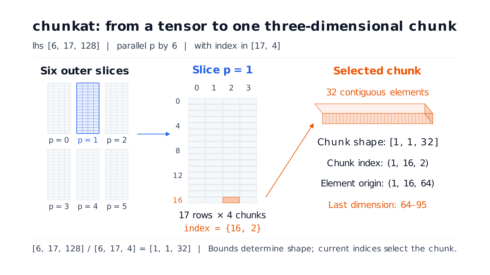
<div class="cap">图 10：形状 [6, 17, 128] 按范围 [6, 17, 4] 划分后，每块为 [1, 1, 32]。分块 (1, 16, 2) 从元素 (1, 16, 64) 开始。</div>
</div>

`lhs` 和 `rhs` 的对应分块分别搬入设备的 `local` 存储，供当前实例计算。

`local s32 [lhs_load.span] l1_out;` 声明同分块形状的输出缓冲区。`call kernel` 在其中完成计算，随后 DMA 将结果搬回主机侧输出区域。

每个实例迭代 17 × 4 次，每次处理一个 `[1, 1, 32]` 分块。全部实例完成后，函数把输出交给主机调用方。

DMA 语句同时描述要搬运的数据区域和传输结果，结果可以用期值命名。

异步 DMA 允许程序在传输期间继续执行后续代码；使用传输结果前，需要等待完成。

基本写法如下：

```co
future = dma-op src-expr => dst-expr;
```

<div class="listing-cap">清单 122：基本语法</div>

`=` 左边的期值命名传输结果。同步传输也可以命名，以便引用目的数据；不需要引用时可以省略。

`=` 右边依次写搬运操作、源表达式和目的表达式。`=>` 表示从源到目的的数据流向。

#### 同步与异步

异步复制是非阻塞的，搬运尚未完成时后续代码可以继续执行。同步复制则在语句执行结束前完成搬运。这些术语描述发起代码何时能够继续，并不表示可以安全读取未完成搬运的目标。

下面同时使用异步和同步拷贝：

```co
f0 = dma.copy.async data0 => shared; // non-blocking
f1 = dma.copy data1 => shared;       // blocking
...
wait f0;                             // synchronization
```

<div class="listing-cap">清单 123：同步与异步</div>

`f0` 的拷贝在后台进行，程序继续执行；`f1` 的拷贝是同步的，需要等它完成才能继续。等待 `f1` 时，`f0` 的传输可能仍在进行。

`wait f0;` 等待对应传输完成。应在读取结果之前完成等待，并安排好所有异步传输的使用顺序。

#### 数据表达式

数据表达式可以引用已有缓冲区。目的也可以直接写存储位置，由编译器分配相应缓冲区：

```co
global f32 [32, 16] input;
shared f32 [32, 16] output;
dma.copy input => output;  // Copy to a user-declared buffer
dma.copy input => shared;  // Same, but to a compiler-allocated buffer
```

<div class="listing-cap">清单 124：数据表达式</div>

第二条语句以 `shared` 为目的，编译器按源形状分配缓冲区，效果与第一条显式声明的写法相同。

源和目标位置也可以使用分块表达式。例如 `input.chunkat(p)` 将复制限制在 `p` 选中的区域，显式目标视图则限制写入位置。第 2.8 节说明这些视图怎样形成。

#### 期值与等待

期值命名传输结果。异步传输的期值还可以传给 `wait`，用来等待完成。

`wait` 可以同时等待多个异步期值；同步传输已经完成，不能再用其期值等待。

```co
f0 = dma.copy.async input0 => shared;
f1 = dma.copy.async input1 => shared;
f2 = dma.copy input2 => shared;
...
wait f0, f1;  // Multiple wait
wait f2;      // Error: cannot wait on a sync-dma
```

<div class="listing-cap">清单 125：同步与异步期值的等待</div>

同步传输返回期值，是为了让后续代码取得目的缓冲区。主要成员如下：

- `.span` 取出 DMA 目的缓冲区的 `mdspan`。
- `.data` 取出 DMA 目的缓冲区的引用（带形状数据）。

下面通过期值访问目的缓冲区：

```co
f0 = dma.copy.async input0 => shared;
f1 = dma.copy input2 => shared;
...
local f32 [f0.span] buffer;
call device_kernel(f1.data, |f1.span|);
```

<div class="listing-cap">清单 126：通过期值访问数据与形状</div>

`.span` 返回目的形状，`.data` 返回目的数据。示例中的元素计数运算还可以取得目的区域的总元素数。

#### 数据搬运小结

搬运操作确定传输方式，期值命名结果，`wait` 明确异步数据何时就绪。读代码时，可以沿着这三个环节追踪数据流。

需要回顾分块区域的选择方式时，可查阅 2.8 节。

## 2.10 协调：`inthreads`、事件与异步块 <a id="sec-2-10"></a>

当不同执行实例分别负责搬运和计算时，仅仅启动这些工作还不够：消费者要等数据就绪，生产者也要知道缓冲区何时可以复用。下面先用 `inthreads` 选择执行实例，再用事件把异步区域的执行顺序连接起来，最后扩展到多个缓冲槽。

#### 选择执行实例

`inthreads` 从当前并行作用域中选择执行实例。

下面只让索引不大于 2 的实例执行选定区域：

```co
__co__  void foo() {
  // sequential code
  // start of the SPMD code region
  parallel p by 6 {
    // some uniform code for all threads
    // ...
    inthreads (p <= 2) {
      // divergent code for thread 0, 1, 2 (thread-mask: 000111)
    }
    // threads are forced to be synchronized
    // some uniform code for all threads
    // ...
  }
  // end of the SPMD code region
  // sequential code
}
```

<div class="listing-cap">清单 127：tileflow 程序的并行视角</div>

可以把程序中的执行范围分成以下几类：

- 主机侧的顺序代码。
- `parallel-by` 内由多个实例执行的代码。
- 并行实例共同执行的代码。
- `inthreads` 中仅由选定实例执行的代码。

本例的 `p <= 2` 选择索引为 `0`、`1`、`2` 的实例；其余实例跳过该区域。普通 `inthreads` 用于按顺序执行的过滤区域，异步形式则使用 `.async`。

`inthreads` 从已有并行区域中选择实例，使用位置和条件需要满足以下约束：

- 只能放在 `parallel-by` 创建的并行作用域中。
- 条件需要与并行索引有关。

编译器会检查条件表达式及其所在的并行作用域。

假设外层已有六个实例，筛选条件 `p <= 2` 只保留 0、1、2 三个执行者。它改变的是这一段代码由谁执行，外层的六实例结构仍然存在；需要其他实例使用它们准备的数据时，再用同步构造连接两段工作。

#### 嵌套层次之间的执行范围

嵌套并行层次之间的语句，不一定由内层的所有实例重复执行：

```co
__co__  void foo() {
  parallel p by 6 {
    // implicit masking: 'inthreads (q == 0) { ... } '
    parallel q by 2 {
      // code here is for all threads
    }
    // implicit masking: 'inthreads (q == 0) { ... } '
  }
}
```

<div class="listing-cap">清单 128：隐式掩码</div>

本例中，位于外层 `parallel p by 6`、内层 `parallel q by 2` 之外的代码，每个外层实例只执行一份。可以理解为内层索引 `q == 0` 的实例执行它；进入内层块后，才由该层的全部实例执行。

异步区域可以独立推进，但对另一区域的依赖仍需显式表达。事件标记这项依赖：一个区域完成所需工作后触发事件，另一区域在使用结果前等待。事件传递就绪信息，数据仍保存在这些区域共用的缓冲区中。

#### 事件基础

事件用于协调异步代码区域的执行顺序。例如，一个区域准备数据，另一个区域要在准备完成后才能读取。生产者触发事件，消费者等待事件，就把这项先后关系直接写进了程序。

事件有 *SET*（已触发）和 *UNSET*（未触发）两种状态，声明时为 *UNSET*：

```co
shared event e;
```

<div class="listing-cap">清单 129：声明一个共享事件</div>

`shared` 事件在并行作用域中供协作实例使用。也可以声明 `global` 或 `local` 事件，具体可见范围与约束由目标平台决定。

事件也可以声明为数组：

```co
shared event e[4], e1;
```

<div class="listing-cap">清单 130：声明事件数组</div>

逗号分隔的声明可以同时定义数组 `e` 和单个事件 `e1`。

`trigger` 将事件置为 *SET*：

```co
shared event e[4], e1;
trigger e, e1;
```

<div class="listing-cap">清单 131：触发事件数组</div>

`trigger e, e1` 触发数组 `e` 的各个事件和单个事件 `e1`。

`wait` 等待事件触发。事件为 *UNSET* 时，当前实例阻塞；变为 *SET* 后，等待结束。

下面用事件让一个异步区域等待另一个区域：

```co
parallel p by 2 {
  shared event e;                          // init 'e' to 'UNSET'
  inthreads.async (p == 1) { wait e; }     // wait-thread
                                           // once unblocked, change 'e' to 'UNSET'
  inthreads.async (p == 0) { trigger e; }  // trigger-thread
                                           // convert 'e' to 'SET'
  sync.barrier : thread;                   // sync point
}
```

<div class="listing-cap">清单 132：等待事件</div>

索引 `1` 的区域先等待 `e`，索引 `0` 的区域触发它后，等待才能结束。两个区域随后到达 `sync.barrier` 同步点。事件明确了触发操作必须先于等待结束的顺序。

等待完成后，事件自动恢复为 *UNSET*，可以用于下一次触发与等待。

可以按一次交接来读：消费者先遇到 `wait e`，数据尚未就绪就停在这里；生产者准备完成后执行 `trigger e`，消费者才继续。等待完成会让事件恢复未触发状态，下一次交接需要再次触发。

#### 多级流水线的事件数组

设想生产者装入分块，消费者使用分块计算。读取槽位前，消费者需要知道数据已经就绪；覆盖槽位前，生产者需要知道上一次读取已经结束。将这两个信号命名为 `full` 和 `empty`。若流水线包含多个可复用槽位，每个槽位就各自配备一对事件：

```co
shared event full[STAGES], empty[STAGES];
```

<div class="listing-cap">清单 133：多级流水线的事件数组</div>

每个缓冲槽对应一组 `full` 和 `empty` 事件。`stage = iv_k % STAGES` 将循环索引映射到固定数量的槽位：生产者等待空槽，写完后触发 `full`；消费者等待数据就绪，读完后再触发 `empty`。这样，同一个缓冲区可以在后续迭代中复用。

#### 初始化空槽事件

循环开始前，需要先触发空槽对应的 `empty` 事件：

```co
foreach {s} in [STAGES] {
  trigger empty[s];
}
```

<div class="listing-cap">清单 134：引导协议</div>

事件初始为未触发状态。如果没有这一步，生产者第一次等待空槽时就无法继续。初始化表示这些槽位已经可以使用。

完整的双缓冲和多阶段流水线示例见 3.8.5 节。先理解事件的触发与等待关系，再阅读这些组合用法。

以两个槽位为例，迭代 0、1、2、3 依次使用槽位 0、1、0、1。复用槽位 0 之前，生产者先等待 `empty[0]`，确认上一次读取已完成；写入后触发 `full[0]`，把可读取的消息交给消费者。

#### 事件的配对与复用

使用事件时，应把每个 `wait` 与相应的 `trigger` 配对，并考虑等待完成后的自动复位。

每次等待都需要有可到达的触发操作；缓冲区循环复用时，还要安排好初始状态。

## 2.11 分支与提前返回 <a id="sec-2-11"></a>

并非每个并行实例都需要执行相同的后续工作。运行时条件可以决定是否进入分支，`yield` 则让当前实例提前结束。下面分别说明这两种写法；存在同步操作时，还需要考虑退出的实例是否承担了其他工作正在等待的责任。

#### 运行时条件：`if`

`if` 根据运行时条件决定是否执行代码。它适合检查当前索引或运行值，再决定是否处理这份工作；没有进入分支的实例会继续执行分支后的语句：

```co
if (tile_id < total_tiles) {
  // body executes only when the condition is true
}
```

<div class="listing-cap">清单 135：用 if 做谓词执行</div>

条件为真的实例执行分支，条件为假的实例跳过。在按线程组执行的平台上，组内条件不一致可能让不同路径依次执行，增加执行成本。

运行时边界检查、条件累加等判断使用 `if`，条件可以依赖当前分块坐标或输入值。若语句体含有需要协作组共同参与的操作，应让组内实例对条件作出一致判断。

条件尽量在同一执行组内保持一致。本例所面向的线程束包含 32 个线程。

一次条件判断只影响当前实例：条件为真就执行花括号中的代码，为假则跳到分支之后。阅读含多个分支的并行程序时，可以选定一个实例的索引，沿着它实际满足的条件追踪执行路径。

#### 从 `parallel` 提前返回

`yield` 让当前并行实例提前结束，生成对应的 `return;`。与跳过一个 `if` 分支不同，它会省去该实例的所有后续工作，适合已经完成任务或无需继续处理的实例：

```co
parallel p by BLK_CNT: block {
  parallel q by THR_CNT : thread {
    if (cond) yield;
    ...
  }
}
```

<div class="listing-cap">清单 136：从 parallel 提前返回</div>

> `yield` 不会自动检查提前退出是否影响同步。使用前应确认其他实例仍能完成相应的等待与同步操作。

检查提前退出时，要对照区域中尚未执行的同步操作。实例若在触发事件前离开，消费者可能一直等待；若跳过必须共同参与的操作，也可能阻塞其他实例。负责同一分块的实例做出一致的尾部判断时，最容易确认这些同步责任是否仍能完成。

## 2.12 四步 MMA 语法 <a id="sec-2-12"></a>

逐元素加法可以直接写算术表达式，矩阵乘法则通常围绕一个输出分块反复累加。MMA 语法把这个过程拆成四步：准备累加器、装入输入、执行乘加、写回结果。先掌握各步之间的数据关系，再到第 3 章阅读完整核函数。

矩阵乘法中，一个输出分块的结果通常来自多个 K 维切片。程序先准备累加器，再逐次装入对应的 A、B 分块，把每次乘加结果留在同一个累加器中，最后写回输出。MMA 把这个过程分为四步：初始化累加器、装入操作数、计算并累加、写回结果。

- `mma.fill 0.0`：初始化累加器。
- `mma.load`：装入当前分块的操作数。
- `mma.row.row mc, ma, mb`：执行 C += A × B，将结果累加到 `mc`。
- `mma.store mc, dst`：写回结果。

装入与计算步骤沿 K 维重复，每次把一个切片的结果累加到 `mc`；完成后再写回输出。底层的线程数据分配由编译器结合布局约定处理。

`row.row` 表示两个操作数采用行优先布局。其他组合包括 `row.col`、`col.row` 和 `col.col`。布局必须与输入数据一致，否则计算结果可能错误。

若 K 被分为两个切片，先初始化一次 `mc`，装入第一对操作数并累加，再装入第二对并累加到同一个 `mc`，最后才写回。装入句柄描述操作数片段，累加器则跨迭代保留部分结果，因此填充与写回应放在反复执行的装入和乘加过程之外。

## 2.13 C++ 嵌入、调用、宏与预处理器 <a id="sec-2-13"></a>

Croqtile 嵌入在 C++ 中，因此可以与现有代码和配置配合使用。需要复用设备函数时使用 `call`，需要原样保留一段 C++ 时使用 `__cpp__`；宏和条件编译则用于共享常量、选择代码路径。下面分别说明这些接口作用在哪个阶段，以及使用时要注意的边界。

#### `__cpp__`：原样注入 C++

`__cpp__` 将字符串作为 C++ 源码插入到它在 Croqtile 函数中的位置。某个简短目标操作需要放在特定并行或异步区域内时，可以使用这种形式。插入内容必须在该作用域中合法，引用的名字也必须对目标编译器可见。Croqtile 原样传递这些内容，不解析或改写字符串内部的代码。

- `__cpp__("...")`：适合简短代码。
- `__cpp__(R"(...)")`：原始字符串写法，适合包含引号或多行内容的代码。

预处理在 Croqtile 解析之前进行。普通 C++ 和 `__co__` 区域可以共用宏定义，便于统一维度与配置。

| 指令 | 作用 |
| --- | --- |
| `#define NAME value` | 对象式宏：文本替换 |
| `#if` / `#elif` / `#else` / `#endif` | 条件包含 |
| `#ifdef` / `#ifndef` | 判断宏是否已定义的简写 |
| `#error message` | 带消息强制编译时失败 |

预处理器不支持函数式宏。需要带参数的计算时，可以在普通 C++ 中使用辅助函数。

#### 集中定义分块参数

分块尺寸与阶段数可以集中定义为宏：

```co
#define MATMUL_WARP_M 64
#define MATMUL_WARP_N 128
#define MATMUL_TILE_K 64
#define MATMUL_WARP_K 16
#define MATMUL_STAGES 4
```

<div class="listing-cap">清单 137：用宏表示分块参数</div>

这些名字可以在 `parallel`、缓冲区声明、循环范围和主机侧检查中共同使用。

#### 用 `#error` 做编译时断言

```co
#if MATMUL_SWIZ != (2 * MATMUL_TILE_K)
#error "MATMUL_SWIZ must equal 2 * MATMUL_TILE_K for f16 kernel"
#endif
#if MATMUL_WARP_M != 64
#endif
```

<div class="listing-cap">清单 138：用 #error 做编译时断言</div>

预处理器在解析 Croqtile 函数前求值这一条件。配置常量不兼容时，构建便会停止并显示给定消息。这适合检查配置宏之间的关系；若属性取决于运行时输入数据，则应使用运行时断言。

#### 条件编译的代码路径

```co
#define PATH0
__co__ auto foo() {
  #ifdef PATH0
    // path 0 code
  #else
    // path 1 code
  #endif
}
```

<div class="listing-cap">清单 139：条件代码路径</div>

预处理器根据条件保留相应的代码分支。宏也可以从命令行定义，例如 `croq kernel.co -DMATMUL_TILE_K=128`。

#### 调用 C++ 辅助函数

Croqtile 函数不是设备函数：在另一个函数里调用它不会产生设备调用，编译器会警告找不到同名的设备函数；调用 C++ 辅助函数才是常规用法。

```co
void bar() {...}    // C++ kernel function
__co__ void foo() {
  parallel p by 6 {
    call bar();     // Call the C++ function
  }
}
```

<div class="listing-cap">清单 140：用 call 调用 C++ 辅助函数</div>

本例用 `call bar()` 调用 C++ 辅助函数 `bar`。设备调用的作用域和参数约束见本节后面的说明。

同一个配置常量经常同时用于主机分配和核函数声明。将它定义为对象式宏，可以让这些位置使用同一份配置。下面的例子说明，在 Croqtile 检查形状和类型之前，文本替换与条件编译怎样影响源码。

#### 对象式宏

参数化宏同样会展开，参数在形状求值前完成替换：

```co
#define M 256
#define N 32
#define K 64
__co__ auto matmul(f32 [M, K] lhs, f32 [N, K] rhs) { /*...*/ }
void foo() {
  croq::f32 a[M][K];
  croq::f32 b[N][K];
  // ...
  auto res = matmul(croq::make_spanview<2>(a, {M, K}),
                    croq::make_spanview<2>(b, {N, K}));
}
```

<div class="listing-cap">清单 141：对象式宏</div>

本例的 `M`、`N`、`K` 在解析前被替换为 `256`、`32`、`64`，因此对应的形状是静态确定的。主机代码也使用相同的宏值。

带参数的函数式宏不受支持：

```text
#define MAX(a, b) (((a) > (b)) ? (a) : (b))
```

<div class="listing-cap">清单 142：带参数的宏</div>

这个 `MAX` 定义不能按函数式宏使用。

例如先定义 `M` 为 256，后面声明中的 `[M, N]` 就会在解析前使用替换后的尺寸。主机侧准备输入时也使用同一个 M，可以让数据准备与核函数形状保持一致；修改常量后仍需检查其他维度关系。

#### 注释

注释可以使用 `/*...*/` 或 `//...`。

#### 条件编译

条件编译支持 `#if`、`#ifdef`、`#ifndef`、`#else` 和 `#endif` 等指令：

```co
#define PATH0
// some host code
__co__ auto foo() {
#ifdef PATH0
// some code related to PATH0
#else
// other code
#endif
}
// host control
#ifdef PATH0
// ...
#else
// ...
#endif
```

<div class="listing-cap">清单 143：条件编译</div>

同一个条件可以同时控制主机代码与 Croqtile 代码。

这里使用 Croqtile 预处理器支持的指令即可；其支持范围不等同于完整的 C 预处理器。

可以把条件编译看成先从多条候选源码路径中选出一条，再交给编译器解析。运行时 `if` 则是在程序执行时根据当前值选择路径；判断配置常量和判断实际数据时，应分别使用对应的构造。

设备辅助函数用于完成具体计算，Tileflow 程序负责在合适的执行位置调用它。

#### 调用设备函数

设备函数使用 `call` 调用。调用需要放在可以执行设备代码的并行区域中：Tileflow 程序先准备数据并选择执行位置，再把相应参数交给设备函数。它主要用于按需复用已有硬件函数；硬件支持完善时，通常直接使用 Croqtile 提供的能力。

#### 调用语句的基本语法

`call` 的基本形式如下：

```co
call func-name <optional-template-args> (arguments);
```

<div class="listing-cap">清单 144：调用语句的一般语法</div>

函数名后可以附带尖括号中的模板实参，普通参数写在圆括号中，并用逗号分隔。

先对照设备函数的声明确认参数顺序，再看调用位于哪个并行区域。带形状数据作为元素指针传入后，设备函数无法仅从指针恢复各维大小，因此需要的尺寸应通过整数参数一并传递。

目标编译器检查被调函数是否存在，以及其签名是否接受生成的实参。Croqtile 不在转译时执行这些 C++ 检查。因此，调用错误可能指向生成源码，需要对照辅助函数声明与原始调用位置查看。

`foo` 中的调用位于并行区域内；`mou` 中的调用处于主机执行区域，不能直接调用设备函数。

```co
__co__ void foo() {
  parallel p by 1 {
    call bar();  // ok
  }
}
__co__ void mou() {
  call bar();  // error: not able to call device function from host
}
```

<div class="listing-cap">清单 145：非法的调用点</div>

#### 设备调用的参数类型

设备调用可传递以下参数：

- 带形状数据。
- 标量整数。
- 目标平台支持的标量浮点值。

控制整数可以使用 `int`、`s32` 或 `u32`。可传递的浮点类型取决于目标平台，例如 `float`、`double`、`half`、`bfp16` 或 `half8`。

Tileflow 侧不进行这些浮点值的算术运算，而是把它们传给设备函数用于计算。

下面将几类参数传给设备辅助函数：

```co
__device__ void bar(float *p, int m, int n) {}
__device__ void foo(float *, int, unsigned, double, float) {}
__co__ void foobar(f32 [M, 24] input, int N, float padding) {
  parallel p by 1 {
    shared f32 [14, 7] buffer;
    call bar(input, input.span(0), buffer.span(0));
    call foo(buffer, N, 3, 3.14, padding);
  }
}
```

<div class="listing-cap">清单 146：向设备函数传递参数</div>

带形状数据传到设备函数时，参数是指向元素的指针，不再携带完整形状。例如 `bar` 的 `float *p` 对应 `input.data`；需要的维度另以整数参数传递。设备函数的声明应与这些参数类型匹配。

目标平台没有对应的原生类型时，可以使用 `croq::f16`、`croq::bf16` 等类型。

#### 设备调用的检查阶段

设备调用的接口由后续目标编译阶段检查。出现参数或类型错误时，需要结合生成的调用和设备函数声明定位问题。

## 2.14 打印、断言与编译时检视 <a id="sec-2-14"></a>

读懂语法后，还需要确认形状推导和运行结果符合预期。编译时打印适合观察形状、范围与类型；运行时打印和断言则帮助检查实际执行。先根据要观察的信息选择时机，再限制输出范围，便于定位问题。

#### `print!` 与 `println!`：编译时检视

`print!` 和 `println!` 在编译时输出信息，可用于查看形状、范围和类型。例如，修改分块因子后，可以先打印推导出的形状，确认尺寸关系成立，再运行程序检查数值结果：

```co
__co__ void check_shapes(f32 [3, 2] b) {
  print!("shape of b: ");
  println!("b.span = ", b.span);
}
```

<div class="listing-cap">清单 147：编译时打印形状</div>

编译时得到如下输出：

```co
shape of b: b.span = [3, 2]
```

<div class="listing-cap">清单 148：打印出的形状</div>

相邻字符串字面量会拼接，例如 `"wor" "ld!"` 等价于 `"world!"`。

修改分块尺寸后，可以先查看 `input.span` 或分块的 `.span`，确认编译器推导出的区域大小。这个检查回答的是“程序理解了怎样的形状”，实际元素是否算对，还要在运行时验证。

#### `print` 与 `println`：运行时设备输出

```co
__co__ void inspect(s32 [4, 8] data) {
  foreach i in [data.span] {
    println("element ", i, " = ", data.at(i));
  }
}
```

<div class="listing-cap">清单 149：一个运行时检视核函数</div>

运行时打印接受字符串和表达式，参数用逗号分隔。它适合观察实际执行中的索引或数据，与编译时检视互相补充。多个并行实例的输出顺序不固定，因此读取日志时需要结合实例索引辨认来源。

若只需检查一条执行路径，可以用索引条件限制打印：

```co
parallel {px, py} by [8, 16] : block
  parallel {qx, qy} by [16, 16] : thread {
    // ... compute ...
    if (px == 0 && py == 0 && qx == 3 && qy == 5) {
      println("partial sum = ", accum);
    }
  }
```

<div class="listing-cap">清单 150：并行块内的打印</div>

调试时可以用条件限制打印的实例，避免大量重复输出。

#### `assert`：运行时不变式检查

`assert` 在运行时检查条件，不满足时输出消息并中止。适合把程序必须满足的假设写在使用位置附近，让失败信息直接指向相应索引、数据或执行阶段：

```co
assert(stage < MATMUL_STAGES, "stage index out of bounds");
```

<div class="listing-cap">清单 151：assert：运行时不变式检查</div>

可以用断言检查索引范围、指针有效性或其他必须成立的条件，以便尽早发现错误。

调试时先选一个实例输出索引和值，再在可疑操作附近写断言，检查当前数据是否满足预期。将输出限制到少量实例，可以把一次执行中的具体位置与源码对应起来，避免从大量并行日志中猜测来源。

## 2.15 语法速查 <a id="sec-2-15"></a>

下面把本章的常用写法集中列出，便于在编写程序时快速回看。表格中的构造已经在前面的示例中出现；如果记得作用但忘了写法，可以从这里查起，需要理解使用条件时再回到对应小节。

#### 数据搬运与分块选择

下面汇总数据搬运和分块选择的常用写法。

| 语法 | 含义 |
| --- | --- |
| `dma.copy.async ...` | 启动非阻塞 DMA 传输。 |
| `wait f` | 等待 `f` 对应的传输完成。 |
| `future.data` | 访问已搬运分块。 |
| `future.span` | 访问已搬运分块的形状。 |
| `dma.transp<...>` | 搬运过程中置换维度。 |
| `dma.pad<...>` | 搬运过程中填充，并显式给出填充值。 |
| `.zfill` | 把不完整分块中的越界位置补零。 |
| `.swiz<N>` | 选择共享内存重排布局。 |
| `chunkat(...)` | 从规则分块中选出一个等分块。 |
| `subspan(...).at(...)` | 按显式分块范围与分块坐标选取分块。 |
| `view(...).from(...)` | 按显式范围与显式元素偏移选取分块。 |
| `tile # i` | 把分块坐标与块内坐标合成为全局坐标。 |
| `#tile` | 求 `tile` 轴的范围。 |

阅读搬运语句时，先确定所选区域和目标位置，再检查目标何时就绪。流水线中仍需回答这两个问题；额外缓冲区只是让不同分块能够同时处在这个过程的不同阶段。

#### 并行与迭代

| **语法** | **含义** |
| --- | --- |
| `parallel p by N` | N 个独立实例，索引为 0 至 N-1 |
| `parallel px, py by [M, N]` | 同一并行层次中的两个坐标轴 |
| `parallel p by A, q by B` | 逗号分隔的多个并行层次 <br>（`p` 与 `q` 对应不同并行层次） |
| `parallel q by N : thread` | 映射到线程块内的线程 |
| `foreach index = m, n, k in [a, b, c]` | 在 `foreach` 中对具名元组解构 |
| `lhs.span(0)` | 取出张量形状的一个维度 |
| `p # m` | 把外部分块索引 `p` 与内部偏移 `m` 合成为全局坐标 |

2.12 节概述 MMA 的计算步骤，3.7 节给出完整示例。

#### 分支与协调

| **语法** | **含义** |
| --- | --- |
| `if (expr) ...` | 按运行时条件选择执行 |
| `inthreads.async (condition)` | 结构化并发区域：编译时划分线程 |
| `shared event name[N]` | 声明 N 个同步令牌 |
| `trigger name` | 发出条件已满足的信号 |
| `wait name` | 阻塞直到相应的 `trigger` 触发 |
| `tile_id = tile_iter # block_id` | 组合分块索引 |
| `int total_tiles = expr` | 初始化一个控制整数 |
| `yield` | 从 `parallel` 块提前返回 |

#### 期值与循环简写

| **语法** | **含义** |
| --- | --- |
| `dma.copy.async src => dst` | 非阻塞拷贝，立即返回 |
| `dma.any` | 占位期值，尚无传输在途 |
| `swap(f0, f1)` | 交换两个期值句柄，不拷贝数据 |
| `rotate(f0, f1, f2)` | 轮转三个期值句柄 |
| `with tile_k in N ...` | 绑定到范围为 N 的分块轴，作用域受限 |
| `foreach tile_k(1:)` | 从索引 1 开始迭代 |
| `__co__ auto fn(...)` | 由 `return` 语句推导返回类型 |

读完本章，你已了解 Croqtile 程序的基本结构，以及形状、迭代、分块、搬运和协调的常用写法。第 3 章进一步解释这些构造的语义、约束与设计理由；附录 A 可用于快速查阅语法。

# 第 3 章 编程指南 <a id="ch3"></a>

本章按功能重新组织同一门语言，说明 Croqtile 程序的结构、类型系统、符号形状、并行性、分块选择、数据搬运、收缩与协调，以及背后的设计依据。完整核函数就放在它所演示的特性旁边，因此每一节也可独立阅读。

## 3.1 程序结构与编译模型 <a id="sec-3-1"></a>

一个 `.co` 文件将应用程序与其中的并行工作放在同一份源码中。普通主机 C++ 准备输入并调用 `__co__` 函数；后者描述并行工作，也可以调用设备辅助函数完成专门计算。理解每部分由哪个编译器处理，有助于代码集成和错误定位。

#### 构造一个 Croqtile 程序

一个典型的 *Croqtile* 程序由几部分组成，具体取决于目标平台。

- 设备程序
- 主机程序
- tileflow 程序

#### 转译与编译

Croqtile 的编译过程通常包含三个主要步骤：**预处理**、**转译**和**目标编译**。

<div class="guide-figure">
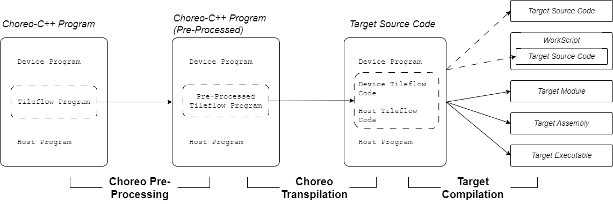
<div class="cap">图 11：Croqtile 的完整编译流程</div>
</div>

如图所示，*预处理*之后，Croqtile 立刻把 *tileflow 程序* *转译*（也就是*源到源*编译）为目标代码，而用户提供的*主机程序*和*设备程序*保留原样。*tileflow 程序*被*转译*成主机源代码和设备源代码，这些统称 *Croqtile 生成代码*。随后，编译器把用户代码和 *Croqtile 生成*代码合并，执行*目标编译*。这个过程可以产出多种结果，比如转译后的源代码、工作流脚本、目标模块、目标汇编和可执行文件。

Croqtile 驱动完整的构建过程，其中的关键步骤是把 *tileflow 程序*转译成 *Croqtile 生成代码*。

Croqtile 编译有一个显著特点：同时支持两种模型：

- **单源编译模型**：目标编译器允许在同一源文件中编译设备程序和主机程序。
- **分离源编译模型**：主机代码和设备代码需要分别编译。

上面的代码天然支持*单源编译模型*。但要支持*分离源编译模型*，Croqtile 要求用 `__cok__` 块把设备程序包起来，如下所示：

```co
__cok__ {
  void device_function(...) { ... }
} // end of __cok__
__co__ void croqtile_function(...) { ... }
void foo() { ... }
```

<div class="listing-cap">清单 152：转译与编译</div>

`__cok__` 标记需要在调用目标编译器前从主机代码中分离的设备代码。当目标平台分别编译主机与设备代码时，需要使用这一包装。源码仍可维护在一个 `.co` 文件中，由包装告诉构建过程在哪里拆分。

#### 设备程序：并行计算

设备辅助函数接收调用方选取并暂存的数据，用目标语言完成计算。下面的加法辅助函数展示这条边界：Croqtile 安排分块与搬运，辅助函数则使用传入的指针和元素数量。

下面再次列出前面的设备辅助函数：

```co
__device__ void kernel(int * a, int * b, int * c, int n) {
  for (int i = 0; i < n; ++i) c[i] = a[i] + b[i];
}
```

<div class="listing-cap">清单 153：从 tileflow 调用的设备辅助函数</div>

对于只支持*分离源编程模型*的目标平台，代码可能需要包在 `__cok__` 块里。等价的写法如下：

```co
__cok__ {
  extern "C" void kernel(int * a, int * b, int * c, int n) {
    for (int i = 0; i < n; ++i) c[i] = a[i] + b[i];
  }
} // end of __cok__
```

<div class="listing-cap">清单 154：分离源所需的 cok 包装</div>

这里 `extern "C"` 标注取代了目标平台使用的 `__device__` 关键字，因为设备函数要求 C 链接。

设备程序遵循单程序多数据范式。主机与设备之间、以及设备内部各存储层次之间的数据搬运，由 Tileflow 程序统一编排；设备函数则负责具体计算。

#### 异构性：从转译到程序启动

在某些目标平台上，`parallel-by` 块不仅指定并行线程的数量，还划出了主机代码与设备代码的边界，这正是 Croqtile 管理异构性的方式。具体来说：

- `parallel-by` 块**之外**的代码被转译为**主机代码**。
- 块**之内**的代码被转译为**设备代码**，如下图所示：

```co
__co__ void foo(...) {
  // Generate host code
  // ...
  parallel p by 6 {
    // Generate device code
    // ...
  }
  // Generate host code
  // ...
}
```

<div class="listing-cap">清单 155：异构性：从转译到程序启动</div>

熟悉相关目标平台的读者会看出，这里正对应着 `parallel-by` 语句处发生的程序启动。Croqtile 用统一的单程序多数据并行模型把这些细节抽象掉，让开发者专心写算法，不必操心底层异构性。

这份参考覆盖 Croqtile 编程的方方面面：

- **程序结构**：Croqtile 程序如何组织——`__co__` 函数、主机侧 API 与 C++ 互操作。
- **带形状数据**：Croqtile 面向多维张量的类型系统——形状、`MDSpan`、`spanned data`、符号维度与动态形状。
- **循环与并行性**：单程序多数据并行、循环控制、分块与迭代构造。
- **数据搬运**：DMA 语句、用 `chunkat` 分块、重排与高级数据搬运模式。
- **C++ 嵌入**：输入／输出约定、`__cpp__` 内联块、宏与预处理器集成。
- **优化模式**：tileflow 优化、异步 DMA 模式、多缓冲与性能调优技术。

#### 小结

到这里可以看清：Croqtile 程序由三部分组成，其中 *tileflow 程序*是核心，它在编译时被转译成目标源代码。调用链通常从主机到 tileflow 程序，再从 tileflow 程序到设备代码。

Croqtile 不仅把 DMA 操作抽象成更高层的语义，还把迭代和分块结合起来，因此代码既简洁又有表现力。

## 3.2 语法设计与类型系统 <a id="sec-3-2"></a>

#### 类型系统补记：`mdspan` 与 `ituple`

选择一个分块需要知道张量形状、各轴划分为多少块，以及当前块的坐标。Croqtile 用形状、元组和有界索引显式表示这些信息，让分块表达式保留原本分散在偏移计算中的关系。

带形状声明 `s32 [128, 256] lhs` 同时确定元素类型和秩。这里的尺寸是常量，编译器能在执行前求值，拒绝用三个坐标访问二维张量，并检查分块形状的兼容性。声明使用符号维度时，即使部分尺寸来自调用方，秩信息仍然保留。

`span(i)` 语法取出一个维度：`lhs.span(0)` 是 128，`rhs.span(1)` 是 256。简写 `lhs.span` 则复制整个形状。

`ituple` 将整数值组成元组。在 `parallel {px, py} by [8, 16]` 中，坐标还带有范围：当前值标识某个实例，上界描述整个网格。编译器可以化简上界及派生表达式，但并不是给所有实例确定同一个当前索引。依赖实际执行的索引计算仍在运行时进行。

第 2.4 和 2.5 节介绍具体声明。这里需要区分程序本身已知的信息与某次调用提供的信息。编译时检查使用前者，入口检查和运行时断言则处理依赖后者的约束。

它的目标是给日常编写高性能核函数的工程师减负。借助 Croqtile，编程过程更容易上手，工程师也能更轻松、更高效地优化这些关键环节。

#### 把 Croqtile 嵌入 C++

Croqtile 是嵌入在 C++ 里的领域专用语言代码。Croqtile 编译器对 Croqtile 函数做源到源翻译，生成 C++ 代码，并隐式包含 `choreo.h`，让翻译后的代码能与其他 C++ 代码正常协作。下面的代码片段是一个例子。

```co
// some C++ code
__co__ void croqtile_function() {
  // croqtile code
}
// another C++ code
void foo() {
  croqtile_function();
}
```

<div class="listing-cap">清单 156：在 C++ 中嵌入 Croqtile</div>

`__co__` 前缀标识需要由 Croqtile 翻译的函数体。普通 C++ 通过声明的函数名调用它。面向主机的接口使用带形状的缓冲区包装对象，使调用同时携带尺寸和地址。

此外，Croqtile 引入了一些专用类型，用来保证 Croqtile 函数的实参与调用方之间的一致性。相关细节将在数据类型的讨论中说明。

#### 变量与类型

Croqtile 引入四类基础类型：标量类型、带形状类型、整数元组类型（`ituple` 类型）和有界类型。它们分别服务于不同的用途。

- **标量类型**：为满足程序控制的需要而设计，由*整数类型*和*布尔类型*组成。
- **带形状类型**：表示参与计算的数据类型（通常是张量）。除了引用原始数据，*带形状类型*还把数据与一个用多维范围表示的形状关联起来，这种「多维范围」就叫 `mdspan`。它对分块等操作很有用。
- **整数元组类型**：表示一组整数值，常见用法是给出多维数据的界。
- **有界（整数／ITuple）类型**：这是一类特殊类型，用于简化对数据子区域的引用，并与循环构造配合，迭代地处理数据。

四类之中，*标量*和 *ituple* 比较容易理解，因为它们对应现有通用编程语言里就有的要素；*带形状类型*和*有界类型*则是这个领域特有的。

#### 带形状类型

带形状类型是一种**复合类型**，由**基础类型**和**多维跨度（`mdspan`）类型**组成。*基础类型*和 *mdspan* 都不是*完整类型*，也就是说，任一部分都不能单独声明带存储的数据。在 Croqtile 中，称它们为*部分类型*。

将类型分为两部分，是为了能单独操作 *mdspan*。机器学习数据通常按多维方式组织，程序员经常要把它切成更小的分块，让分块跨存储层次移动。因此，形状计算可以独立于元素类型进行。

部分类型必须组合成完整类型，才能声明带存储的多维数据。

#### 部分类型：**mdspan**

与多数类型系统不同，*mdspan* 作为一种类型手段并不完整。称它为*部分*，是因为 Croqtile 程序不能把数据定义成 *mdspan* 类型，但 *mdspan* 本身可以单独定义。这样设计基于一个观察：循环分块只关心多维数据的形状。因此，Croqtile 允许程序员独立于基础类型操作 *mdspan*，从而简化形状计算。

与此同时，Croqtile 编译器可以对 *mdspan* 做类型检查，尽可能早地（在适用时早于执行）暴露代码错误。

在 Croqtile 中，mdspan 用 `[` 和 `]` 括起来，其中的维度上界用 `,` 分隔：

```co
mdspan sp : [7, 8];           // defined a mdspan of 2-dimensions
mdspan<4> mds : [a, 3, 4, 1]; // 'a' is an existing integer
d : [c, 4, 28];               // 'd' is not explicit annotated. Type is deduced.
```

<div class="listing-cap">清单 157：一个 mdspan 声明</div>

如上例所示，可以用 *mdspan* 部分类型关键字显式定义 mdspan，也可以选用 `<` `>` 括起的秩。还可以不加类型标注定义 mdspan，比如上面 `d` 的定义。（注意：`mds` 和 `d` 属于**依赖类型**，因为它们的类型取决于 `a` 和 `b` 的求值。程序员可以给 `a`、`b` 提供运行时值，但这样一来就要付出一些运行时检查的代价。）

对 C++ 程序员来说，可以把 mdspan 看成多维数组的特征描述，它描述的是多层范围。例如上例中的 `sp` 定义了两层范围，分别是 0 到 6 和 0 到 7。

定义好 mdspan 之后，可以用 `()` 运算符取出整数维度值。

```co
sp : [7, 8];
int b = sp(0) + sp(1);   // 'b' equals to 15 (7 + 8)
```

<div class="listing-cap">清单 158：一个形状字面量</div>

上例中，表达式 `sp(0)` 求出 mdspan `sp` 第一维的取值。维度值本质上是整数，可以直接参与整数算术。

于是就可以像下面这样，从已有的 mdspan 派生出新的 mdspan：

```co
sp : [6, 8];
spn : [1, sp(0)/2, sp(1)/4]; // define a new mdspan from the existing one.
```

<div class="listing-cap">清单 159：改变一个维度后的形状</div>

有了这个机制，在 Croqtile 代码里对多维跨度做分块更加方便。分块是高性能核函数中的常见操作，因此 Croqtile 提供了相应的语法糖：

```co
sp : [6, 8];
spn : sp [1, (0)/2, (1)/4];  // spn is defined as [1, 3, 2]
```

<div class="listing-cap">清单 160：同样的形状，另一种写法</div>

这段代码和前面那段作用相同，但语法更简洁。这体现了 Croqtile 的一条设计理念：用简洁的代码表达常见操作。

命名 `mdspan` 必须在声明时初始化，之后不能修改。需要另一种形状时，应从已有形状派生新名字，使编译器能够保留并分析形状表达式之间的关系。

除了这种*逐维度*定义 mdspan 的方式，Croqtile 还支持其他定义方法；这些方法在 *i-tuple* 的讨论中介绍。

#### 有界类型

有界整数同时携带当前值和排他上界。在 `parallel p by 6` 中，可能的取值是 0 到 5，上界为 6。因此，分块选择既能确定 `p` 标识哪一块，也能确定总共有多少块。`parallel-by` 和 `with-in` 建立这种关联。

有界元组将同样的做法扩展到多个维度。每个分量有自己的上界，整个范围由 `mdspan` 描述。例如，范围为 `[4, 8]` 的元组能标识 32 个位置之一。第 2.7 节说明如何声明和遍历这些索引。

#### 小结

Croqtile 以嵌入 C++ 的领域专用语言表达单程序多数据程序，保留 C++ 风格的写法。它主要简化通过 DMA 跨存储层次搬运数据的底层细节，因此也被称为数据流编程语言。其目标是支持日常核函数开发，让开发者更专注于计算组织，减少重复的实现工作。

实际使用中的反馈，也有助于进一步改进这些构造。

#### 范围的组与整数的组

在 Croqtile 中，*mdspan* 可以表示各维度的形状。*mdspan* 就是**多维跨度**，其中的元素是*维度跨度*，隐含着一个取值范围。

例如，*mdspan* `[7, 14]` 表示两个范围组成的一组：`[0, 7)` 和 `[0, 14)`。所以 *mdspan* 并不表示一组整数值。不过在某些场景里，把整数值组成一组确实有用：

- 计算两个 mdspan 之差时需要多个整数；在高层的语义上，这个差可能反映调整形状维度时的填充差异。
- 对形状做分块时，各个分块因子是整数，而不是范围。

这些情形促使 Croqtile 提供一种把整数值组成一组的类型。

#### 前瞻：有界 I-Tuple

有界元组为普通整数元组附加范围。例如，位置 `{1, 2}` 与范围 `[4, 8]` 结合后，既标识当前位置，也描述容纳它的空间。循环用范围确定迭代，`chunkat` 用范围推导划分。

#### *Spanned*：数据与缓冲区

tileflow 程序的主要任务，就是搬动大规模数据集来处理它们。在某些术语体系里，Croqtile 函数的输入和输出分别称为「输入数据」和「输出数据」，其余存储则称为「缓冲区」。从函数的视角看，这就在概念上分出了「外部」内存和「内部」内存。不过「数据」和「缓冲区」指的都是存储位置；在 Croqtile 中，两者都定型为**带形状类型**，表明它们是与形状关联的数据或缓冲区。

这两种情况都称为带形状数据。`mdspan` 描述形状，带形状对象则将形状、元素类型和存储访问组合起来。单独命名或推导一个形状，并不会复制数据。

#### 缓冲区生存期管理

在 *Croqtile 函数*内部分配的存储，生存期由 Croqtile 编译器管理，以便高效利用：只要生存期不重叠，编译器就尽量复用缓冲区。因此，开发者不必自行管理这些缓冲区。

自动分配不能替代同步。若异步搬运或计算仍在使用缓冲区，必须等它结束后才能覆盖或释放存储。流水线中的等待和完成操作明确了这些使用时段，使程序能够安全复用同一组槽位。

#### 有界变量

在 `parallel-by` 块中，紧跟 `parallel` 关键字定义的变量称为**有界变量**。具体来说：

- 若变量是*整数*，称为**有界整数**。
- 若变量是 *ituple*，称为**有界 ituple**。

这个术语表明，变量不只有值，还有确定的界。例如在语句 `parallel p by 6` 中，`p` 是*有界整数*，界为 `[0, 6)`，其中 `6` 是不含在内的上界。

并行索引的当前值标识执行实例，循环索引的当前值随 `foreach` 迭代变化。两者的上界分别来自 `parallel-by` 和 `with-in` 声明。

#### 有界变量的取值

有界变量同时携带范围和当前值。对于 `with-in` 声明的索引，`foreach` 按以下规则提供当前值：

- **当前值**：在 `foreach` 语句中，有界变量充当迭代变量，当前值由循环迭代决定；在 `foreach` 语句之外，其当前值恒为零。

- **上界值**：由 `with-in` 或 `parallel-by` 语句指定。

`foreach` 结束后，`with-in` 索引恢复为循环外的值，不会像 C++ 循环变量那样保留终止值。并行索引遵循另一条规则，其值标识当前并行实例。下面的例子讨论顺序执行的 `with-in` 情形。

```co
with x in 6 {
  // x's current value is 0
  foreach x {
    // x's current value is either 0, 1, 2, ..., 5
  }
  // x's current value is 0, NOT 6
}
```

<div class="listing-cap">清单 161：有界变量的取值</div>

#### Croqtile 中的内存

当不同并行实例需要以不同方式使用分块时，存储安排便成为算法的一部分。同一个 `[M, N]` 形状可能用于全局输入、共享暂存分块或私有工作缓冲区。形状控制索引，存储说明符确定缓冲区所在的位置。

#### Croqtile 中的带形状类型

**带形状类型**是一种复合类型，同时包含基本数据类型（如 `f32`、`s32`、`f16`）和描述数据形状与组织的**多维跨度（`mdspan`）**。有了它，Croqtile 能用高效的布局定义大型数组或矩阵，程序员也可以抛开数据类型单独操作形状（也就是各个维度）。并行计算和机器学习负载里常见的多维数据集，正需要这种灵活性。

带形状类型本身并不为数据分配存储。它描述数据在内存中如何组织，从而为运行时留出灵活性与优化空间。

#### Croqtile 中的存储说明符

在这里使用的目标平台上，`global`、`shared` 和 `local` 分别表示设备全局存储、块内共享存储和线程私有存储。第 2.6 节给出声明示例。先根据哪些实例需要读写缓冲区选择位置，再按需安排不同位置之间的搬运。

## 3.3 符号形状、形状求值与值编号(value numbering) <a id="sec-3-3"></a>

#### 一等公民：形状

仅凭一个原始指针，调用方无法知道元素组成的是向量、矩阵，还是从大张量中切出的分块。计算偏移或检查搬运时，代码就必须从别处取得这些信息。Croqtile 将形状与数据放在一起，使声明、分块选择和搬运语句能引用同一组尺寸。

Croqtile 则要求**任何声明或使用的数据都必须关联一个形状**，以此强化代码安全，也让带形状数据的编程变简单。这就是 Croqtile 把形状当作一等公民的原因。

#### *mdspan* 的求值

在很多场景里，取常量值的 mdspan 就足够了，因为高性能设备核函数往往要针对固定的输入形状做精细调优。这时 `mdspan` 在编译时求值，不会带来额外的执行时间或存储开销。

当维度来自输入时，生成的主机代码在进入 Croqtile 函数时求值所需的形状表达式。常量部分仍可提前化简，运行时工作量取决于余下的表达式与检查。

#### 整数与 I-Tuple 的求值

操作数已知时，整数和元组表达式在编译时求值；依赖运行时索引或输入尺寸的表达式，则保留为生成程序中的计算。不可变性有助于编译器复用和化简表达式，但不会使每个值都成为常量。

核函数往往需要在保持程序结构的同时接受不同输入尺寸。匿名维度让大小暂时未知，符号维度则进一步为它命名。当两份输入的尺寸必须一致，或输出维度来自输入时，这个名字就很有用。

#### 固定形状与动态形状

固定形状的数据在高性能计算核函数里很常见，因为维度已知，可以做激进的优化。但有些场景必须处理带运行时维度的形状，也就是动态形状；这就要求核函数足够通用，能应对形状各异的输入。许多机器学习框架都强调这一点。

#### 代码安全的提升

使用*符号维度*能提升代码安全，是因为 Croqtile 编译器可以施加更全面的检查。例如，先看 `Matmul` 函数的*匿名维度*版本：

```co
__co__ auto Matmul(s32 [?, ?] lhs, s32 [?, ?] rhs) {
  int tile_m = 32, tile_n = 8, tile_k = 16;
  s32 [lhs.span / {tile_m, tile_k}] tiled_lhs;  // 'mdspan' and 'ituple': rank must be same
  s32 [rhs.span / {tile_k, tile_n}] tiled_rhs;  // 'tiled_rhs' can not have a zero dimension
  // ...
}
```

<div class="listing-cap">清单 162：使用匿名维度的核函数</div>

Croqtile 同时做编译时检查和运行时检查来保证安全：

- **编译时检查**：Croqtile 校验秩是否一致。本例中 `lhs.span` 的秩为 `2`，与 `tile_m`、`tile_k` 的秩一致，所以没有问题。
- **运行时检查**：Croqtile 生成的代码在运行时校验维度。例如 `tiled_lhs` 的声明里，形状不能出现 `0` 维，否则会得到非法的零大小缓冲区。Croqtile 的*转译*过程会生成如下*目标主机代码*：

```text
void __croqtile_transpiled_Matmul(const croq::spanned_view<croq::s32, 2> & lhs,
                                  const croq::spanned_view<croq::s32, 2> & rhs) {
  croq::runtime_check(lhs.shape()[0] / 32 > 0,
                        "the 0 dimension of 'lhs' may result in spanned data "
                        "with a dimension value of 0.");
  // ...
}
```

<div class="listing-cap">清单 163：转译后的函数签名</div>

条件不满足时，`croqtile_abort` 函数会中止程序。这项前置检查帮助 Croqtile 及时发现问题。

对于*符号维度*版本，Croqtile 编译器会在*目标主机代码*里生成额外的检查：

```text
void __croqtile_transpiled_Matmul(const croq::spanned_view<croq::s32, 2> & lhs,
                                  const croq::spanned_view<croq::s32, 2> & rhs) {
  // additional check happens only when using symbolic dimensions
  croq::runtime_check(lhs.shape()[1] == rhs.shape()[0],
                        "dimension 'K' is not consistent.");
  croq::runtime_check(lhs.shape()[0] / 32 > 0,
                        "the 0 dimension of 'lhs' may result in spanned data "
                        "with a dimension value of 0.");
  // ...
}
```

<div class="listing-cap">清单 164：生成的形状检查</div>

除了*匿名维度*版本已有的检查，*符号维度*版本还会校验 `lhs` 与 `rhs` 之间维度是否一致，所以代码更安全。

因此建议使用符号维度：不只是为了易用性，也是为了代码更安全。

#### 代价与限制

为了支持动态形状，Croqtile 在编译时必须保守。这一限制让某些编译时检查做不了，只能挪到运行时。实现上已经尽量把这些检查放进主机代码来压低开销，但它们**仍然比固定形状的代码更保守**。程序员需要考虑这一限制，必要时添加用户级断言，加强代码安全。

*匿名维度*和*符号维度*都有一个重要限制：它们**只能用在参数列表里的 *spanned data* 上**。内部缓冲区可以从输入派生形状，但不能用 `?` 或新的符号名引入尚未指定的维度。例如，下面的代码会产生编译时错误：

```co
__co__ void foo(s32 [M] input) {
  s32 [M] derived;  // ok: the shape comes from the parameter
  s32 [?] fresh;    // error: an internal buffer cannot introduce an anonymous dimension
}
```

<div class="listing-cap">清单 165：代价与限制</div>

#### 小结

匿名维度表达未知大小，符号维度还使程序能够命名与之有关的关系。两个操作数共用 `K`，就记录了收缩维度必须一致的要求。Croqtile 在编译时检查能够确定的部分，并为依赖实际输入尺寸的关系生成检查。

#### **a. 可读性与清晰度**

在形状定义里显式写出 `M`、`N` 这样的符号维度，程序会**更易读**、也更好懂。读者不用看到 `?` 或 `-1` 再猜这个维度代表什么，而能立刻明白 `M` 和 `N` 是依赖运行时值的变量。这提升了**可维护性**，也减轻了阅读和修改代码的认知负担。

例如，两个问号表示两个未知尺寸，并没有声明两者相等。重复使用同一个符号名，则能直接在函数签名中记录相等关系：

```co
// Using symbolic dimensions
mdspan sp : [M, N];
mdspan spn : sp [1, M / 2, N / 4];
// Clear how the new shape is derived
// Using `?` or `-1`
mdspan sp : [? , ?];
```

<div class="listing-cap">清单 166：a. 可读性与清晰度</div>

维度相互独立时，匿名形式仍然有用。若维度之间的关系是操作要求的一部分，就应为它们命名。

#### **b. 类型安全与编译时检查**

符号维度让编译器不必知道每个尺寸的数值，也能推导表达式。例如可以检查秩，并化简重复出现的 `M / 2` 等关系。但这不会消除运行时验证：调用方提供的尺寸是否一致、是否满足所需约束，可能只有进入函数时才能确定。

下面的表达式将派生形状与命名的输入维度关联起来。编译器可以使用这项关联，读者也能直接看到它，不必再通过独立的尺寸参数维护关系：

```co
mdspan sp : [M, N];
// M and N are symbolic dimensions
mdspan spn : sp [1, M / 2, N / 4];
// Compiler ensures validity of shape expressions`
```

<div class="listing-cap">清单 167：b. 类型安全与编译时检查</div>

这保证了类型一致性，也减少了运行时出错的可能。

#### **c. 表达力与灵活性**

符号维度描述数据形状的方式**更丰富**。`?` 或 `-1` 这类任意占位符只能表达基本的维度信息，符号维度却能用复杂的算术和关系来**约束**。比如，某个维度如何依赖另一个维度、如何缩放或分块，都可以直接写出来，自然得多。

匿名维度仍然可以通过输入形状读取。当同一个值出现在多个表达式中时，符号名更方便：修改某项推导后，它与其他维度之间的关系仍然清晰可见。

例如，用符号变量可以轻松表达维度之间的关系：

```co
mdspan sp : [M, N]; // Symbolic dimensions
mdspan spn : sp [1, M / 2, N / 4]; // Derived shape based on symbolic expressions
```

<div class="listing-cap">清单 168：c. 表达力与灵活性</div>

这种写法把依赖关系放在形状声明处。每次调用仍需满足由此产生的尺寸和整除要求。

#### **d. 编译时优化**

符号表达式让编译器有机会复用维度计算，并根据已知关系化简表达式。常量部分可以在编译时求值，依赖输入大小的部分仍需运行时计算。符号名为优化保留了信息，但不会把未知输入尺寸变为常量，也不保证某种性能结果。

#### Croqtile 值编号简介

在 Croqtile 中，值编号过程用来支撑形状推导：要么直接推导出编译时已知的形状，要么生成形状计算表达式。

许多值编号方法着眼于消除冗余计算，也就是那些始终产生相同值的表达式；Croqtile 的值编号则想建立一种渐进的方法，化简自己的领域专用构造 `mdspan`。在这种语境下，常量传播、代数化简等技术更为关键。

实现上，Croqtile 采用一种简单的**基于作用域**的值编号方法：它是局部值编号的扩展，配上一张词法作用域的值编号表[1]。与其他方法不同，Croqtile 不需要构造基本块、剪枝 SSA，也不需要编译器后端，因为它直接把值编号施加在抽象语法树上。但为了配合这种做法，必须给 Croqtile 的语法规则加上若干限制，尤其是防止值被改写。

#### 快速示例

值编号过程会给所有含有一组取值的实体分配值编号，mdspan 和 ituple 都在其中。例如：

```co
mdspan a : {1, b, c + 3}
```

<div class="listing-cap">清单 169：一个形状表达式</div>

值编号过程会产生下面这些取值：

```co
   VN #0:  const_1
   VN #1:  b
   VN #2:  c
   VN #3:  const_3
   VN #4:  +:#2:#3
   VN #5:  #0,#1,#4
```

<div class="listing-cap">清单 170：对应的值编号图</div>

图中「VN #」后面的数字，是某个表达式的值编号。它可能表示编译时已知的常量整数，也可能表示符号值（如变量 `a`、`b`），还可能表示其他值编号的组合。这里值编号 #0 和 #3 引用常量值，#1 和 #2 分别引用整型变量 `b` 和 `c`。#4 表示一个加法表达式的值，也就是 #2 与 #3 之和；把所有值编号解引用之后，它就是表达式 `c + 3`。最后，值编号 #5 表示由 mdspan `a` 以符号方式定义的一组取值。有了这样的定义，就可以翻译索引操作了：例如 `a(0)` 得到值编号 #0，也就是常量 1。

#### 从表达式到值编号

在当前实现中，值编号以语法制导的方式进行：遍历抽象语法树的节点，遇到含表达式的节点就生成值编号。

生成值编号的方法很简单：把表达式作为输入，返回它对应的值编号。

更具体地说，它：

- 先由表达式生成一个签名。
- 如果这个签名已经存在，就查询值编号表，返回与它关联的值编号。
- 否则，在值编号表里把这个签名和一个新值编号关联起来，再返回这个新编号。

为简化实现，目前签名就是表达式的字符串；以后可以像多数值编号过程那样改用哈希来改进。

此外，为了处理符号的定义和引用，它遵循以下规则：

- 表达式用于初始化某个符号（变量或部分类型）时，该符号获得与表达式相同的值编号。更具体地说，它把*带作用域*的符号名签名和值编号关联到表中。
- 表达式引用某个符号时，就在值编号表里查找对应的签名并返回。

注意，生成签名时，符号必须使用*带作用域的名字*，因为不同作用域里允许定义同名符号。

#### 化简

值编号过程每生成一个签名，都会尝试化简表达式。例如：

```co
   int a = 3 + 8;
```

<div class="listing-cap">清单 171：一个常量表达式</div>

对这个简单的整数表达式，值编号过程可能生成下面的签名和关联值编号：

```co
   VN #0:  const_3
   VN #1:  const_8
   VN #2:  +:#0:#1
   Alias a -> #2
```

<div class="listing-cap">清单 172：未化简的图</div>

如果不做优化，这里会生成两个常量值 #0 和 #1，以及一个表示两者相加的新值编号 #2，它的签名是 `+:#0:#1`。但常量相加可以在编译时求值，所以可以化简。下面的输出展示了优化后的值编号过程：

```co
   VN #0:  const_3
   VN #1:  const_8
   VN #2:  const_11
   Alias a -> #2
```

<div class="listing-cap">清单 173：折叠后的图</div>

值编号 #2 的签名现在表示一个常量，说明代数化简已经生效。

#### 从值编号回到表达式

经过值编号和化简，每个表达式都关联到一个化简后的值编号。在 Croqtile 中，这是 `mdspan` 类型形状推导的重要一步。

*mdspan* 类型是一种部分类型，定义基础类型元素的个数。编程时，它和某个基础类型一起，决定一个 *spanned* 对象占多少内存。

*mdspan* 的形状细节可以在运行时确定。但很多场景下，形状能在编译时完全求成固定数值。这时还可以在编译时触发静态内存分配，充分利用系统内存；否则就得生成计算形状的代码。

所以，除了常量值，还需要从值编号还原表达式。

#### 词法作用域与限制

在 Croqtile 中，值编号是**全局地**施加在抽象语法树上的。这是语法制导的方法，没有基本块，也就没有数据流分析，因此无法推导维度会变化的形状。

阅读生成代码时，可以看到直接结果：常量形状可能已折叠成常数，符号形状则成为生成程序中的计算。值编号尽量保留并化简这些关系，但不会证明所有数学恒等式。因此，手工看来等价的表达式，有时仍需要改用更明确的写法。

#### 限制

更具体地说，有两条限制：

- 任何 mdspan 都不能含有有界整数类型的元素，也不能由有界 ituple 生成。
- 简单整数类型和 ituple 类型不能被重新定义。

#### 参考文献

[1] Briggs P, Cooper K D, Simpson L T. Value numbering[J]. Software: Practice and Experience, 1997, 27(6): 701-724.

## 3.4 并行性、空间说明符与加掩码(masking) <a id="sec-3-4"></a>

#### 并行性：Croqtile 如何表示并行工作

前两章使用了较简单的例子：`parallel {i, j} by [4, 8]` 创建 32 个实例，每个实例处理一个元素，却尚未指定这些实例的执行位置。对逐元素加法和理解数据搬运来说，这样处理没问题——编译器会选择默认配置。

#### 如何看待并行任务

在接触 Croqtile 语法之前，先把「并行」到底是什么意思说清楚。

假设有八个彼此独立的任务——八个要相加的分块、八行要处理的数据，等。你可以一次把八个任务都描述出来，称之为「并行」。但这句话完全没说明有多少任务真的在同时运行：在单核 CPU 上，它们一个接一个执行；在 4 核 CPU 上，也许同时执行四个。

<div class="guide-figure">
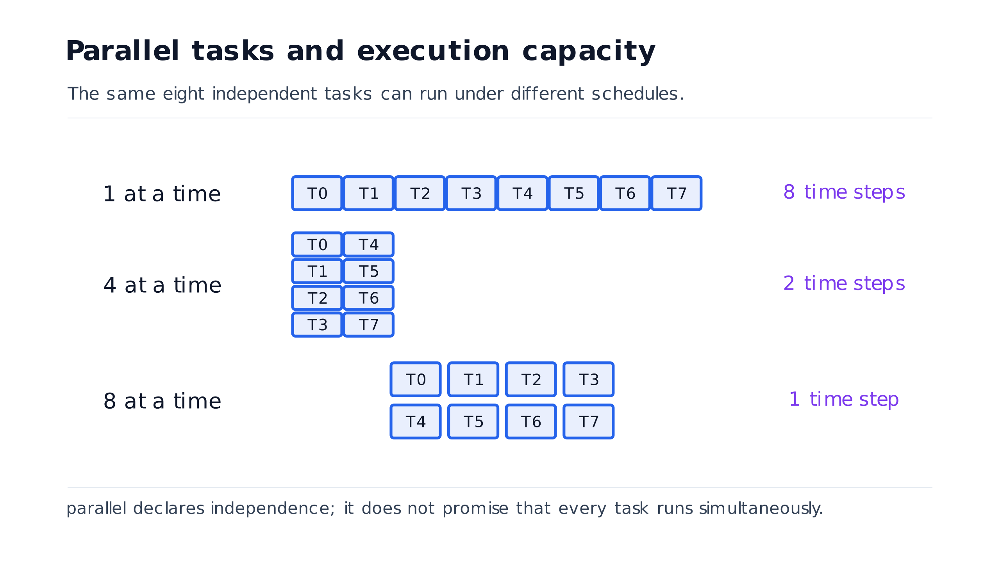
<div class="cap">图 12：同样的八个任务，在每次执行一个、四个或八个任务的示意调度下，分别需要八个、两个或一个时间步。</div>
</div>

并行性描述哪些任务可以独立执行，执行资源则决定同一时刻能推进多少任务。

如果分块数量和启动尺寸由同一组常量表示，修改分块就会迫使资源映射一起改变。将两种描述分开后，这些选择更容易调整。

Croqtile 用 `parallel` 描述独立工作，用空间说明符描述映射。因此，可以先理解工作划分，再判断某个轴应映射到块、线程还是协作组。

#### 矩阵乘法：组合起来

有了 `parallel`、`foreach`、`dma.copy`、`chunkat`、`#` 和空间说明符，分块矩阵乘法便可以组合实现。

思路是：用 `[128, 256]` 的矩阵乘以 `[256, 256]` 的矩阵，得到 `[128, 256]` 的结果。

#### 控制结构

Croqtile 表达并行和循环的方式与 C++ 不同，但程序内部的分支处理仍然沿用 C++ 的 `if`-`else` 块。

#### 顺序性与并行性

重复性任务在编程中很常见。

目前用得最广的并行范式是**单程序多数据**：代码只写一次，却以多个实例同时执行。除非显式同步，各实例彼此独立运行。Croqtile 采用这一范式，并用 **parallel-by** 块来抽象并行性。

有前后依赖的工作需要顺序循环，例如沿 K 切片累加部分结果。Croqtile 将 `with-in` 声明的有界范围与 `foreach` 执行的遍历分开，因此可以在遍历前后安排工作，多缓冲流水线就使用了这一结构。

循环处理必须依次执行的工作，`parallel-by` 处理彼此独立的实例。

`parallel-by` 块声明一组彼此独立的实例；空间说明符则规定这些实例如何分组。

#### 并行执行块

在 Croqtile 中，并行运行的代码放进*并行执行块*，表示同一段代码有多个实例同时执行。

#### 小结

`parallel-by` 块声明独立的实例，空间说明符把它们分组；掩码再决定其中哪些实例真正执行某条语句。

必须依次执行的工作仍然需要循环；2.7 节会介绍它们在 Croqtile 中的写法。

#### 并行化与加掩码

编写单程序多数据代码时，可能启动了固定数量的并行线程，但任务不能平均分配。掩码使有有效任务的线程执行，让其余线程保持非活跃状态。

在 Croqtile 代码里，掩码可以是隐式的，也可以是显式的。

#### 显式掩码／条件

线程掩码这个概念，从所有 SPMD 实例的整体视角描述执行状态。但在 SPMD 编程实践中，程序只有单线程视角，于是线程掩码表现为一个布尔表达式，通常是与线程标识符有关的比较结果。

后面的示例里，Croqtile 以实验性质支持对整个 `foreach` 块加显式掩码，也就是把循环代码整段屏蔽。例如：

```co
__co__  void foo() {
  parallel p by 6 {
    with q in [2] {
      foreach q if (p == 0) {
        // this iteration only work for parallel thread 0
      }
    }
  }
}
```

<div class="listing-cap">清单 174：显式掩码／条件</div>

#### 隐式掩码

Croqtile 中有些代码结构自带隐式掩码，多层 `parallel-by` 块就是典型。下面是一个例子：

```co
__co__  void foo() {
  parallel p by 6 {
    // parallel-level-0:
    //   code here is as if implicitly masked 'if (q == 0)'
    parallel q by 2 {
      // parallel-level-1:
      //   code here is for all 'q' threads
    }
    // parallel-level-0:
    //   code here is as if implicitly masked 'if (q == 0)'
  }
}
```

<div class="listing-cap">清单 175：隐式掩码</div>

本例有两层并行。位于 `parallel p by 6` 块内、却在 `parallel q by 2` 块之外的代码，只属于*并行层次 0*。然而在某些目标平台上，实际会启动 2 个并行线程，分别执行*并行层次 0* 或*并行层次 1* 里的代码。于是，只属于*并行层次 0* 的那部分，就好像被一个 C++ 的 `if (q == 0)` 块保护着。

条件也可以用于保护整个 `foreach` 循环，控制循环体是否执行。

#### 实验特性：`within` 的可选 *Where-Binding*

还可以追加 *where 子句*，在 `with-in` 语句定义的多个有界变量之间施加 **Where-Binding** 约束，让不同的有界变量互为别名。例如：

```co
with {m, n} in [M, N], {n_p, k} in [N_P, K]
where n_p <-> n {
  // matmul implements with m, n, K. 'n_p' always refers to the same value as 'n'.
}
```

<div class="listing-cap">清单 176：实验特性：within 的可选 Where-Binding</div>

语法上，`<->` 运算在两个有界变量之间建立 *where-binding*。在 `with-in` 块里，任何对 `n_p` 的引用都指向 `n`，反过来也一样。

Croqtile 主要面向单程序多数据编程，但也通过线程掩码支持多程序多数据(MPMD)执行；发散代码就写在 `inthreads` 块里。

#### SPMD 中的加掩码

在 SPMD 编程中，常常需要屏蔽掉一部分*并行线程*。比如，程序员把数据切成分块，交给多个线程并行或迭代处理，但可能除不尽，留下余量。

<div class="guide-figure">
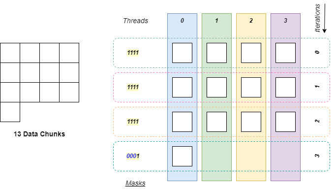
<div class="cap">图 13：13 个数据分块在 4 个并行线程上的分派</div>
</div>

上图把 13 个数据分块分派给 4 个并行线程。要处理完全部分块需要 4 次迭代，但最后一次只有*线程 0* 需要处理分块。前三次迭代的**线程掩码**都是 `1111`，只有最后一次是 `0001`（最低位对应线程 0）。线程掩码由若干布尔位组成，`1` 表示**活跃**，`0` 表示**非活跃**。所以本例中只把*线程 0* 设为*活跃*，避免在最后一次迭代中处理无效分块。

#### 一致与发散

加掩码是实现层面的概念。从 SPMD 编程的视角看，处理数据分块的代码通常被称为**发散**的，因为并非所有线程实例都执行同一段代码。程序员应当意识到，自己的 SPMD 代码由两部分组成：

- **一致代码**：*所有线程*执行同一条代码路径。
- **发散代码**：只有*被掩码选中的线程*执行*发散*代码路径。

现实中的不同需求，需要 SPMD 代码里有*发散*代码来处理。换一种范式看，在 SPMD 程序里使用*发散*代码，甚至能模拟多程序多数据的行为：MPMD 里不同线程执行不同代码，所以*发散*在概念上把 SPMD 扩展到了 MPMD 的范围。

在 Croqtile 中，可以用 `inthreads` 块来写发散代码。

#### 多层次的加掩码

线程掩码可以施加在不同的并行层次上。下面这个例子演示了这一点：

```co
__co__  void foo() {
  parallel p by 3, q by 4 {
    inthreads (p < 2 && q == 0) {
      // divergent code for thread (0, 0), (1, 0)
      // thread-mask: 011-0001
    }
    inthreads (q == 1) {
      // divergent code for thread (0, 1), (1, 1), (2, 1)
      // thread-mask: 111-0010
    }
  }
}
```

<div class="listing-cap">清单 177：多层次的加掩码</div>

这段代码用了两层并行：

- 外层（`p`）：并行数为 3
- 内层（`q`）：并行数为 4

第一个 `inthreads` 谓词（`p < 2 && q == 0`）把执行限制为：

- 外层并行 ID：`0, 1`（不含 2）
- 内层并行 ID：仅 `0`

线程掩码 `011-0001` 反映了这些约束，两个层次之间用连字符 `-` 分隔。

第二个谓词（`q == 1`）不限制外层（`p`），允许所有外层 ID（`0, 1, 2`），只把内层限制为 `q == 1`。

#### 小结

加掩码让原本一致的并行区域内部也能出现发散执行。开发者既可以用 `inthreads` 块做显式线程掩码，也可以借 `parallel-by` 构造隐式控制，把执行限制在特定线程上。

加掩码确定哪些实例执行区域，其他实例是否在区域结束处等待，则取决于同步形式。第 3.8 节讨论异步区域：程序需要用事件表达数据依赖，不能依赖每个区域结束后的汇合。

### 3.4.1 示例剖析：分块矩阵乘法 <a id="sec-3-4-1"></a>

#### 标量矩阵乘法（不使用 DMA）

第一个版本用 `parallel` 划分输出，用 `.at()` 逐个读取元素，尚未加入显式的数据搬运。

```co
__co__ s32 [128, 256] matmul(s32 [128, 256] lhs, s32 [256, 256] rhs) {
  s32 [lhs.span(0), rhs.span(1)] output;
  parallel {p, q} by [16, 64] {
    foreach {m, n} in [128 / #p, 256 / #q]
      output.at(p#m, q#n) = 0;
    foreach index = {m, n, k} in [128 / #p, 256 / #q, 256]
      output.at(p#m, q#n) += lhs.at(p#m, k) * rhs.at(k, q#n);
  }
  return output;
}
```

<div class="listing-cap">清单 178：标量矩阵乘法（不使用 DMA）</div>

<div class="guide-figure">
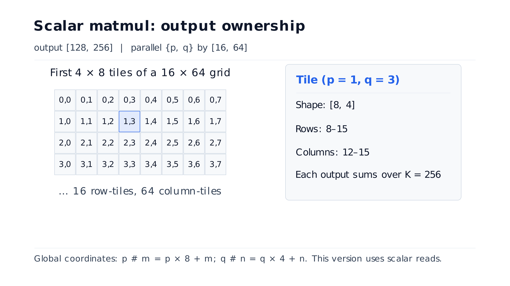
<div class="cap">图 14：[128, 256] 输出按 [16, 64] 网格划分，每块形状为 [8, 4]；图中只画出开头的一部分分块。</div>
</div>

可以从输出形状开始，逐步核对并行划分、块内范围与全局坐标。

输出声明从 `lhs.span(0)` 取得 128 行，从 `rhs.span(1)` 取得 256 列。收缩维度出现在两个输入中，但不会成为输出维度。

声明 `parallel {p, q} by [16, 64]` 为同一并行层次提供两个坐标轴。1,024 对索引将输出划分为每块八行四列。

循环将 `m`、`n` 和 `k` 绑定为 `index` 的分量。前两者遍历输出块内位置，第三者遍历收缩维度。迭代次数直接来自输出划分：

- `128 / #p = 128 / 16 = 8`：每块的行数。
- `256 / #q = 256 / 64 = 4`：每块的列数。
- `256`：完整的收缩维度。

组合行索引 `p#m` 的值为 `p * 8 + m`。p 遍历 16 个行分块，m 遍历每块八行，合起来覆盖第 0 到 127 行。列表达式 `q#n` 使用相同规则，每块四列。

对每个输出位置，语句体沿 K 累加 `lhs.at(p#m, k) * rhs.at(k, q#n)`，所有贡献进入同一个输出元素。清零循环在同一并行实例中先执行，因此每个累加元素都由拥有它的实例清零。

### 3.4.2 追踪一个输出元素 <a id="sec-3-4-2"></a>

按照第 3.6.1 节 DMA 矩阵乘法的块与线程划分，追踪输出位置 `(37, 50)`。该例使用 8 × 16 的块网格，每块负责 16 × 16 的输出分块。这与前面标量示例中的 16 × 64 逻辑网格不同，但两者覆盖相同的输出形状。

各块把 128 行划分为 8 个大小为 16 的分块：`px = 37 / 16 = 2`，偏移 `qx = 37 % 16 = 5`。列方向把 256 划分为 16 个大小为 16 的分块：`py = 50 / 16 = 3`，偏移 `qy = 50 % 16 = 2`。于是块为 `(2, 3)`，线程为 `(5, 2)`。

对该线程，K 循环执行 16 次迭代。在 `tile_k = 0` 这次迭代中，`dma.copy` 把 `lhs` 的第 32..47 行、K 的第 0..15 列装入共享的 `lhs_load`，把 `rhs` 的 K 第 0..15 行、第 48..63 列装入共享的 `rhs_load`。内层 `foreach k in [16]` 把 `lhs_load.data.at(5, k) * rhs_load.data.at(k, 2)`（k = 0..15）累加到 `output.at(37, 50)`。随后 `tile_k = 1` 装入下一条 K 条带，依此类推。16 次迭代之后，`output.at(37, 50)` 中就是完整的点积——与标量参考版本的答案相同。

## 3.5 分块选择与数据表达式 <a id="sec-3-5"></a>

#### `chunkat`、`subspan` 与 `view().from()`：三种选取分块的方式

分块表达式需要回答两个问题：区域有多大，从哪里开始？使用 `chunkat` 时，有界索引提供划分数量并选择一块；使用 `subspan(...).at(...)` 时，分块形状显式给出，坐标按块计数；使用 `view(...).from(...)` 时，形状和起始元素坐标都显式给出。窗口不落在规则分块边界上时，这种区别尤其重要。

#### `#`：合成与范围

一元形式 `#p` 取得索引上界，二元形式 `p # i` 将外层与内层索引组合起来，其值为 `p * #i + i`，上界为 `#p * #i`。若有八块、每块 16 个元素，第 2 块的块内第 5 个元素就对应 128 个元素范围中的第 37 个。

#### 处理不规则访问

尺寸能够整除且起点遵循固定网格时，规则分块很合适。其他核函数可能需要不同描述：专家批次从运行时偏移开始，卷积窗口相互重叠，最后一个分块的有效元素可能不足。扁平输入也可能需要先解释为多维视图，再参与计算。

下面的操作调整所选区域或形状，使外围算法仍保持原有结构。得到的视图仍需满足所选搬运操作的要求，包括形状、布局以及目标平台特定的对齐约束。

#### 分块与流动

`chunkat` 表达式既可以作 *DMA 语句*的源，也可以作目标。只把它用在源上，通常是把输入或缓冲区切成更小的块，搬到离处理器更近的存储；只用在目标上，则通常是搬运缓冲区，拼出输出的一部分。下面的代码是一个例子：

```co
__co__ auto foo(f32 [36] input) {
  f32 [36] output;
  parallel p by 6 : block {
    f0 = dma.copy input.chunkat(p) => shared;  // tile the source
    dma.copy f0.data => output.chunkat(p);     // un-tile the destination
  }
  return output;
}
```

<div class="listing-cap">清单 179：分块与流动</div>

本例把 `chunkat` 用在目标，把 `shared` 里的数据块搬出来，「反分块」地写进输出。注意元素类型必须一致，且源的任一维度都不能大于对应的目的维度；源比目的小是允许的。

同时在源和目标两端使用 `chunkat` 表达式，目前几乎没有任何目标平台支持。

#### 用 `#` 合成两个有界变量以分块

第 3.10.2 节 RGB 转灰度示例将工作实例索引 q 与顺序图像索引 n 组合起来。`q # n` 为每个实例分配连续图像。N = 18、共有六个实例时，内层上界是 3，所以实例 1 处理图像 3、4、5。下面沿用这一划分。

共有六个工作实例时，q 的上界是 6，n 的上界是 N / 6。组合后的上界为 N，值为 `q * (N / 6) + n`。其余索引 h、w 选择空间分块，通道维保持完整。因此，实例分配与局部遍历共同确定源分块及对应输出位置。

交换操作数会改变分配方式。N = 18 时，随着 n 递增，`n # q` 会让实例 1 处理图像 1、7、13，而 `q # n` 选择的是连续的图像 3、4、5。运算符将这种调度选择直接写入数据表达式，实际性能取决于所得访问在目标平台上的表现。

### 3.5.1 任意偏移窗口：`view` 与 `from` <a id="sec-3-5-1"></a>

混合专家核函数中，不同专家经常处理不同数量的词元。每位专家数据的起点到运行时才确定，固定分块网格未必能描述所需切片。窗口可以先为切片确定自己的起点，再进行内部划分。

表达式 `view(M, N).from(row, col)` 描述从给定元素坐标开始的 M × N 矩形。选择区域不必落在分块网格边界上，但使用该视图的搬运仍需满足自身的对齐和形状要求：

```co
patch = matrix.view(16, 16).from(37, 50);
```

<div class="listing-cap">清单 180：常量偏移处的窗口</div>

该表达式选取从第 37 行、第 50 列开始的 `[16, 16]` 切片。原点可以是任意运行时值。

<div class="guide-figure">
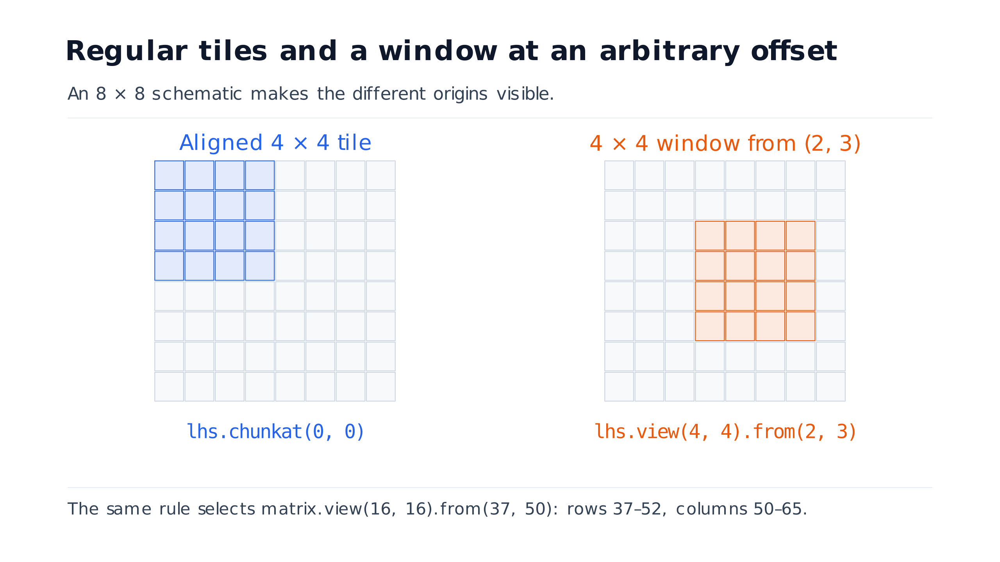
<div class="cap">图 15：图中用从 (2, 3) 开始的 [4, 4] 小窗口说明原理；正文代码从 (37, 50) 选取 [16, 16] 窗口时遵循相同规则。</div>
</div>

`view` / `from` 的优势在于可组合性：选定窗口后，后面的所有操作——`subspan`、`chunkat`、`dma.copy`——都作用在这个窗口上，就像它是一个独立的张量。流水线保持不变，只是起始位置发生变化：

```co
expert_lhs = lhs.view(expert_M, K).from(expert_offset, 0);
dma.copy expert_lhs.subspan(WARP_M, TILE_K).at(block_m, iv_k) => shared;
```

<div class="listing-cap">清单 181：运行时偏移处的窗口</div>

在 MoE 栈里，每个专家的 token 批次都从动态行 `expert_offset` 开始。`view` / `from` 只调整流水线入口的操作数；下面的 DMA、暂存和 MMA 循环，对每个专家都执行同一段代码。

划分数量已能描述所需区域时，使用 `chunkat`。起点是显式元素偏移时，使用 `view` 和 `from`，再在窗口内部进行规则划分。这样就能将外层不规则选择与内部重复工作分开。

### 3.5.2 跨步分块：`subspan`、`step` 与 `at` <a id="sec-3-5-2"></a>

表达式 `subspan(M, K).at(i, j)` 使用分块坐标。没有显式步长时，元素起点为 `(i * M, j * K)`。指定步长会改变相邻分块起点之间的距离，但不改变选中分块的大小。

加上 `.step(sM, sK)` 会改写步长：分块之间相隔 `sM` 行、`sK` 列，可以按指定间隔排列：

```co
matrix.subspan(16, 16).step(32, 32).at(i, j);
```

<div class="listing-cap">清单 182：带步长的分块：.subspan、.step 与 .at</div>

<div class="guide-figure">
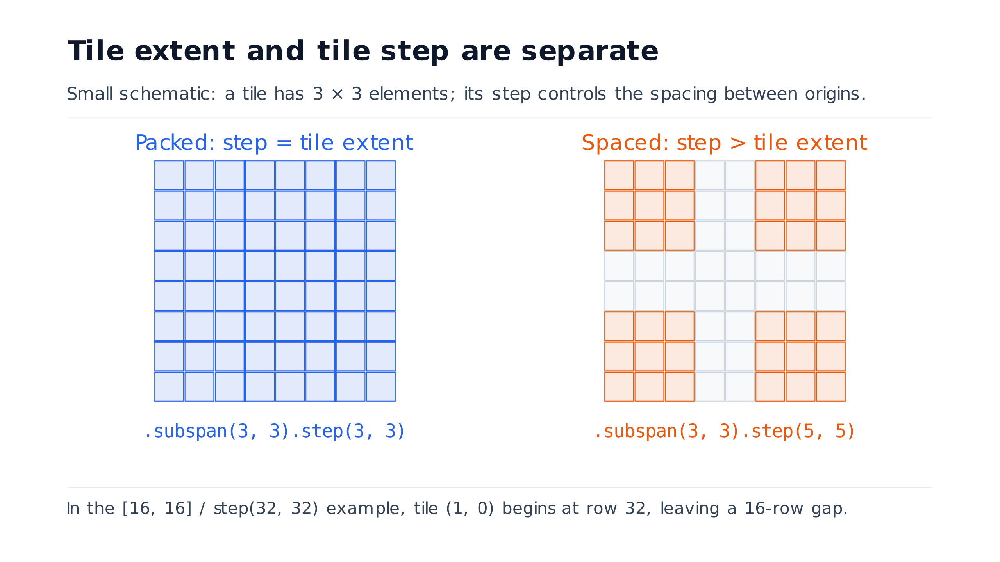
<div class="cap">图 16：小图比较紧密排列的 [3, 3] 分块与 step(5, 5) 的间隔排列。正文的 [16, 16] 分块采用 step(32, 32)，留下 16 个元素的间隔。</div>
</div>

分块 `(0,0)` 从 `(0,0)` 开始，而分块 `(1,0)` 从第 32 行开始（不是第 16 行），留出 16 行的间隔。省略 `.step` 时，步长等于分块尺寸，也就是紧凑排列的情形。

步长小于分块尺寸时，窗口相互重叠；步长更大时，窗口之间留下空隙。例如，16 行窗口每次前进八行，会与下一个窗口共享一半行。步长控制起点序列，不应与分块内部元素之间的存储步幅混淆。

### 3.5.3 用 `span_as` 做布局重解释 <a id="sec-3-5-4"></a>

#### 布局重新解释：`span_as`

有些核函数把数据当作扁平的一维条带载入，却要把它作为二维矩阵交给 MMA。朴素的做法是把数据复制到一个改过形状的缓冲区；`span_as` 则不拷贝，直接就地重新解释现有缓冲区的形状：

```co
flat_buffer.span_as([rows, cols])
```

<div class="listing-cap">清单 183：扁平条带被重新解释为矩阵</div>

元素个数保持不变，只有逻辑秩改变，不搬运任何数据。

```co
strip_load = dma.copy data.chunkat(tile) => shared;
tile_2d = strip_load.data.span_as([tile_m, tile_k]);
ma = mma.load tile_2d.chunkat(_, iv_warp);
```

<div class="listing-cap">清单 184：使用重新解释结果的搬运语句</div>

`rows * cols` 的乘积必须等于底层区域的元素数量。重解释形状会保留线性元素顺序，因此不能转置矩阵，也不能去掉行间填充。尺寸为常量时，编译器能在执行前检查元素数量；尺寸来自输入时，实际调用也必须满足同一约束。

<div class="guide-figure">
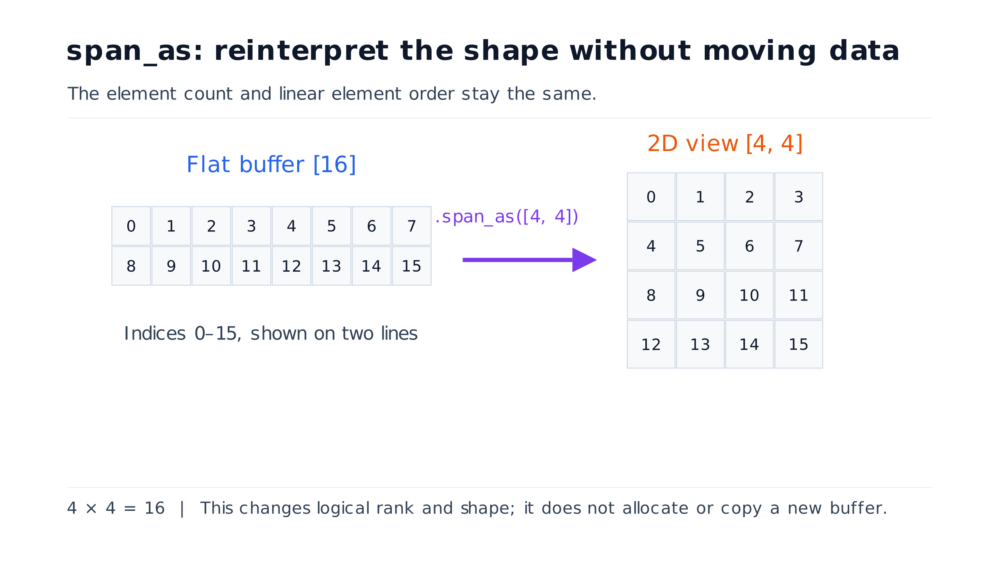
<div class="cap">图 17：16 个元素的缓冲区重解释为 [4, 4] 视图，线性顺序保持不变；图中将一维数据分成两行显示，便于阅读。</div>
</div>

### 3.5.4 分块选择：小结与语法 <a id="sec-3-5-10"></a>

#### 小结

| **概念** | **语法** | **作用** |
| --- | --- | --- |
| 软件 DMA | `dma.copy` / `dma.copy.swiz<N>` | 线程协作的分块传输 |
| 重排 | 拷贝上的 `.swiz<N>` 与 `mma.load.swiz<N>` | 无布局冲突的共享内存布局；对不同搬运路径效果相同 |
| 任意窗口 | `view(M,N).from(r,c)` | 不规整或运行时定位的切片 |
| 带步长的分块 | `.subspan().step().at()` | 非紧凑布局、相互重叠的模板 |
| 不完整分块 | `.zfill` | 把越界元素补零 |
| 形状重新解释 | `span_as([dims])` | 暂存缓冲区的零拷贝变形 |

#### 语法速览

| **语法** | **含义** |
| --- | --- |
|
| `dma.copy.swiz<N>` src => dst | 采用以字节计的重排宽度 `N` 的拷贝 |
| `mma.load.swiz<N>` src | 与重排 `N` 一致的 MMA 操作数加载 |
| `.view(M, N).from(r, c)` | 任意偏移处的 `M x N` 窗口 |
| `.subspan(M, K).step(sM, sK).at(i, j)` | 带步长的分块选择 |
| `.zfill` | 把拷贝源中的越界元素补零 |
| `span_as(dims)` | 把线性存储重新解释为带形状的张量 |

3.6 节把上面的分块表达式用作搬运语句的源与目的。对于程序中确实需要纯 C++ 的部分，2.13 节汇集了 `__device__` 函数、预处理守卫与注入的源代码文本。

## 3.6 数据搬运：操作、配置与异步模式 <a id="sec-3-6"></a>

#### 到目前为止已具备的内容

已介绍的构造可以拼成一副骨架：一个参数和返回值都带类型、带形状的 `__co__` 函数；用 `parallel` 和 `.at()` 做逐元素计算；用 `lhs.span` 从输入推导输出形状；以及主机侧用 `make_spandata` / `.view()` API 创建、传递张量。

2.9 节会引入 `dma.copy` 和 `chunkat`，用来表达分块级的数据搬运。

#### 数据搬运：分块搬运引擎

逐元素写法使用标量索引：选一个位置、读输入、计算、写输出。

分块实现则先选择区域，将其暂存到计算使用的存储中，再在那里复用数据。Croqtile 直接表达这次搬运，也能将属于搬运过程的变换写入同一语句：

- `dma.copy` 原样搬运一个分块。
- `dma.transp<...>` 在搬运的同时置换维度。
- `dma.pad<...>` 扩大分块并填充边缘。

这一模型的核心语法和规则，决定了 DMA 代码能否正确、高效地转换为目标代码。

<div class="guide-figure">
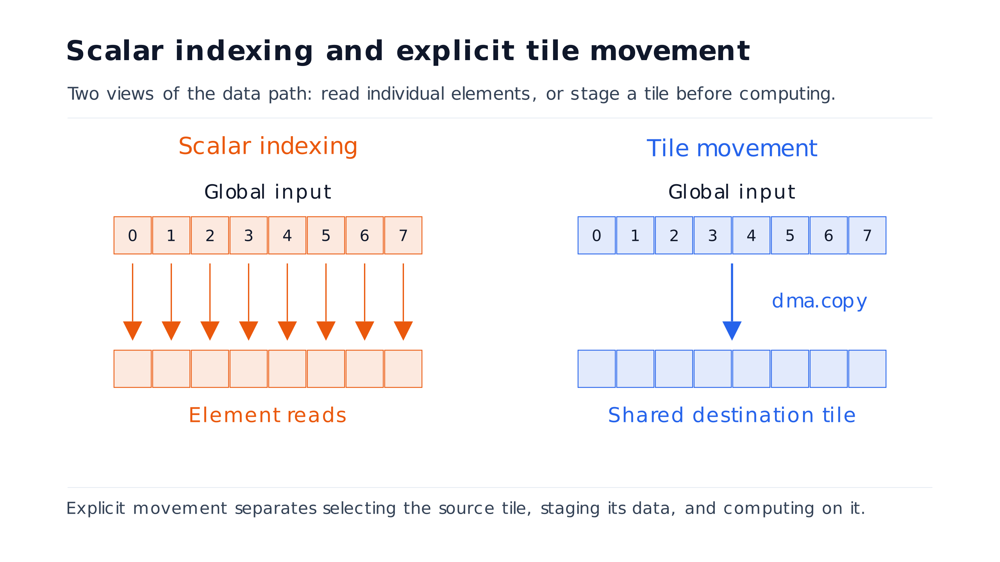
<div class="cap">图 18：标量索引逐个读取元素；显式分块搬运先选择分块，再将其复制到 shared 存储。</div>
</div>

#### 其他操作：`transp` 与 `pad`

普通复制保留源的形状和元素顺序。目标需要不同维度顺序时使用 `transp`，需要增加位置并填入指定值时使用 `pad`。目标形状也是操作的一部分，后续分块选择和计算应使用变换后的形状，而不是原始形状。

#### 异步操作：DMA 语句

除了并行执行，Croqtile 只允许一种固定形式的异步操作：DMA 语句。

概念上，DMA 语句与 SPMD 代码异步执行，行为很像 CPU 的异步线程，只是受 DMA 配置的约束（CPU 上的异步线程则可以执行一般程序代码）。

一条基本的 DMA 语句把源分块搬到目的存储，并返回一个异步句柄。

```co
global f32 [10] g_data;
local f32 [10] l_data;
f = dma.copy.async g_data => l_data;
// ... async operations
wait f;         // explicit wait
```

<div class="listing-cap">清单 185：一个异步 DMA 声明</div>

注意对 `f` 的赋值。它是异步 DMA 实体的句柄，在 Croqtile 中称为该 DMA 操作的「期值」。程序员可以显式写出同步语句 `wait`，暂停当前线程直到期值到达；不写的话，线程就和 DMA 操作并行地继续执行。

显式声明临时缓冲区可能需要重复代码。Croqtile 提供了更简单的语法：

```co
global f32 [10] data;
f = dma.copy data => local;
... f.data;  // retrieve the 'local' data from the future
```

<div class="listing-cap">清单 186：带存储的同一种声明</div>

这里不必指定 DMA 把数据搬到哪个确切位置，只要说明目的内存类型。要取用已搬运的数据，调用期值的 `data` 成员即可。另外，这个 dma 操作没有标 `.async`，所以对 `f` 的 `wait` 既不需要，也不能执行。

简写形式将分配交给编译器，但数据依赖并未改变。仍需通过期值确认目标，等待异步搬运完成，并检查后续操作是否接受所得形状与存储位置。下面的高级模式允许多次搬运同时进行，同时保留这些要求。

#### 数据搬运语句

Croqtile 要处理多个层次的数据搬运。它沿用了这个术语，并把数据搬运抽象为 **DMA 操作**。

#### 操作类型

Croqtile 在软件层把这些功能映射成不同的 **DMA 操作类型**。支持的操作包括：

- `dma.copy`：直接拷贝扁平内存。
- `dma.pad`：搬运带形状数据的同时做填充。
- `dma.transp`：搬运带形状数据的同时做转置。

填充、转置这些细节，作为 DMA 操作的参数来配置。例如：

```co
global f32 [32, 16, 9] input;
dma.transp<0, 2, 1> input => shared;  // Result shape [32, 9, 16]
dma.pad<{1, 0, 3}, {0, 1, 2}, {0, 0, 0}, 0.1f> input => shared; // Result shape [33, 17, 14]
```

<div class="listing-cap">清单 187：操作类型</div>

这里的 **DMA 配置**用 `<...>` 括起，内容随操作不同而变化。以某个目标平台为例，具体的配置语法和限制如下：

要注意，`dma.copy` 之外的 DMA 类型，支持程度因平台而异。比如在某些平台上，它可能映射到专用搬运引擎，也可能是对多个线程加载指令的编排。

数据搬运对 *tileflow 程序*至关重要。*DMA 语句*为各个层次各提供一种形式，从单次拷贝一直到链式非阻塞传输。

#### 完全非阻塞 DMA 模式（Croqtile 中的链模式）

使用前一次搬运结果的传输，必须在前一次完成后才能开始。`after` 子句记录这项依赖，而不要求发起操作的代码当场等待。下面的例子将暂存缓冲区的复制与此前操作连接起来：

```co
out_store = dma.copy.async l2_out => output.chunkat(m_tile, n_tile) after out_store_s;
```

<div class="listing-cap">清单 188：完全非阻塞 DMA 模式（Croqtile 中的链模式）</div>

这个例子里：

- `out_store` 是把数据从 `l2_out` 搬到 `output.chunkat(m_tile, n_tile)` 的异步 DMA 操作。
- `out_store_s` 是另一项 DMA 操作或事件，必须在 `out_store` 开始前完成。
- `after out_store_s` 语法规定，`out_store` 只能在 `out_store_s` 完成后启动，从而保证主线程不被阻塞。

依赖尚未满足时，发起操作的代码可以继续执行，但目标并不会立即变得可读，源也不能因此提前复用。后续消费者仍需要等最终搬运完成。阅读搬运链时，应沿源到目标检查每次交接，包括最后回到普通计算的那一次。

### 3.6.1 示例剖析：DMA 矩阵乘法 <a id="sec-3-6-1"></a>

#### DMA 矩阵乘法：共享存储中的分块

```co
__co__ s32 [128, 256] matmul(s32 [128, 256] lhs, s32 [256, 256] rhs) {
  s32 [lhs.span(0), rhs.span(1)] output;
  parallel {px, py} by [8, 16] : block {
    parallel {qx, qy} by [16, 16] : thread
      output.at(px#qx, py#qy) = 0;
    foreach {tile_k} in [16] {
      lhs_load = dma.copy lhs.chunkat(px, tile_k) => shared;
      rhs_load = dma.copy rhs.chunkat(tile_k, py) => shared;
      parallel {qx, qy} by [16, 16] : thread {
        foreach k in [256 / #tile_k]
          output.at(px#qx, py#qy) += lhs_load.data.at(qx, k) * rhs_load.data.at(k, qy);
      }
    }
  }
  return output;
}
```

<div class="listing-cap">清单 189：DMA 矩阵乘法：共享存储中的分块</div>

<div class="guide-figure">
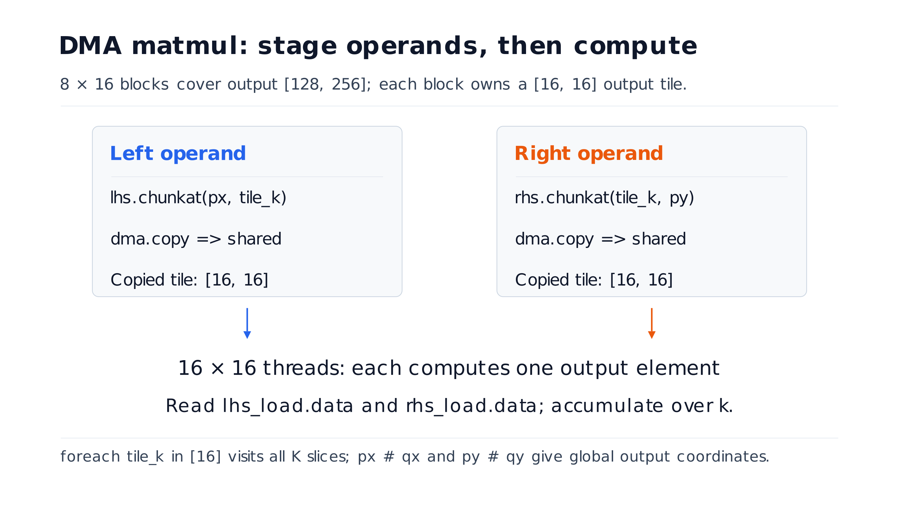
<div class="cap">图 19：每个 block 为当前 K 切片装入两个 [16, 16] 操作数分块，再由 256 个线程累加该 block 的 [16, 16] 输出分块。</div>
</div>

标量版本一次索引一个元素；分块版本先把一个分块复制到共享存储，再在这块数据上计算：

- 外层 `parallel` 现在用 `: block` 和花括号形式的索引 `{px, py}`。8 × 16 的块网格覆盖整个输出。
- 对 `tile_k` 的 `foreach` 分 16 步走完 K 维。每一步用 `dma.copy ... => shared` 把 `lhs` 和 `rhs` 的一条条带复制到 `shared` 存储。
- 内层 `parallel {qx, qy} by [16, 16] : thread` 在每个块里创建 256 个线程，每个线程负责块内分块的一个输出元素。
- 算术从 `lhs_load.data` 和 `rhs_load.data` 读取，也就是共享内存里的副本，而不是全局的 `lhs` 和 `rhs`。

合成索引分两层：`px#qx` 把块索引 `px` 和线程索引 `qx` 合成为全局行，`py#qy` 对列做同样的事。

块网格 `[8, 16]` 为每块分配 16 行、16 列输出。块内 `[16, 16]` 个线程各负责一个输出元素。K 方向共有 16 个分块，每块含 16 个元素，共同覆盖大小为 256 的完整收缩维度。

数据复用发生在块内：装入的左侧分块为多个输出列供数，右侧分块为多个输出行供数。K 循环遍历各切片一次，将贡献累加到同一组输出位置。与标量示意代码一样，输出在 K 循环之前清零。暂存改变了内层循环的读取位置，点积本身保持不变。

### 3.6.2 多缓冲(multi-buffering)：`dma.any`、`swap` 与 `rotate` <a id="sec-3-6-2"></a>

#### 用 `swap` 做双缓冲

给 K 循环准备两个逻辑缓冲区：计算使用缓冲区 0 时，DMA 将下一个分块装入缓冲区 1。计算完成后交换句柄，原来的“下一个”变成“当前”，释放的槽位供下一次装入使用。

在 Croqtile 中，这一过程由 `dma.copy.async`（非阻塞拷贝）、`dma.any`（占位期值）、`swap`（交换期值句柄）和一个三阶段循环来表达：

```co
__co__ auto matmul(s32 [M, K] lhs, s32 [K, N] rhs) {
  s32 [lhs.span(0), rhs.span(1)] output;
  parallel {px, py} by [8, 16] : block
    parallel {qx, qy} by [16, 16] : thread {
    output.at(px#qx, py#qy) = 0;
    with tile_k in 16 {
      // Prologue: start loading tile 0
      lf0 = dma.copy.async lhs.chunkat(px, tile_k) => shared;
      rf0 = dma.copy.async rhs.chunkat(tile_k, py) => shared;
      // Placeholder futures for buffer 1
      lf1 = dma.any;
      rf1 = dma.any;
      // Steady state: load next tile while computing on current
      foreach tile_k(1:) {
        lf1 = dma.copy.async lhs.chunkat(px, tile_k) => shared;
        rf1 = dma.copy.async rhs.chunkat(tile_k, py) => shared;
        wait lf0, rf0;
        foreach k in [256 / #tile_k]
          output.at(px#qx, py#qy) += lf0.data.at(qx, k) * rf0.data.at(k, qy);
        swap(lf0, lf1);
        swap(rf0, rf1);
      }
      // Epilogue: compute on the last loaded tile
      foreach k in [256 / #tile_k]
        output.at(px#qx, py#qy) += lf0.data.at(qx, k) * rf0.data.at(k, qy);
    }
  }
  return output;
}
```

<div class="listing-cap">清单 190：用 swap 做双缓冲</div>

#### 三个阶段

前序阶段发起第 0 块的装入，用 `lf0` 和 `rf0` 表示。此时还没有上一块可供计算，这两次搬运为后面的循环建立初始状态。

稳定阶段先用 `lf1` 和 `rf1` 发起下一块的装入，再等待当前块就绪，并从 `lf0` 和 `rf0` 读取计算。两对期值对应不同缓冲区，因此下一块的搬运可以与当前计算重叠，并不要求下一块先装入完成。当前计算结束后，`swap` 将下一对变为下一次迭代的当前对。

循环停止发起搬运后，收尾阶段处理最后装入的分块。读取之前，仍需确认它已装入完成。上面的清单用于展示期值轮换，省略了最后一次等待和输出初始化；实际执行累加时必须补齐这两项，也必须像稳定阶段一样保证读取时数据已就绪。

#### `swap`：交换的是名字，不是字节

操作 `swap(lf0, lf1)` 交换表示当前和下一缓冲区的句柄，不复制元素，也不等待搬运。三个缓冲区可用 `rotate(f0, f1, f2)` 轮换句柄。无论哪种情况，都应在交换后继续追踪句柄，确定读取之前需要等待哪次搬运。

#### `dma.any`：占位期值

`dma.any` 在尚未发起搬运时先声明期值名字，使两个句柄都能位于包含循环与收尾代码的作用域中。占位期值并不包含已就绪的分块，必须先用实际搬运替换它，才能使用其数据。

#### 用 Croqtile 做多缓冲优化

要激进地优化高性能计算核函数，一个有效的办法是让计算与 DMA（直接内存访问）数据搬运重叠。这种做法叫**多缓冲优化**，通常要求程序员管理多个缓冲区。

在 Croqtile 中，这种做法需要两个关键原语：占位期值 **dma.any**，以及 **swap/rotate** 函数：

```co
__co__ s32 [6, 17, 128] ele_add(s32 [6, 17, 128] lhs,
                                s32 [6, 17, 128] rhs) {
  s32[lhs.span] output;
  parallel p by 6 {
    with index = {x, y} in [17, 4] {
      local s32 [rhs.span / {#p, #x, #y}] l_out;
      foreach x { // first bunch
        lfA = dma.copy.async lhs.chunkat(p, x, y) => local;
        rfA = dma.copy.async rhs.chunkat(p, x, y) => local;
        lfB = dma.any;  // dummy DMA used for multi-buffering
        rfB = dma.any;
        foreach y(1:) {
          lfB = dma.copy.async lhs.chunkat(p, x, y) => local;
          rfB = dma.copy.async rhs.chunkat(p, x, y) => local;
          wait lfA, rfA;  // wait another bunch
          call kernel(lfA.data, rfA.data, l_out, |lfB.span|);
          dma.copy l_out => output.chunkat(p, x, y - 1);
          swap(lfA, lfB); // exchange futures
          swap(rfA, rfB);
        }
        lf = select(#y % 2, lfB, lfA);
        rf = select(#y % 2, rfB, rfA);
        wait lf, rf;  // handle the last bunch
        call kernel(lf.data, rf.data, l_out, |lfB.span|);
        dma.copy l_out => output.chunkat(p, x, y(-1));
      }
    }
  }
  return output;
}
```

<div class="listing-cap">清单 191：用 Croqtile 做多缓冲优化</div>

这个加法核函数为每份输入维护两组局部缓冲区。A 句柄表示当前操作数，B 句柄接收下一次装入。当前结果计算并写回后，通过交换句柄推进两组角色。左右输入沿同一调度前进，使每次加法使用相互对应的分块。

实现把数据搬运和计算分成三个阶段：

- **前奏**（第 8--11 行）：先（预）装入第一块数据。本例中缓冲区 A 被预先装好。
- **主体**（第 12--20 行）：处理上一轮迭代或前奏预装的数据，同时预装下一轮要用的数据。
- **尾声**（第 21--25 行）：只处理最后一块数据。

占位期值 `lfB` 和 `rfB` 在内层循环前声明，因此收尾代码仍能引用它们。循环先用实际搬运结果替换占位值，再使用其数据。若只在循环内部声明这些名字，处理最后一块时它们就已超出作用域。

第 18--19 行的 **swap** 语句交换期值，让第 15 行的 **wait** 语句能正常工作。注意，只有对应相同 DMA 操作的期值才能交换。另外，第 12 行 *foreach* 的迭代范围也调过：`foreach y(1:)` 表示对*有界变量* `y` 的循环从第二个取值开始，一直到上界。第 17 行的 *chunkat* 表达式同样调过：`y - 1` 取 `y` 的当前值减 1，让主体阶段和前奏阶段正确衔接。这个调整是必要的：迭代次数要减 1，而预装载操作应该在计算「当前」数据块时装入「下一」块。也可以改用 `foreach y(:-1)`，再相应调整第 13--14 行预装载语句的 chunkat 表达式，效果一样。

第 25 行的 `y(-1)` 取出 `y` 在界内的「最后一个取值」。

第 21--22 行的 **select** 表达式处理*有界变量* `y` 上界为奇数和偶数两种情况，无论哪种都能取得最后一块数据对应的期值。

如果想用两个以上的缓冲区，就要用 **rotate** 语句代替 **swap**。

## 3.7 收缩与布局约定 <a id="sec-3-7"></a>

#### 张量收缩：`mma` 语法

3.4 节的分块矩阵乘法是按 CPU 的方式计算内部收缩的：一个 `foreach k` 循环，每次迭代把两个标量相乘，累加到同一个输出元素上。这种写法可以得到正确结果。

真正的任务是**二维张量收缩**——C += A × B，其中 A、B、C 都是形状固定的小矩阵分块。它是每个 GEMM、每个以 im2col 矩阵乘表达的卷积、每个注意力头 QKT 的内层核函数。

困难在于矩阵元素如何分布到参与协作的操作数片段中。布局声明必须与数据布局一致，例如把列主序分块当作行主序片段使用，就可能得到错误结果。下面的颜色只示意分布，不表示某条指令的精确映射。

<div class="guide-figure">
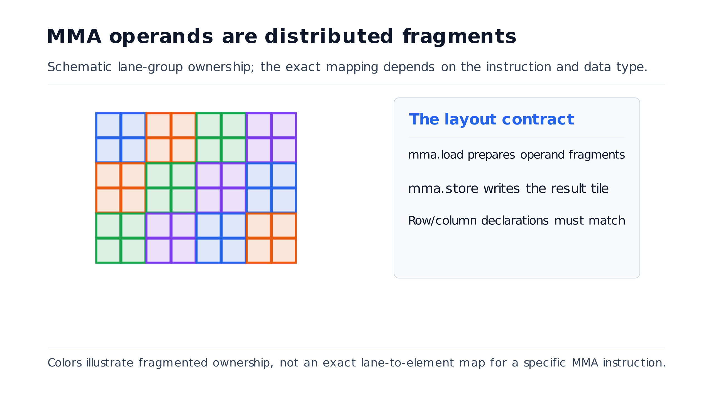
<div class="cap">图 20：操作数片段分布在协作的线程之间。颜色仅示意这种分布，不代表某条指令的精确寄存器映射。</div>
</div>

Croqtile 用 `fill`、`load`、乘加和 `store` 表达收缩，由编译器处理片段元素在所选协作范围内的分布。程序员仍需选择兼容的分块形状并声明操作数布局，这层抽象以这些选择正确为前提。

<div class="guide-figure">
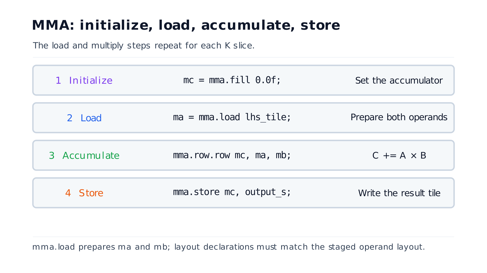
<div class="cap">图 21：先初始化累加器，再装入两个操作数、执行累加，最后写回；沿 K 切片重复装入和累加步骤。</div>
</div>

#### 扩大协作范围

无论多少线程协作完成一次收缩，四步语法都不变。变的是**协作范围**——以下示例围绕这一变化展开。

#### 不完整分块、守卫与 `.zfill`

真实核函数常常以不完整的分块收尾。关键区别在于**源分块形状**和**目的分块形状**是否相同。

例如：

```co
dma.copy.swiz<32>.zfill
  lhs.view(ROWS_M, TILE_K).from(base_m, base_k)
    => lhs_load_s;
```

<div class="listing-cap">清单 192：不完整分块、守卫与 .zfill</div>

这里 `lhs_load_s` 的形状可能是 `[group_M, TILE_K]`，源视图的形状却是 `[ROWS_M, TILE_K]`；在最后一个分块上，`ROWS_M` 可能小于 `group_M`。这是源区域与目的区域之间的形状差异，此时 `.zfill` 的意思是：拷贝有效的源行，把目的分块剩下的行写零。

这正是 `.zfill` 的正确用法。

形状相同时，情况是这样：

- 源视图和目的分块形状相同时，编译器已经自动给运行时尾部加了守卫。
- 这时它会生成掩码，让越界元素既不被读，也不被写。
- 对把 `[100]` 张量切成 `[64]` 分块这类情况，这已经够了：最后一个分块只有 36 个有效元素。

`.zfill` **不是**处理「任意不完整分块」的通用机制。它专门针对目的分块大于有效源区域、且目的端多出的部分必须填零的情形。

`.zfill` 为什么重要：

- 消费者只读有效区域时，编译器的自动掩码通常就够了。
- 消费者要读整个目的分块时，尤其是 MMA 片元，无效区域里必须是已知值。
- `.zfill` 把多出来的那块区域置零。

当有效源区域小于目的分块，且消费者会把目的端当作完整的稠密分块时，应使用 `.zfill`。这是带动态行数或带填充边缘分块的 GEMM 式流水线里的常见情形。

源和目的形状本来就相同时再加 `.zfill`，编译器可能警告说这个 `.zfill` 是多余的；反过来，形状不同时，编译器也可能警告需要 `.zfill`，免得未覆盖区域里出现未定义值。

#### `.swiz<N>`：面向消费者的共享内存布局

典型的 GEMM 暂存代码如下：

```co
dma.copy.swiz<128> lhs.subspan(WARP_M, TILE_K).at(block_m, iv_k) => lhs_load_s;
ma = mma.load.swiz<128> lhs_load_s.chunkat(_, iv_warp);
```

<div class="listing-cap">清单 193：.swiz N：面向消费者的共享内存布局</div>

装载侧和计算侧的重排必须一致。用 `.swiz<128>` 暂存的分块，消费者通常也要用匹配的重排来加载。

`.swiz<N>` 的取值决定共享内存中分块元素的排列，必须与 `mma.load.swiz<N>` 一致。

#### 重排与布局冲突

交错布局改变暂存分块的元素在共享存储中的排列。逻辑矩阵形状不变，但读取方必须使用匹配的地址映射。Croqtile 的拷贝操作都提供这一选择：

```co
dma.copy.swiz<128> src => dst;       // software DMA with swizzle
dma.copy.swiz<128> src => dst;
```

<div class="listing-cap">清单 194：一次带重排的拷贝</div>

MMA 的读取路径必须使用相同的 `swiz<N>`，让地址与暂存的布局一致：

```co
ma = mma.load.swiz<128> lhs_load_s.chunkat(_, iv_warp);
```

<div class="listing-cap">清单 195：一次带重排的 mma 加载</div>

重排是拷贝自身的性质，而不是某个引擎独有的特性：`dma.copy.swiz<N>` 产生的共享内存布局与数据如何到达无关。

模板参数选择目标支持的交错模式。示例使用编号模式，其中模式 0 表示恒等映射。有效模式及兼容的分块尺寸取决于目标平台，搬运与 MMA 装入应采用同一套已记录的约定。

复制与 `mma.load.swiz<N>` 必须对布局达成一致。用不兼容模式读取交错分块，会把相同字节解释为不同矩阵位置，导致数值错误。修改任一操作时，都应将两者匹配视为正确性要求。

<div class="guide-figure">
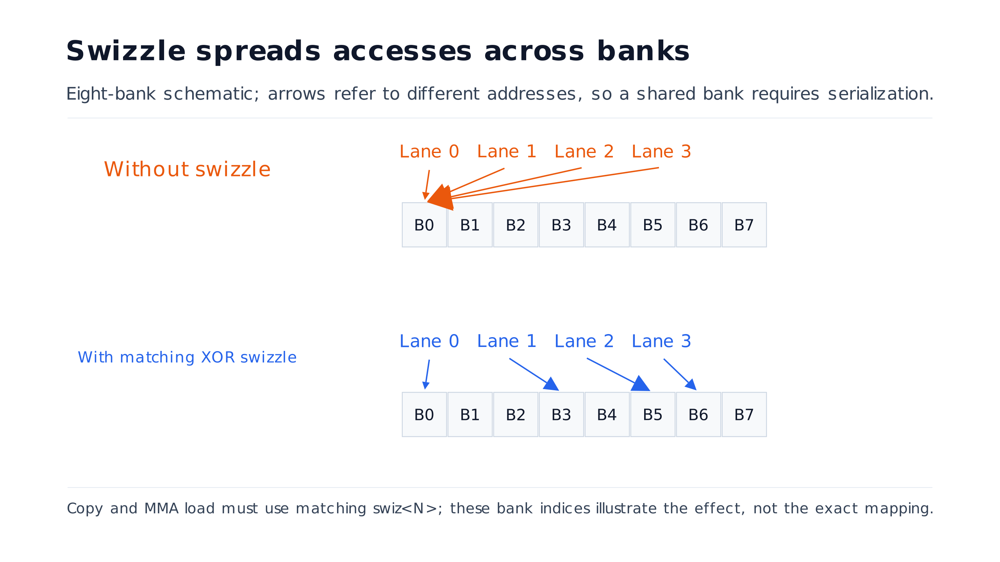
<div class="cap">图 22：八个 bank 的简化示意：同一 bank 的不同地址访问需要串行处理，重映射则分散访问。复制与 MMA 装入必须采用一致的 swizzle。</div>
</div>

#### 稠密 FP16 之外：四步还能表达什么

上面的例子对稠密 FP16 分块使用 `mma.row.row`。同样的四步模式可以扩展到基本形式覆盖不到的工作负载。

稀疏收缩还需要一个**元数据操作数** `me`，用来标明哪些元素非零：

```co
mma.row.row.sp mc, ma, mb, me;
```

<div class="listing-cap">清单 196：一次稀疏收缩</div>

`.sp` 后缀加上元数据操作数，其余仍是填充、加载、相乘、存储的顺序。任何布局组合都能用，比如 `mma.row.col.sp`。`me` 和 A、B 一起，从单独的元数据张量里载入。

对带分块缩放值的量化操作数，收缩还需要所选 A、B 分块对应的缩放值。`.scale` 形式将缩放与矩阵操作一起表达：

```co
mma.row.row.scale mc, ma, mb, sc_a, sc_b;
```

<div class="listing-cap">清单 197：一次带缩放的收缩</div>

收缩之后，每个结果元素由 `sc_a` 和 `sc_b` 缩放——不再需要单独的反量化核函数。如果缩放来源和标准的融合路径不同，缩放也可以写成**独立语句**：

```co
mma.row.row mc, ma, mb;
mma.scale mc, sc_a, sc_b;
```

<div class="listing-cap">清单 198：另一种收缩布局</div>

独立的 `mma.scale` 出现在某些 MoE 与混合精度核函数中。

`dma.copy.swiz<N>` 和 `mma.load.swiz<N>` 里的 `N` 必须一致，不一致就会读出错误数据。输出方面，`mma.store.transp mc, dst` 会把累加器的行和列互换后写出，适合下一阶段需要列主序数据的情形。

所有变体汇总在下表中，方便查阅。

### 3.7.1 示例剖析：单个协作组(cooperative group) <a id="sec-3-7-1"></a>

#### 一组一分块：最简单的 MMA 矩阵乘法

最小示例将一个输出分块分配给用 `: group` 表示的协作组。函数接收左右操作数和调用方提供的输出缓冲区。沿着一个输出分块阅读代码：初始化累加器，遍历各 K 切片，将累加分块存入共享存储，最后复制到对应输出位置。

```co
#define TILE_M 16
#define TILE_N 16
#define TILE_K 16
#define WARP_M 16
#define WARP_N 16
#define WARP_K 16
#define MMA_M 16
#define MMA_N 16
#define MMA_K 16
__co__ void matmul_wmma(global f16 [M, K] lhs, global f16 [N, K] rhs, global f16 [M, N] output) {
  parallel {block_m, block_n} by [cdiv(M, TILE_M), cdiv(N, TILE_N)] : block {
    shared f16 [TILE_M, TILE_N] output_s;
    parallel {warp_m, warp_n} by [cdiv(TILE_M, MMA_M), cdiv(TILE_N, MMA_N)] : group {
      mc = mma.fill 0.0;
      foreach {iv_k} in [cdiv(K, TILE_K)] {
        lhs_load_s = dma.copy lhs.subspan(TILE_M, TILE_K).at(block_m, iv_k) => shared;
        rhs_load_s = dma.copy rhs.subspan(TILE_N, TILE_K).at(block_n, iv_k) => shared;
        foreach iv_warp_k in [cdiv(TILE_K, MMA_K)] {
          ma = mma.load lhs_load_s.chunkat(warp_m, iv_warp_k);
          mb = mma.load rhs_load_s.chunkat(warp_n, iv_warp_k);
          mma.row.row mc, ma, mb;
        }
      }
      mma.store mc, output_s.subspan(MMA_M, MMA_N).at(warp_m, warp_n);
    }
    dma.copy output_s => output.subspan(TILE_M, TILE_N).at(block_m, block_n);
  }
}
```

<div class="listing-cap">清单 199：一组一分块：最简单的 MMA 矩阵乘法</div>

函数返回 `void`，因为它直接写入参数 `output`。调用方提供该缓冲区，并在操作完成后读取结果。函数内部的 `output_s` 是 `mma.store` 与最终复制之间使用的暂存缓冲区。

向上取整除法 `cdiv(M, TILE_M)` 计算 M 方向分块数量，包括可能不足一整块的尾部。`(block_m, block_n)` 标识当前块负责的输出分块。操作数选择复用这些输出坐标，并加入当前 K 切片坐标。

当矩阵尺寸与分块尺寸都为 16 时，块网格为 1 × 1。更大的矩阵会产生更多输出分块。编译这段清单前，需要补充 `MMA_M`、`MMA_N` 和 `MMA_K` 的定义，并使它们与所选片段尺寸一致。

3.5 节详细讨论 `subspan` 和 `chunkat` 的区别。

> `subspan(h, w)` 声明固定大小的矩形视图形状，`.at(i, j)` 从父张量中选出想要的视图实例。换言之，`lhs.subspan(TILE_M, TILE_K).at(block_m, iv_k)` 的意思是「取位于 `(block_m, iv_k)` 的 `[TILE_M, TILE_K]` 分块」。需要显式分块形状时用 `subspan`；需要按已有维度的等分来切时用 `chunkat`。

累加器跨越整个 K 循环。若在循环内初始化，就会丢弃此前的贡献；若在循环内写回，得到的只是部分结果。将初始化放在循环前、写回放在循环后，能清楚表示输出分块的累加过程。

### 3.7.2 MMA 语法小结 <a id="sec-3-7-9"></a>

#### 语法速览

| **语法** | **含义** |
| --- | --- |
| `mc = mma.fill 0.0` | 把累加器分块初始化为零 |
| `mma.fill.f16 0.0f` / `mma.fill.f32 0.0f` | 显式指定精度的累加器 |
| `mma.load.swiz<N>` src | 按重排模式加载 |
| `mma.row.row mc, ma, mb` | C += A × B（均为行主序） |
| `mma.row.col mc, ma, mb` | C += A × B（A 行主序，B 列主序） |
| `mma.row.row.sp mc, ma, mb, me` | 带元数据操作数的稀疏 MMA |
| `mma.row.row.scale mc, ma, mb, sc_a, sc_b` | 融合的 MMA 与逐分块反量化 |
| `mma.scale mc, sc_a, sc_b` | 独立的 MMA 后置缩放 |
| `mma.store.transp mc, dst` | 转置后写出累加器 |
| `cdiv(a, b)` | 向上取整除法 |
| `__co__ void fn(...)` | 就地写出结果的核函数 |

阅读修饰符时，应同时追踪数据路径。交错装入必须匹配复制产生的布局，稀疏操作需要同一操作数分块的元数据，缩放值也必须对应正在累加的分块。语句写得简短，并不意味着可以忽略这些关系。

### 3.7.3 MMA 设计小结 <a id="sec-3-7-10"></a>

#### 小结

| **主题** | **要点** |
| --- | --- |
| 二维张量收缩 | 在分块状操作数上做 C += A × B —— 通用的内层核函数 |
| 四步抽象 | **填充 → 加载 → 相乘 → 存储**；编译器为各目标平台处理片元布局 |
| 扩大协作规模 | 语法保持不变 |
| 布局约定 | `mma.row.row`、`mma.row.col` 等 |
| 稀疏与量化 | `.sp` 增加元数据操作数；`.scale` 融合逐分块反量化 |
| 重排与流水线 | `mma.load.swiz<N>` 匹配带重排的共享布局 |

收缩执行得更快，但装载和计算仍然轮流进行——3.8 节会引入**角色专门化**，让不同的线程组各司其职：一组装载数据，另一组做计算，使内存访问和数学运算在时间上重叠。

## 3.8 协调、流水线与持久调度 <a id="sec-3-8"></a>

#### 控制流：发散、并发与协同

每一种面向并行机的语言都必须回答同一个问题：**当不同线程需要做不同的事情时，会发生什么？**

CPU 的各个核心具有独立的程序计数器；共享指令流的线程遇到发散路径时，则需要依次执行各条路径，并屏蔽当前不执行的线程。

所有线程都求值该条件，条件为假的线程被屏蔽（停用）；这就是**谓词执行**——发散路径可能需要额外执行时间。

分块矩阵乘法还包含职责不同的工作：一个组装入下一批操作数，另一个组使用当前操作数计算。两组需要在明确的交接点之间独立推进。运行时条件描述实例选择哪个分支，而流水线还需要表达这些独立职责及其依赖关系。

Croqtile 引入两个额外的控制流原语来填补这个空白：

- **`inthreads.async`** —— **结构化并发区域**：在编译时把线程分成若干组，各组**同时运行不同的程序**，编译器为它们生成彼此独立的指令流；
- **`shared event` / `wait` / `trigger`** —— **区域间通信**：轻量级的同步令牌，让并发区域能安全地通信。

#### 用 `inthreads.async` 构造结构化并发区域

形式 `inthreads.async` 将不同线程组分配到各自推进的区域，谓词标识负责该区域的组。生产者和消费者的职责固定，而进度取决于哪些缓冲区就绪，适合用这种方式表达。

```co
parallel p1 by 2 : thread {
  inthreads.async (p1 == 0) {
  }
  inthreads.async (p1 == 1) {
  }
}
```

<div class="listing-cap">清单 200：用 inthreads.async 构造结构化并发区域</div>

与 `if` 的区别是结构性的，不只是性能上的：

|  | **`if`（谓词执行）** | **`inthreads.async`**（结构化并发） |
| --- | --- | --- |
| **判定时机** | 运行时——每个线程都求值条件 | 编译时——线程归属已固定 |
| **指令流** | 一段程序；发散线程被屏蔽 | 每个区域各有一段程序 |
| **编程语言类比** | 任意语言中的 `if`/`else` | 结构化并发中的 `async`/`spawn`（Trio、Go 协程、Cilk） |

区域由词法作用域限定，编译器可以从程序结构中识别参与者。代码不会在运行时创建数量不定的任务，每个区域都在已声明的并行范围内执行。

不加 `.async` 时，区域在继续后续代码之前与外围执行汇合。加上 `.async` 后，其他区域可以独立推进，它们之间的数据交接需要显式同步协议。

下图展示了实际效果——生产者的 DMA 和消费者的 MMA 在时间上重叠：

<div class="guide-figure">
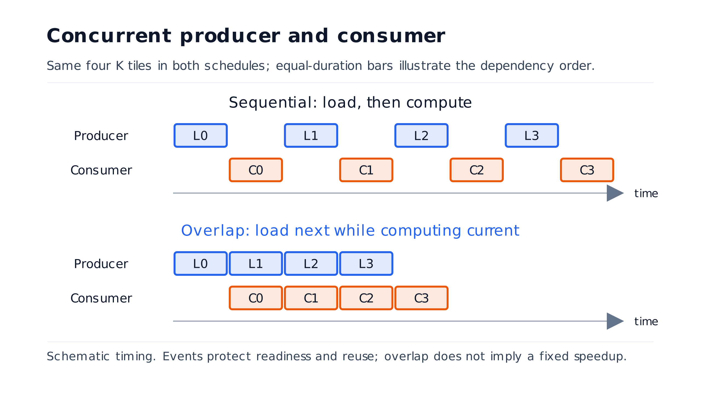
<div class="cap">图 23：两种调度都包含四组装入与计算任务。并发的生产者和消费者在遵守依赖关系的前提下重叠执行。</div>
</div>

#### 用事件做区域间通信

`inthreads.async` 创建并发区域之后，这些区域需要一种通信方式。Croqtile 提供了**事件**。

```co
shared event full;
shared event empty;
```

<div class="listing-cap">清单 201：用事件做区域间通信</div>

事件有两种操作：

- **`trigger name`** —— 发出条件已满足的信号（例如「数据已就绪」）
- **`wait name`** —— 阻塞直到相应的 `trigger` 触发

生产者写完一个分块后调用 `trigger full`，发出「数据就绪」的信号；消费者读取之前调用 `wait full`，阻塞到信号到达。对称地，消费者读完（缓冲区可以复用了）就触发 `empty`，生产者在写下一个分块之前等待 `empty`。

这是一种**通过许可交接的有界缓冲区**协议——`full` 是「数据可用」许可，`empty` 是「缓冲区空闲」许可。

#### 同步实践：流水线、缓冲区与事件

缓冲流水线有两项顺序要求：消费者必须等生产者填完槽位后才能读取，生产者也必须等消费者用完槽位后才能覆盖。装入再快也不能省去第二项要求，消费者再快也不能省去第一项要求。

第 3.6.2 节的双缓冲模式由一个组发起搬运、等待当前输入并轮换句柄。生产者—消费者流水线则将这些职责分配给不同异步区域，再用事件传递就绪和复用信号；在单组版本中，这些顺序由组内指令安排表达。

两种模式解决的是同一个根本问题：**不能在一方写入缓冲区的同时读取它**。区别只在于解法的组织方式。

#### 为什么没有事件就无法「直接重叠」

`swap` 模式之所以能够工作，是因为同一个线程组同时控制装载和计算——它清楚顺序。一旦拆成两组，就没法共享同一套 `swap` 调度了，需要额外的通信机制。

下图对比了严格的「先装载再计算」阶梯和双缓冲重叠：逻辑上的工作量一样，空闲时间却少了。

<div class="guide-figure">
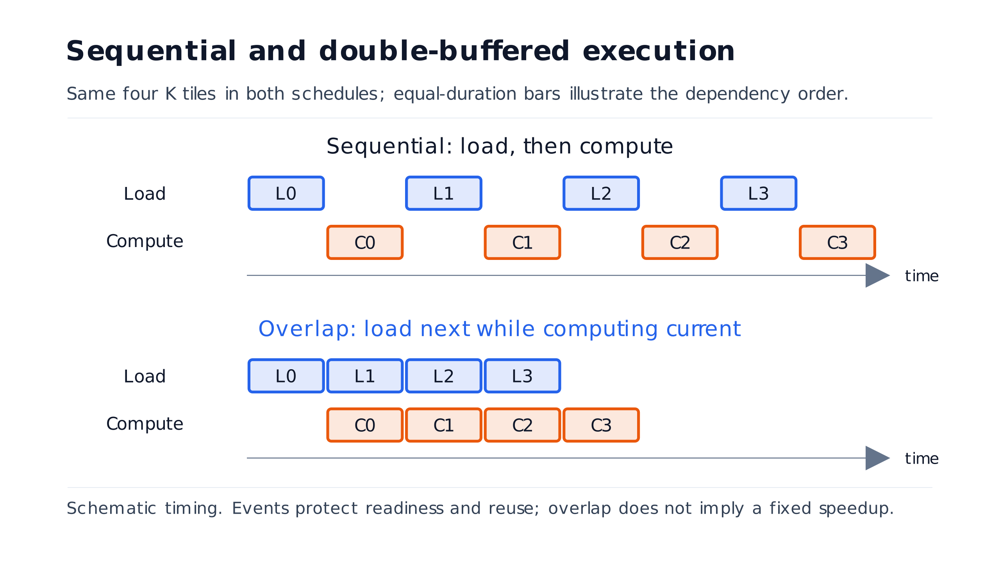
<div class="cap">图 24：同样的四个 K 分块可以顺序执行，也可以通过双缓冲重叠执行。图中时间仅为示意，并包含流水线启动与收尾。</div>
</div>

#### 让它异步

和 `parallel-by` 语句类似，也可以让执行发散代码的线程与不执行发散代码的线程彼此异步。下面的例子展示如何在 SPMD 代码里做 MPMD 执行：

```co
__co__  void foo() {
  parallel p by 6 {
    inthreads.async (p <= 2) {
      // divergent code for thread 0, 1, 2 (thread-mask: 000111)
    }
    inthreads.async (p > 2) {
      // divergent code for thread 3, 4, 5 (thread-mask: 111000)
    }
    sync.barrier : thread; // sync point
                 // all 'inthreads' paths must get executed
  }
}
```

<div class="listing-cap">清单 202：让它异步</div>

本例把并行线程平均分成两个子组，并且不在每个 `inthreads` 块之后强制同步。这样两组的线程就能并行执行，模拟出 MPMD 的效果。不过 `sync.barrier` 语句为所有线程建立了一个**同步点**，保证两条路径的代码都执行到该*同步点*之后。

只有外层 `inthreads` 能声明为异步。对任何内层 `inthreads` 块使用 `inthreads.async`，都会得到编译时错误。

#### 事件实例

在 Croqtile 中，事件与存储说明符关联，可以是 `global`、`shared` 或 `local`；这个存储说明符决定了事件的实例。

```co
__co__ void foo() {
  global event ge;     // single instance in the tileflow program
  parallel p by 2 {    // shared level
    shared event se;   // two instances, 1 for each shared instance
    parallel q by 6 {  // local level
      local event le;  // 12 instances in total, 6 for each shared instance
    }
  }
}
```

<div class="listing-cap">清单 203：事件实例</div>

上面代码里的注释说明了事件实例。机制和带形状数据的声明相同，后者同样要求存储说明符。从实现角度看，事件可以做成指定存储层次里的布尔数据，因此也占用该层次的存储；但在概念上，事件属于某个特定层次，实例数就对应它的并行层次。

#### 死锁

默认情况下，事件是无锁的，用于不同异步块之间的高性能同步。这意味着多个线程同时更新事件时有风险，尤其是 `wait`。

例如：

```co
parallel p by 1 {
  shared event e;
  trigger e;   // one thread set e;
  parallel q by 2 {
    wait e;    // two threads can reset e;
  }
}
```

<div class="listing-cap">清单 204：单实例死锁</div>

这段代码里，两个线程等待同一个事件 `e`。但 `wait` 会复位事件 `e`，因此可能出现 `thread-0` 在 `thread-1` 发现 `e` 已触发之前就把它复位的情况，结果 `thread-1` 永远无法解除阻塞，形成死锁。

```co
qc = 2;
parallel p by 1 {
  shared event e[qc];
  trigger e;   // one thread set e[0] and e[1];
  parallel q by qc {
    wait e[q]; // no dead lock
  }
}
```

<div class="listing-cap">清单 205：信用计数死锁</div>

这段代码使用事件数组，保证每个事件只由一个线程等待和复位。

### 3.8.1 典型模式：一个生产者与一个消费者 <a id="sec-3-8-1"></a>

#### 典型模式：1 生产者 + 1 消费者

`inthreads.async` 最常见的用途，是矩阵乘法里的 **1P1C**（一生产者、一消费者）划分：

```co
parallel p1 by 2 : thread {
  inthreads.async (p1 == 0) {
  }
  inthreads.async (p1 == 1) {
  }
}
```

<div class="listing-cap">清单 206：典型模式：1 生产者 1 消费者</div>

声明 `parallel p1 by 2 : thread` 在同一个外层块中建立两个线程角色。`p1` 的值选择职责，并不表示 K 方向的分块编号。

`p1 == 0` 的区域承担生产者职责，负责写入共享暂存缓冲区。若写入使用另一个已空闲槽位，另一组就可以同时推进计算。

`p1 == 1` 的区域承担消费者职责，读取已完成的分块并更新累加器。两个区域共享暂存存储，因此事件协议必须明确槽位何时从可写变为可读，以及何时重新可写。

共享地址空间要求明确的读写协调：没有协调的话，消费者可能在生产者还没写完缓冲区时就开始读。事件用于表达这一先后关系。

### 3.8.2 示例剖析：1P1C 核函数骨架 <a id="sec-3-8-2"></a>

#### 1P1C 矩阵乘法骨架

这个骨架省略了基于事件的同步；3.8.5 节会补上完整的流水线协议。

```co
#define WARP_M 64
#define WARP_N 64
#define TILE_K 128
#define WARP_K 16
__co__ auto matmul(global f16 [M, K] lhs, global f16 [N, K] rhs) {
  f16 [M, N] output;
  parallel {block_m, block_n} by [cdiv(M, WARP_M), cdiv(N, WARP_N)] : block {
    shared f16 [WARP_M, TILE_K] lhs_load_s;
    shared f16 [WARP_N, TILE_K] rhs_load_s;
    shared f16 [WARP_M, WARP_N] output_s;
    parallel p1 by 2 : thread {
      inthreads.async (p1 == 0) {
        foreach {iv_k} in [cdiv(K, TILE_K)] {
          dma.copy lhs.subspan(WARP_M, TILE_K).at(block_m, iv_k) => lhs_load_s;
          dma.copy rhs.chunkat(block_n, iv_k) => rhs_load_s;
        }
      }
      inthreads.async (p1 == 1) {
        mc = mma.fill.f16 0.0f;
        foreach {iv_k} in [cdiv(K, TILE_K)] {
          foreach {iv_warp} in [cdiv(TILE_K, WARP_K)] {
            ma = mma.load lhs_load_s.chunkat(_, iv_warp);
            mb = mma.load rhs_load_s.chunkat(_, iv_warp);
            mma.row.row mc, ma, mb;
          }
        }
        mma.store mc, output_s;
        dma.copy output_s => output.subspan(WARP_M, WARP_N).at(block_m, block_n);
      }
    }
  }
  return output;
}
```

<div class="listing-cap">清单 207：一个 1P1C 矩阵乘法骨架</div>

生产者循环遍历 `cdiv(K, TILE_K)` 个输入切片，每次填充左右暂存缓冲区。对应收缩开始之前，消费者需要确认两个操作数都已就绪。

消费者为输出分块初始化一个累加器，然后针对各 K 切片装入并相乘操作数片段，在最后一次贡献加入后写回输出。两个循环独立运行，仅仅迭代次数相同，并不能保证消费者读到预期切片。

这段骨架省略了两个循环之间的交接。作为实际流水线使用之前，需要在装入后增加就绪信号，在消费后增加复用信号。第 3.8.5 节通过每槽位事件补齐这两项要求。

### 3.8.3 持久调度 <a id="sec-3-8-3"></a>

前面的核函数里，网格随问题规模增长：大致每个输出分块对应一个块。矩阵一大，启动的块数就很多，而最后一批块常常让一部分 SM 闲着——这就是**尾部利用率不足**。

**持久核函数**把启动规模固定下来（通常接近 SM 数量），让每个块迭代处理多个分块：

```co
#define WARP_M 64
#define WARP_N 64
#define TILE_K 128
#define WARP_K 16
#define NUM_GROUPS 4
__co__ auto matmul(global f16 [M, K] lhs, global f16 [N, K] rhs) {
  f16 [M, N] output;
  int total_tiles = cdiv(M, WARP_M) * cdiv(N, WARP_N);
  parallel block_id by NUM_GROUPS : block {
    shared f16 [WARP_M, TILE_K] lhs_load_s;
    shared f16 [WARP_N, TILE_K] rhs_load_s;
    shared f16 [WARP_M, WARP_N] output_s;
    foreach {tile_iter} in [cdiv(total_tiles, NUM_GROUPS)] {
      tile_id = tile_iter # block_id;
      if (tile_id < total_tiles) {
        block_m = tile_id / cdiv(N, WARP_N);
        block_n = tile_id % cdiv(N, WARP_N);
        mc = mma.fill.f16 0.0f;
        foreach {iv_k} in [cdiv(K, TILE_K)] {
          dma.copy lhs.subspan(WARP_M, TILE_K).at(block_m, iv_k) => lhs_load_s;
          dma.copy rhs.subspan(WARP_N, TILE_K).at(block_n, iv_k) => rhs_load_s;
          foreach {iv_warp} in [cdiv(TILE_K, WARP_K)] {
            parallel p by 1 : thread {
              ma = mma.load lhs_load_s.chunkat(_, iv_warp);
              mb = mma.load rhs_load_s.chunkat(_, iv_warp);
              mma.row.row mc, ma, mb;
            }
          }
        }
        mma.store mc, output_s;
        dma.copy output_s => output.subspan(WARP_M, WARP_N).at(block_m, block_n);
      }
    }
  }
  return output;
}
```

<div class="listing-cap">清单 208：持久调度与 if 守卫</div>

声明将工作块数量固定为 `NUM_GROUPS`。工作量变化时，调整的是循环迭代次数，而不是启动块数。

表达式 `tile_iter # block_id` 的值为 `tile_iter * NUM_GROUPS + block_id`，每次迭代为各工作块分配下一组连续分块。

条件 `tile_id < total_tiles` 排除最后一个有效分块之后的索引。属于该分块的工作都应放入判断之内，包括需要参与者一致确认分块是否存在的生产者—消费者协议。

<div class="guide-figure">
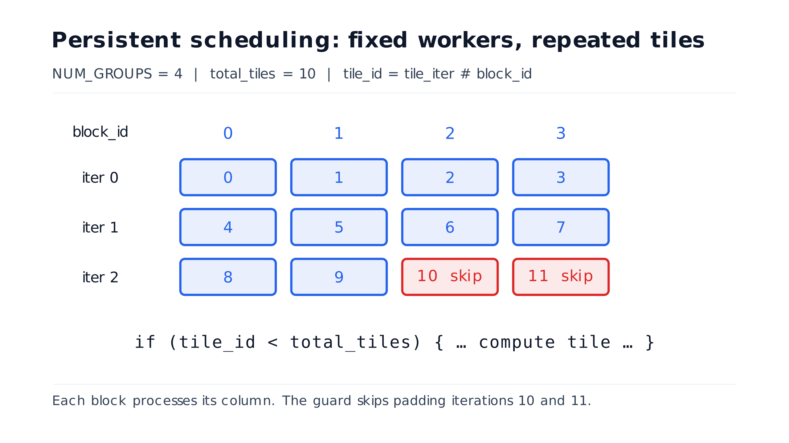
<div class="cap">图 25：四个固定 block 用三轮迭代处理十个分块；最后两个补齐的分块编号由 if 条件跳过。</div>
</div>

若有四个工作块和十个输出分块，组合索引在第一次迭代为 0–3，第二次为 4–7，第三次为 8–11。最后一次只有 8 和 9 通过条件判断。这样每个有效分块恰好被处理一次，但并不保证所有工作块始终忙碌，利用率仍取决于分块开销和剩余工作量。

#### 数据相关网格与持久网格

| **方面** | **每分块一个块** | **持久（`NUM_GROUPS` 块）** |
| --- | --- | --- |
| 网格规模 | 随问题增长 | 固定 |
| 尾部利用率 | 最后一批可能使 SM 空闲 | 可继续处理后续分块；尾部仍可能空闲 |
| 额外构造 | 最少 | `total_tiles`、`tile_iter # block_id`、`if` |
| 复杂度 | 较低 | 较高 |

### 3.8.4 主机级并发与流绑定 <a id="sec-3-8-4"></a>

#### `parallel.async`：主机层并发

上面这些都发生在核函数内部。有时需要在**主机层**实现并发：启动一个网格而不阻塞 CPU。

```co
parallel.async {px, py} by [grid_m, grid_n] : block {
  // kernel body
}
```

<div class="listing-cap">清单 209：parallel.async：主机层并发</div>

异步启动在提交核函数后将控制权返回主机，完成发生在之后。流绑定选择接收工作的流，没有显式绑定时使用默认流。

这属于**主机编排**，与核函数内部的控制流互不相干。它既不能替代用于线程划分的 `inthreads.async`，也不能替代用于运行时谓词的 `if`——它决定的是一个网格相对于其他网格*在何时、何处*运行。

#### 异步程序启动与流绑定

默认情况下，主机会等 `parallel-by` 核函数完成后才继续。要异步启动核函数，就用 `parallel.async`。

```co
__co__ void foo(stream s, f32[M] a) {
  parallel.async<s> p by M : block {
    a.at(p) = 1.0f;
  }
  // host continues immediately (no synchronization)
}
```

<div class="listing-cap">清单 210：异步程序启动与流绑定</div>

3.8.4 节对此有详细说明。

#### 同步与异步 `parallel-by`

和 `inthreads` 类似，`parallel-by` 也可以加上 `.async` 变成异步：

```co
parallel.async p by 6 : block {
}
```

<div class="listing-cap">清单 211：一次异步启动</div>

不加 `.async` 时，主机会等核函数结束后才继续：

```co
parallel p by 6 : block {
}
// host continues only after the kernel finishes
```

<div class="listing-cap">清单 212：同步形式</div>

加上 `.async` 之后，主机代码在启动核函数后立刻继续。要让计算和数据传输重叠，或者并发启动彼此独立的核函数，这一点很关键。

在 Croqtile 中，可以用尖括号语法把 `parallel-by` 块绑定到指定的流：

```co
__co__ void foo(stream s0, stream s1, f32[M] a, f32[N] b) {
  parallel.async<s0> p by M : block {
    a.at(p) = 1.0f;
  }
  parallel.async<s1> q by N : block {
    b.at(q) = 2.0f;
  }
}
```

<div class="listing-cap">清单 213：流绑定</div>

这个例子里：

- **`stream s0, stream s1`**：由主机传入的流参数。
- **`parallel.async<s0>`**：在流 `s0` 上异步启动核函数。
- **`parallel.async<s1>`**：在流 `s1` 上启动第二个核函数。

#### 不带 `.async` 的流绑定

流绑定同样适用于同步的 `parallel-by`。此时主机在指定的流上启动核函数，然后等待该流完成：

```co
__co__ void bar(stream _s, f32[M] a) {
  parallel<_s> p by M : block {
    a.at(p) = 1.0f;
  }
  // host synchronizes on stream _s before continuing
}
```

<div class="listing-cap">清单 214：不带 .async 的流绑定</div>

#### 规则

- 流绑定只能用在**块级**并行（`: block`）上。
- `<...>` 里的标识符必须是 `stream` 类型的变量。
- 不做流绑定时，同步的 `parallel-by` 使用设备范围的同步机制。

异步的 `parallel-by` 则使用默认流。

流为启动操作选择顺序上下文。如果第二个核函数读取第一个写入的数据，使用流不会让两者变得独立。使用不同流时，仍需明确表达依赖，并将缓冲区保留到队列中的使用者结束。异步启动返回主机，只说明执行已提交。

### 3.8.5 示例剖析：完整事件流水线 <a id="sec-3-8-5"></a>

#### 完整的 1P1C 事件流水线

这个核函数把 3.8 节的 `inthreads.async` 和事件数组结合起来，构建一条完整的多级流水线。生产者和消费者作为独立的并发程序运行，通过 `wait` / `trigger` 协调：

```co
#define TILE_M 128
#define TILE_N 128
#define TILE_K 128
#define WARP_M 64
#define WARP_N 64
#define WARP_K 16
#define STAGES 2
__co__ auto matmul(global f16 [M, K] lhs, global f16 [N, K] rhs) {
  f16 [M, N] output;
  parallel {block_m, block_n} by [cdiv(M, WARP_M), cdiv(N, WARP_N)] : block {
    shared event full[STAGES], empty[STAGES];
    shared f16 [WARP_M, TILE_K] lhs_load_s[STAGES];
    shared f16 [WARP_N, TILE_K] rhs_load_s[STAGES];
    shared f16 [WARP_M, WARP_N] output_s;
    parallel p1 by 2 : thread {
      inthreads.async (p1 == 0) {
        foreach {iv_k} in [cdiv(K, TILE_K)] {
          stage = iv_k % STAGES;
          wait empty[stage];
          dma.copy lhs.subspan(WARP_M, TILE_K).at(block_m, iv_k)
            => lhs_load_s[stage];
          dma.copy rhs.chunkat(block_n, iv_k)
            => rhs_load_s[stage];
          trigger full[stage];
        }
      }
      inthreads.async (p1 == 1) {
        mc = mma.fill.f16 0.0f;
        foreach {s} in [STAGES]
          trigger empty[s];
        foreach {iv_k} in [cdiv(K, TILE_K)] {
          stage = iv_k % STAGES;
          wait full[stage];
          foreach {iv_warp} in [cdiv(TILE_K, WARP_K)] {
            ma = mma.load lhs_load_s[stage].chunkat(_, iv_warp);
            mb = mma.load rhs_load_s[stage].chunkat(_, iv_warp);
            mma.row.row mc, ma, mb;
          }
          trigger empty[stage];
        }
        mma.store mc, output_s;
        dma.copy output_s => output.subspan(WARP_M, WARP_N).at(block_m, block_n);
      }
    }
  }
  return output;
}
```

<div class="listing-cap">清单 215：完整的 1P1C 事件流水线</div>

#### 逐段走查核函数

阶段索引为 `iv_k % STAGES`。使用两个槽位时，分块 0 和 2 使用槽位 0，分块 1 和 3 使用槽位 1。它们是不同的逻辑分块，在不同时刻共用物理存储；事件对属于槽位，不属于某个永久分块。

生产者在写入任一操作数前等待 `empty[stage]`。本例的两次复制均为同步操作，因此在它们之后触发 `full[stage]`，就表示两个操作数都已就绪。若替换为异步搬运，则必须先完成这些搬运，再发送同一个信号。

消费者先触发所有 `empty` 事件。事件初始均未置位，因此这一步授予生产者首次填充各槽位的许可。此时尚未装入输入，所以不会触发任何 `full` 事件。

消费者等待 `full[stage]`，装入操作数片段并累加当前切片，随后触发 `empty[stage]`。这个顺序不能颠倒：发出矩阵操作，并不足以证明它已经停止读取共享操作数。

完成点保护缓冲区复用。若 MMA 仍在读取时生产者就覆盖槽位，即使分块形状完全正确，消费者也可能混用两个 K 切片的操作数。仅检查 `full` 信号无法防止这一错误，归还 `empty` 许可同样必要。

#### 单级的信用流

图和代码一一对应：引导阶段先授予 `empty` 信用；生产者等待 `empty`、填入数据、发出 `full` 信号；消费者等待 `full`、做计算、发出 `empty` 信号。当 `iv_k` 按 `STAGES` 取模回绕时，同一个物理级又进入下一轮循环。

<div class="guide-figure">
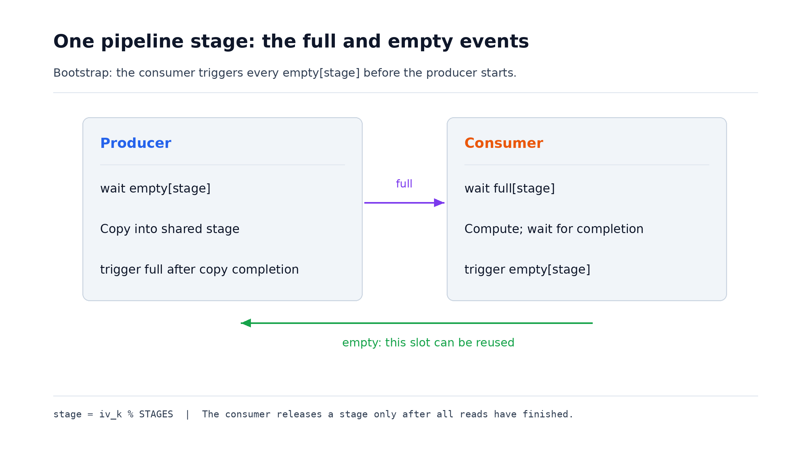
<div class="cap">图 26：empty 信用允许填充阶段，full 信用允许读取阶段；消费者在计完成计算成后才释放该阶段供再次使用。</div>
</div>

### 3.8.6 协调模式小结 <a id="sec-3-8-10"></a>

#### 小结

| **概念** | **原语** | **何时使用** |
| --- | --- | --- |
| 谓词执行 | `if` | 数据相关的判断（边界、条件） |
| 结构化并发 | `inthreads.async` | 编译时划分线程（生产者／消费者、异构角色） |
| 区域间通信 | `shared event` / `wait` / `trigger` | 并发区域之间的协调 |
| 主机并发 | `parallel.async` / `stream s` | 多核函数重叠、非阻塞启动 |
| 持久调度 | `if` + `foreach` + `#` | 固定网格规模、带填充守卫的分块条带化 |

完整流水线为前面的骨架补上两项依赖：计算前输入必须就绪，复用槽位前操作数必须用完。修改流水线时，可以沿一个槽位追踪完整周期，再追踪下一次复用。与只看某一侧循环相比，这样更容易发现缺失信号和迭代次数不匹配。

#### 小结

| **模式** | **所用原语** | **何时使用** |
| --- | --- | --- |
| `swap` 双缓冲 | `dma.any`、`swap` | 单线程组交错执行装载与计算 |
| 事件流水线 | `inthreads.async`、事件 | 生产者与消费者分别推进 |

一个组同时控制搬运调度和计算时，可以通过句柄轮换组织缓冲。分离的生产者与消费者需要事件，因为任一侧都无法仅凭自身指令顺序判断另一侧进度。增加缓冲区可以为重叠执行提供空间，却无法修复缺失的依赖。

更深的流水线则改用事件数组与 `inthreads.async`，底层数据搬运原语不变。

## 3.9 C++ 互操作与预处理器 <a id="sec-3-9"></a>

#### C++ 互操作：设备函数、内联代码与预处理器

核函数可能需要归约、排序过程，或 Croqtile 没有直接表达的指令。已有设备 C++ 可以提供这部分计算，Croqtile 继续安排输入、输出和并行范围。调用接口必须保留两侧代码各自的使用约定。

Croqtile 的互操作方案由三部分组成：

- **`__device__` 函数** —— 编译器保留原样。
- **`__cpp__`**
- **预处理器** —— `#define`、`#if`、`#ifdef`、`#error` 用于编译时配置，作用与 C/C++ 代码库中的 `#define` 相同。

前面几节介绍了分块、并行、MMA、流水线、事件等抽象。需要额外的设备函数或目标平台代码时，可以通过本节的 C++ 互操作机制补充。

#### `__device__` 与普通 C++ 内联代码

`__device__` 函数与普通 C++ 函数都会被保留原样，但二者进入不同的编译路径——这个区别很重要。

`__device__` 函数编译成设备代码；`__co__` 函数体用 `call` 关键字调用它，生成的 `__global__` 核函数会在设备上直接调用。

普通 C++ 函数（没有 `__device__` 或 `__co__` 标注）编译成 **CPU 代码**，运行在主机上，负责建立缓冲区、启动核函数、打印结果。不能在 `__co__` 函数体里调用主机函数。

边界很严格：`__device__` 在 `c++` 划分的设备侧，主机 C++ 在主机侧。`__co__` 函数是桥——编译器把它变换成 `__global__` 核函数（设备侧），同时生成启动它的主机侧包装。

#### 与 C++ 预处理的区别

Croqtile 的预处理比 C++ 预处理早得多。Croqtile 编译流程如下图所示：

```co
chore-preprocessing -> croqtile compilation -> c/c++ preprocessing -> c/c++ compilation
```

<div class="listing-cap">清单 216：与 C 预处理的区别</div>

Croqtile 预处理的主要目标，是让主机和设备的宏作为一个整体生效，但这样的工作流有时会带来差异。从实现角度看，Croqtile 预处理器只对 tileflow 函数内部的代码做替换或条件编译，其余预处理留给 C++ 预处理器——这就把 Croqtile 预处理限制在了较小的范围内。

#### 预定义宏

为了模仿目标平台的原生编译，Croqtile 预处理也会取用目标平台的内建宏。因此这些宏既能在 tileflow 函数里用，也能在主机代码里用。

#### 触发 C++ 模板实例化

Croqtile 代码可以调用模板函数。例如：

```co
template<int M, int N, int K>
__device__ void matmul_kernel(int *lhs, int* rhs, int* output) {}
__co__ auto matmul(s32 [96, 72] lhs, s32 [72, 24] rhs) {
  s32 [lhs.span(0), rhs.span(1)] output;
  parallel {p, q} by [6, 6] : block {
    shared s32 [output.span / {#p, #q}] buffer;   // shape: [16, 4]
    lhs_load = dma.copy lhs.chunkat(p, _) => shared;
    rhs_load = dma.copy rhs.chunkat(_, q) => shared;
    call matmul_kernel<buffer.span(0), buffer.span(1), 72>(lhs_load.data, rhs_load.data, buffer);
    dma.copy buffer => output.chunkat(p, q);
  }
  return output;
}
```

<div class="listing-cap">清单 217：一个模板化的设备辅助函数</div>

调用向 `matmul_kernel` 提供三个常量模板实参，目标编译器据此实例化对应特化，与普通 C++ 模板调用相同。

所以，在 Croqtile 中调用模板函数与 C++ 类似。但**传入的模板实参必须能被 Croqtile 编译器推导为编译时常量**；带运行时值时，编译器会给出警告，指出该实参无法在编译时求值。

```co
__co__ void foo(int M) {
  parallel p by 1 {
    call bar<M>();  // warning: 'M' cannot be evaluated at compile time
  }
}
```

<div class="listing-cap">清单 218：一次触发实例化的调用</div>

Croqtile 编译器会尽可能在编译时推导取值。若模板实参无法推导，编译器会给出警告，指出该实参无法在编译时求值。

#### 更多问题

和 C++ 函数一样，Croqtile 函数可以定义在源代码的任何位置。把模块和 Croqtile 函数定义链接起来时，需要确定它的**函数签名**。

答案是：Croqtile 函数遵循 C++ 调用约定，也就是带 C++ 名字改编的标准 C++ 函数。Croqtile 函数**不能**使用 `extern "C"`，因为它的参数类型（带形状数据）是基于 C++ 模板的对象。

还有一些特性尚未支持：

- 只有声明、没有定义的 Croqtile 函数——有了它，才能从另一个模块调用 Croqtile 函数。
- 带 `inline` 的 Croqtile 函数——有了它，Croqtile 函数才能放进头文件。

#### *Factor* 目标的特定细节

在 *factor* 这类目标上，设备函数必须遵循 C 链接，也就是函数要加 `extern "C"`。模板函数不能用于带 C 链接的函数，所以 Croqtile 用了一些包装技巧。例如：

```co
__cok__ {
extern "C" void bar(int v) {};  // v is a compile-time constant
}
__co__ void foo() {
  parallel p by 1 { call bar(3); }
}
```

<div class="listing-cap">清单 219：包住设备代码的 cok 块</div>

程序员可以把 `bar` 改成函数模板，如下所示：

```co
__cok__ {
template <int v> void bar() {};
// compiler generate a explicit function template specialization:
// template<> void bar<3>() {};
}
__co__ void foo() {
  parallel p by 1 { call bar<3>(); }
}
```

<div class="listing-cap">清单 220：抽取目标特定细节之后的块</div>

正如注释所示，Croqtile 编译器可能生成函数模板 `bar<3>` 的特化版本，这样函数模板也能用。但要注意，这个函数模板不再需要普通 *factor* 设备函数所用的 `extern "C"`。

由于实现方式与其他目标不同，可以用 `-kt` 为 *croqtile-factor* 编译启用该功能。

### 3.9.1 示例剖析：调用设备辅助函数 <a id="sec-3-9-1"></a>

#### `__device__` 函数：与 Croqtile 一并面向目标平台

自定义归约、排序网络和特殊数学运算等计算，可以通过设备辅助函数实现。

`__co__` 函数可以用 `call` 关键字调用 `__device__` 函数：

```co
#define N_TOKENS 1024
#define N_EXPERTS 8
#define N_THREAD 128
template <int K>
__device__ void warp_topk(f32* vals, s32* idxs);
template <typename T>
__device__ __forceinline__ T SHFL_XOR(T var, int lane_mask, int width) {
  return __shfl_xor_sync(uint32_t(-1), var, lane_mask, width);
}
__co__ void moe_topk(f32 [N_TOKENS, N_EXPERTS] scores,
                     s32 [N_TOKENS, K]& topk_ids,
                     f32 [N_TOKENS, K]& topk_scores,
                     int N_BLOCK) {
  parallel n by N_BLOCK : block {
    foreach m in [ |scores.span| / N_THREAD / N_BLOCK ] {
      shared_scores = dma.copy scores.chunkat(n#m, _) => shared;
      parallel gid by [N_THREAD / 32] : group
        parallel tid by 32 : thread {
          flat_scores = shared_scores.span_as([|shared_scores.span|]);
          score = flat_scores.at(gid # tid);
          local s32 [K] frag_idx{-1};
          local f32 [K] frag_val{-1.0f};
          frag_idx.at(0) = tid;
          frag_val.at(0) = score;
          call warp_topk<8>(frag_val, frag_idx);
          inthreads (tid == 0)
            foreach k in K {
              topk_ids.at(n#m, gid#k) = frag_idx.at(k);
              topk_scores.at(n#m, gid#k) = frag_val.at(k);
            }
        }
    }
  }
}
```

<div class="listing-cap">清单 221：device 函数：与 Croqtile 一并面向目标平台</div>

辅助函数接收指向元素存储的原始指针。因此，接口需要给出它所需的尺寸或布局约定，仅凭指针不会保留 Croqtile 形状。

`SHFL_XOR` 辅助函数是交给目标编译器的普通设备代码。计算中如何使用它属于辅助函数的实现，Croqtile 不会把其函数体翻译成分块操作。

语句 `call group_topk<8>(...)` 提供辅助函数的编译时配置和普通实参。Croqtile 将带形状数据实参转换为元素指针，由目标编译器验证生成的 C++ 调用。

区域 `inthreads (tid == 0)` 选择一个线程完成其中工作，结束后汇合。它没有 `.async` 修饰符，因此不会引入独立推进的生产者或消费者。

这种分工——Croqtile 管并行、分块和内存编排，设备函数管专门计算——在 MoE（专家混合）top-K、自定义归约和专用数学运算等生产核函数里很常见。

### 3.9.2 互操作小结 <a id="sec-3-9-10"></a>

#### 小结

| **语法** | **作用** | **运行于** |
| --- | --- | --- |
| `#define NAME value` | 对象式宏；在 `__co__` 与主机区域间共享 | 预处理器 |
| `#if` / `#ifdef` / `#error` | 条件编译与编译时断言 | 预处理器 |
| `-DNAME=value` | 从命令行定义宏，用于分块尺寸扫描 | 预处理器 |
| `call helper(...)` | 调用设备辅助函数 | 设备 |
| `__cpp__("...")` | 在当前位置插入目标 C++ | 取决于所在目标作用域 |

3.11 节转向工作流程的另一面：核函数能编译、输出却不对时该怎么办——调试、详细模式，以及一步步缩小范围。3.10 节的两个完整程序，则把互操作机制放进了具体语境。

## 3.10 Tileflow 模式与设计依据 <a id="sec-3-10"></a>

#### 受限接口为何有效：表达力与性能

逐条编写装入和地址计算给程序员很多选择，也让编译器需要重新识别哪些操作共同构成一次分块搬运。Croqtile 要求程序显式描述这片区域。当所需搬运能够用规则形状表示时，这项约束很有用，因为在生成各次传输之前，区域几何信息就已明确。

Croqtile 用结构化搬运操作显式描述分块形状和布局。编译器据此生成传输代码，程序员也不必为每个元素反复编写地址计算与协作逻辑。

<div class="guide-figure">
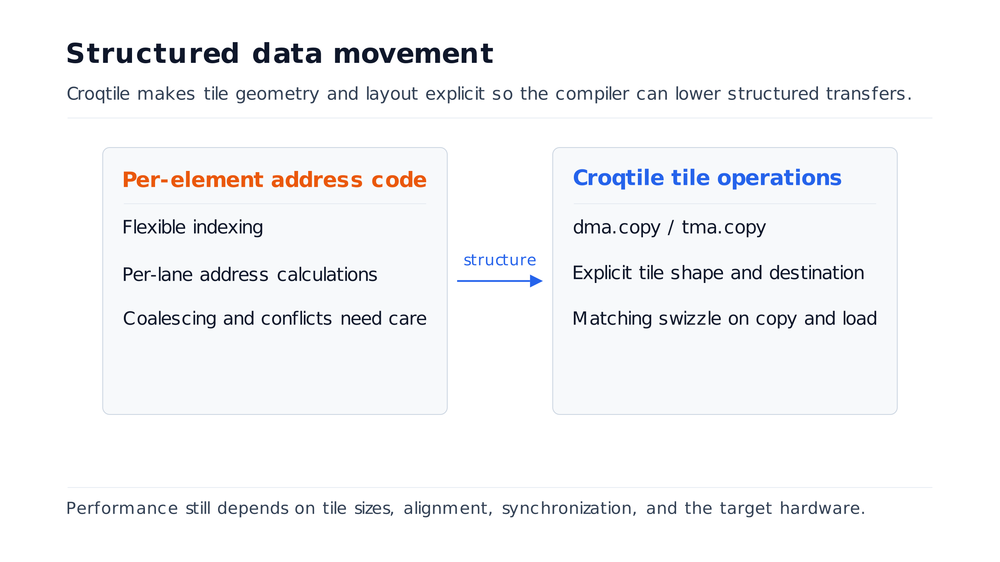
<div class="cap">图 27：结构化分块操作显式提供形状和布局，便于编译器生成高效代码；实际性能仍取决于分块选择与执行配置。</div>
</div>

这里的取舍是用明确的分块表达替代任意的逐元素搬运代码，从而便于高效生成目标代码。实际性能仍取决于分块尺寸、对齐方式、布局和同步安排，并不由语法单独保证。

#### 易于使用

分块选择可以直接使用输入形状和有界索引。例如，改变分块数量后，派生分块尺寸随之改变，无需另行维护一套手工偏移计算。划分仍由程序员选择，语言则把这一选择带来的相关信息连接起来。

#### 编译时安全

信息充分时，形状和秩检查能在执行前发现不兼容的用法。运行时检查覆盖依赖实际输入的约束，断言则可补充应用自身的要求。这些检查有助于定位失败，但不能替代输出数值验证和同步协议检查。

#### 动态形状

符号维度让一份源码表达一组输入形状。输出大小和迭代次数可以从命名维度推导，不必作为独立常量重复维护。每次调用仍需满足核函数的分块、布局和目标约束，符号形状并不意味着所有形状都能得到同样好的支持。

#### 为 AI 调优而生

紧凑源码让自动调优过程能够同时保留核函数、编译诊断和测量结果。显式分块尺寸与协作范围也提供了可调整的具体选择。每个候选仍需验证正确性，并在目标负载上测量；成功编译只是其中一部分依据。

#### Croqtile 中的分块优化

下面的示例将相同分块选择机制用于不同计算。矩阵乘法需要在 K 切片之间保留部分和，RGB 转灰度则独立处理每片图像区域。对照数据路径，可以看出哪些结构来自分块安排，哪些来自计算本身。

### 3.10.1 示例剖析：分块矩阵乘法 <a id="sec-3-10-1"></a>

#### 示例 1：`matmul`

第一个例子是设备程序上的矩阵乘法。代码展示了 Croqtile 的分块和内存管理机制如何配合起来优化矩阵运算，也包括如何借助 DMA（直接内存访问）高效搬运数据。

#### 示例代码：带分块的矩阵乘法

```co
__co__ s32 [512, 1024] matmul(s32 [512, 1024] lhs, s32 [1024, 1024] rhs) {
  // Device program
  s32[lhs.span(0), rhs.span(1)] output; // Use same shape as lhs
  parallel p by 1 {
    with index = {m_tile, k_tile, n_tile} in [4, 4, 8] {
      foreach m_tile, n_tile {
        shared s32[128, 128] l2_out;
        foreach k_tile {
          // Initiate DMA operations
          lhs_load = dma.copy.async lhs.chunkat(m_tile, k_tile) => shared;
          rhs_load = dma.copy.async rhs.chunkat(k_tile, n_tile) => shared;
          out_store_s = dma.any;
          parallel q by 1 {
            with index = {m_tile_s, k_tile_s, n_tile_s} in [4, 4, 8] {
              // Local buffers for tiling
              local s32 [32, 64] lhs_load_s_buffer_0 {0}, lhs_load_s_buffer_1 {0};
              local s32 [64, 16] rhs_load_s_buffer_0 {0}, rhs_load_s_buffer_1 {0};
              foreach index {
                // Add "after" primitive to chain up paired DMA operations
                lhs_load_s = dma.copy.async lhs_load.data.chunkat(m_tile_s, k_tile_s) => select(k_tile_s % 2, lhs_load_s_buffer_0, lhs_load_s_buffer_1) after lhs_load;
                rhs_load_s = dma.copy.async rhs_load.data.chunkat(k_tile_s, n_tile_s) => select(k_tile_s % 2, rhs_load_s_buffer_0, rhs_load_s_buffer_1) after rhs_load;
                out_load_s = dma.copy.async l2_out.chunkat(m_tile_s, n_tile_s) => local;
                wait out_load_s;
                // Perform the matrix multiplication (dot product) operation
                wait lhs_load_s, rhs_load_s;
                call dot_general_fp32(lhs_load_s.data, rhs_load_s.data, 32, 16, 64, 0, 8, out_load_s.data);
                // Store the result back to l2_out
                out_store_s = dma.copy.async out_load_s.data => l2_out.chunkat(m_tile_s, n_tile_s);
              }
            }
          }
          // Add "after" primitive to chain up DMA operations for the final output
          out_store = dma.copy.async l2_out => output.chunkat(m_tile, n_tile) after out_store_s;
          wait out_store;
        }
      }
    }
  }
  return output;
}
```

<div class="listing-cap">清单 222：示例代码：带分块的矩阵乘法</div>

外层范围 `[4, 4, 8]` 把操作数切成 `[128, 256]` 的左分块、`[256, 128]` 的右分块，以及 `[128, 128]` 的输出分块——这正是 `l2_out` 暂存缓冲区的大小。内层同样按 `[4, 4, 8]` 划分，得到 `[32, 64]`、`[64, 16]` 和 `[32, 16]` 的结果。`after` 子句使内层输入复制在外层复制之后开始。这段清单用于展示结构；作为可运行核函数使用前，必须补齐并检查辅助函数定义、操作数使用与缓冲区复用前的完整等待，以及输出初始化。

#### 用 `chunkat` 做内存分块

矩阵乘法示例里，**内存分块**是用 `chunkat` 方法做的：它把输入矩阵 `lhs`（左操作数）和 `rhs`（右操作数）切成更小的块，方便并行处理。

- `lhs` 与 `rhs` 矩阵用 `chunkat` 方法分块，分块由 `m_tile`、`k_tile`、`n_tile` 定义，分别对应乘法涉及矩阵的不同维度。
- 两个矩阵的分块都用 `dma.copy.async` 异步装入（`lhs_load` 和 `rhs_load`）。这个操作把矩阵的一部分从源缓冲区搬进暂存缓冲区，是大型矩阵运算里改善数据局部性的常见优化。

- 变量 `m_tile`、`k_tile`、`n_tile` 是**有界变量**，定义在 `parallel-by` 和 `with-in` 构造的上下文中，这些构造确定了分块的迭代空间。
- 这些有界变量让分块能被并行计算，每个线程处理矩阵的不同切片，矩阵乘法因此能跨多个线程高效完成。

### 3.10.2 示例剖析：rgb2gray <a id="sec-3-10-2"></a>

#### 示例 2：rgb2gray

第二个例子是 RGB 转灰度算法：用加权平均把彩色 RGB 图像变成灰度图像。它展示了物理并行和虚拟并行如何协同工作。

#### 示例代码

```co
__co__ auto rgb2gray(f32 [N, 3, H, W] input) {
  f32 [N, H, W] out;
  parallel q by 6 {
    with index={n, h, w} in [N, H, W]/{#q, 16, 512} {
      foreach n, h, w {
        // _ means no tiling
        input_L1_A = dma.copy input.chunkat(q#n, _, h, w) => local;
        dims : input_L1_A.span[(0), (2), (3)];
        local f32 [dims] out_L1;
        call rgb2gray_kernel_fp32_fp32(input_L1_A.data, out_L1, |out_L1|, 1);
        dma.copy out_L1 => out.chunkat(q#n, h, w);
      }
    }
  }
  return out;
}
```

<div class="listing-cap">清单 223：示例代码</div>

输入形状为 `[N, 3, H, W]`，第二维包含三个颜色通道。`chunkat(q#n, _, h, w)` 中的下划线保持这些通道完整，同时选择一幅图像中的空间区域。从装入形状中去掉通道维，就得到 `out_L1` 的形状，辅助函数为每个空间位置写入一个灰度值。

组合索引 `q # n` 为六个并行实例分别分配一组连续图像。这种规则划分假定 N 能被 6 整除，H 能被 16 整除，W 能被 512 整除。满足这些条件时，每个输入分块包含一个 16 × 512 区域的全部三个通道，最后的复制将灰度结果写入对应输出分块。其他图像尺寸需要明确的边界处理方式。

## 3.11 诊断与方法论 <a id="sec-3-11"></a>

#### 调试与详细模式：打印、断言与 GDB

调试的基本方法是**逐步缩小问题范围**。先做静态分析和编译时断言，在不增加运行时开销的情况下发现错误；再用有针对性的运行时检查定位问题；范围缩小后，按需使用交互式调试器深入检查。

Croqtile 在每一层都有工具：**编译时形状打印**（`print!`、`println!`），不用启动核函数就能核对分块尺寸；**运行时断言**（`assert`），用来检查不变式；**带守卫的设备 `println`**，在运行时查看特定线程；给 `debugger` 用的**调试 RTTI**；以及查看编译器实际执行步骤的**详细模式**（`-v`）。

先使用容易计算参考结果的小输入。矩阵某个元素错误时，还原它的分块坐标和块内坐标，检查选中的输入切片，再比较一个部分和，最后才看完整输出。程序挂起时，则追踪一个事件槽位，记录初始状态、每次触发以及应消费该事件的实例。这样可以区分索引错误与交接缺失。

若失败发生在编译阶段，先确定阶段再修改核函数。预处理输出显示宏展开结果，生成源码显示 Croqtile 的翻译，详细输出则给出目标编译命令。修复后，关闭诊断输出，再次与参考结果比较，然后测量性能。第 1.4 和 2.14 节给出对应命令与检视语法。

附录 A 集中列出语法。关于语言背后的编译器设计，见[参考文献]。

## 语法速查

构造按阅读顺序分组：先是声明，然后是迭代、分块选择与数据搬运，再是语句、协调与诊断。第 3 章说明每个构造的含义及其设计依据；本附录的用途是查写法，无需重读示例。

## 声明与形状

| 构造 | 含义 |
| --- | --- |
| `__co__ T [shape] f(T [shape] a)` | 带形状参数的 Croqtile 函数。 |
| `__co__ void` / `__co__ auto` | 就地结果 / 推导返回类型。 |
| `T [a.span] b;` | 复制形状的缓冲区。 |
| `a.span` / `a.span(i)` | 整体形状 / 单个维度。 |
| `x : [7, 8]` | 具名 `mdspan` 声明。 |
| `a = {1, 2, 3}` | `ituple` 声明。 |
| `tensor.at(i, j)` | 位置访问。 |

## 迭代

| 构造 | 含义 |
| --- | --- |
| `parallel p by N` / `parallel p, q by [M, N]` | 相互独立的实例。 |
| `: block` / `: thread` / `: group` | 并行轴上的标注。 |
| `foreach idx in [N]` / `foreach t(1:)` | 有序迭代 / 切片迭代。 |
| `with idx in [a, b]` | 有作用域的索引绑定。 |
| `p # m` / `#p` | 组合索引 / 轴范围。 |
| `cdiv(a, b)` | 向上取整除法。 |

## 分块选择与数据搬运

| 构造 | 含义 |
| --- | --- |
| `f = dma.copy src => shared` | 分块搬运语句。 |
<ROW> | `a.chunkat(t)` | 规则划分中的一个分块。 |
| `a.subspan(M, K).at(i, j)` | 显式范围与分块坐标。 |
| `a.subspan(M, K).step(sM, sK).at(i, j)` | 跨步分块选择。 |
| `a.view(M, N).from(r, c)` | 带显式元素偏移的窗口。 |
| `a.span_as([dims])` | 不搬运数据的形状重解释。 |
| `f.data` / `f.span` / `dma.any` | 已搬运分块 / 其形状 / 占位句柄。 |
| `.async` / `wait f` / `swap` / `rotate` | 异步传输与句柄轮转。 |
| `global` / `shared` / `local` | 存储说明符。 |

## 语句修饰符与收缩

| 构造 | 含义 |
| --- | --- |
| `dma.transp<...>` / `dma.pad<...>` | 搬运时变换。 |
| `.zfill` / `.swiz<N>` | 填充与布局修饰符。 |
| `mc = mma.fill 0.0` | 累加器清零。 |
| `ma = mma.load src.chunkat(...)` | 装入操作数。 |
| `mma.row.row mc, ma, mb` | 带布局约定的收缩。 |
| `mma.store mc, dst` | 写回累加器。 |
| `.sp` / `.scale` / `mma.scale` | 收缩变体与阶段栅栏。 |

## 协调、互操作与诊断

| 构造 | 含义 |
| --- | --- |
| `if (expr) ... ` | 运行时谓词。 |
| `inthreads.async (cond)` / `inthreads (cond)` | 并发区域 / 顺序过滤。 |
| `shared event e[N]` / `trigger e` / `wait e` | 同步令牌。 |
| `parallel.async ...` / `stream s` / `yield` | 主机调度与提前返回。 |
| `__device__ fn()` / `call fn(args)` | 互操作的 C++ 函数及其调用。 |
| `__cpp__("...")` / `__cpp__(R"(...)")` | 注入的源文本。 |
| `#define` / `#if` / `#ifdef` / `#error` / `-D` | 预处理器。 |
| `print!` / `println!` / `print` / `println` | 编译时输出与运行时输出。 |
| `assert` / `croq_assert` | 设备侧与主机侧断言。 |

若要了解构造背后的含义，请回到引入它的小节：初次阅读见第 2 章，设计依据见第 3 章。若要在完整程序中观察某个构造，可从 3.4.1、3.6.1 与 3.8.5 节的示例核函数开始。


## 术语表

英文术语与中文译名对照。

| English | 中文 |
| --- | --- |
| kernel | 核函数 |
| tile / tiling | 分块 |
| data movement | 数据搬运 |
| zero-cost abstraction | 零开销抽象 |
| cooperative group | 协作组 |
| source-to-source compiler | 源到源编译器 |

